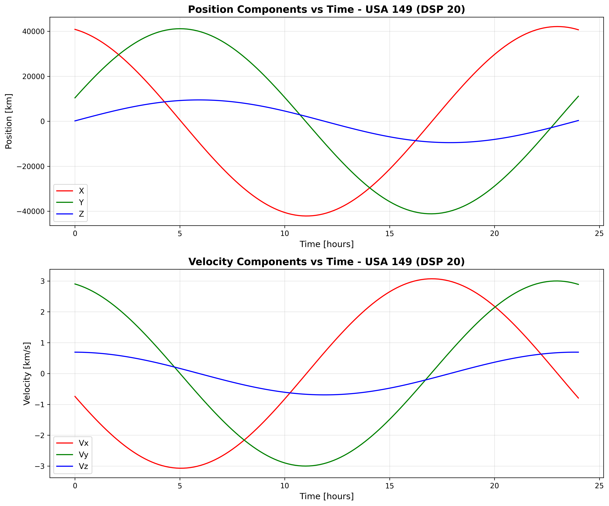
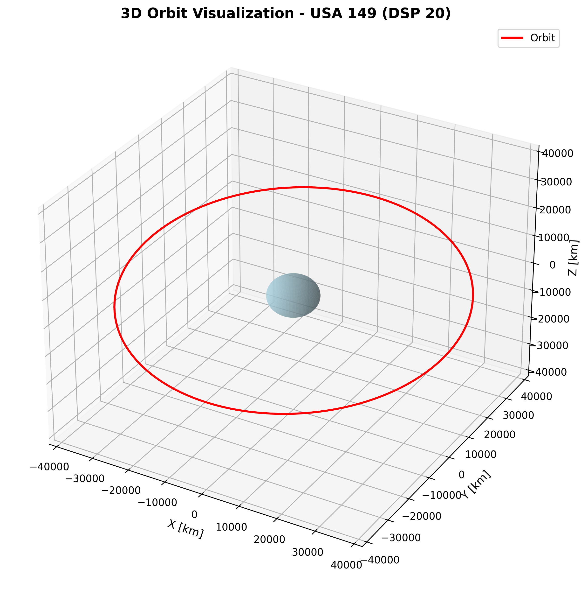
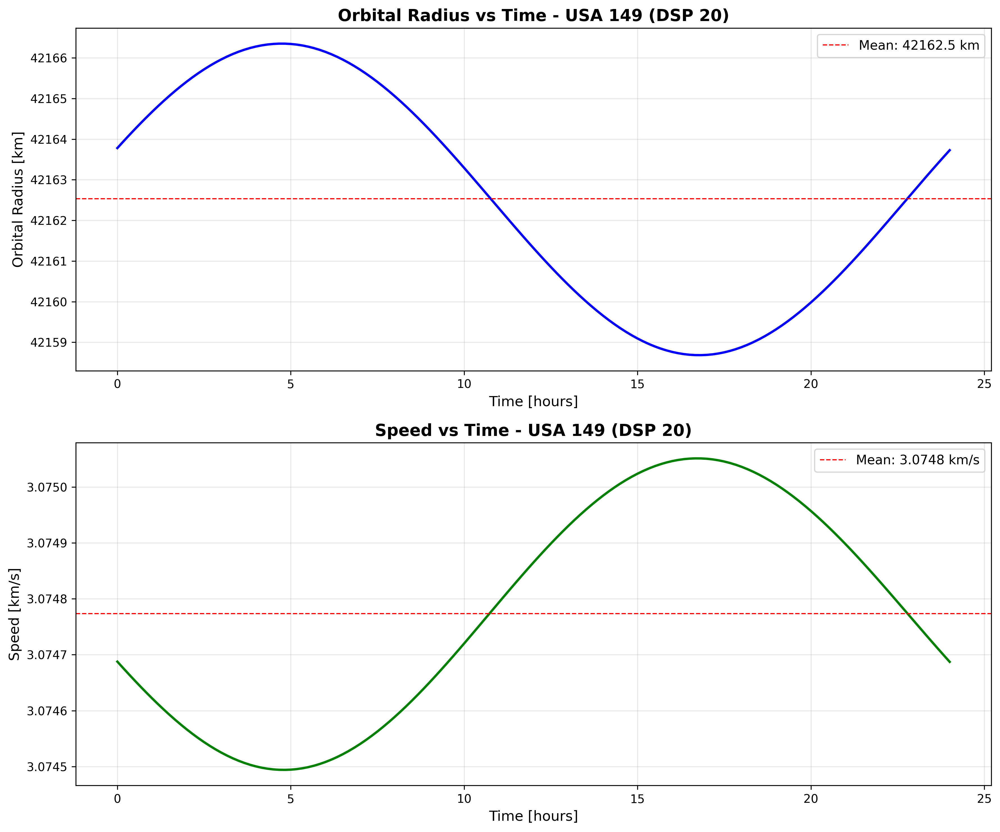
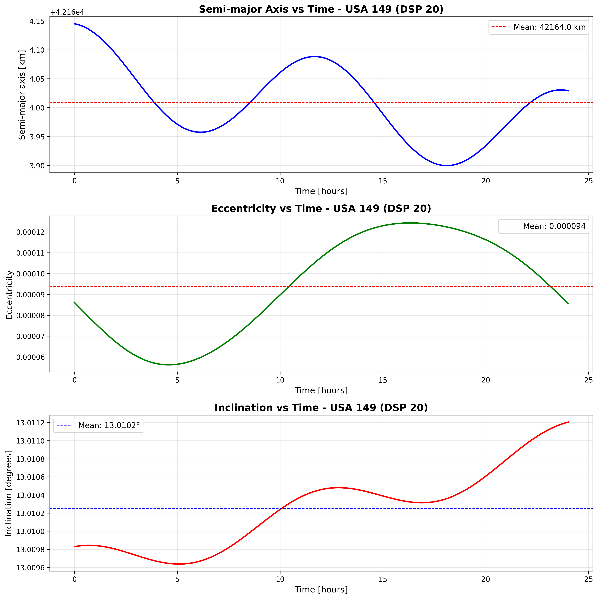
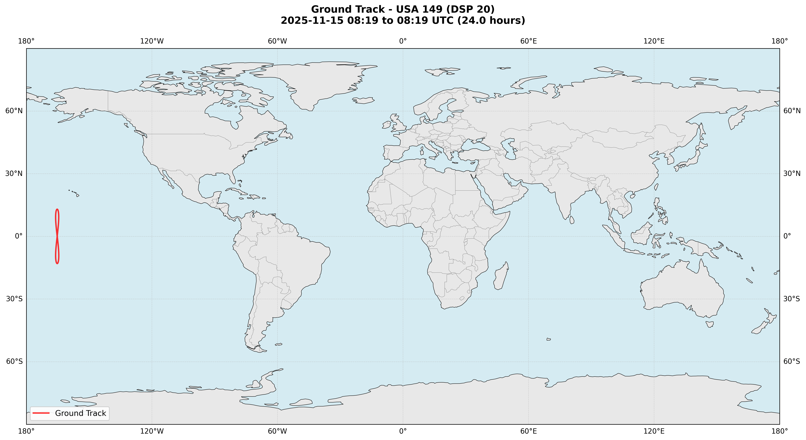
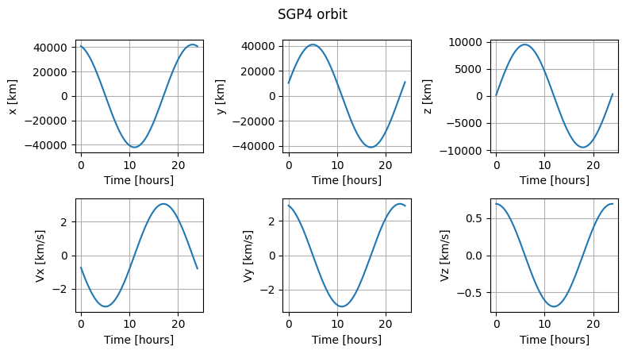

<script>
  src="https://cdn.mathjax.org/mathjax/latest/MathJax.js?config=TeX-AMS-MML_HTMLorMML"
  type="text/javascript">
</script>

# Grading report for assignment A1 of student 6541356

## Submission

- Assignment deadline: 2025-11-16 23:59:59
- Assignment submitted: 2025-11-15 17:54:17
- Assignment submitted 1 day, 6:05:42 before the deadline.

## Authors

- igallolopez
- igallolopez@student.tudelft.nl

## Useful links

- [Student repository](https://gitlab.tudelft.nl/ae4894-practical-astrodynamics/2025-2026/reports/6541356/a1)
- [Grading repository](https://gitlab.tudelft.nl/ae4894-practical-astrodynamics/2025-2026/grades/a1/-/tree/main/6541356) (for reviewers only)
- [Grading guidelines](https://gitlab.tudelft.nl/ae4894-practical-astrodynamics/2025-2026/management/grading/-/blob/main/README.md) (for reviewers only)


## Submitted files

- [IMPLEMENTATION_SUMMARY.md](https://gitlab.tudelft.nl/ae4894-practical-astrodynamics/2025-2026/reports/6541356/a1/-/blob/main/IMPLEMENTATION_SUMMARY.md)
- [README.md](https://gitlab.tudelft.nl/ae4894-practical-astrodynamics/2025-2026/reports/6541356/a1/-/blob/main/README.md)
- [README_PROPAGATION.md](https://gitlab.tudelft.nl/ae4894-practical-astrodynamics/2025-2026/reports/6541356/a1/-/blob/main/README_PROPAGATION.md)
- [answer-sheet.yaml](https://gitlab.tudelft.nl/ae4894-practical-astrodynamics/2025-2026/reports/6541356/a1/-/blob/main/answer-sheet.yaml)
- [data/orbit_propagation.npz](https://gitlab.tudelft.nl/ae4894-practical-astrodynamics/2025-2026/reports/6541356/a1/-/blob/main/data/orbit_propagation.npz)
- [data/tle.txt](https://gitlab.tudelft.nl/ae4894-practical-astrodynamics/2025-2026/reports/6541356/a1/-/blob/main/data/tle.txt)
- [example_load_data.py](https://gitlab.tudelft.nl/ae4894-practical-astrodynamics/2025-2026/reports/6541356/a1/-/blob/main/example_load_data.py)
- [fetch_tle.py](https://gitlab.tudelft.nl/ae4894-practical-astrodynamics/2025-2026/reports/6541356/a1/-/blob/main/fetch_tle.py)
- [generate_answer_sheet.py](https://gitlab.tudelft.nl/ae4894-practical-astrodynamics/2025-2026/reports/6541356/a1/-/blob/main/generate_answer_sheet.py)
- [main.py](https://gitlab.tudelft.nl/ae4894-practical-astrodynamics/2025-2026/reports/6541356/a1/-/blob/main/main.py)
- [plot_orbit.py](https://gitlab.tudelft.nl/ae4894-practical-astrodynamics/2025-2026/reports/6541356/a1/-/blob/main/plot_orbit.py)
- [plots/orbit_3d.png](https://gitlab.tudelft.nl/ae4894-practical-astrodynamics/2025-2026/reports/6541356/a1/-/blob/main/plots/orbit_3d.png)
- [plots/orbit_groundtrack.png](https://gitlab.tudelft.nl/ae4894-practical-astrodynamics/2025-2026/reports/6541356/a1/-/blob/main/plots/orbit_groundtrack.png)
- [plots/orbit_orbital_elements.png](https://gitlab.tudelft.nl/ae4894-practical-astrodynamics/2025-2026/reports/6541356/a1/-/blob/main/plots/orbit_orbital_elements.png)
- [plots/orbit_pos_vel_vs_time.png](https://gitlab.tudelft.nl/ae4894-practical-astrodynamics/2025-2026/reports/6541356/a1/-/blob/main/plots/orbit_pos_vel_vs_time.png)
- [plots/orbit_radius_speed.png](https://gitlab.tudelft.nl/ae4894-practical-astrodynamics/2025-2026/reports/6541356/a1/-/blob/main/plots/orbit_radius_speed.png)
- [run_all.sh](https://gitlab.tudelft.nl/ae4894-practical-astrodynamics/2025-2026/reports/6541356/a1/-/blob/main/run_all.sh)

# Assignment grading

Please carefully read the [rules](https://gitlab.tudelft.nl/ae4894-practical-astrodynamics/rules/-/blob/main/README.md). Remember that you have to create the `answer-sheet.yaml` file yourself and check that it is formatted correctly with the `answer-sheet-sanity.py` utility. You are also highly encouraged to get feedback with the [Formative Assessment online tool](https://spacegravimetry.tudelft.nl/PA/check.html).

You will find the answer keys in the assignment text below. They are all related uniquely to the task specified directly above the respective answer key. 

Please direct any questions to Brightspace, as it may be of help to your colleagues.

## Contents

[[_TOC_]]

## Objectives

This assignment aims to help you set up the basic tools that will be needed for later assignments in the course.  It will lay the foundations for you to solve other assignments. It is also the perfect way for you to get acquainted with Git, GitLab, the submission process, and the general idea of solving tasks. You will receive general feedback on the lectures, and you will have the opportunity to ask questions to address any difficulties you encounter.

We will grade this assignment only in terms of pass/fail. It is, therefore, mandatory, like any other assignment, and you must achieve a pass grade. Like all other assignments, you are given two chances to solve the assignment with a pass grade. The difference with other assignments is that it will not influence your final grade.

### Use of libraries

You may use any library for this assignment.

### Programming language

Report the name of the programming language you used to solve this assignment:


```
Python 3.12
```


## Tasks

### Pick a satellite

Go to [CelesTrak](https://celestrak.org/satcat/search.php) and pick an Earth-orbiting object of your choice under the following conditions:

- The last 3 digits of the NORAD ID must be the same as the **last** 3 digits of your student number
- the satellite must be active (there's a check box with this criterion when you search for satellites on the CelesTrak website)
- must not be part of a *mega constellation*, i.e., those mentioned in [this article](https://spj.science.org/doi/10.34133/2022/9865174):
    - StarLink
    - OneWeb
    - Iridium Next
    - Globalstar
    - PlanetLabs' Flock
    - Samsung
    - Boeing
    - Telesat
    - Kuper

If there are no satellites that meet these criteria, you may pick a satellite with a NORAD ID that **starts** with the last 3 digits of your student number. If that doesn't work either, then select a satellite with a NORAD ID that **contains** the last 3 digits of your student number. If that still doesn't work, please post a request in Brightspace to have a NORAD ID assigned to you. 

NORAD ID:


```
26356
```


In your own words, provide a brief description of this satellite, its purpose and how this is connected to the orbit configuration:


```
USA 149 (DSP 20) is a missile detection satellite launched in 
        2000-05-08 in a geosyncronous orbit avobe the Pacific Ocean. Its orbit is verly likely designed for 
        continuous surveillance of possible tactical missile attacks from Asia towards the US. It is equipped 
        with infrarred sensors for that mission.
```
Reviewer feedback:
```
Spelling mistakes x2 (-20%).
```

Score for `ss_REG_SatDesc_OIC_5`: 80 % of 5.0 = 4.00

### Retrieve the TLE data 

Retrieve the TLE data, which should look something like this:

```
DELFI-N3XT              
1 39428U 13066N   22278.36746881  .00006067  00000+0  92841-3 0  9991
2 39428  97.8159 208.0372 0114906 286.7293  72.1329 14.69680532474673
```

TLE data:


```
USA 149 (DSP 20)
1 26356U 00024A   25319.34697609  .00000098  00000+0  00000+0 0  9997
2 26356  13.0092  13.3480 0001289 258.3132 102.6669  1.00277785 30776
```


### Implement the SGP4 propagator 

There are several implementations of the SGP4 orbit propagator:

- [Python](https://pypi.org/project/sgp4/)
- [Matlab](https://www.mathworks.com/matlabcentral/fileexchange/62013-sgp4)
- [C, C++, C#, FORTRAN 90, Java, JavaScript, LibreOffice Basic, Matlab/Octave, Python 2/3, R, Ruby, Rust, Swift from GitHub user *aholinch*](https://github.com/aholinch/sgp4)
- [C++, C#, Excel, FORTRAN, Java, MATLAB and Pascal from Vallado et al. (2006)](http://celestrak.org/publications/AIAA/2006-6753/)

Download/clone one SGP4 implementation, not necessarily from the choices above. Generally, the implementations of the SGP4 are in the form of a library, which means you will have to implement a program that:

- reads one file with TLE data
- generate a time domain, from specified start, stop and time step
- integrates the orbit over this time domain (i.e., call the relevant routine in the SGP4 library)
- stored the resulting time series of position and velocity in a suitable data structure, e.g. a NumPy array.

Optionally, write these data to a file.

For this to happen, you need to tell your program 5 parameters:

- input TLE data file
- start time
- time step
- end time

Report the URL or GitHub repository of the SGP4 implementation you have used in your code. 


```
https://github.com/brandon-rhodes/python-sgp4
```


Report the source code where you call the SGP4 implementation. Ensure that you include only the code relevant to this task.

Source code filename: 

[main.py](https://gitlab.tudelft.nl/ae4894-practical-astrodynamics/2025-2026/reports/6541356/a1/-/blob/main/main.py)


```python
main.py:

```python
def sgp4_propagate(tle, ti, tf, dt):
    """Propagate orbit using SGP4 with vectorized array operations.
    
    Args:
        tle: Tuple of (name, line1, line2) TLE data
        ti: Start time in seconds from TLE epoch
        tf: End time in seconds from TLE epoch
        dt: Time step in seconds
    
    Returns:
        Tuple of (errors, positions, velocities, jd_array, fr_array, satellite, times_seconds)
        - errors: (N,) array of error codes
        - positions: (N, 3) array of positions [km] in TEME frame
        - velocities: (N, 3) array of velocities [km/s] in TEME frame
        - jd_array: (N, 1) array of Julian date whole parts
        - fr_array: (N, 1) array of Julian date fractional parts (days from epoch)
        - satellite: Satrec object
        - times_seconds: (N, 1) array of times in seconds from epoch
    """
    sat = Satrec.twoline2rv(tle[1], tle[2])

    # Time vector in seconds from TLE epoch
    times_seconds = np.arange(ti, tf + dt, dt, dtype=float)  # shape (N,)

    # Full Julian date at each step (including fractional epoch!)
    epoch_jd = sat.jdsatepoch + sat.jdsatepochF
    jd_full = epoch_jd + times_seconds / 86400.0             # shape (N,)

    # Split into integer + fractional parts for sgp4_array
    jd_int = np.floor(jd_full).astype(float)
    jd_frac = jd_full - jd_int

    # Propagate
    e, r_km, v_km_s = sat.sgp4_array(jd_int, jd_frac)
    assert np.all(e == 0), f"SGP4 failed at {np.sum(e != 0)} epochs out of {len(e)}"

    return e, r_km, v_km_s, jd_int, jd_frac, sat, times_seconds

```
```

Reviewer feedback:
```
none
```

Score for `ss_REG_SGP4_CODE_4`: 100 % of 4.0 = 4.00

### Generate an orbit

Use the SGP4 propagator to generate the position and velocity of your satellite. We'll refer to this as the *SGP4 orbit*.

Report the parameters that define your time domain. The initial and final times are relative to the TLE epoch. You may select the start/stop times, as well as the integration time step, provided that they comply with the stated [rules](https://gitlab.tudelft.nl/ae4894-practical-astrodynamics/rules/-/blob/main/README.md#reporting-start-and-stop-times-of-the-sgp4-integration).

- Initial time in seconds: 

<table>
<tr> <td>Student answer</td> <td>0.0</td> </tr>
<tr> <td>Considered answer</td> <td>0.0</td> </tr>
</table>


- Final time in seconds: 

<table>
<tr> <td>Student answer</td> <td>86400.0</td> </tr>
<tr> <td>Considered answer</td> <td>86400.00064373016</td> </tr>
</table>


- The time step in seconds: 

<table>
<tr> <td>Student answer</td> <td>600.0000044703484</td> </tr>
<tr> <td>Considered answer</td> <td>600.0000044703484</td> </tr>
</table>


Report the initial and final positions (in meters) and velocities (in meters per second) of the S/C as represented by the SGP4 orbit.

- Initial 3D position: 

<table>
<tr> <td>Student answer</td> <td>40856798.06472652</td><td>10415249.306201033</td><td>170241.0454771349</td> </tr>
<tr> <td>Correct answer</td> <td>40856798.07900576</td><td>10415249.250383746</td><td>170241.032167585</td> </tr>
</table>


- Initial 3D velocity: 

<table>
<tr> <td>Student answer</td> <td>-742.474890142332</td><td>2902.325079477011</td><td>692.057854118429</td> </tr>
<tr> <td>Correct answer</td> <td>-742.4748859638104</td><td>2902.3250805422053</td><td>692.0578541358277</td> </tr>
</table>


- Final 3D position: 

<table>
<tr> <td>Student answer</td> <td>40672064.132925205</td><td>11110742.225688145</td><td>338394.5815567545</td> </tr>
<tr> <td>Correct answer</td> <td>40672063.63672523</td><td>11110744.02954111</td><td>338395.0135727621</td> </tr>
</table>

Error: 4.55e-06 %

Score for `lf_REG_OrbPosEnd_NUM_1`: 100 % of 1.0 = 1.00


- Final 3D velocity: 

<table>
<tr> <td>Student answer</td> <td>-794.5765133610251</td><td>2888.556664458679</td><td>691.8020841904826</td> </tr>
<tr> <td>Correct answer</td> <td>-794.5766484293827</td><td>2888.5566275607607</td><td>691.8020830672358</td> </tr>
</table>

Error: 4.55e-06 %

Score for `lf_REG_OrbVelEnd_NUM_1`: 100 % of 1.0 = 1.00


### Plot your orbit 

Represent the orbit data you generated in Task *[Generate an orbit](#generate-an-orbit)* in a plot, showing how each position and velocity coordinate is changing with time. You are encouraged to represent the orbit data in **alternative ways** in additional plots to aid in interpretation and conclusion.

Report the source code where you implement the plots requested above. Ensure that you include only the code relevant to this task.

Source code filename: 

[plot_orbit.py](https://gitlab.tudelft.nl/ae4894-practical-astrodynamics/2025-2026/reports/6541356/a1/-/blob/main/plot_orbit.py)


```python
plot_orbit.py:

```python
def plot_groundtrack(positions, times_jd, sat_name, output_prefix='plots/orbit'):
    """Plot satellite groundtrack on Earth map with proper Earth rotation.
    
    Args:
        positions: (N, 3) array of positions in TEME frame [km]
        times_jd: (N, 2) array of Julian dates [jd_whole, jd_frac]
        sat_name: Satellite name for title
        output_prefix: Prefix for output filenames
    """
    # Convert TEME to ECEF (accounting for Earth rotation)
    positions_ecef = teme_to_ecef(positions, times_jd)
    
    # Convert ECEF to lat/lon
    latitude, longitude = ecef_to_latlon(positions_ecef)
    
    # Create figure with PlateCarree projection
    fig = plt.figure(figsize=(16, 9))
    ax = plt.axes(projection=ccrs.PlateCarree())
    
    # Add map features
    ax.add_feature(cfeature.LAND, facecolor='lightgray', alpha=0.5)
    ax.add_feature(cfeature.OCEAN, facecolor='lightblue', alpha=0.5)
    ax.add_feature(cfeature.COASTLINE, linewidth=0.5)
    ax.add_feature(cfeature.BORDERS, linewidth=0.3, alpha=0.5)
    ax.gridlines(draw_labels=True, linewidth=0.5, alpha=0.5, linestyle='--')
    
    # Plot groundtrack - handle longitude wrapping
    # Split into segments where longitude wraps around
    lon_diff = np.diff(longitude)
    wrap_indices = np.where(np.abs(lon_diff) > 180)[0]
    
    # Plot in segments
    start_idx = 0
    for wrap_idx in wrap_indices:
        ax.plot(longitude[start_idx:wrap_idx+1], latitude[start_idx:wrap_idx+1],
                'r-', linewidth=2, transform=ccrs.Geodetic(), alpha=0.8)
        start_idx = wrap_idx + 1
    
    # Plot final segment
    ax.plot(longitude[start_idx:], latitude[start_idx:],
            'r-', linewidth=2, transform=ccrs.Geodetic(), alpha=0.8, label='Ground Track')
    
    # Get time range for title
    start_time = jd_to_datetime(times_jd[0, 0], times_jd[0, 1])
    end_time = jd_to_datetime(times_jd[-1, 0], times_jd[-1, 1])
    duration_hours = (end_time - start_time).total_seconds() / 3600
    
    ax.set_title(f'Ground Track - {sat_name}\n' +
                f'{start_time.strftime("%Y-%m-%d %H:%M")} to {end_time.strftime("%H:%M UTC")} ' +
                f'({duration_hours:.1f} hours)',
                fontsize=14, fontweight='bold', pad=20)
    
    ax.legend(loc='lower left', fontsize=11, framealpha=0.9)
    ax.set_extent([-180, 180, -90, 90], crs=ccrs.PlateCarree())
    
    plt.tight_layout()
    filename = f'{output_prefix}_groundtrack.png'
    plt.savefig(filename, dpi=300, bbox_inches='tight')
    print(f'Saved: {filename}')
    plt.close()

```
```

Reviewer feedback:
```
Plots are not showing due to bug in answer format (-10%), but correct.
```

Score for `ss_REG_OrbPlot_CODE_7`: 90 % of 7.0 = 6.30

Report the filename(s) of your plot(s).







Example of a correct plot(s):




Reviewer feedback:
```
too many plots, not relevant to observations (-10%)
```

Score for `ls_REG_Orb_PLOT_22`: 90 % of 22.0 = 19.80

### Analyse the results

Regarding the plot(s) in the task [above](#plot-your-orbit):

- Make three observations about what the plots show. Don't forget to specify which plot(s) you refer to in each observation.


```
1. (orbit_pos_vel_vs_time.png) Position and velocity of the satellite show sinusodial
        variations with a day period between them. Z-axis variations are much smaller than X and Y-axis ones.
        
        2. (orbit_radius_speed.png) Radius and speed remain nearly constant. 

        3. (orbit_groundtrack.png) Ground track representation shows a repeating ground track orbit over the Pacific Ocean.
```
Reviewer feedback:
```
O1 not fully certain. Maybe it has a linear trend in velocity/position. too short simulation time  (-16%)
O2 vague nearly? (-10%)

```

Score for `ss_REG_OrbObs_OIC_14`: 74 % of 14.0 = 10.36

- Make two interpretations about the observations you reported above.


```
1. Low inclination values are typical for geosynchronous satellites, helping pointing from ground.
        
        2. Low changes in radius and speed indicate a very low eccentricity orbit.
```
Reviewer feedback:
```
I1 not interpretations (-50%)
```

Score for `ss_REG_OrbInt_OIC_19`: 50 % of 19.0 = 9.50

- Make one conclusion based on the observations and interpretations you reported above.


```
Geopolitical considerations influence the design of surveillance 
        satellite orbits, which exploit orbital mechanics to serve military interests.
```
Reviewer feedback:
```
Not fully certain how this conclusion comes from I12. (-50%)
```

Score for `ss_REG_OrbCon_OIC_27`: 50 % of 27.0 = 13.50

## Assignment excellence

Since this assignment is only pass/fail, there is no opportunity for excellence.

## Code excellence

Report below any advanced coding features you have implemented in your code.


```
Advanced coding features implemented:

1. Modular design: Separate modules for TLE fetching (fetch_tle.py), propagation 
   (main.py), and visualization (plot_orbit.py) following separation of concerns.

2. Vectorized NumPy operations: Arrays used throughout for fast computation of 
   orbital parameters (radii, speeds, angular momentum, eccentricity).

3. Data persistence: Results saved in compressed .npz format with metadata.

4. Comprehensive visualization: Four plot types with professional formatting, 
   including 3D orbit with Earth sphere and computed orbital elements.

5. Error handling: SGP4 error codes tracked; file existence checks with informative 
   error messages.

6. Documentation: Docstrings for all functions with parameter and return types; 
   README files with usage examples.

7. Preallocated arrays: Using np.zeros() instead of append operations for efficiency.

8. Reusable functions: fetch_tle() returns structured data for use in other scripts.
```
Reviewer feedback:
```
1. +5%
2. +0%
3. +10%
4. +0%
5. +5%
6. +5%
7. +5%
8. +5%
```

Score for `ss_CEX_Explain_GEN_10`: 35 % of 10.0 = 3.50

## AI use

Irrespective of the use of AI, you are responsible for the code, plots, answers and statements you submit.

If you use AI:
- You must vet and guarantee your results, i.e., be critical of AI output and verify it against non-AI sources. 
- AI must augment, not replace, your efforts. Do not use AI output directly.

Explain, motivate and substantiate how you used AI. If you leave this answer empty (it still needs to be in your answer sheet since it is an `MDT` answer), it means you are implicitly declaring you did not use AI in any way.


```
AI (GitHub Copilot) was used to assist with:

1. Code structure and organization: suggestions for modular design and function signatures, 
code excellence features' implementation and implementation of new libraries with low 
familiarity by the student (e.g., cartopy).

2. NumPy vectorization: assistance with efficient array operations for orbital element 
   calculations.

3. Matplotlib formatting.

4. Documentation: template for docstrings and README structure.

5. Generating the answer sheet programatically (generate_answer_sheet.py)
```


## Final remarks

Report the time, in hours, that it took you to solve the assignment.


```
8.0
```


Please provide feedback on the assignment, namely how interesting you found it and how challenging it was to answer. Suggestions are welcome.


```
Assignment 1 good introduction to gitlab and SGP4.

        Suggestions:
        - Organize a tutorial session or similar to go through most of the steps in person together.
```


## Final grade:  72.96
