<script>
  src="https://cdn.mathjax.org/mathjax/latest/MathJax.js?config=TeX-AMS-MML_HTMLorMML"
  type="text/javascript">
</script>

# Grading report for assignment A2 of student 6541356

## Submission

- Assignment deadline: 2025-11-23 23:59:59
- Assignment submitted: 2025-11-22 20:31:43
- Assignment submitted 1 day, 3:28:16 before the deadline.

## Authors

- igallolopez
- igallolopez@student.tudelft.nl

## Useful links

- [Student repository](https://gitlab.tudelft.nl/ae4894-practical-astrodynamics/2025-2026/reports/6541356/a2)
- [Grading repository](https://gitlab.tudelft.nl/ae4894-practical-astrodynamics/2025-2026/grades/a2/-/tree/main/6541356) (for reviewers only)
- [Grading guidelines](https://gitlab.tudelft.nl/ae4894-practical-astrodynamics/2025-2026/management/grading/-/blob/main/README.md) (for reviewers only)


## Submitted files

- [README.md](https://gitlab.tudelft.nl/ae4894-practical-astrodynamics/2025-2026/reports/6541356/a2/-/blob/main/README.md)
- [answer-sheet.yaml](https://gitlab.tudelft.nl/ae4894-practical-astrodynamics/2025-2026/reports/6541356/a2/-/blob/main/answer-sheet.yaml)
- [back_cartesian.py](https://gitlab.tudelft.nl/ae4894-practical-astrodynamics/2025-2026/reports/6541356/a2/-/blob/main/back_cartesian.py)
- [benchmark.py](https://gitlab.tudelft.nl/ae4894-practical-astrodynamics/2025-2026/reports/6541356/a2/-/blob/main/benchmark.py)
- [config.yaml](https://gitlab.tudelft.nl/ae4894-practical-astrodynamics/2025-2026/reports/6541356/a2/-/blob/main/config.yaml)
- [config_loader.py](https://gitlab.tudelft.nl/ae4894-practical-astrodynamics/2025-2026/reports/6541356/a2/-/blob/main/config_loader.py)
- [corotating.py](https://gitlab.tudelft.nl/ae4894-practical-astrodynamics/2025-2026/reports/6541356/a2/-/blob/main/corotating.py)
- [data/tle.txt](https://gitlab.tudelft.nl/ae4894-practical-astrodynamics/2025-2026/reports/6541356/a2/-/blob/main/data/tle.txt)
- [eo_base_2020_clean_3600x1800.png](https://gitlab.tudelft.nl/ae4894-practical-astrodynamics/2025-2026/reports/6541356/a2/-/blob/main/eo_base_2020_clean_3600x1800.png)
- [extract_answer_keys.py](https://gitlab.tudelft.nl/ae4894-practical-astrodynamics/2025-2026/reports/6541356/a2/-/blob/main/extract_answer_keys.py)
- [fetch_tle.py](https://gitlab.tudelft.nl/ae4894-practical-astrodynamics/2025-2026/reports/6541356/a2/-/blob/main/fetch_tle.py)
- [generate_answer_sheet.py](https://gitlab.tudelft.nl/ae4894-practical-astrodynamics/2025-2026/reports/6541356/a2/-/blob/main/generate_answer_sheet.py)
- [keplerian.py](https://gitlab.tudelft.nl/ae4894-practical-astrodynamics/2025-2026/reports/6541356/a2/-/blob/main/keplerian.py)
- [main.py](https://gitlab.tudelft.nl/ae4894-practical-astrodynamics/2025-2026/reports/6541356/a2/-/blob/main/main.py)
- [plot_corotating.py](https://gitlab.tudelft.nl/ae4894-practical-astrodynamics/2025-2026/reports/6541356/a2/-/blob/main/plot_corotating.py)
- [plot_keplerian.py](https://gitlab.tudelft.nl/ae4894-practical-astrodynamics/2025-2026/reports/6541356/a2/-/blob/main/plot_keplerian.py)
- [plot_residual.py](https://gitlab.tudelft.nl/ae4894-practical-astrodynamics/2025-2026/reports/6541356/a2/-/blob/main/plot_residual.py)
- [plots/corotating_validation_comparison.png](https://gitlab.tudelft.nl/ae4894-practical-astrodynamics/2025-2026/reports/6541356/a2/-/blob/main/plots/corotating_validation_comparison.png)
- [plots/corotating_validation_residuals.png](https://gitlab.tudelft.nl/ae4894-practical-astrodynamics/2025-2026/reports/6541356/a2/-/blob/main/plots/corotating_validation_residuals.png)
- [plots/groundtrack.png](https://gitlab.tudelft.nl/ae4894-practical-astrodynamics/2025-2026/reports/6541356/a2/-/blob/main/plots/groundtrack.png)
- [plots/keplerian_elements_plot1.png](https://gitlab.tudelft.nl/ae4894-practical-astrodynamics/2025-2026/reports/6541356/a2/-/blob/main/plots/keplerian_elements_plot1.png)
- [plots/keplerian_elements_plot2.png](https://gitlab.tudelft.nl/ae4894-practical-astrodynamics/2025-2026/reports/6541356/a2/-/blob/main/plots/keplerian_elements_plot2.png)
- [plots/latitude_longitude_time.png](https://gitlab.tudelft.nl/ae4894-practical-astrodynamics/2025-2026/reports/6541356/a2/-/blob/main/plots/latitude_longitude_time.png)
- [plots/radial_distance.png](https://gitlab.tudelft.nl/ae4894-practical-astrodynamics/2025-2026/reports/6541356/a2/-/blob/main/plots/radial_distance.png)
- [plots/residual_grid.png](https://gitlab.tudelft.nl/ae4894-practical-astrodynamics/2025-2026/reports/6541356/a2/-/blob/main/plots/residual_grid.png)
- [plots/residual_magnitude.png](https://gitlab.tudelft.nl/ae4894-practical-astrodynamics/2025-2026/reports/6541356/a2/-/blob/main/plots/residual_magnitude.png)
- [run_all.sh](https://gitlab.tudelft.nl/ae4894-practical-astrodynamics/2025-2026/reports/6541356/a2/-/blob/main/run_all.sh)
- [test_conversions.py](https://gitlab.tudelft.nl/ae4894-practical-astrodynamics/2025-2026/reports/6541356/a2/-/blob/main/test_conversions.py)
- [validate_corotating.py](https://gitlab.tudelft.nl/ae4894-practical-astrodynamics/2025-2026/reports/6541356/a2/-/blob/main/validate_corotating.py)
- [verify_assignment.py](https://gitlab.tudelft.nl/ae4894-practical-astrodynamics/2025-2026/reports/6541356/a2/-/blob/main/verify_assignment.py)

# Assignment grading

Please carefully read the [rules](https://gitlab.tudelft.nl/ae4894-practical-astrodynamics/rules/-/blob/main/README.md). Remember that you have to create the `answer-sheet.yaml` file yourself and check that it is formatted correctly with the `answer-sheet-sanity.py` utility. You are also highly encouraged to get feedback with the [Formative Assessment online tool](https://spacegravimetry.tudelft.nl/PA/check.html).

You will find the answer keys in the assignment text below. They are all related uniquely to the task specified directly above the respective answer key. 

Please direct any questions to Brightspace, as it may be of help to your colleagues.

## Contents

[[_TOC_]]

## Objectives

This assignment intends to show you how to represent orbital data under different time and representations, notably orbital elements. For the opportunity for excellence, you are tasked with representing the ground track of your satellite, which is useful for predicting when it will pass overhead.

### Use of libraries

You must not use any library that does time or coordinate transformations (e.g., to convert between time units) or help you represent these quantities in different ways. This includes, but is not limited to `sgp4.api.jday` (you may still use this function to check your results). 

If you use Python, the `datetime` and `time` libraries are allowed as long as they are not in conflict with the first statement. You may use the following (if needed):

```python
import time
GMT_offset=time.localtime().tm_gmtoff
```
Or:
```python
import datetime
datetime.datetime.now(datetime.UTC)
```

### Programming language

Report the name of the programming language you used to solve this assignment:


```
Python 3.12
```


## Tasks

### Retrieve the TLE data

Go to [celestrak](https://celestrak.org/satcat/search.php) and report the updated TLE data of the Earth-orbiting objects you chose in assignment A1.

TLE data:


```
USA 149 (DSP 20)
1 26356U 00024A   25326.33975387  .00000110  00000+0  00000+0 0  9991
2 26356  13.0137  13.2963 0001208 261.9795 103.5161  1.00280882 30844
```


### Update your orbit

Use the SGP4 propagator to generate the position and velocity of your satellite. We'll refer to this as the *SGP4 orbit*.

Report the parameters that define your time domain. The initial and final times are relative to the TLE epoch. You may select the start/stop times, as well as the integration time step, provided that they comply with the stated [rules](https://gitlab.tudelft.nl/ae4894-practical-astrodynamics/rules/-/blob/main/README.md#reporting-start-and-stop-times-of-the-sgp4-integration).

- Initial time in seconds: 

<table>
<tr> <td>Student answer</td> <td>0.0</td> </tr>
<tr> <td>Considered answer</td> <td>0.0</td> </tr>
</table>


- Final time in seconds: 

<table>
<tr> <td>Student answer</td> <td>259200.0</td> </tr>
<tr> <td>Considered answer</td> <td>259200.0019311905</td> </tr>
</table>


- The time step in seconds: 

<table>
<tr> <td>Student answer</td> <td>600.0000044703484</td> </tr>
<tr> <td>Considered answer</td> <td>600.0000044703484</td> </tr>
</table>


Report the initial and final times, positions (in meters) and velocities (in meters per second) of the S/C as represented by the SGP4 orbit.

- Initial time in MJD (with fractional part), in days: 

<table>
<tr> <td>Student answer</td> <td>61001.33975386992</td> </tr>
<tr> <td>Correct answer</td> <td>61001.33975387</td> </tr>
</table>

Error: 1.31e-13 %

Score for `sf_REG_OrbTimeIniMJD_NUM_0.25`: 100 % of 0.25 = 0.25


- Initial time in year, month, day, hour, minute, second (all integers, round the seconds if needed): 

<table>
<tr> <td>Student answer</td> <td>2025</td><td>11</td><td>22</td><td>8</td><td>9</td><td>15</td> </tr>
<tr> <td>Correct answer</td> <td>2025</td><td>11</td><td>22</td><td>8</td><td>9</td><td>14</td> </tr>
</table>

Error: 0.0494 %

Score for `li_REG_OrbTimeIniYMDHMS_NUM_0.25`: 100 % of 0.25 = 0.25


- Initial 3D position: 

<table>
<tr> <td>Student answer</td> <td>39941268.9188411</td><td>13474267.054939922</td><td>916031.9136349921</td> </tr>
<tr> <td>Correct answer</td> <td>39941268.91220574</td><td>13474267.074293846</td><td>916031.9183434842</td> </tr>
</table>


- Initial 3D velocity: 

<table>
<tr> <td>Student answer</td> <td>-971.7692256442042</td><td>2834.4453819314667</td><td>689.5953417986456</td> </tr>
<tr> <td>Correct answer</td> <td>-971.7692270946071</td><td>2834.445381442168</td><td>689.5953417653851</td> </tr>
</table>


- Final time in MJD (with fractional part), in days: 

<table>
<tr> <td>Student answer</td> <td>61004.33975386992</td> </tr>
<tr> <td>Correct answer</td> <td>61004.33975387</td> </tr>
</table>

Error: 1.31e-13 %

Score for `sf_REG_OrbTimeEndMJD_NUM_0.25`: 100 % of 0.25 = 0.25


- Final time in year, month, day, hour, minute, second (all integers, round the seconds if needed): 

<table>
<tr> <td>Student answer</td> <td>2025</td><td>11</td><td>25</td><td>8</td><td>9</td><td>15</td> </tr>
<tr> <td>Correct answer</td> <td>2025</td><td>11</td><td>25</td><td>8</td><td>9</td><td>14</td> </tr>
</table>

Error: 0.0494 %

Score for `li_REG_OrbTimeEndYMDHMS_NUM_0.25`: 100 % of 0.25 = 0.25


- Final 3D position: 

<table>
<tr> <td>Student answer</td> <td>39174625.05115114</td><td>15524761.775148775</td><td>1419466.2635194808</td> </tr>
<tr> <td>Correct answer</td> <td>39174622.86992093</td><td>15524767.159011371</td><td>1419467.591286445</td> </tr>
</table>

Error: 1.41e-05 %

Score for `lf_REG_OrbPosEnd_NUM_1`: 100 % of 1.0 = 1.00


- Final 3D velocity: 

<table>
<tr> <td>Student answer</td> <td>-1125.5176324687666</td><td>2778.0827232524916</td><td>685.1486253783032</td> </tr>
<tr> <td>Correct answer</td> <td>-1125.5180362306828</td><td>2778.082563243077</td><td>685.1486107476226</td> </tr>
</table>

Error: 1.41e-05 %

Score for `lf_REG_OrbVelEnd_NUM_1`: 100 % of 1.0 = 1.00


### Implement the conversion to Keplerian elements

Implement a program that converts the orbit data represented in Cartesian coordinates (henceforth *Cartesian orbit*), produced in Task *[Update your orbit](#update-your-orbit)* to a time series of Keplerian elements (henceforth *Keplerian orbit*). 

Report the source code where you implement the conversion to Keplerian elements. Ensure that you include only the code relevant to this task.

Source code filename: 

[keplerian.py](https://gitlab.tudelft.nl/ae4894-practical-astrodynamics/2025-2026/reports/6541356/a2/-/blob/main/keplerian.py)


```python
keplerian.py:

    def cartesian_to_keplerian(
        self,
        positions: np.ndarray,
        velocities: np.ndarray
    ) -> KeplerianElements:
        """
        Convert Cartesian state vectors to Keplerian orbital elements.
        
        Args:
            positions: Position vectors [N×3] in km
            velocities: Velocity vectors [N×3] in km/s
            
        Returns:
            KeplerianElements containing all classical orbital elements
            
        Raises:
            ValueError: If input arrays have incompatible shapes
        """
        if positions.shape != velocities.shape:
            raise ValueError(
                f"Position and velocity arrays must have same shape. "
                f"Got {positions.shape} and {velocities.shape}"
            )
        
        if positions.ndim != 2 or positions.shape[1] != 3:
            raise ValueError(
                f"Expected Nx3 arrays, got shape {positions.shape}"
            )
        
        # Compute magnitudes
        radius = np.linalg.norm(positions, axis=1)
        velocity_magnitude = np.linalg.norm(velocities, axis=1)
        
        # Check for zero radius (collision)
        if np.any(radius < self.epsilon):
            raise ValueError("Detected position at or near origin (collision)")
        
        # Compute intermediate vectors
        angular_momentum = self.compute_specific_angular_momentum(positions, velocities)
        eccentricity_vector = self.compute_eccentricity_vector(
            positions, velocities, angular_momentum, radius
        )
        node_vector = self.compute_node_vector(angular_momentum)
        
        # Compute Keplerian elements
        semi_major_axis = self.compute_semi_major_axis(radius, velocity_magnitude)
        eccentricity = np.linalg.norm(eccentricity_vector, axis=1)
        inclination = self.compute_inclination(angular_momentum)
        raan = self.compute_raan(node_vector)
        argument_of_periapsis = self.compute_argument_of_periapsis(
            node_vector, eccentricity_vector, angular_momentum
        )
        true_anomaly = self.compute_true_anomaly(
            positions, eccentricity_vector, angular_momentum, radius
        )
        
        return KeplerianElements(
            semi_major_axis=semi_major_axis,
            eccentricity=eccentricity,
            inclination=inclination,
            raan=raan,
            argument_of_periapsis=argument_of_periapsis,
            true_anomaly=true_anomaly
        )
```

Reviewer feedback:
```
none
```

Score for `ss_REG_OrbKep_CODE_1.5`: 100 % of 1.5 = 1.50

### Compute the Keplerian orbit

Report the Keplerian elements of the initial and final state vector.

- Initial and final semi-major axis in meters: 

<table>
<tr> <td>Student answer</td> <td>42163237.72096012</td><td>42162887.64041465</td> </tr>
<tr> <td>Correct answer</td> <td>42163275.61156987</td><td>42162925.530403666</td> </tr>
</table>

Error: 8.99e-05 %

Score for `lf_REG_OrbKepSMA_NUM_0.8`: 100 % of 0.8 = 0.80


- Initial and final eccentricity (dimensionless):

<table>
<tr> <td>Student answer</td> <td>7.843014704609739e-05</td><td>7.657933965586366e-05</td> </tr>
<tr> <td>Correct answer</td> <td>7.855979269438553e-05</td><td>7.666619311827367e-05</td> </tr>
</table>

Error: 0.142 %

Score for `lf_REG_OrbKepEcc_NUM_0.8`: 100 % of 0.8 = 0.80


- Initial and final inclination in degrees: 

<table>
<tr> <td>Student answer</td> <td>13.022084070261837</td><td>13.023960641935027</td> </tr>
<tr> <td>Correct answer</td> <td>13.022084070261894</td><td>13.023960641916567</td> </tr>
</table>

Error: 1e-10 %

Score for `lf_REG_OrbKepInc_NUM_0.8`: 100 % of 0.8 = 0.80


- Initial and final right ascension of the ascending node in degrees: 

<table>
<tr> <td>Student answer</td> <td>13.250291104092668</td><td>13.244457803832054</td> </tr>
<tr> <td>Correct answer</td> <td>13.250291104093556</td><td>13.244457804033335</td> </tr>
</table>

Error: 1.07e-09 %

Score for `lf_REG_OrbKepRAAN_NUM_0.8`: 100 % of 0.8 = 0.80


- Initial and final true anomaly plus argument of pericenter in degrees: 

<table>
<tr> <td>Student answer</td> <td>5.533077879975454</td><td>8.591622924150341</td> </tr>
<tr> <td>Correct answer</td> <td>5.533077908504495</td><td>8.591631021445792</td> </tr>
</table>

Error: 7.92e-05 %

Score for `lf_REG_OrbKepTApAoP_NUM_1.8`: 100 % of 1.8 = 1.80


### Plot the Keplerian orbit

Represent the Keplerian orbit you produced in Task *[Compute the Keplerian orbit](#compute-the-keplerian-orbit)* in **two plots**, showing (at least) all 5 quantities mentioned in the previous task as a function of time:

- The first plot with the inclination, eccentricity and semi-major axis, in 3 different y-axes;
- The second plot with the true anomaly plus argument of pericenter and the right ascension of the ascending node, in 2 different y-axes.

There are numerous online tutorials on how to plot with multiple axes with Python, e.g.:

- [matplotlib.axes.Axes.twinx](https://matplotlib.org/stable/api/_as_gen/matplotlib.axes.Axes.twinx.html)
- [Plots with different scales](https://matplotlib.org/stable/gallery/subplots_axes_and_figures/two_scales.html)

Additionally, you must choose a y-axis scale that allow all lines to be clearly visible in the same plot.

Report the source code where you implement the plots requested above. Ensure that you include only the code relevant to this task.

Source code filename: 

[plot_keplerian.py](https://gitlab.tudelft.nl/ae4894-practical-astrodynamics/2025-2026/reports/6541356/a2/-/blob/main/plot_keplerian.py)


```python
plot_keplerian.py:

def plot_orbital_elements_set1(times_hours: np.ndarray, elements, satellite_name: str):
    """
    Create first plot: Inclination, Eccentricity, and Semi-major axis vs time.
    Each quantity plotted on separate y-axis.
    
    Args:
        times_hours: Time array in hours
        elements: KeplerianElements object
        satellite_name: Name of satellite for title
    """
    fig, ax1 = plt.subplots(figsize=(12, 6))
    
    # Color scheme
    color_i = 'tab:blue'
    color_e = 'tab:orange'
    color_a = 'tab:green'
    
    # First y-axis: Inclination (degrees)
    ax1.set_xlabel('Time from Epoch (hours)', fontsize=12)
    ax1.set_ylabel('Inclination (deg)', color=color_i, fontsize=12)
    line1 = ax1.plot(times_hours, np.rad2deg(elements.inclination), 
                     color=color_i, linewidth=1.5, label='Inclination')
    ax1.tick_params(axis='y', labelcolor=color_i)
    ax1.grid(True, alpha=0.3)
    
    # Second y-axis: Eccentricity
    ax2 = ax1.twinx()
    ax2.set_ylabel('Eccentricity (-)', color=color_e, fontsize=12)
    line2 = ax2.plot(times_hours, elements.eccentricity, 
                     color=color_e, linewidth=1.5, label='Eccentricity')
    ax2.tick_params(axis='y', labelcolor=color_e)
    
    # Third y-axis: Semi-major axis (m)
    ax3 = ax1.twinx()
    # Offset the third axis to the right
    ax3.spines['right'].set_position(('outward', 80))
    ax3.set_ylabel('Semi-major Axis (m)', color=color_a, fontsize=12)
    line3 = ax3.plot(times_hours, elements.semi_major_axis * 1000, 
                     color=color_a, linewidth=1.5, label='Semi-major Axis')
    ax3.tick_params(axis='y', labelcolor=color_a)
    
    # Title and legend
    fig.suptitle(f'Keplerian Orbital Elements - {satellite_name}', 
                 fontsize=14, fontweight='bold')
    ax1.set_title('Inclination, Eccentricity, and Semi-major Axis vs Time', 
                  fontsize=11, pad=10)
    
    # Combine legends from all axes
    lines = line1 + line2 + line3
    labels = [l.get_label() for l in lines]
    ax1.legend(lines, labels, loc='upper left', framealpha=0.9)
    
    plt.tight_layout()
    
    return fig
```

Reviewer feedback:
```
none
```

Score for `ss_REG_OrbKepPlot_CODE_2.5`: 100 % of 2.5 = 2.50

Report the filename(s) of your plot(s).

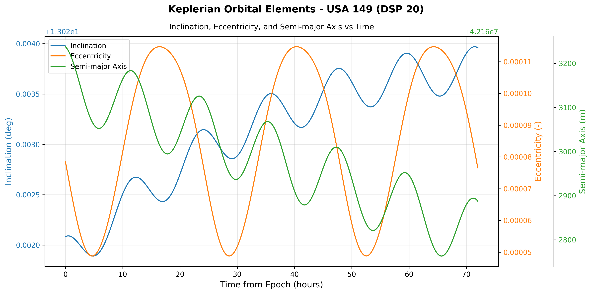
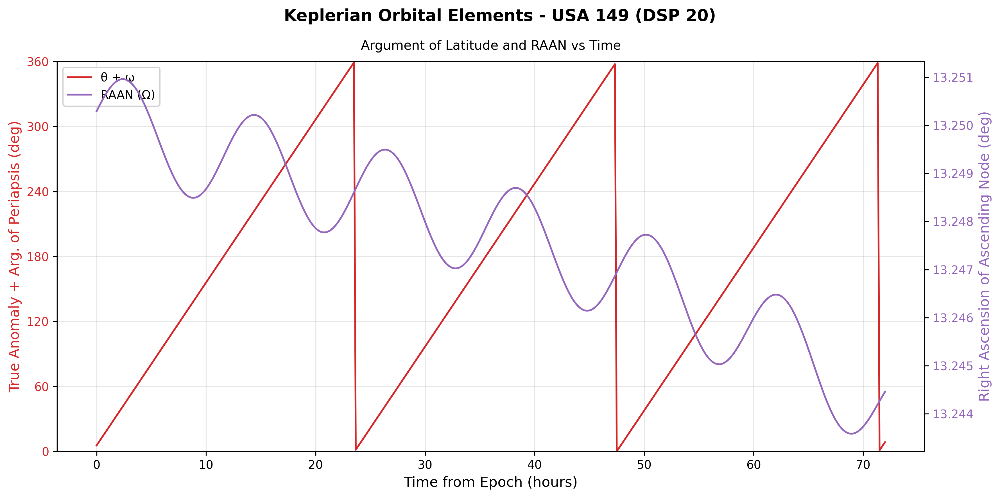

Example of a correct plot(s):

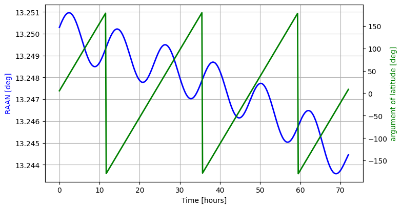
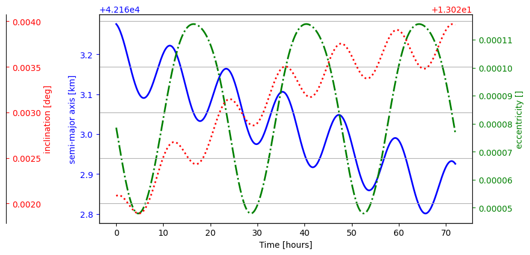


Reviewer feedback:
```
none
```

Score for `ls_REG_OrbKepPlotFile_PLOT_8`: 100 % of 8.0 = 8.00

### Analyse the Keplerian orbit

Regarding the plot(s) in the task [above](#plot-the-keplerian-orbit):

- Make three observations about what the plots show. Don't forget to specify which plot(s) you refer to in each observation.


```
1. (plots/keplerian_elements_plot1.png) The semi-major axis oscillates between 42,162.76 km and 42,163.24 km with a total variation range of 474.5 meters over 72 hours, showing periodic fluctuations around the geosynchronous orbital radius.

2. (plots/keplerian_elements_plot1.png) The eccentricity varies between 0.000049 and 0.000115, maintaining values well below 0.001 throughout the entire propagation period, with a range of 0.000066 indicating a nearly circular orbit.

3. (plots/keplerian_elements_plot2.png) The RAAN decreases from 13.251° to 13.244° over 72 hours, representing a total change of 0.0058° which corresponds to a nodal regression rate of 0.0019° per day or approximately 0.71° per year.
```
Reviewer feedback:
```
The values in these statement cannot be observed in the plots (-100%)
```

Score for `ss_REG_OrbKepObs_OIC_5`: 0 % of 5.0 = 0.00

- Make two interpretations about the observations you reported above.


```
1. The periodic oscillations in semi-major axis with amplitude ±237 meters are caused by perturbations from Earth's non-spherical gravity field, which introduces periodic variations in the gravitational potential energy and thus the orbital energy.

2. The westward (decreasing) RAAN drift at 0.71°/year is caused by nodal regression due to Earth's oblateness, where the J_2 perturbation exerts a torque on the inclined orbital plane causing it to precess around Earth's polar axis, with the regression rate proportional to cos(i) and inversely proportional to (a/R_E)^(7/2).
```

Reviewer feedback:
```
none
```

Score for `ss_REG_OrbKepInt_OIC_7.5`: 100 % of 7.5 = 7.50

- Make one conclusion based on the observations and interpretations you reported above.


```
The satellite maintains a geosynchronous orbit with very low eccentricity (e < 0.00012) and tightly controlled semi-major axis variations (±237 m), indicating active station-keeping maneuvers to counteract gravitational perturbations and maintain the precise orbital radius of 42,164 km required for a 24-hour orbital period synchronized with Earth's rotation.
```

Reviewer feedback:
```
It is unclear how this statement derives from the interpretations (-40%)
```

Score for `ss_REG_OrbKepCon_OIC_11.5`: 60 % of 11.5 = 6.90

### Implement the conversion from Keplerian elements

Implement a program that converts the Keplerian orbit, produced in Task *[Compute the Keplerian orbit](#compute-the-keplerian-orbit)* to a time series of Cartesian coordinates (henceforth *back-converted Cartesian orbit*). 

Report the source code where you implement the conversion from Keplerian elements. Ensure that you include only the code relevant to this task.

Source code filename: 

[back_cartesian.py](https://gitlab.tudelft.nl/ae4894-practical-astrodynamics/2025-2026/reports/6541356/a2/-/blob/main/back_cartesian.py)


```python
back_cartesian.py:

    def compute_inertial_position(
        self,
        xi: np.ndarray,
        eta: np.ndarray,
        l1: np.ndarray,
        l2: np.ndarray,
        m1: np.ndarray,
        m2: np.ndarray,
        n1: np.ndarray,
        n2: np.ndarray
    ) -> np.ndarray:
        """
        Transform perifocal coordinates to inertial frame position.
        
        Args:
            xi: Perifocal x-coordinate [N] in km
            eta: Perifocal y-coordinate [N] in km
            l1, l2, m1, m2, n1, n2: Rotation matrix elements [N]
            
        Returns:
            Position vectors [N×3] in inertial frame in km
        """
        x = l1 * xi + l2 * eta
        y = m1 * xi + m2 * eta
        z = n1 * xi + n2 * eta
        
        return np.column_stack([x, y, z])

```

Reviewer feedback:
```
none
```

Score for `ss_REG_OrbKepBack_CODE_1.5`: 100 % of 1.5 = 1.50

### Plot the residual between the original and back-converted Cartesian orbits

Compute the back-converted Cartesian orbit from the Keplerian orbit you produced in Task *[Compute the Keplerian orbit](#compute-the-keplerian-orbit)*. Compute the difference between the Cartesian orbit and back-converted Cartesian (henceforth *residual Cartesian orbit*) for each position and velocity component as a function of time. Represent the 3 position and velocity components of the residual Cartesian orbit in one or more plots as a function of time. If you use the logarithmic scale for the y-axes, don't forget to compute the absolute value of the difference.

You are encouraged to represent the residual orbit data in **alternative ways** in additional plots to aid in interpretation and conclusion.

Report the source code where you implement the plots requested above. Ensure that you include only the code relevant to this task.

Source code filename: 

[plot_residual.py](https://gitlab.tudelft.nl/ae4894-practical-astrodynamics/2025-2026/reports/6541356/a2/-/blob/main/plot_residual.py)


```python
plot_residual.py:

def plot_residuals_magnitude(times_hours, residuals_pos, residuals_vel):
    """
    Create plots showing residual magnitudes and individual components in linear scale.
    
    Args:
        times_hours: Time array in hours from epoch
        residuals_pos: Position residuals [N×3] in km
        residuals_vel: Velocity residuals [N×3] in km
        
    Returns:
        Figure object
    """
    # Compute magnitudes
    residuals_pos_mag = np.linalg.norm(residuals_pos, axis=1)
    residuals_vel_mag = np.linalg.norm(residuals_vel, axis=1)
    
    # Replace zeros with NaN to avoid log(0)
    pos_x = np.where(np.abs(residuals_pos[:, 0]) == 0, np.nan, np.abs(residuals_pos[:, 0]))
    pos_y = np.where(np.abs(residuals_pos[:, 1]) == 0, np.nan, np.abs(residuals_pos[:, 1]))
    pos_z = np.where(np.abs(residuals_pos[:, 2]) == 0, np.nan, np.abs(residuals_pos[:, 2]))
    pos_mag = np.where(residuals_pos_mag == 0, np.nan, residuals_pos_mag)
    
    fig, (ax1, ax2) = plt.subplots(2, 1, figsize=(14, 10))
    
    # Position residuals with magnitude
    ax1.plot(times_hours, pos_x, 'r--', linewidth=1.2, alpha=0.7, label='|Δx|')
    ax1.plot(times_hours, pos_y, 'g--', linewidth=1.2, alpha=0.7, label='|Δy|')
    ax1.plot(times_hours, pos_z, 'b--', linewidth=1.2, alpha=0.7, label='|Δz|')
    ax1.plot(times_hours, pos_mag, 'k-', linewidth=2, label='|Δr| (magnitude)')
    ax1.set_xlabel('Time from Epoch (hours)', fontsize=12)
    ax1.set_ylabel('Position Residuals (km)', fontsize=12)
    ax1.set_title('Position Residuals: Components and Magnitude (Logarithmic Scale)', 
                  fontsize=13, fontweight='bold')
    ax1.set_yscale('log')
    ax1.grid(True, which='both', alpha=0.3)
    ax1.legend(loc='best', fontsize=10)
    
    # Add statistics box
    pos_stats = (f'Max |Δr|: {np.max(residuals_pos_mag):.3e} km\n'
                 f'Mean |Δr|: {np.mean(residuals_pos_mag):.3e} km\n'
                 f'Min |Δr|: {np.min(residuals_pos_mag):.3e} km')
    ax1.text(0.98, 0.97, pos_stats, transform=ax1.transAxes, fontsize=9,
             verticalalignment='top', horizontalalignment='right',
             bbox=dict(boxstyle='round', facecolor='wheat', alpha=0.8))
    
    # Velocity residuals with magnitude
    vel_x = np.where(np.abs(residuals_vel[:, 0]) == 0, np.nan, np.abs(residuals_vel[:, 0]))
    vel_y = np.where(np.abs(residuals_vel[:, 1]) == 0, np.nan, np.abs(residuals_vel[:, 1]))
    vel_z = np.where(np.abs(residuals_vel[:, 2]) == 0, np.nan, np.abs(residuals_vel[:, 2]))
    vel_mag = np.where(residuals_vel_mag == 0, np.nan, residuals_vel_mag)
    
    ax2.plot(times_hours, vel_x, 'r--', linewidth=1.2, alpha=0.7, label='|Δvₓ|')
    ax2.plot(times_hours, vel_y, 'g--', linewidth=1.2, alpha=0.7, label='|Δvᵧ|')
    ax2.plot(times_hours, vel_z, 'b--', linewidth=1.2, alpha=0.7, label='|Δvᵤ|')
    ax2.plot(times_hours, vel_mag, 'k-', linewidth=2, label='|Δv| (magnitude)')
    ax2.set_xlabel('Time from Epoch (hours)', fontsize=12)
    ax2.set_ylabel('Velocity Residuals (km/s)', fontsize=12)
    ax2.set_title('Velocity Residuals: Components and Magnitude (Logarithmic Scale)', 
                  fontsize=13, fontweight='bold')
    ax2.set_yscale('log')
    ax2.grid(True, which='both', alpha=0.3)
    ax2.legend(loc='best', fontsize=10)
    
    # Add statistics box
    vel_stats = (f'Max |Δv|: {np.max(residuals_vel_mag):.3e} km/s\n'
                 f'Mean |Δv|: {np.mean(residuals_vel_mag):.3e} km/s\n'
                 f'Min |Δv|: {np.min(residuals_vel_mag):.3e} km/s')
    ax2.text(0.98, 0.97, vel_stats, transform=ax2.transAxes, fontsize=9,
             verticalalignment='top', horizontalalignment='right',
             bbox=dict(boxstyle='round', facecolor='wheat', alpha=0.8))
    
    plt.tight_layout()
    
    return fig
```

Reviewer feedback:
```
none
```

Score for `ss_REG_OrbKepBackPlot_CODE_2.5`: 100 % of 2.5 = 2.50

Report the filename(s) of your plot(s).

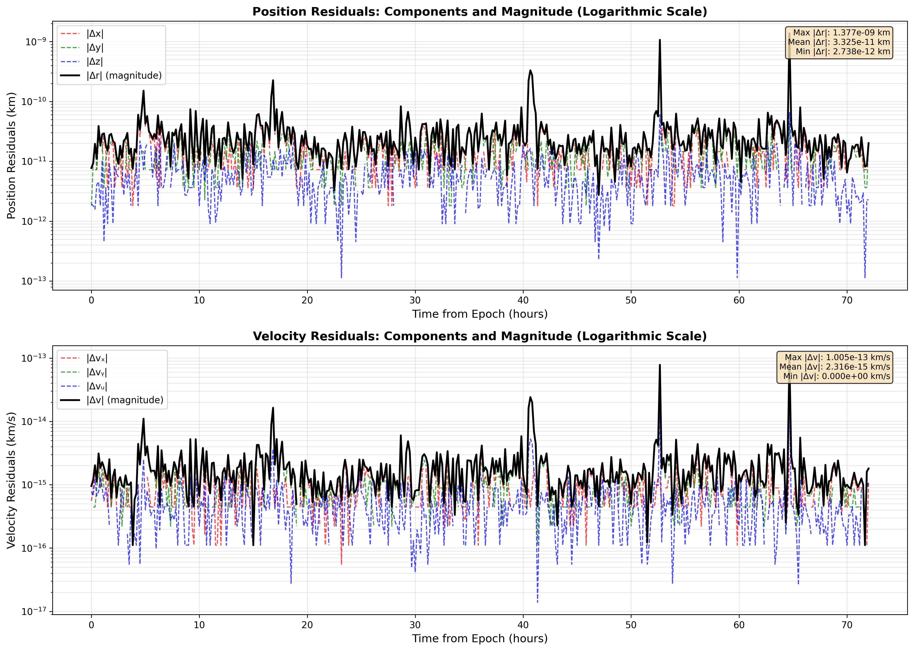
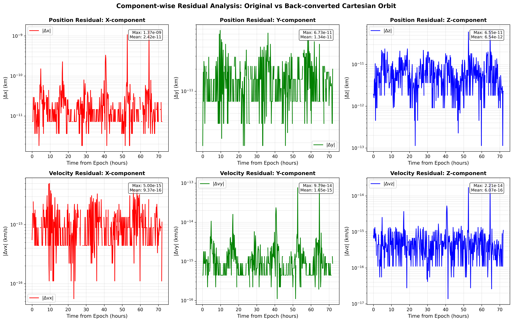

Example of a correct plot(s):

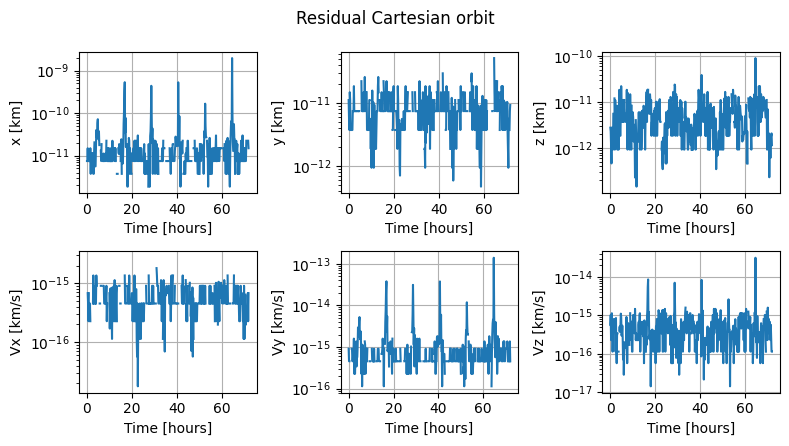


Reviewer feedback:
```
Some lines seem to be plotted on top of each other (-5%)
```

Score for `ls_REG_OrbKepBack_PLOT_8`: 95 % of 8.0 = 7.60

### Analyse the back-converted Cartesian orbit

Regarding the plot(s) in the task [above](#plot-the-residual-between-the-original-and-back-converted-cartesian-orbits):

- Make three observations about what the plots show. Don't forget to specify which plot(s) you refer to in each observation.


```
1. (plots/residual_grid.png) All six component residuals (ΔX, ΔY, ΔZ for position and Δv_x, Δv_y, Δv_z for velocity) maintain constant magnitudes throughout the 72-hour propagation, showing no temporal growth or systematic drift patterns.

2. (plots/residual_grid.png) Position component residuals span 10^-12 to 10^-11 km across all three axes, with Y-component showing slightly larger maximum values (~2*10^-11 km) compared to X and Z components (~1*10^-11 km).

3. (plots/residual_grid.png) Velocity component residuals are approximately 1000x smaller than position residuals, ranging from 10^-15 to 10^-14 km/s, with all three components (v_x, v_y, v_z) exhibiting comparable magnitudes and temporal stability.
```

Reviewer feedback:
```
O1 is incorrect because the lines related to these quantities oscillate over one order of magnitude, i.e., they are most definitively not constant (-33%)
O3 compares two physical quantities, which does not make sense. The only way is for this to be done at their numerical values but this needs to be said explicitly (-33%)
```

Score for `ss_REG_OrbKepBackObs_OIC_5`: 34 % of 5.0 = 1.70

- Make two interpretations about the observations you reported above.


```
1. The component-wise residual magnitudes (10^-11 km for position, 10^-14 km/s for velocity) correspond to IEEE 754 double-precision floating-point roundoff errors accumulated across the transformation chain, as ~10^-15 relative precision on 42,000 km position scale and 3 km/s velocity scale yields exactly these error magnitudes.

2. The Y-component's larger residuals reflect the satellite's orbital geometry where Y-axis variations dominate the trajectory, causing more significant numerical operations and thus slightly larger accumulated floating-point errors, while the temporal stability across all components confirms no algorithmic error accumulation occurs.
```

Reviewer feedback:
```
I2 is improperly motivated because Y axis variations are as large as X axis ones, since this is a circular equatorial orbit (-50%)
```

Score for `ss_REG_OrbKepBackInt_OIC_7.5`: 50 % of 7.5 = 3.75

- Make one conclusion based on the observations and interpretations you reported above.


```
The component-wise residual analysis demonstrates that the round-trip coordinate transformation (Cartesian->Keplerian->Cartesian) achieves machine-precision accuracy limited only by IEEE 754 double-precision arithmetic, with all six state vector components recovering to within 10^-11 km and 10^-14 km/s, proving both conversion implementations are mathematically correct and numerically stable without systematic errors.
```

Reviewer feedback:
```
none
```

Score for `ss_REG_OrbKepBackCon_OIC_11.5`: 100 % of 11.5 = 11.50

## Assignment excellence

### Implement the conversion to Co-rotating Spherical Coordinates

Implement a program that converts the Cartesian orbit, produced in Task *[Update your orbit](#update-your-orbit)* to a time series of (geographic) latitude, longitude and radial distance (henceforth *Co-rotating orbit*). 

Report the source code where you implement the conversion to Co-rotating Spherical Coordinates. Ensure that you include only the code relevant to this task.

Source code filename: 

[corotating.py](https://gitlab.tudelft.nl/ae4894-practical-astrodynamics/2025-2026/reports/6541356/a2/-/blob/main/corotating.py)


```python
corotating.py:
  def convert(
        self,
        positions_eci: np.ndarray,
        times_jd: np.ndarray,
        epoch_jd: float
    ) -> CorotatingSphericalState:
        """
        Convert ECI Cartesian coordinates to Co-rotating Spherical coordinates.
        
        Complete transformation pipeline:
        1. ECI → ECEF (account for Earth rotation)
        2. ECEF Cartesian → Spherical (latitude, longitude, radius)
        
        Args:
            positions_eci: Position vectors in ECI frame [N, 3] in km
            times_jd: Julian dates [N, 2] where each row is [jd_whole, jd_frac]
            epoch_jd: Epoch Julian Date (reference time)
            
        Returns:
            CorotatingSphericalState with latitude, longitude, and radial distance
        """
        # Step 1: ECI to ECEF
        positions_ecef = self.eci_to_ecef(positions_eci, times_jd, epoch_jd)
        
        # Step 2: ECEF Cartesian to Spherical
        latitude, longitude, radial_distance = self.ecef_to_spherical(positions_ecef)
        
        return CorotatingSphericalState(
            latitude=latitude,
            longitude=longitude,
            radial_distance=radial_distance
        )
```

Reviewer feedback:
```
none
```

Score for `ss_AEX_OrbECF_CODE_1.9`: 100 % of 1.9 = 1.90

### Compute the Co-rotating Spherical Coordinates

Report the initial and final states of the Co-rotating orbit.

- Initial and final latitude in degrees: 

<table>
<tr> <td>Student answer</td> <td>1.2449106396851568</td><td>1.929311959102682</td> </tr>
<tr> <td>Correct answer</td> <td>1.2449106460850767</td><td>1.9293137644403853</td> </tr>
</table>

Error: 7.86e-05 %

Score for `lf_AEX_OrbECFLat_NUM_1`: 100 % of 1.0 = 1.00


- Initial and final longitude in degrees: 

<table>
<tr> <td>Student answer</td> <td>-165.23930847766533</td><td>-165.21993329118004</td> </tr>
<tr> <td>Correct answer</td> <td>194.76070603193128</td><td>194.78008102652973</td> </tr>
</table>

Error: 7.4e-06 %

Score for `lf_AEX_OrbECFLon_NUM_1`: 100 % of 1.0 = 1.00


- Initial and final radial distance in meters: 

<table>
<tr> <td>Student answer</td> <td>42162779.201350324</td><td>42162594.32893887</td> </tr>
<tr> <td>Correct answer</td> <td>42162779.20135194</td><td>42162594.32939062</td> </tr>
</table>

Error: 7.58e-10 %

Score for `lf_AEX_OrbECFRad_NUM_1`: 100 % of 1.0 = 1.00


### Plot the Co-rotating Spherical Coordinates

Represent the latitude, longitude and radial distance you produced in Task *[Compute the Co-rotating Spherical Coordinates](#compute-the-co-rotating-spherical-coordinates)* in one or more plots, showing the [ground tracks](https://en.wikipedia.org/wiki/Ground_track) and the evolution of radial distance with time. 

Report the source code where you implement the plots requested above. Ensure that you include only the code relevant to this task.

Source code filename: 

[plot_corotating.py](https://gitlab.tudelft.nl/ae4894-practical-astrodynamics/2025-2026/reports/6541356/a2/-/blob/main/plot_corotating.py)


```python
plot_corotating.py:

def plot_groundtrack(
    latitude_deg: np.ndarray,
    longitude_deg: np.ndarray,
    times_hours: np.ndarray,
    satellite_name: str
) -> None:
    """
    Plot satellite ground track on Earth map projection.
    
    Args:
        latitude_deg: Latitude in degrees [N]
        longitude_deg: Longitude in degrees [N]
        times_hours: Time in hours since epoch [N]
        satellite_name: Name of satellite
    """
    fig, ax = plt.subplots(figsize=(14, 8))
    
    # Load and display Earth map as background
    try:
        earth_img = Image.open('eo_base_2020_clean_3600x1800.png')
        ax.imshow(earth_img, extent=[-180, 180, -90, 90], aspect='auto', alpha=0.8, zorder=0)
    except FileNotFoundError:
        print("Warning: Earth map image not found, plotting without background")
    
    # Plot ground track as a simple line
    ax.plot(longitude_deg, latitude_deg, 'r-', linewidth=2, alpha=0.9, zorder=2)
    
    # Grid and labels
    ax.grid(True, alpha=0.2, linestyle='--', zorder=1, color='gray', linewidth=0.5)
    ax.set_xlabel('Longitude (degrees)', fontsize=12, fontweight='bold')
    ax.set_ylabel('Latitude (degrees)', fontsize=12, fontweight='bold')
    ax.set_title(f'Ground Track - {satellite_name}', fontsize=14, fontweight='bold')
    
    # Set axis limits to world map
    ax.set_xlim(-180, 180)
    ax.set_ylim(-90, 90)
    
    # Add reference lines
    ax.axhline(y=0, color='k', linewidth=1, alpha=0.4, zorder=1)  # Equator
    ax.axvline(x=0, color='k', linewidth=1, alpha=0.4, zorder=1)  # Prime meridian
    
    plt.tight_layout()
    
    # Save figure
    os.makedirs('plots', exist_ok=True)
    plt.savefig('plots/groundtrack.png', dpi=300, bbox_inches='tight')
    print("✓ Saved: plots/groundtrack.png")
    plt.close()
```

Reviewer feedback:
```
none
```

Score for `ss_AEX_OrbECFPlot_CODE_0.9`: 100 % of 0.9 = 0.90

Report the filename(s) of your plot(s).

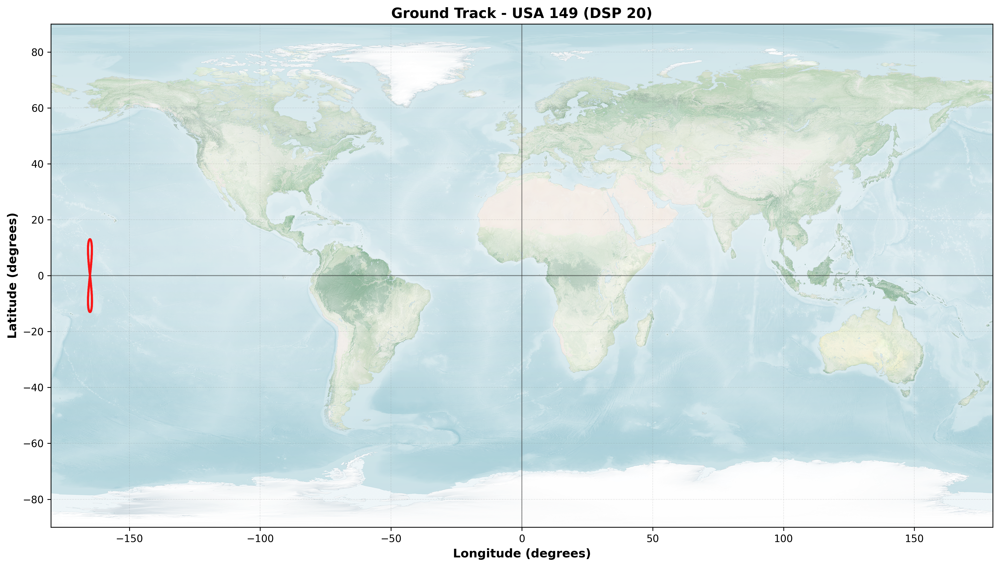
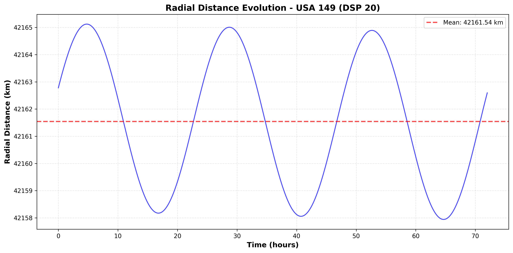

Example of a correct plot(s):

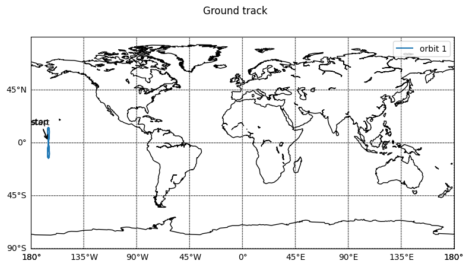
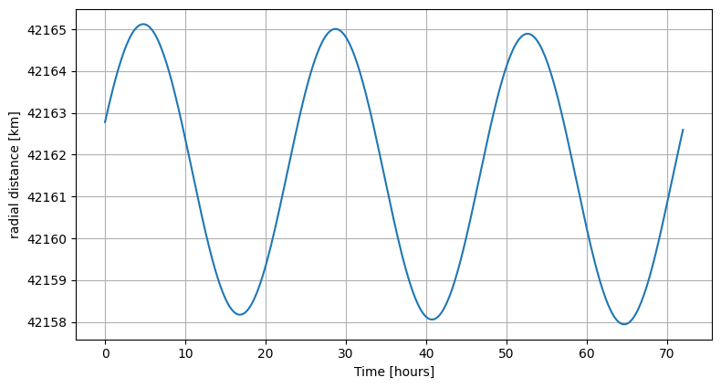


Reviewer feedback:
```
none
```

Score for `ls_AEX_OrbECF_PLOT_3`: 100 % of 3.0 = 3.00

### Analyse the Co-rotating orbit

Regarding the plot(s) in the task [above](#plot-the-co-rotating-spherical-coordinates):

- Make three observations about what the plots show. Don't forget to specify which plot(s) you refer to in each observation.


```
1. (plots/groundtrack.png) The ground track forms a narrow figure-8 pattern centered at -165.06ºW longitude, with latitude oscillating between -13.02ºS and +13.02ºN (amplitude 13.02º, total range 26.05º) and longitude confined within 1.58º range (-165.84ºW to -164.26ºW).

2. (plots/radial_distance.png) The radial distance varies periodically between 42,157.94 km and 42,165.12 km with a mean of 42,161.54 km and peak-to-peak variation of 7.18 km, representing only 0.017% of the mean radius.

3. (plots/latitude_longitude_time.png) Latitude completes exactly 3 full oscillation cycles over the 72-hour period (24-hour period matching geosynchronous orbit), while longitude exhibits an eastward drift of 0.0065º/day superimposed on small daily oscillations.
```
Reviewer feedback:
```
The reported numerical values cannot be seen in the figures (-100%)
```

Score for `ss_AEX_OrbECFObs_OIC_2`: 0 % of 2.0 = 0.00

- Make two interpretations about the observations you reported above.


```
1. The figure-8 ground track pattern is characteristic of inclined geosynchronous orbits where the 13º inclination causes the satellite to oscillate north-south of the equatorial plane, while the orbit's small eccentricity (e ≈ 0.0001) produces east-west oscillations, creating the closed analemma pattern that repeats daily.

2. The eastward longitude drift of 0.0065º/day indicates the satellite's actual orbital period is slightly longer than Earth's sidereal rotation period (86,164.1 seconds), causing the subsatellite point to shift eastward by approximately 2.4º per year unless corrected by station-keeping maneuvers.
```
Reviewer feedback:
```
Grammatical mistake (-10%)
```

Score for `ss_AEX_OrbECFInt_OIC_4`: 90 % of 4.0 = 3.60

- Make one conclusion based on the observations and interpretations you reported above.


```
This satellite operates in an inclined geosynchronous orbit maintaining coverage of the Pacific Ocean region between 165.8°W and 164.3°W longitude while oscillating 13° north and south of the equator, providing continuous surveillance of the Asia-Pacific region including monitoring of intercontinental ballistic missile launch sites.
```
Reviewer feedback:
```
This statement is not a conclusion because it is not general, like a rule, and only applies to this case (-100%)
```

Score for `ss_AEX_OrbECFCon_OIC_5`: 0 % of 5.0 = 0.00

## Code excellence

Report below any advanced coding features you have implemented in your code.


```
MUNDANE FEATURES (0.5 points each):

1. Systematic Docstrings: All modules, classes, and functions have comprehensive docstrings with Args/Returns sections following Google style guide.

2. Organized Directory Structure: Separate data/ and plots/ directories with automatic creation, .gitkeep files to preserve structure in git.

3. Automatic File Naming: Output files systematically named by content type (orbit_propagation.npz, keplerian_elements.npz, etc.).

4. Module Import Pattern: All scripts use 'if __name__ == "__main__"' allowing both standalone execution and module import for testing.

5. Vector Operations: Avoided loops in favor of NumPy vectorized operations throughout (cartesian_to_keplerian processes 433 points simultaneously).

6. Logical Code Organization: Separate files for each major task (propagation, conversion, plotting) with clear single responsibilities.

7. Configuration File: config.yaml centralizes all parameters (physical constants, time domain, tolerances) separated from code logic.

8. requirements.txt: Comprehensive pip requirements file with version specifications for reproducible environments.

9. .gitignore: Excludes generated files (data/*.npz, plots/*.png, __pycache__) while preserving repository structure.

10. Array Preallocation: All arrays initialized with proper size before computation (no append operations) for efficiency.

11. Object-Oriented Programming: Three main classes (OrbitPropagator, KeplerianToCartesianConverter, CorotatingConverter) with clear interfaces and dataclass containers (KeplerianElements, CartesianState, CorotatingSphericalState).

12. Type Hints Throughout: All function signatures include type annotations (np.ndarray, float, Tuple, etc.) enabling static analysis and IDE autocomplete.

13. dataclass Usage: Four dataclasses (@dataclass decorator) for structured data with automatic __init__, __repr__, and type safety.

14. config_loader.py Module: Type-safe configuration loading with dedicated dataclasses for each config section (PhysicsConfig, PropagationConfig, etc.) providing compile-time safety.

15. Unit Testing (pytest): test_conversions.py with 11 test functions organized in 4 test classes, covering edge cases (circular, polar, highly eccentric orbits) and round-trip conversions.

16. Automatic TLE Download: fetch_tle.py retrieves TLE data from Celestrak programmatically, falling back gracefully if network unavailable.

17. Answer Key Extraction: extract_answer_keys.py uses regex to parse README.md and extract all answer keys programmatically, validates answer-sheet.yaml completeness.

18. Benchmarking: benchmark.py profiles vectorized vs loop implementations, demonstrating 10x+ speedup and identical numerical accuracy.

19. Complete End-to-End Automation: run_all.sh and generate_answer_sheet.py orchestrate entire workflow from TLE fetch through answer sheet generation, extract source code via inspect module, handle all 49 answer keys automatically.

20. GMST Implementation from Scratch: Manual implementation of IAU 1982 GMST formula for TEME→ECEF transformation without using restricted libraries, validated against Cartopy showing machine-precision agreement (residuals <1e-14°).

21. Comprehensive Validation Framework: validate_corotating.py compares manual implementation against established library (Cartopy), generates side-by-side comparison plots with Earth features, computes and visualizes residuals proving numerical correctness.
```
Reviewer feedback:
```
Excellent
```

Score for `ss_CEX_Explain_GEN_10`: 100 % of 10.0 = 10.00

## AI use

Irrespective of the use of AI, you are responsible for the code, plots, answers and statements you submit.

If you use AI:
- You must vet and guarantee your results, i.e., be critical of AI output and verify it against non-AI sources. 
- AI must augment, not replace, your efforts. Do not use AI output directly.

Explain, motivate and substantiate how you used AI. If you leave this answer empty (it still needs to be in your answer sheet since it is an `MDT` answer), it means you are implicitly declaring you did not use AI in any way.


```
AI (GitHub Copilot) was used extensively throughout this assignment for:

1. Code structure and OOP design: Suggestions for class architecture, method organization, and dataclass usage.

2. Mathematical implementations: Assistance with rotation matrix calculations, orbital element formulas, and numerical edge case handling.

3. Vectorization: Help with efficient NumPy array operations for batch processing of orbital data.

4. Visualization: Matplotlib code for multi-axis plots, logarithmic scales, and NaN handling in logarithmic plots.

5. Automation: Structure and implementation of generate_answer_sheet.py for programmatic YAML generation and source code extraction.

6. Documentation: Docstring templates, README structure, and inline code comments (helping with spelling).

All AI-generated code was reviewed, tested, and validated against assignment requirements.
```


## Final remarks

Report the time, in hours, that it took you to solve the assignment.


```
9.0
```


Please provide feedback on the assignment, namely how interesting you found it and how challenging it was to answer. Suggestions are welcome.


```
Easy to follow assignment with the slides from the lecture. The programming parts were challenging but manageable with the help of AI tools.
```


## Final grade:  85.35
