<script>
  src="https://cdn.mathjax.org/mathjax/latest/MathJax.js?config=TeX-AMS-MML_HTMLorMML"
  type="text/javascript">
</script>

# Grading report for assignment A3 of student 6541356

## Submission

- Assignment deadline: 2026-02-06 23:59:59
- Assignment submitted: 2026-03-10 11:37:12
- Assignment submitted 31 days, 11:37:13 **after** the deadline.

## Authors

- Ismael Gallo López
- ismaellopez.clase@gmail.com
- igallolopez
- igallolopez@student.tudelft.nl

## Useful links

- [Student repository](https://gitlab.tudelft.nl/ae4894-practical-astrodynamics/2025-2026/reports/6541356/a3)
- [Grading repository](https://gitlab.tudelft.nl/ae4894-practical-astrodynamics/2025-2026/grades/a3/-/tree/main/6541356) (for reviewers only)
- [Grading guidelines](https://gitlab.tudelft.nl/ae4894-practical-astrodynamics/2025-2026/management/grading/-/blob/main/README.md) (for reviewers only)


## Submitted files

- [ANSWER_SHEET_GENERATOR_README.md](https://gitlab.tudelft.nl/ae4894-practical-astrodynamics/2025-2026/reports/6541356/a3/-/blob/main/ANSWER_SHEET_GENERATOR_README.md)
- [ASSIGNMENT_SUBMISSION_GUIDE.md](https://gitlab.tudelft.nl/ae4894-practical-astrodynamics/2025-2026/reports/6541356/a3/-/blob/main/ASSIGNMENT_SUBMISSION_GUIDE.md)
- [METHODS_COMPARISON.md](https://gitlab.tudelft.nl/ae4894-practical-astrodynamics/2025-2026/reports/6541356/a3/-/blob/main/METHODS_COMPARISON.md)
- [Makefile](https://gitlab.tudelft.nl/ae4894-practical-astrodynamics/2025-2026/reports/6541356/a3/-/blob/main/Makefile)
- [PROJECT_STRUCTURE.md](https://gitlab.tudelft.nl/ae4894-practical-astrodynamics/2025-2026/reports/6541356/a3/-/blob/main/PROJECT_STRUCTURE.md)
- [PROPAGATION_README.md](https://gitlab.tudelft.nl/ae4894-practical-astrodynamics/2025-2026/reports/6541356/a3/-/blob/main/PROPAGATION_README.md)
- [README.md](https://gitlab.tudelft.nl/ae4894-practical-astrodynamics/2025-2026/reports/6541356/a3/-/blob/main/README.md)
- [TIMING_ANALYSIS.md](https://gitlab.tudelft.nl/ae4894-practical-astrodynamics/2025-2026/reports/6541356/a3/-/blob/main/TIMING_ANALYSIS.md)
- [VERLET_README.md](https://gitlab.tudelft.nl/ae4894-practical-astrodynamics/2025-2026/reports/6541356/a3/-/blob/main/VERLET_README.md)
- [answer-sheet.yaml](https://gitlab.tudelft.nl/ae4894-practical-astrodynamics/2025-2026/reports/6541356/a3/-/blob/main/answer-sheet.yaml)
- [build/euler_integrator_module.mod](https://gitlab.tudelft.nl/ae4894-practical-astrodynamics/2025-2026/reports/6541356/a3/-/blob/main/build/euler_integrator_module.mod)
- [build/gravity.mod](https://gitlab.tudelft.nl/ae4894-practical-astrodynamics/2025-2026/reports/6541356/a3/-/blob/main/build/gravity.mod)
- [build/propagate_orbit](https://gitlab.tudelft.nl/ae4894-practical-astrodynamics/2025-2026/reports/6541356/a3/-/blob/main/build/propagate_orbit)
- [build/propagate_orbit_verlet](https://gitlab.tudelft.nl/ae4894-practical-astrodynamics/2025-2026/reports/6541356/a3/-/blob/main/build/propagate_orbit_verlet)
- [build/velocity_verlet_integrator_module.mod](https://gitlab.tudelft.nl/ae4894-practical-astrodynamics/2025-2026/reports/6541356/a3/-/blob/main/build/velocity_verlet_integrator_module.mod)
- [data/euler_outputs/dt10000s_euler_output.txt](https://gitlab.tudelft.nl/ae4894-practical-astrodynamics/2025-2026/reports/6541356/a3/-/blob/main/data/euler_outputs/dt10000s_euler_output.txt)
- [data/euler_outputs/dt1000s_euler_output.txt](https://gitlab.tudelft.nl/ae4894-practical-astrodynamics/2025-2026/reports/6541356/a3/-/blob/main/data/euler_outputs/dt1000s_euler_output.txt)
- [data/euler_outputs/dt100s_euler_output.txt](https://gitlab.tudelft.nl/ae4894-practical-astrodynamics/2025-2026/reports/6541356/a3/-/blob/main/data/euler_outputs/dt100s_euler_output.txt)
- [data/euler_outputs/dt10s_euler_output.txt](https://gitlab.tudelft.nl/ae4894-practical-astrodynamics/2025-2026/reports/6541356/a3/-/blob/main/data/euler_outputs/dt10s_euler_output.txt)
- [data/euler_outputs/dt1500s_euler_output.txt](https://gitlab.tudelft.nl/ae4894-practical-astrodynamics/2025-2026/reports/6541356/a3/-/blob/main/data/euler_outputs/dt1500s_euler_output.txt)
- [data/euler_outputs/dt150s_euler_output.txt](https://gitlab.tudelft.nl/ae4894-practical-astrodynamics/2025-2026/reports/6541356/a3/-/blob/main/data/euler_outputs/dt150s_euler_output.txt)
- [data/euler_outputs/dt1s_euler_output.txt](https://gitlab.tudelft.nl/ae4894-practical-astrodynamics/2025-2026/reports/6541356/a3/-/blob/main/data/euler_outputs/dt1s_euler_output.txt)
- [data/euler_outputs/dt20000s_euler_output.txt](https://gitlab.tudelft.nl/ae4894-practical-astrodynamics/2025-2026/reports/6541356/a3/-/blob/main/data/euler_outputs/dt20000s_euler_output.txt)
- [data/euler_outputs/dt2000s_euler_output.txt](https://gitlab.tudelft.nl/ae4894-practical-astrodynamics/2025-2026/reports/6541356/a3/-/blob/main/data/euler_outputs/dt2000s_euler_output.txt)
- [data/euler_outputs/dt200s_euler_output.txt](https://gitlab.tudelft.nl/ae4894-practical-astrodynamics/2025-2026/reports/6541356/a3/-/blob/main/data/euler_outputs/dt200s_euler_output.txt)
- [data/euler_outputs/dt20s_euler_output.txt](https://gitlab.tudelft.nl/ae4894-practical-astrodynamics/2025-2026/reports/6541356/a3/-/blob/main/data/euler_outputs/dt20s_euler_output.txt)
- [data/euler_outputs/dt2s_euler_output.txt](https://gitlab.tudelft.nl/ae4894-practical-astrodynamics/2025-2026/reports/6541356/a3/-/blob/main/data/euler_outputs/dt2s_euler_output.txt)
- [data/euler_outputs/dt300s_euler_output.txt](https://gitlab.tudelft.nl/ae4894-practical-astrodynamics/2025-2026/reports/6541356/a3/-/blob/main/data/euler_outputs/dt300s_euler_output.txt)
- [data/euler_outputs/dt30s_euler_output.txt](https://gitlab.tudelft.nl/ae4894-practical-astrodynamics/2025-2026/reports/6541356/a3/-/blob/main/data/euler_outputs/dt30s_euler_output.txt)
- [data/euler_outputs/dt5000s_euler_output.txt](https://gitlab.tudelft.nl/ae4894-practical-astrodynamics/2025-2026/reports/6541356/a3/-/blob/main/data/euler_outputs/dt5000s_euler_output.txt)
- [data/euler_outputs/dt500s_euler_output.txt](https://gitlab.tudelft.nl/ae4894-practical-astrodynamics/2025-2026/reports/6541356/a3/-/blob/main/data/euler_outputs/dt500s_euler_output.txt)
- [data/euler_outputs/dt50s_euler_output.txt](https://gitlab.tudelft.nl/ae4894-practical-astrodynamics/2025-2026/reports/6541356/a3/-/blob/main/data/euler_outputs/dt50s_euler_output.txt)
- [data/euler_outputs/dt5s_euler_output.txt](https://gitlab.tudelft.nl/ae4894-practical-astrodynamics/2025-2026/reports/6541356/a3/-/blob/main/data/euler_outputs/dt5s_euler_output.txt)
- [data/euler_outputs/dt750s_euler_output.txt](https://gitlab.tudelft.nl/ae4894-practical-astrodynamics/2025-2026/reports/6541356/a3/-/blob/main/data/euler_outputs/dt750s_euler_output.txt)
- [data/euler_outputs/dt75s_euler_output.txt](https://gitlab.tudelft.nl/ae4894-practical-astrodynamics/2025-2026/reports/6541356/a3/-/blob/main/data/euler_outputs/dt75s_euler_output.txt)
- [data/sgp4_reference/initial_state.txt](https://gitlab.tudelft.nl/ae4894-practical-astrodynamics/2025-2026/reports/6541356/a3/-/blob/main/data/sgp4_reference/initial_state.txt)
- [data/sgp4_reference/tle.txt](https://gitlab.tudelft.nl/ae4894-practical-astrodynamics/2025-2026/reports/6541356/a3/-/blob/main/data/sgp4_reference/tle.txt)
- [data/verlet_outputs/dt1000s_verlet_output.txt](https://gitlab.tudelft.nl/ae4894-practical-astrodynamics/2025-2026/reports/6541356/a3/-/blob/main/data/verlet_outputs/dt1000s_verlet_output.txt)
- [data/verlet_outputs/dt100s_verlet_output.txt](https://gitlab.tudelft.nl/ae4894-practical-astrodynamics/2025-2026/reports/6541356/a3/-/blob/main/data/verlet_outputs/dt100s_verlet_output.txt)
- [data/verlet_outputs/dt10s_verlet_output.txt](https://gitlab.tudelft.nl/ae4894-practical-astrodynamics/2025-2026/reports/6541356/a3/-/blob/main/data/verlet_outputs/dt10s_verlet_output.txt)
- [data/verlet_outputs/dt1500s_verlet_output.txt](https://gitlab.tudelft.nl/ae4894-practical-astrodynamics/2025-2026/reports/6541356/a3/-/blob/main/data/verlet_outputs/dt1500s_verlet_output.txt)
- [data/verlet_outputs/dt150s_verlet_output.txt](https://gitlab.tudelft.nl/ae4894-practical-astrodynamics/2025-2026/reports/6541356/a3/-/blob/main/data/verlet_outputs/dt150s_verlet_output.txt)
- [data/verlet_outputs/dt2000s_verlet_output.txt](https://gitlab.tudelft.nl/ae4894-practical-astrodynamics/2025-2026/reports/6541356/a3/-/blob/main/data/verlet_outputs/dt2000s_verlet_output.txt)
- [data/verlet_outputs/dt200s_verlet_output.txt](https://gitlab.tudelft.nl/ae4894-practical-astrodynamics/2025-2026/reports/6541356/a3/-/blob/main/data/verlet_outputs/dt200s_verlet_output.txt)
- [data/verlet_outputs/dt20s_verlet_output.txt](https://gitlab.tudelft.nl/ae4894-practical-astrodynamics/2025-2026/reports/6541356/a3/-/blob/main/data/verlet_outputs/dt20s_verlet_output.txt)
- [data/verlet_outputs/dt300s_verlet_output.txt](https://gitlab.tudelft.nl/ae4894-practical-astrodynamics/2025-2026/reports/6541356/a3/-/blob/main/data/verlet_outputs/dt300s_verlet_output.txt)
- [data/verlet_outputs/dt30s_verlet_output.txt](https://gitlab.tudelft.nl/ae4894-practical-astrodynamics/2025-2026/reports/6541356/a3/-/blob/main/data/verlet_outputs/dt30s_verlet_output.txt)
- [data/verlet_outputs/dt500s_verlet_output.txt](https://gitlab.tudelft.nl/ae4894-practical-astrodynamics/2025-2026/reports/6541356/a3/-/blob/main/data/verlet_outputs/dt500s_verlet_output.txt)
- [data/verlet_outputs/dt50s_verlet_output.txt](https://gitlab.tudelft.nl/ae4894-practical-astrodynamics/2025-2026/reports/6541356/a3/-/blob/main/data/verlet_outputs/dt50s_verlet_output.txt)
- [data/verlet_outputs/dt750s_verlet_output.txt](https://gitlab.tudelft.nl/ae4894-practical-astrodynamics/2025-2026/reports/6541356/a3/-/blob/main/data/verlet_outputs/dt750s_verlet_output.txt)
- [data/verlet_outputs/dt75s_verlet_output.txt](https://gitlab.tudelft.nl/ae4894-practical-astrodynamics/2025-2026/reports/6541356/a3/-/blob/main/data/verlet_outputs/dt75s_verlet_output.txt)
- [euler_integrator_module.mod](https://gitlab.tudelft.nl/ae4894-practical-astrodynamics/2025-2026/reports/6541356/a3/-/blob/main/euler_integrator_module.mod)
- [generate_answer_sheet.py](https://gitlab.tudelft.nl/ae4894-practical-astrodynamics/2025-2026/reports/6541356/a3/-/blob/main/generate_answer_sheet.py)
- [gravity.mod](https://gitlab.tudelft.nl/ae4894-practical-astrodynamics/2025-2026/reports/6541356/a3/-/blob/main/gravity.mod)
- [plots/combined_timesteps_euler/gpd_combined.png](https://gitlab.tudelft.nl/ae4894-practical-astrodynamics/2025-2026/reports/6541356/a3/-/blob/main/plots/combined_timesteps_euler/gpd_combined.png)
- [plots/combined_timesteps_euler/position_magnitude_combined.png](https://gitlab.tudelft.nl/ae4894-practical-astrodynamics/2025-2026/reports/6541356/a3/-/blob/main/plots/combined_timesteps_euler/position_magnitude_combined.png)
- [plots/combined_timesteps_verlet/gpd_combined.png](https://gitlab.tudelft.nl/ae4894-practical-astrodynamics/2025-2026/reports/6541356/a3/-/blob/main/plots/combined_timesteps_verlet/gpd_combined.png)
- [plots/combined_timesteps_verlet/position_magnitude_combined.png](https://gitlab.tudelft.nl/ae4894-practical-astrodynamics/2025-2026/reports/6541356/a3/-/blob/main/plots/combined_timesteps_verlet/position_magnitude_combined.png)
- [plots/summary/cgpd_vs_timestep.png](https://gitlab.tudelft.nl/ae4894-practical-astrodynamics/2025-2026/reports/6541356/a3/-/blob/main/plots/summary/cgpd_vs_timestep.png)
- [plots/summary/cgpd_vs_timestep_combined.png](https://gitlab.tudelft.nl/ae4894-practical-astrodynamics/2025-2026/reports/6541356/a3/-/blob/main/plots/summary/cgpd_vs_timestep_combined.png)
- [plots/summary/cgpd_vs_timestep_verlet.png](https://gitlab.tudelft.nl/ae4894-practical-astrodynamics/2025-2026/reports/6541356/a3/-/blob/main/plots/summary/cgpd_vs_timestep_verlet.png)
- [plots/timestep_comparisons/dt10000s/euler_keplerian_plot1.png](https://gitlab.tudelft.nl/ae4894-practical-astrodynamics/2025-2026/reports/6541356/a3/-/blob/main/plots/timestep_comparisons/dt10000s/euler_keplerian_plot1.png)
- [plots/timestep_comparisons/dt10000s/euler_keplerian_plot2.png](https://gitlab.tudelft.nl/ae4894-practical-astrodynamics/2025-2026/reports/6541356/a3/-/blob/main/plots/timestep_comparisons/dt10000s/euler_keplerian_plot2.png)
- [plots/timestep_comparisons/dt10000s/keplerian_comparison_eccentricity.png](https://gitlab.tudelft.nl/ae4894-practical-astrodynamics/2025-2026/reports/6541356/a3/-/blob/main/plots/timestep_comparisons/dt10000s/keplerian_comparison_eccentricity.png)
- [plots/timestep_comparisons/dt10000s/keplerian_comparison_inclination.png](https://gitlab.tudelft.nl/ae4894-practical-astrodynamics/2025-2026/reports/6541356/a3/-/blob/main/plots/timestep_comparisons/dt10000s/keplerian_comparison_inclination.png)
- [plots/timestep_comparisons/dt10000s/keplerian_comparison_raan.png](https://gitlab.tudelft.nl/ae4894-practical-astrodynamics/2025-2026/reports/6541356/a3/-/blob/main/plots/timestep_comparisons/dt10000s/keplerian_comparison_raan.png)
- [plots/timestep_comparisons/dt10000s/keplerian_comparison_semi_major_axis.png](https://gitlab.tudelft.nl/ae4894-practical-astrodynamics/2025-2026/reports/6541356/a3/-/blob/main/plots/timestep_comparisons/dt10000s/keplerian_comparison_semi_major_axis.png)
- [plots/timestep_comparisons/dt10000s/keplerian_comparison_true_anomaly_arg_periapsis.png](https://gitlab.tudelft.nl/ae4894-practical-astrodynamics/2025-2026/reports/6541356/a3/-/blob/main/plots/timestep_comparisons/dt10000s/keplerian_comparison_true_anomaly_arg_periapsis.png)
- [plots/timestep_comparisons/dt10000s/position_difference_l2_norm.png](https://gitlab.tudelft.nl/ae4894-practical-astrodynamics/2025-2026/reports/6541356/a3/-/blob/main/plots/timestep_comparisons/dt10000s/position_difference_l2_norm.png)
- [plots/timestep_comparisons/dt10000s/sgp4_keplerian_plot1.png](https://gitlab.tudelft.nl/ae4894-practical-astrodynamics/2025-2026/reports/6541356/a3/-/blob/main/plots/timestep_comparisons/dt10000s/sgp4_keplerian_plot1.png)
- [plots/timestep_comparisons/dt10000s/sgp4_keplerian_plot2.png](https://gitlab.tudelft.nl/ae4894-practical-astrodynamics/2025-2026/reports/6541356/a3/-/blob/main/plots/timestep_comparisons/dt10000s/sgp4_keplerian_plot2.png)
- [plots/timestep_comparisons/dt1000s/euler_keplerian_plot1.png](https://gitlab.tudelft.nl/ae4894-practical-astrodynamics/2025-2026/reports/6541356/a3/-/blob/main/plots/timestep_comparisons/dt1000s/euler_keplerian_plot1.png)
- [plots/timestep_comparisons/dt1000s/euler_keplerian_plot2.png](https://gitlab.tudelft.nl/ae4894-practical-astrodynamics/2025-2026/reports/6541356/a3/-/blob/main/plots/timestep_comparisons/dt1000s/euler_keplerian_plot2.png)
- [plots/timestep_comparisons/dt1000s/keplerian_comparison_eccentricity.png](https://gitlab.tudelft.nl/ae4894-practical-astrodynamics/2025-2026/reports/6541356/a3/-/blob/main/plots/timestep_comparisons/dt1000s/keplerian_comparison_eccentricity.png)
- [plots/timestep_comparisons/dt1000s/keplerian_comparison_inclination.png](https://gitlab.tudelft.nl/ae4894-practical-astrodynamics/2025-2026/reports/6541356/a3/-/blob/main/plots/timestep_comparisons/dt1000s/keplerian_comparison_inclination.png)
- [plots/timestep_comparisons/dt1000s/keplerian_comparison_raan.png](https://gitlab.tudelft.nl/ae4894-practical-astrodynamics/2025-2026/reports/6541356/a3/-/blob/main/plots/timestep_comparisons/dt1000s/keplerian_comparison_raan.png)
- [plots/timestep_comparisons/dt1000s/keplerian_comparison_semi_major_axis.png](https://gitlab.tudelft.nl/ae4894-practical-astrodynamics/2025-2026/reports/6541356/a3/-/blob/main/plots/timestep_comparisons/dt1000s/keplerian_comparison_semi_major_axis.png)
- [plots/timestep_comparisons/dt1000s/keplerian_comparison_true_anomaly_arg_periapsis.png](https://gitlab.tudelft.nl/ae4894-practical-astrodynamics/2025-2026/reports/6541356/a3/-/blob/main/plots/timestep_comparisons/dt1000s/keplerian_comparison_true_anomaly_arg_periapsis.png)
- [plots/timestep_comparisons/dt1000s/position_difference_l2_norm.png](https://gitlab.tudelft.nl/ae4894-practical-astrodynamics/2025-2026/reports/6541356/a3/-/blob/main/plots/timestep_comparisons/dt1000s/position_difference_l2_norm.png)
- [plots/timestep_comparisons/dt1000s/sgp4_keplerian_plot1.png](https://gitlab.tudelft.nl/ae4894-practical-astrodynamics/2025-2026/reports/6541356/a3/-/blob/main/plots/timestep_comparisons/dt1000s/sgp4_keplerian_plot1.png)
- [plots/timestep_comparisons/dt1000s/sgp4_keplerian_plot2.png](https://gitlab.tudelft.nl/ae4894-practical-astrodynamics/2025-2026/reports/6541356/a3/-/blob/main/plots/timestep_comparisons/dt1000s/sgp4_keplerian_plot2.png)
- [plots/timestep_comparisons/dt100s/euler_keplerian_plot1.png](https://gitlab.tudelft.nl/ae4894-practical-astrodynamics/2025-2026/reports/6541356/a3/-/blob/main/plots/timestep_comparisons/dt100s/euler_keplerian_plot1.png)
- [plots/timestep_comparisons/dt100s/euler_keplerian_plot2.png](https://gitlab.tudelft.nl/ae4894-practical-astrodynamics/2025-2026/reports/6541356/a3/-/blob/main/plots/timestep_comparisons/dt100s/euler_keplerian_plot2.png)
- [plots/timestep_comparisons/dt100s/keplerian_comparison_eccentricity.png](https://gitlab.tudelft.nl/ae4894-practical-astrodynamics/2025-2026/reports/6541356/a3/-/blob/main/plots/timestep_comparisons/dt100s/keplerian_comparison_eccentricity.png)
- [plots/timestep_comparisons/dt100s/keplerian_comparison_inclination.png](https://gitlab.tudelft.nl/ae4894-practical-astrodynamics/2025-2026/reports/6541356/a3/-/blob/main/plots/timestep_comparisons/dt100s/keplerian_comparison_inclination.png)
- [plots/timestep_comparisons/dt100s/keplerian_comparison_raan.png](https://gitlab.tudelft.nl/ae4894-practical-astrodynamics/2025-2026/reports/6541356/a3/-/blob/main/plots/timestep_comparisons/dt100s/keplerian_comparison_raan.png)
- [plots/timestep_comparisons/dt100s/keplerian_comparison_semi_major_axis.png](https://gitlab.tudelft.nl/ae4894-practical-astrodynamics/2025-2026/reports/6541356/a3/-/blob/main/plots/timestep_comparisons/dt100s/keplerian_comparison_semi_major_axis.png)
- [plots/timestep_comparisons/dt100s/keplerian_comparison_true_anomaly_arg_periapsis.png](https://gitlab.tudelft.nl/ae4894-practical-astrodynamics/2025-2026/reports/6541356/a3/-/blob/main/plots/timestep_comparisons/dt100s/keplerian_comparison_true_anomaly_arg_periapsis.png)
- [plots/timestep_comparisons/dt100s/position_difference_l2_norm.png](https://gitlab.tudelft.nl/ae4894-practical-astrodynamics/2025-2026/reports/6541356/a3/-/blob/main/plots/timestep_comparisons/dt100s/position_difference_l2_norm.png)
- [plots/timestep_comparisons/dt100s/position_magnitude.png](https://gitlab.tudelft.nl/ae4894-practical-astrodynamics/2025-2026/reports/6541356/a3/-/blob/main/plots/timestep_comparisons/dt100s/position_magnitude.png)
- [plots/timestep_comparisons/dt100s/sgp4_keplerian_plot1.png](https://gitlab.tudelft.nl/ae4894-practical-astrodynamics/2025-2026/reports/6541356/a3/-/blob/main/plots/timestep_comparisons/dt100s/sgp4_keplerian_plot1.png)
- [plots/timestep_comparisons/dt100s/sgp4_keplerian_plot2.png](https://gitlab.tudelft.nl/ae4894-practical-astrodynamics/2025-2026/reports/6541356/a3/-/blob/main/plots/timestep_comparisons/dt100s/sgp4_keplerian_plot2.png)
- [plots/timestep_comparisons/dt10s/euler_keplerian_plot1.png](https://gitlab.tudelft.nl/ae4894-practical-astrodynamics/2025-2026/reports/6541356/a3/-/blob/main/plots/timestep_comparisons/dt10s/euler_keplerian_plot1.png)
- [plots/timestep_comparisons/dt10s/euler_keplerian_plot2.png](https://gitlab.tudelft.nl/ae4894-practical-astrodynamics/2025-2026/reports/6541356/a3/-/blob/main/plots/timestep_comparisons/dt10s/euler_keplerian_plot2.png)
- [plots/timestep_comparisons/dt10s/keplerian_comparison_eccentricity.png](https://gitlab.tudelft.nl/ae4894-practical-astrodynamics/2025-2026/reports/6541356/a3/-/blob/main/plots/timestep_comparisons/dt10s/keplerian_comparison_eccentricity.png)
- [plots/timestep_comparisons/dt10s/keplerian_comparison_inclination.png](https://gitlab.tudelft.nl/ae4894-practical-astrodynamics/2025-2026/reports/6541356/a3/-/blob/main/plots/timestep_comparisons/dt10s/keplerian_comparison_inclination.png)
- [plots/timestep_comparisons/dt10s/keplerian_comparison_raan.png](https://gitlab.tudelft.nl/ae4894-practical-astrodynamics/2025-2026/reports/6541356/a3/-/blob/main/plots/timestep_comparisons/dt10s/keplerian_comparison_raan.png)
- [plots/timestep_comparisons/dt10s/keplerian_comparison_semi_major_axis.png](https://gitlab.tudelft.nl/ae4894-practical-astrodynamics/2025-2026/reports/6541356/a3/-/blob/main/plots/timestep_comparisons/dt10s/keplerian_comparison_semi_major_axis.png)
- [plots/timestep_comparisons/dt10s/keplerian_comparison_true_anomaly_arg_periapsis.png](https://gitlab.tudelft.nl/ae4894-practical-astrodynamics/2025-2026/reports/6541356/a3/-/blob/main/plots/timestep_comparisons/dt10s/keplerian_comparison_true_anomaly_arg_periapsis.png)
- [plots/timestep_comparisons/dt10s/position_difference_l2_norm.png](https://gitlab.tudelft.nl/ae4894-practical-astrodynamics/2025-2026/reports/6541356/a3/-/blob/main/plots/timestep_comparisons/dt10s/position_difference_l2_norm.png)
- [plots/timestep_comparisons/dt10s/sgp4_keplerian_plot1.png](https://gitlab.tudelft.nl/ae4894-practical-astrodynamics/2025-2026/reports/6541356/a3/-/blob/main/plots/timestep_comparisons/dt10s/sgp4_keplerian_plot1.png)
- [plots/timestep_comparisons/dt10s/sgp4_keplerian_plot2.png](https://gitlab.tudelft.nl/ae4894-practical-astrodynamics/2025-2026/reports/6541356/a3/-/blob/main/plots/timestep_comparisons/dt10s/sgp4_keplerian_plot2.png)
- [plots/timestep_comparisons/dt1500s/euler_keplerian_plot1.png](https://gitlab.tudelft.nl/ae4894-practical-astrodynamics/2025-2026/reports/6541356/a3/-/blob/main/plots/timestep_comparisons/dt1500s/euler_keplerian_plot1.png)
- [plots/timestep_comparisons/dt1500s/euler_keplerian_plot2.png](https://gitlab.tudelft.nl/ae4894-practical-astrodynamics/2025-2026/reports/6541356/a3/-/blob/main/plots/timestep_comparisons/dt1500s/euler_keplerian_plot2.png)
- [plots/timestep_comparisons/dt1500s/keplerian_comparison_eccentricity.png](https://gitlab.tudelft.nl/ae4894-practical-astrodynamics/2025-2026/reports/6541356/a3/-/blob/main/plots/timestep_comparisons/dt1500s/keplerian_comparison_eccentricity.png)
- [plots/timestep_comparisons/dt1500s/keplerian_comparison_inclination.png](https://gitlab.tudelft.nl/ae4894-practical-astrodynamics/2025-2026/reports/6541356/a3/-/blob/main/plots/timestep_comparisons/dt1500s/keplerian_comparison_inclination.png)
- [plots/timestep_comparisons/dt1500s/keplerian_comparison_raan.png](https://gitlab.tudelft.nl/ae4894-practical-astrodynamics/2025-2026/reports/6541356/a3/-/blob/main/plots/timestep_comparisons/dt1500s/keplerian_comparison_raan.png)
- [plots/timestep_comparisons/dt1500s/keplerian_comparison_semi_major_axis.png](https://gitlab.tudelft.nl/ae4894-practical-astrodynamics/2025-2026/reports/6541356/a3/-/blob/main/plots/timestep_comparisons/dt1500s/keplerian_comparison_semi_major_axis.png)
- [plots/timestep_comparisons/dt1500s/keplerian_comparison_true_anomaly_arg_periapsis.png](https://gitlab.tudelft.nl/ae4894-practical-astrodynamics/2025-2026/reports/6541356/a3/-/blob/main/plots/timestep_comparisons/dt1500s/keplerian_comparison_true_anomaly_arg_periapsis.png)
- [plots/timestep_comparisons/dt1500s/position_difference_l2_norm.png](https://gitlab.tudelft.nl/ae4894-practical-astrodynamics/2025-2026/reports/6541356/a3/-/blob/main/plots/timestep_comparisons/dt1500s/position_difference_l2_norm.png)
- [plots/timestep_comparisons/dt1500s/sgp4_keplerian_plot1.png](https://gitlab.tudelft.nl/ae4894-practical-astrodynamics/2025-2026/reports/6541356/a3/-/blob/main/plots/timestep_comparisons/dt1500s/sgp4_keplerian_plot1.png)
- [plots/timestep_comparisons/dt1500s/sgp4_keplerian_plot2.png](https://gitlab.tudelft.nl/ae4894-practical-astrodynamics/2025-2026/reports/6541356/a3/-/blob/main/plots/timestep_comparisons/dt1500s/sgp4_keplerian_plot2.png)
- [plots/timestep_comparisons/dt150s/euler_keplerian_plot1.png](https://gitlab.tudelft.nl/ae4894-practical-astrodynamics/2025-2026/reports/6541356/a3/-/blob/main/plots/timestep_comparisons/dt150s/euler_keplerian_plot1.png)
- [plots/timestep_comparisons/dt150s/euler_keplerian_plot2.png](https://gitlab.tudelft.nl/ae4894-practical-astrodynamics/2025-2026/reports/6541356/a3/-/blob/main/plots/timestep_comparisons/dt150s/euler_keplerian_plot2.png)
- [plots/timestep_comparisons/dt150s/keplerian_comparison_eccentricity.png](https://gitlab.tudelft.nl/ae4894-practical-astrodynamics/2025-2026/reports/6541356/a3/-/blob/main/plots/timestep_comparisons/dt150s/keplerian_comparison_eccentricity.png)
- [plots/timestep_comparisons/dt150s/keplerian_comparison_inclination.png](https://gitlab.tudelft.nl/ae4894-practical-astrodynamics/2025-2026/reports/6541356/a3/-/blob/main/plots/timestep_comparisons/dt150s/keplerian_comparison_inclination.png)
- [plots/timestep_comparisons/dt150s/keplerian_comparison_raan.png](https://gitlab.tudelft.nl/ae4894-practical-astrodynamics/2025-2026/reports/6541356/a3/-/blob/main/plots/timestep_comparisons/dt150s/keplerian_comparison_raan.png)
- [plots/timestep_comparisons/dt150s/keplerian_comparison_semi_major_axis.png](https://gitlab.tudelft.nl/ae4894-practical-astrodynamics/2025-2026/reports/6541356/a3/-/blob/main/plots/timestep_comparisons/dt150s/keplerian_comparison_semi_major_axis.png)
- [plots/timestep_comparisons/dt150s/keplerian_comparison_true_anomaly_arg_periapsis.png](https://gitlab.tudelft.nl/ae4894-practical-astrodynamics/2025-2026/reports/6541356/a3/-/blob/main/plots/timestep_comparisons/dt150s/keplerian_comparison_true_anomaly_arg_periapsis.png)
- [plots/timestep_comparisons/dt150s/position_difference_l2_norm.png](https://gitlab.tudelft.nl/ae4894-practical-astrodynamics/2025-2026/reports/6541356/a3/-/blob/main/plots/timestep_comparisons/dt150s/position_difference_l2_norm.png)
- [plots/timestep_comparisons/dt150s/sgp4_keplerian_plot1.png](https://gitlab.tudelft.nl/ae4894-practical-astrodynamics/2025-2026/reports/6541356/a3/-/blob/main/plots/timestep_comparisons/dt150s/sgp4_keplerian_plot1.png)
- [plots/timestep_comparisons/dt150s/sgp4_keplerian_plot2.png](https://gitlab.tudelft.nl/ae4894-practical-astrodynamics/2025-2026/reports/6541356/a3/-/blob/main/plots/timestep_comparisons/dt150s/sgp4_keplerian_plot2.png)
- [plots/timestep_comparisons/dt1s/euler_keplerian_plot1.png](https://gitlab.tudelft.nl/ae4894-practical-astrodynamics/2025-2026/reports/6541356/a3/-/blob/main/plots/timestep_comparisons/dt1s/euler_keplerian_plot1.png)
- [plots/timestep_comparisons/dt1s/euler_keplerian_plot2.png](https://gitlab.tudelft.nl/ae4894-practical-astrodynamics/2025-2026/reports/6541356/a3/-/blob/main/plots/timestep_comparisons/dt1s/euler_keplerian_plot2.png)
- [plots/timestep_comparisons/dt1s/keplerian_comparison_eccentricity.png](https://gitlab.tudelft.nl/ae4894-practical-astrodynamics/2025-2026/reports/6541356/a3/-/blob/main/plots/timestep_comparisons/dt1s/keplerian_comparison_eccentricity.png)
- [plots/timestep_comparisons/dt1s/keplerian_comparison_inclination.png](https://gitlab.tudelft.nl/ae4894-practical-astrodynamics/2025-2026/reports/6541356/a3/-/blob/main/plots/timestep_comparisons/dt1s/keplerian_comparison_inclination.png)
- [plots/timestep_comparisons/dt1s/keplerian_comparison_raan.png](https://gitlab.tudelft.nl/ae4894-practical-astrodynamics/2025-2026/reports/6541356/a3/-/blob/main/plots/timestep_comparisons/dt1s/keplerian_comparison_raan.png)
- [plots/timestep_comparisons/dt1s/keplerian_comparison_semi_major_axis.png](https://gitlab.tudelft.nl/ae4894-practical-astrodynamics/2025-2026/reports/6541356/a3/-/blob/main/plots/timestep_comparisons/dt1s/keplerian_comparison_semi_major_axis.png)
- [plots/timestep_comparisons/dt1s/keplerian_comparison_true_anomaly_arg_periapsis.png](https://gitlab.tudelft.nl/ae4894-practical-astrodynamics/2025-2026/reports/6541356/a3/-/blob/main/plots/timestep_comparisons/dt1s/keplerian_comparison_true_anomaly_arg_periapsis.png)
- [plots/timestep_comparisons/dt1s/position_difference_l2_norm.png](https://gitlab.tudelft.nl/ae4894-practical-astrodynamics/2025-2026/reports/6541356/a3/-/blob/main/plots/timestep_comparisons/dt1s/position_difference_l2_norm.png)
- [plots/timestep_comparisons/dt1s/sgp4_keplerian_plot1.png](https://gitlab.tudelft.nl/ae4894-practical-astrodynamics/2025-2026/reports/6541356/a3/-/blob/main/plots/timestep_comparisons/dt1s/sgp4_keplerian_plot1.png)
- [plots/timestep_comparisons/dt1s/sgp4_keplerian_plot2.png](https://gitlab.tudelft.nl/ae4894-practical-astrodynamics/2025-2026/reports/6541356/a3/-/blob/main/plots/timestep_comparisons/dt1s/sgp4_keplerian_plot2.png)
- [plots/timestep_comparisons/dt20000s/euler_keplerian_plot1.png](https://gitlab.tudelft.nl/ae4894-practical-astrodynamics/2025-2026/reports/6541356/a3/-/blob/main/plots/timestep_comparisons/dt20000s/euler_keplerian_plot1.png)
- [plots/timestep_comparisons/dt20000s/euler_keplerian_plot2.png](https://gitlab.tudelft.nl/ae4894-practical-astrodynamics/2025-2026/reports/6541356/a3/-/blob/main/plots/timestep_comparisons/dt20000s/euler_keplerian_plot2.png)
- [plots/timestep_comparisons/dt20000s/keplerian_comparison_eccentricity.png](https://gitlab.tudelft.nl/ae4894-practical-astrodynamics/2025-2026/reports/6541356/a3/-/blob/main/plots/timestep_comparisons/dt20000s/keplerian_comparison_eccentricity.png)
- [plots/timestep_comparisons/dt20000s/keplerian_comparison_inclination.png](https://gitlab.tudelft.nl/ae4894-practical-astrodynamics/2025-2026/reports/6541356/a3/-/blob/main/plots/timestep_comparisons/dt20000s/keplerian_comparison_inclination.png)
- [plots/timestep_comparisons/dt20000s/keplerian_comparison_raan.png](https://gitlab.tudelft.nl/ae4894-practical-astrodynamics/2025-2026/reports/6541356/a3/-/blob/main/plots/timestep_comparisons/dt20000s/keplerian_comparison_raan.png)
- [plots/timestep_comparisons/dt20000s/keplerian_comparison_semi_major_axis.png](https://gitlab.tudelft.nl/ae4894-practical-astrodynamics/2025-2026/reports/6541356/a3/-/blob/main/plots/timestep_comparisons/dt20000s/keplerian_comparison_semi_major_axis.png)
- [plots/timestep_comparisons/dt20000s/keplerian_comparison_true_anomaly_arg_periapsis.png](https://gitlab.tudelft.nl/ae4894-practical-astrodynamics/2025-2026/reports/6541356/a3/-/blob/main/plots/timestep_comparisons/dt20000s/keplerian_comparison_true_anomaly_arg_periapsis.png)
- [plots/timestep_comparisons/dt20000s/position_difference_l2_norm.png](https://gitlab.tudelft.nl/ae4894-practical-astrodynamics/2025-2026/reports/6541356/a3/-/blob/main/plots/timestep_comparisons/dt20000s/position_difference_l2_norm.png)
- [plots/timestep_comparisons/dt20000s/sgp4_keplerian_plot1.png](https://gitlab.tudelft.nl/ae4894-practical-astrodynamics/2025-2026/reports/6541356/a3/-/blob/main/plots/timestep_comparisons/dt20000s/sgp4_keplerian_plot1.png)
- [plots/timestep_comparisons/dt20000s/sgp4_keplerian_plot2.png](https://gitlab.tudelft.nl/ae4894-practical-astrodynamics/2025-2026/reports/6541356/a3/-/blob/main/plots/timestep_comparisons/dt20000s/sgp4_keplerian_plot2.png)
- [plots/timestep_comparisons/dt2000s/euler_keplerian_plot1.png](https://gitlab.tudelft.nl/ae4894-practical-astrodynamics/2025-2026/reports/6541356/a3/-/blob/main/plots/timestep_comparisons/dt2000s/euler_keplerian_plot1.png)
- [plots/timestep_comparisons/dt2000s/euler_keplerian_plot2.png](https://gitlab.tudelft.nl/ae4894-practical-astrodynamics/2025-2026/reports/6541356/a3/-/blob/main/plots/timestep_comparisons/dt2000s/euler_keplerian_plot2.png)
- [plots/timestep_comparisons/dt2000s/keplerian_comparison_eccentricity.png](https://gitlab.tudelft.nl/ae4894-practical-astrodynamics/2025-2026/reports/6541356/a3/-/blob/main/plots/timestep_comparisons/dt2000s/keplerian_comparison_eccentricity.png)
- [plots/timestep_comparisons/dt2000s/keplerian_comparison_inclination.png](https://gitlab.tudelft.nl/ae4894-practical-astrodynamics/2025-2026/reports/6541356/a3/-/blob/main/plots/timestep_comparisons/dt2000s/keplerian_comparison_inclination.png)
- [plots/timestep_comparisons/dt2000s/keplerian_comparison_raan.png](https://gitlab.tudelft.nl/ae4894-practical-astrodynamics/2025-2026/reports/6541356/a3/-/blob/main/plots/timestep_comparisons/dt2000s/keplerian_comparison_raan.png)
- [plots/timestep_comparisons/dt2000s/keplerian_comparison_semi_major_axis.png](https://gitlab.tudelft.nl/ae4894-practical-astrodynamics/2025-2026/reports/6541356/a3/-/blob/main/plots/timestep_comparisons/dt2000s/keplerian_comparison_semi_major_axis.png)
- [plots/timestep_comparisons/dt2000s/keplerian_comparison_true_anomaly_arg_periapsis.png](https://gitlab.tudelft.nl/ae4894-practical-astrodynamics/2025-2026/reports/6541356/a3/-/blob/main/plots/timestep_comparisons/dt2000s/keplerian_comparison_true_anomaly_arg_periapsis.png)
- [plots/timestep_comparisons/dt2000s/position_difference_l2_norm.png](https://gitlab.tudelft.nl/ae4894-practical-astrodynamics/2025-2026/reports/6541356/a3/-/blob/main/plots/timestep_comparisons/dt2000s/position_difference_l2_norm.png)
- [plots/timestep_comparisons/dt2000s/sgp4_keplerian_plot1.png](https://gitlab.tudelft.nl/ae4894-practical-astrodynamics/2025-2026/reports/6541356/a3/-/blob/main/plots/timestep_comparisons/dt2000s/sgp4_keplerian_plot1.png)
- [plots/timestep_comparisons/dt2000s/sgp4_keplerian_plot2.png](https://gitlab.tudelft.nl/ae4894-practical-astrodynamics/2025-2026/reports/6541356/a3/-/blob/main/plots/timestep_comparisons/dt2000s/sgp4_keplerian_plot2.png)
- [plots/timestep_comparisons/dt200s/euler_keplerian_plot1.png](https://gitlab.tudelft.nl/ae4894-practical-astrodynamics/2025-2026/reports/6541356/a3/-/blob/main/plots/timestep_comparisons/dt200s/euler_keplerian_plot1.png)
- [plots/timestep_comparisons/dt200s/euler_keplerian_plot2.png](https://gitlab.tudelft.nl/ae4894-practical-astrodynamics/2025-2026/reports/6541356/a3/-/blob/main/plots/timestep_comparisons/dt200s/euler_keplerian_plot2.png)
- [plots/timestep_comparisons/dt200s/keplerian_comparison_eccentricity.png](https://gitlab.tudelft.nl/ae4894-practical-astrodynamics/2025-2026/reports/6541356/a3/-/blob/main/plots/timestep_comparisons/dt200s/keplerian_comparison_eccentricity.png)
- [plots/timestep_comparisons/dt200s/keplerian_comparison_inclination.png](https://gitlab.tudelft.nl/ae4894-practical-astrodynamics/2025-2026/reports/6541356/a3/-/blob/main/plots/timestep_comparisons/dt200s/keplerian_comparison_inclination.png)
- [plots/timestep_comparisons/dt200s/keplerian_comparison_raan.png](https://gitlab.tudelft.nl/ae4894-practical-astrodynamics/2025-2026/reports/6541356/a3/-/blob/main/plots/timestep_comparisons/dt200s/keplerian_comparison_raan.png)
- [plots/timestep_comparisons/dt200s/keplerian_comparison_semi_major_axis.png](https://gitlab.tudelft.nl/ae4894-practical-astrodynamics/2025-2026/reports/6541356/a3/-/blob/main/plots/timestep_comparisons/dt200s/keplerian_comparison_semi_major_axis.png)
- [plots/timestep_comparisons/dt200s/keplerian_comparison_true_anomaly_arg_periapsis.png](https://gitlab.tudelft.nl/ae4894-practical-astrodynamics/2025-2026/reports/6541356/a3/-/blob/main/plots/timestep_comparisons/dt200s/keplerian_comparison_true_anomaly_arg_periapsis.png)
- [plots/timestep_comparisons/dt200s/position_difference_l2_norm.png](https://gitlab.tudelft.nl/ae4894-practical-astrodynamics/2025-2026/reports/6541356/a3/-/blob/main/plots/timestep_comparisons/dt200s/position_difference_l2_norm.png)
- [plots/timestep_comparisons/dt200s/sgp4_keplerian_plot1.png](https://gitlab.tudelft.nl/ae4894-practical-astrodynamics/2025-2026/reports/6541356/a3/-/blob/main/plots/timestep_comparisons/dt200s/sgp4_keplerian_plot1.png)
- [plots/timestep_comparisons/dt200s/sgp4_keplerian_plot2.png](https://gitlab.tudelft.nl/ae4894-practical-astrodynamics/2025-2026/reports/6541356/a3/-/blob/main/plots/timestep_comparisons/dt200s/sgp4_keplerian_plot2.png)
- [plots/timestep_comparisons/dt20s/euler_keplerian_plot1.png](https://gitlab.tudelft.nl/ae4894-practical-astrodynamics/2025-2026/reports/6541356/a3/-/blob/main/plots/timestep_comparisons/dt20s/euler_keplerian_plot1.png)
- [plots/timestep_comparisons/dt20s/euler_keplerian_plot2.png](https://gitlab.tudelft.nl/ae4894-practical-astrodynamics/2025-2026/reports/6541356/a3/-/blob/main/plots/timestep_comparisons/dt20s/euler_keplerian_plot2.png)
- [plots/timestep_comparisons/dt20s/keplerian_comparison_eccentricity.png](https://gitlab.tudelft.nl/ae4894-practical-astrodynamics/2025-2026/reports/6541356/a3/-/blob/main/plots/timestep_comparisons/dt20s/keplerian_comparison_eccentricity.png)
- [plots/timestep_comparisons/dt20s/keplerian_comparison_inclination.png](https://gitlab.tudelft.nl/ae4894-practical-astrodynamics/2025-2026/reports/6541356/a3/-/blob/main/plots/timestep_comparisons/dt20s/keplerian_comparison_inclination.png)
- [plots/timestep_comparisons/dt20s/keplerian_comparison_raan.png](https://gitlab.tudelft.nl/ae4894-practical-astrodynamics/2025-2026/reports/6541356/a3/-/blob/main/plots/timestep_comparisons/dt20s/keplerian_comparison_raan.png)
- [plots/timestep_comparisons/dt20s/keplerian_comparison_semi_major_axis.png](https://gitlab.tudelft.nl/ae4894-practical-astrodynamics/2025-2026/reports/6541356/a3/-/blob/main/plots/timestep_comparisons/dt20s/keplerian_comparison_semi_major_axis.png)
- [plots/timestep_comparisons/dt20s/keplerian_comparison_true_anomaly_arg_periapsis.png](https://gitlab.tudelft.nl/ae4894-practical-astrodynamics/2025-2026/reports/6541356/a3/-/blob/main/plots/timestep_comparisons/dt20s/keplerian_comparison_true_anomaly_arg_periapsis.png)
- [plots/timestep_comparisons/dt20s/position_difference_l2_norm.png](https://gitlab.tudelft.nl/ae4894-practical-astrodynamics/2025-2026/reports/6541356/a3/-/blob/main/plots/timestep_comparisons/dt20s/position_difference_l2_norm.png)
- [plots/timestep_comparisons/dt20s/sgp4_keplerian_plot1.png](https://gitlab.tudelft.nl/ae4894-practical-astrodynamics/2025-2026/reports/6541356/a3/-/blob/main/plots/timestep_comparisons/dt20s/sgp4_keplerian_plot1.png)
- [plots/timestep_comparisons/dt20s/sgp4_keplerian_plot2.png](https://gitlab.tudelft.nl/ae4894-practical-astrodynamics/2025-2026/reports/6541356/a3/-/blob/main/plots/timestep_comparisons/dt20s/sgp4_keplerian_plot2.png)
- [plots/timestep_comparisons/dt2s/euler_keplerian_plot1.png](https://gitlab.tudelft.nl/ae4894-practical-astrodynamics/2025-2026/reports/6541356/a3/-/blob/main/plots/timestep_comparisons/dt2s/euler_keplerian_plot1.png)
- [plots/timestep_comparisons/dt2s/euler_keplerian_plot2.png](https://gitlab.tudelft.nl/ae4894-practical-astrodynamics/2025-2026/reports/6541356/a3/-/blob/main/plots/timestep_comparisons/dt2s/euler_keplerian_plot2.png)
- [plots/timestep_comparisons/dt2s/keplerian_comparison_eccentricity.png](https://gitlab.tudelft.nl/ae4894-practical-astrodynamics/2025-2026/reports/6541356/a3/-/blob/main/plots/timestep_comparisons/dt2s/keplerian_comparison_eccentricity.png)
- [plots/timestep_comparisons/dt2s/keplerian_comparison_inclination.png](https://gitlab.tudelft.nl/ae4894-practical-astrodynamics/2025-2026/reports/6541356/a3/-/blob/main/plots/timestep_comparisons/dt2s/keplerian_comparison_inclination.png)
- [plots/timestep_comparisons/dt2s/keplerian_comparison_raan.png](https://gitlab.tudelft.nl/ae4894-practical-astrodynamics/2025-2026/reports/6541356/a3/-/blob/main/plots/timestep_comparisons/dt2s/keplerian_comparison_raan.png)
- [plots/timestep_comparisons/dt2s/keplerian_comparison_semi_major_axis.png](https://gitlab.tudelft.nl/ae4894-practical-astrodynamics/2025-2026/reports/6541356/a3/-/blob/main/plots/timestep_comparisons/dt2s/keplerian_comparison_semi_major_axis.png)
- [plots/timestep_comparisons/dt2s/keplerian_comparison_true_anomaly_arg_periapsis.png](https://gitlab.tudelft.nl/ae4894-practical-astrodynamics/2025-2026/reports/6541356/a3/-/blob/main/plots/timestep_comparisons/dt2s/keplerian_comparison_true_anomaly_arg_periapsis.png)
- [plots/timestep_comparisons/dt2s/position_difference_l2_norm.png](https://gitlab.tudelft.nl/ae4894-practical-astrodynamics/2025-2026/reports/6541356/a3/-/blob/main/plots/timestep_comparisons/dt2s/position_difference_l2_norm.png)
- [plots/timestep_comparisons/dt2s/sgp4_keplerian_plot1.png](https://gitlab.tudelft.nl/ae4894-practical-astrodynamics/2025-2026/reports/6541356/a3/-/blob/main/plots/timestep_comparisons/dt2s/sgp4_keplerian_plot1.png)
- [plots/timestep_comparisons/dt2s/sgp4_keplerian_plot2.png](https://gitlab.tudelft.nl/ae4894-practical-astrodynamics/2025-2026/reports/6541356/a3/-/blob/main/plots/timestep_comparisons/dt2s/sgp4_keplerian_plot2.png)
- [plots/timestep_comparisons/dt300s/euler_keplerian_plot1.png](https://gitlab.tudelft.nl/ae4894-practical-astrodynamics/2025-2026/reports/6541356/a3/-/blob/main/plots/timestep_comparisons/dt300s/euler_keplerian_plot1.png)
- [plots/timestep_comparisons/dt300s/euler_keplerian_plot2.png](https://gitlab.tudelft.nl/ae4894-practical-astrodynamics/2025-2026/reports/6541356/a3/-/blob/main/plots/timestep_comparisons/dt300s/euler_keplerian_plot2.png)
- [plots/timestep_comparisons/dt300s/keplerian_comparison_eccentricity.png](https://gitlab.tudelft.nl/ae4894-practical-astrodynamics/2025-2026/reports/6541356/a3/-/blob/main/plots/timestep_comparisons/dt300s/keplerian_comparison_eccentricity.png)
- [plots/timestep_comparisons/dt300s/keplerian_comparison_inclination.png](https://gitlab.tudelft.nl/ae4894-practical-astrodynamics/2025-2026/reports/6541356/a3/-/blob/main/plots/timestep_comparisons/dt300s/keplerian_comparison_inclination.png)
- [plots/timestep_comparisons/dt300s/keplerian_comparison_raan.png](https://gitlab.tudelft.nl/ae4894-practical-astrodynamics/2025-2026/reports/6541356/a3/-/blob/main/plots/timestep_comparisons/dt300s/keplerian_comparison_raan.png)
- [plots/timestep_comparisons/dt300s/keplerian_comparison_semi_major_axis.png](https://gitlab.tudelft.nl/ae4894-practical-astrodynamics/2025-2026/reports/6541356/a3/-/blob/main/plots/timestep_comparisons/dt300s/keplerian_comparison_semi_major_axis.png)
- [plots/timestep_comparisons/dt300s/keplerian_comparison_true_anomaly_arg_periapsis.png](https://gitlab.tudelft.nl/ae4894-practical-astrodynamics/2025-2026/reports/6541356/a3/-/blob/main/plots/timestep_comparisons/dt300s/keplerian_comparison_true_anomaly_arg_periapsis.png)
- [plots/timestep_comparisons/dt300s/position_difference_l2_norm.png](https://gitlab.tudelft.nl/ae4894-practical-astrodynamics/2025-2026/reports/6541356/a3/-/blob/main/plots/timestep_comparisons/dt300s/position_difference_l2_norm.png)
- [plots/timestep_comparisons/dt300s/position_magnitude.png](https://gitlab.tudelft.nl/ae4894-practical-astrodynamics/2025-2026/reports/6541356/a3/-/blob/main/plots/timestep_comparisons/dt300s/position_magnitude.png)
- [plots/timestep_comparisons/dt300s/sgp4_keplerian_plot1.png](https://gitlab.tudelft.nl/ae4894-practical-astrodynamics/2025-2026/reports/6541356/a3/-/blob/main/plots/timestep_comparisons/dt300s/sgp4_keplerian_plot1.png)
- [plots/timestep_comparisons/dt300s/sgp4_keplerian_plot2.png](https://gitlab.tudelft.nl/ae4894-practical-astrodynamics/2025-2026/reports/6541356/a3/-/blob/main/plots/timestep_comparisons/dt300s/sgp4_keplerian_plot2.png)
- [plots/timestep_comparisons/dt30s/euler_keplerian_plot1.png](https://gitlab.tudelft.nl/ae4894-practical-astrodynamics/2025-2026/reports/6541356/a3/-/blob/main/plots/timestep_comparisons/dt30s/euler_keplerian_plot1.png)
- [plots/timestep_comparisons/dt30s/euler_keplerian_plot2.png](https://gitlab.tudelft.nl/ae4894-practical-astrodynamics/2025-2026/reports/6541356/a3/-/blob/main/plots/timestep_comparisons/dt30s/euler_keplerian_plot2.png)
- [plots/timestep_comparisons/dt30s/keplerian_comparison_eccentricity.png](https://gitlab.tudelft.nl/ae4894-practical-astrodynamics/2025-2026/reports/6541356/a3/-/blob/main/plots/timestep_comparisons/dt30s/keplerian_comparison_eccentricity.png)
- [plots/timestep_comparisons/dt30s/keplerian_comparison_inclination.png](https://gitlab.tudelft.nl/ae4894-practical-astrodynamics/2025-2026/reports/6541356/a3/-/blob/main/plots/timestep_comparisons/dt30s/keplerian_comparison_inclination.png)
- [plots/timestep_comparisons/dt30s/keplerian_comparison_raan.png](https://gitlab.tudelft.nl/ae4894-practical-astrodynamics/2025-2026/reports/6541356/a3/-/blob/main/plots/timestep_comparisons/dt30s/keplerian_comparison_raan.png)
- [plots/timestep_comparisons/dt30s/keplerian_comparison_semi_major_axis.png](https://gitlab.tudelft.nl/ae4894-practical-astrodynamics/2025-2026/reports/6541356/a3/-/blob/main/plots/timestep_comparisons/dt30s/keplerian_comparison_semi_major_axis.png)
- [plots/timestep_comparisons/dt30s/keplerian_comparison_true_anomaly_arg_periapsis.png](https://gitlab.tudelft.nl/ae4894-practical-astrodynamics/2025-2026/reports/6541356/a3/-/blob/main/plots/timestep_comparisons/dt30s/keplerian_comparison_true_anomaly_arg_periapsis.png)
- [plots/timestep_comparisons/dt30s/position_difference_l2_norm.png](https://gitlab.tudelft.nl/ae4894-practical-astrodynamics/2025-2026/reports/6541356/a3/-/blob/main/plots/timestep_comparisons/dt30s/position_difference_l2_norm.png)
- [plots/timestep_comparisons/dt30s/sgp4_keplerian_plot1.png](https://gitlab.tudelft.nl/ae4894-practical-astrodynamics/2025-2026/reports/6541356/a3/-/blob/main/plots/timestep_comparisons/dt30s/sgp4_keplerian_plot1.png)
- [plots/timestep_comparisons/dt30s/sgp4_keplerian_plot2.png](https://gitlab.tudelft.nl/ae4894-practical-astrodynamics/2025-2026/reports/6541356/a3/-/blob/main/plots/timestep_comparisons/dt30s/sgp4_keplerian_plot2.png)
- [plots/timestep_comparisons/dt5000s/euler_keplerian_plot1.png](https://gitlab.tudelft.nl/ae4894-practical-astrodynamics/2025-2026/reports/6541356/a3/-/blob/main/plots/timestep_comparisons/dt5000s/euler_keplerian_plot1.png)
- [plots/timestep_comparisons/dt5000s/euler_keplerian_plot2.png](https://gitlab.tudelft.nl/ae4894-practical-astrodynamics/2025-2026/reports/6541356/a3/-/blob/main/plots/timestep_comparisons/dt5000s/euler_keplerian_plot2.png)
- [plots/timestep_comparisons/dt5000s/keplerian_comparison_eccentricity.png](https://gitlab.tudelft.nl/ae4894-practical-astrodynamics/2025-2026/reports/6541356/a3/-/blob/main/plots/timestep_comparisons/dt5000s/keplerian_comparison_eccentricity.png)
- [plots/timestep_comparisons/dt5000s/keplerian_comparison_inclination.png](https://gitlab.tudelft.nl/ae4894-practical-astrodynamics/2025-2026/reports/6541356/a3/-/blob/main/plots/timestep_comparisons/dt5000s/keplerian_comparison_inclination.png)
- [plots/timestep_comparisons/dt5000s/keplerian_comparison_raan.png](https://gitlab.tudelft.nl/ae4894-practical-astrodynamics/2025-2026/reports/6541356/a3/-/blob/main/plots/timestep_comparisons/dt5000s/keplerian_comparison_raan.png)
- [plots/timestep_comparisons/dt5000s/keplerian_comparison_semi_major_axis.png](https://gitlab.tudelft.nl/ae4894-practical-astrodynamics/2025-2026/reports/6541356/a3/-/blob/main/plots/timestep_comparisons/dt5000s/keplerian_comparison_semi_major_axis.png)
- [plots/timestep_comparisons/dt5000s/keplerian_comparison_true_anomaly_arg_periapsis.png](https://gitlab.tudelft.nl/ae4894-practical-astrodynamics/2025-2026/reports/6541356/a3/-/blob/main/plots/timestep_comparisons/dt5000s/keplerian_comparison_true_anomaly_arg_periapsis.png)
- [plots/timestep_comparisons/dt5000s/position_difference_l2_norm.png](https://gitlab.tudelft.nl/ae4894-practical-astrodynamics/2025-2026/reports/6541356/a3/-/blob/main/plots/timestep_comparisons/dt5000s/position_difference_l2_norm.png)
- [plots/timestep_comparisons/dt5000s/sgp4_keplerian_plot1.png](https://gitlab.tudelft.nl/ae4894-practical-astrodynamics/2025-2026/reports/6541356/a3/-/blob/main/plots/timestep_comparisons/dt5000s/sgp4_keplerian_plot1.png)
- [plots/timestep_comparisons/dt5000s/sgp4_keplerian_plot2.png](https://gitlab.tudelft.nl/ae4894-practical-astrodynamics/2025-2026/reports/6541356/a3/-/blob/main/plots/timestep_comparisons/dt5000s/sgp4_keplerian_plot2.png)
- [plots/timestep_comparisons/dt500s/euler_keplerian_plot1.png](https://gitlab.tudelft.nl/ae4894-practical-astrodynamics/2025-2026/reports/6541356/a3/-/blob/main/plots/timestep_comparisons/dt500s/euler_keplerian_plot1.png)
- [plots/timestep_comparisons/dt500s/euler_keplerian_plot2.png](https://gitlab.tudelft.nl/ae4894-practical-astrodynamics/2025-2026/reports/6541356/a3/-/blob/main/plots/timestep_comparisons/dt500s/euler_keplerian_plot2.png)
- [plots/timestep_comparisons/dt500s/keplerian_comparison_eccentricity.png](https://gitlab.tudelft.nl/ae4894-practical-astrodynamics/2025-2026/reports/6541356/a3/-/blob/main/plots/timestep_comparisons/dt500s/keplerian_comparison_eccentricity.png)
- [plots/timestep_comparisons/dt500s/keplerian_comparison_inclination.png](https://gitlab.tudelft.nl/ae4894-practical-astrodynamics/2025-2026/reports/6541356/a3/-/blob/main/plots/timestep_comparisons/dt500s/keplerian_comparison_inclination.png)
- [plots/timestep_comparisons/dt500s/keplerian_comparison_raan.png](https://gitlab.tudelft.nl/ae4894-practical-astrodynamics/2025-2026/reports/6541356/a3/-/blob/main/plots/timestep_comparisons/dt500s/keplerian_comparison_raan.png)
- [plots/timestep_comparisons/dt500s/keplerian_comparison_semi_major_axis.png](https://gitlab.tudelft.nl/ae4894-practical-astrodynamics/2025-2026/reports/6541356/a3/-/blob/main/plots/timestep_comparisons/dt500s/keplerian_comparison_semi_major_axis.png)
- [plots/timestep_comparisons/dt500s/keplerian_comparison_true_anomaly_arg_periapsis.png](https://gitlab.tudelft.nl/ae4894-practical-astrodynamics/2025-2026/reports/6541356/a3/-/blob/main/plots/timestep_comparisons/dt500s/keplerian_comparison_true_anomaly_arg_periapsis.png)
- [plots/timestep_comparisons/dt500s/position_difference_l2_norm.png](https://gitlab.tudelft.nl/ae4894-practical-astrodynamics/2025-2026/reports/6541356/a3/-/blob/main/plots/timestep_comparisons/dt500s/position_difference_l2_norm.png)
- [plots/timestep_comparisons/dt500s/sgp4_keplerian_plot1.png](https://gitlab.tudelft.nl/ae4894-practical-astrodynamics/2025-2026/reports/6541356/a3/-/blob/main/plots/timestep_comparisons/dt500s/sgp4_keplerian_plot1.png)
- [plots/timestep_comparisons/dt500s/sgp4_keplerian_plot2.png](https://gitlab.tudelft.nl/ae4894-practical-astrodynamics/2025-2026/reports/6541356/a3/-/blob/main/plots/timestep_comparisons/dt500s/sgp4_keplerian_plot2.png)
- [plots/timestep_comparisons/dt50s/euler_keplerian_plot1.png](https://gitlab.tudelft.nl/ae4894-practical-astrodynamics/2025-2026/reports/6541356/a3/-/blob/main/plots/timestep_comparisons/dt50s/euler_keplerian_plot1.png)
- [plots/timestep_comparisons/dt50s/euler_keplerian_plot2.png](https://gitlab.tudelft.nl/ae4894-practical-astrodynamics/2025-2026/reports/6541356/a3/-/blob/main/plots/timestep_comparisons/dt50s/euler_keplerian_plot2.png)
- [plots/timestep_comparisons/dt50s/keplerian_comparison_eccentricity.png](https://gitlab.tudelft.nl/ae4894-practical-astrodynamics/2025-2026/reports/6541356/a3/-/blob/main/plots/timestep_comparisons/dt50s/keplerian_comparison_eccentricity.png)
- [plots/timestep_comparisons/dt50s/keplerian_comparison_inclination.png](https://gitlab.tudelft.nl/ae4894-practical-astrodynamics/2025-2026/reports/6541356/a3/-/blob/main/plots/timestep_comparisons/dt50s/keplerian_comparison_inclination.png)
- [plots/timestep_comparisons/dt50s/keplerian_comparison_raan.png](https://gitlab.tudelft.nl/ae4894-practical-astrodynamics/2025-2026/reports/6541356/a3/-/blob/main/plots/timestep_comparisons/dt50s/keplerian_comparison_raan.png)
- [plots/timestep_comparisons/dt50s/keplerian_comparison_semi_major_axis.png](https://gitlab.tudelft.nl/ae4894-practical-astrodynamics/2025-2026/reports/6541356/a3/-/blob/main/plots/timestep_comparisons/dt50s/keplerian_comparison_semi_major_axis.png)
- [plots/timestep_comparisons/dt50s/keplerian_comparison_true_anomaly_arg_periapsis.png](https://gitlab.tudelft.nl/ae4894-practical-astrodynamics/2025-2026/reports/6541356/a3/-/blob/main/plots/timestep_comparisons/dt50s/keplerian_comparison_true_anomaly_arg_periapsis.png)
- [plots/timestep_comparisons/dt50s/position_difference_l2_norm.png](https://gitlab.tudelft.nl/ae4894-practical-astrodynamics/2025-2026/reports/6541356/a3/-/blob/main/plots/timestep_comparisons/dt50s/position_difference_l2_norm.png)
- [plots/timestep_comparisons/dt50s/sgp4_keplerian_plot1.png](https://gitlab.tudelft.nl/ae4894-practical-astrodynamics/2025-2026/reports/6541356/a3/-/blob/main/plots/timestep_comparisons/dt50s/sgp4_keplerian_plot1.png)
- [plots/timestep_comparisons/dt50s/sgp4_keplerian_plot2.png](https://gitlab.tudelft.nl/ae4894-practical-astrodynamics/2025-2026/reports/6541356/a3/-/blob/main/plots/timestep_comparisons/dt50s/sgp4_keplerian_plot2.png)
- [plots/timestep_comparisons/dt5s/euler_keplerian_plot1.png](https://gitlab.tudelft.nl/ae4894-practical-astrodynamics/2025-2026/reports/6541356/a3/-/blob/main/plots/timestep_comparisons/dt5s/euler_keplerian_plot1.png)
- [plots/timestep_comparisons/dt5s/euler_keplerian_plot2.png](https://gitlab.tudelft.nl/ae4894-practical-astrodynamics/2025-2026/reports/6541356/a3/-/blob/main/plots/timestep_comparisons/dt5s/euler_keplerian_plot2.png)
- [plots/timestep_comparisons/dt5s/keplerian_comparison_eccentricity.png](https://gitlab.tudelft.nl/ae4894-practical-astrodynamics/2025-2026/reports/6541356/a3/-/blob/main/plots/timestep_comparisons/dt5s/keplerian_comparison_eccentricity.png)
- [plots/timestep_comparisons/dt5s/keplerian_comparison_inclination.png](https://gitlab.tudelft.nl/ae4894-practical-astrodynamics/2025-2026/reports/6541356/a3/-/blob/main/plots/timestep_comparisons/dt5s/keplerian_comparison_inclination.png)
- [plots/timestep_comparisons/dt5s/keplerian_comparison_raan.png](https://gitlab.tudelft.nl/ae4894-practical-astrodynamics/2025-2026/reports/6541356/a3/-/blob/main/plots/timestep_comparisons/dt5s/keplerian_comparison_raan.png)
- [plots/timestep_comparisons/dt5s/keplerian_comparison_semi_major_axis.png](https://gitlab.tudelft.nl/ae4894-practical-astrodynamics/2025-2026/reports/6541356/a3/-/blob/main/plots/timestep_comparisons/dt5s/keplerian_comparison_semi_major_axis.png)
- [plots/timestep_comparisons/dt5s/keplerian_comparison_true_anomaly_arg_periapsis.png](https://gitlab.tudelft.nl/ae4894-practical-astrodynamics/2025-2026/reports/6541356/a3/-/blob/main/plots/timestep_comparisons/dt5s/keplerian_comparison_true_anomaly_arg_periapsis.png)
- [plots/timestep_comparisons/dt5s/position_difference_l2_norm.png](https://gitlab.tudelft.nl/ae4894-practical-astrodynamics/2025-2026/reports/6541356/a3/-/blob/main/plots/timestep_comparisons/dt5s/position_difference_l2_norm.png)
- [plots/timestep_comparisons/dt5s/sgp4_keplerian_plot1.png](https://gitlab.tudelft.nl/ae4894-practical-astrodynamics/2025-2026/reports/6541356/a3/-/blob/main/plots/timestep_comparisons/dt5s/sgp4_keplerian_plot1.png)
- [plots/timestep_comparisons/dt5s/sgp4_keplerian_plot2.png](https://gitlab.tudelft.nl/ae4894-practical-astrodynamics/2025-2026/reports/6541356/a3/-/blob/main/plots/timestep_comparisons/dt5s/sgp4_keplerian_plot2.png)
- [plots/timestep_comparisons/dt750s/euler_keplerian_plot1.png](https://gitlab.tudelft.nl/ae4894-practical-astrodynamics/2025-2026/reports/6541356/a3/-/blob/main/plots/timestep_comparisons/dt750s/euler_keplerian_plot1.png)
- [plots/timestep_comparisons/dt750s/euler_keplerian_plot2.png](https://gitlab.tudelft.nl/ae4894-practical-astrodynamics/2025-2026/reports/6541356/a3/-/blob/main/plots/timestep_comparisons/dt750s/euler_keplerian_plot2.png)
- [plots/timestep_comparisons/dt750s/keplerian_comparison_eccentricity.png](https://gitlab.tudelft.nl/ae4894-practical-astrodynamics/2025-2026/reports/6541356/a3/-/blob/main/plots/timestep_comparisons/dt750s/keplerian_comparison_eccentricity.png)
- [plots/timestep_comparisons/dt750s/keplerian_comparison_inclination.png](https://gitlab.tudelft.nl/ae4894-practical-astrodynamics/2025-2026/reports/6541356/a3/-/blob/main/plots/timestep_comparisons/dt750s/keplerian_comparison_inclination.png)
- [plots/timestep_comparisons/dt750s/keplerian_comparison_raan.png](https://gitlab.tudelft.nl/ae4894-practical-astrodynamics/2025-2026/reports/6541356/a3/-/blob/main/plots/timestep_comparisons/dt750s/keplerian_comparison_raan.png)
- [plots/timestep_comparisons/dt750s/keplerian_comparison_semi_major_axis.png](https://gitlab.tudelft.nl/ae4894-practical-astrodynamics/2025-2026/reports/6541356/a3/-/blob/main/plots/timestep_comparisons/dt750s/keplerian_comparison_semi_major_axis.png)
- [plots/timestep_comparisons/dt750s/keplerian_comparison_true_anomaly_arg_periapsis.png](https://gitlab.tudelft.nl/ae4894-practical-astrodynamics/2025-2026/reports/6541356/a3/-/blob/main/plots/timestep_comparisons/dt750s/keplerian_comparison_true_anomaly_arg_periapsis.png)
- [plots/timestep_comparisons/dt750s/position_difference_l2_norm.png](https://gitlab.tudelft.nl/ae4894-practical-astrodynamics/2025-2026/reports/6541356/a3/-/blob/main/plots/timestep_comparisons/dt750s/position_difference_l2_norm.png)
- [plots/timestep_comparisons/dt750s/sgp4_keplerian_plot1.png](https://gitlab.tudelft.nl/ae4894-practical-astrodynamics/2025-2026/reports/6541356/a3/-/blob/main/plots/timestep_comparisons/dt750s/sgp4_keplerian_plot1.png)
- [plots/timestep_comparisons/dt750s/sgp4_keplerian_plot2.png](https://gitlab.tudelft.nl/ae4894-practical-astrodynamics/2025-2026/reports/6541356/a3/-/blob/main/plots/timestep_comparisons/dt750s/sgp4_keplerian_plot2.png)
- [plots/timestep_comparisons/dt75s/euler_keplerian_plot1.png](https://gitlab.tudelft.nl/ae4894-practical-astrodynamics/2025-2026/reports/6541356/a3/-/blob/main/plots/timestep_comparisons/dt75s/euler_keplerian_plot1.png)
- [plots/timestep_comparisons/dt75s/euler_keplerian_plot2.png](https://gitlab.tudelft.nl/ae4894-practical-astrodynamics/2025-2026/reports/6541356/a3/-/blob/main/plots/timestep_comparisons/dt75s/euler_keplerian_plot2.png)
- [plots/timestep_comparisons/dt75s/keplerian_comparison_eccentricity.png](https://gitlab.tudelft.nl/ae4894-practical-astrodynamics/2025-2026/reports/6541356/a3/-/blob/main/plots/timestep_comparisons/dt75s/keplerian_comparison_eccentricity.png)
- [plots/timestep_comparisons/dt75s/keplerian_comparison_inclination.png](https://gitlab.tudelft.nl/ae4894-practical-astrodynamics/2025-2026/reports/6541356/a3/-/blob/main/plots/timestep_comparisons/dt75s/keplerian_comparison_inclination.png)
- [plots/timestep_comparisons/dt75s/keplerian_comparison_raan.png](https://gitlab.tudelft.nl/ae4894-practical-astrodynamics/2025-2026/reports/6541356/a3/-/blob/main/plots/timestep_comparisons/dt75s/keplerian_comparison_raan.png)
- [plots/timestep_comparisons/dt75s/keplerian_comparison_semi_major_axis.png](https://gitlab.tudelft.nl/ae4894-practical-astrodynamics/2025-2026/reports/6541356/a3/-/blob/main/plots/timestep_comparisons/dt75s/keplerian_comparison_semi_major_axis.png)
- [plots/timestep_comparisons/dt75s/keplerian_comparison_true_anomaly_arg_periapsis.png](https://gitlab.tudelft.nl/ae4894-practical-astrodynamics/2025-2026/reports/6541356/a3/-/blob/main/plots/timestep_comparisons/dt75s/keplerian_comparison_true_anomaly_arg_periapsis.png)
- [plots/timestep_comparisons/dt75s/position_difference_l2_norm.png](https://gitlab.tudelft.nl/ae4894-practical-astrodynamics/2025-2026/reports/6541356/a3/-/blob/main/plots/timestep_comparisons/dt75s/position_difference_l2_norm.png)
- [plots/timestep_comparisons/dt75s/sgp4_keplerian_plot1.png](https://gitlab.tudelft.nl/ae4894-practical-astrodynamics/2025-2026/reports/6541356/a3/-/blob/main/plots/timestep_comparisons/dt75s/sgp4_keplerian_plot1.png)
- [plots/timestep_comparisons/dt75s/sgp4_keplerian_plot2.png](https://gitlab.tudelft.nl/ae4894-practical-astrodynamics/2025-2026/reports/6541356/a3/-/blob/main/plots/timestep_comparisons/dt75s/sgp4_keplerian_plot2.png)
- [plots/timestep_comparisons_verlet/dt1000s/keplerian_comparison_eccentricity.png](https://gitlab.tudelft.nl/ae4894-practical-astrodynamics/2025-2026/reports/6541356/a3/-/blob/main/plots/timestep_comparisons_verlet/dt1000s/keplerian_comparison_eccentricity.png)
- [plots/timestep_comparisons_verlet/dt1000s/keplerian_comparison_inclination.png](https://gitlab.tudelft.nl/ae4894-practical-astrodynamics/2025-2026/reports/6541356/a3/-/blob/main/plots/timestep_comparisons_verlet/dt1000s/keplerian_comparison_inclination.png)
- [plots/timestep_comparisons_verlet/dt1000s/keplerian_comparison_raan.png](https://gitlab.tudelft.nl/ae4894-practical-astrodynamics/2025-2026/reports/6541356/a3/-/blob/main/plots/timestep_comparisons_verlet/dt1000s/keplerian_comparison_raan.png)
- [plots/timestep_comparisons_verlet/dt1000s/keplerian_comparison_semi_major_axis.png](https://gitlab.tudelft.nl/ae4894-practical-astrodynamics/2025-2026/reports/6541356/a3/-/blob/main/plots/timestep_comparisons_verlet/dt1000s/keplerian_comparison_semi_major_axis.png)
- [plots/timestep_comparisons_verlet/dt1000s/keplerian_comparison_true_anomaly_arg_periapsis.png](https://gitlab.tudelft.nl/ae4894-practical-astrodynamics/2025-2026/reports/6541356/a3/-/blob/main/plots/timestep_comparisons_verlet/dt1000s/keplerian_comparison_true_anomaly_arg_periapsis.png)
- [plots/timestep_comparisons_verlet/dt1000s/position_difference_l2_norm.png](https://gitlab.tudelft.nl/ae4894-practical-astrodynamics/2025-2026/reports/6541356/a3/-/blob/main/plots/timestep_comparisons_verlet/dt1000s/position_difference_l2_norm.png)
- [plots/timestep_comparisons_verlet/dt1000s/sgp4_keplerian_plot1.png](https://gitlab.tudelft.nl/ae4894-practical-astrodynamics/2025-2026/reports/6541356/a3/-/blob/main/plots/timestep_comparisons_verlet/dt1000s/sgp4_keplerian_plot1.png)
- [plots/timestep_comparisons_verlet/dt1000s/sgp4_keplerian_plot2.png](https://gitlab.tudelft.nl/ae4894-practical-astrodynamics/2025-2026/reports/6541356/a3/-/blob/main/plots/timestep_comparisons_verlet/dt1000s/sgp4_keplerian_plot2.png)
- [plots/timestep_comparisons_verlet/dt1000s/verlet_keplerian_plot1.png](https://gitlab.tudelft.nl/ae4894-practical-astrodynamics/2025-2026/reports/6541356/a3/-/blob/main/plots/timestep_comparisons_verlet/dt1000s/verlet_keplerian_plot1.png)
- [plots/timestep_comparisons_verlet/dt1000s/verlet_keplerian_plot2.png](https://gitlab.tudelft.nl/ae4894-practical-astrodynamics/2025-2026/reports/6541356/a3/-/blob/main/plots/timestep_comparisons_verlet/dt1000s/verlet_keplerian_plot2.png)
- [plots/timestep_comparisons_verlet/dt100s/keplerian_comparison_eccentricity.png](https://gitlab.tudelft.nl/ae4894-practical-astrodynamics/2025-2026/reports/6541356/a3/-/blob/main/plots/timestep_comparisons_verlet/dt100s/keplerian_comparison_eccentricity.png)
- [plots/timestep_comparisons_verlet/dt100s/keplerian_comparison_inclination.png](https://gitlab.tudelft.nl/ae4894-practical-astrodynamics/2025-2026/reports/6541356/a3/-/blob/main/plots/timestep_comparisons_verlet/dt100s/keplerian_comparison_inclination.png)
- [plots/timestep_comparisons_verlet/dt100s/keplerian_comparison_raan.png](https://gitlab.tudelft.nl/ae4894-practical-astrodynamics/2025-2026/reports/6541356/a3/-/blob/main/plots/timestep_comparisons_verlet/dt100s/keplerian_comparison_raan.png)
- [plots/timestep_comparisons_verlet/dt100s/keplerian_comparison_semi_major_axis.png](https://gitlab.tudelft.nl/ae4894-practical-astrodynamics/2025-2026/reports/6541356/a3/-/blob/main/plots/timestep_comparisons_verlet/dt100s/keplerian_comparison_semi_major_axis.png)
- [plots/timestep_comparisons_verlet/dt100s/keplerian_comparison_true_anomaly_arg_periapsis.png](https://gitlab.tudelft.nl/ae4894-practical-astrodynamics/2025-2026/reports/6541356/a3/-/blob/main/plots/timestep_comparisons_verlet/dt100s/keplerian_comparison_true_anomaly_arg_periapsis.png)
- [plots/timestep_comparisons_verlet/dt100s/position_difference_l2_norm.png](https://gitlab.tudelft.nl/ae4894-practical-astrodynamics/2025-2026/reports/6541356/a3/-/blob/main/plots/timestep_comparisons_verlet/dt100s/position_difference_l2_norm.png)
- [plots/timestep_comparisons_verlet/dt100s/position_magnitude.png](https://gitlab.tudelft.nl/ae4894-practical-astrodynamics/2025-2026/reports/6541356/a3/-/blob/main/plots/timestep_comparisons_verlet/dt100s/position_magnitude.png)
- [plots/timestep_comparisons_verlet/dt100s/sgp4_keplerian_plot1.png](https://gitlab.tudelft.nl/ae4894-practical-astrodynamics/2025-2026/reports/6541356/a3/-/blob/main/plots/timestep_comparisons_verlet/dt100s/sgp4_keplerian_plot1.png)
- [plots/timestep_comparisons_verlet/dt100s/sgp4_keplerian_plot2.png](https://gitlab.tudelft.nl/ae4894-practical-astrodynamics/2025-2026/reports/6541356/a3/-/blob/main/plots/timestep_comparisons_verlet/dt100s/sgp4_keplerian_plot2.png)
- [plots/timestep_comparisons_verlet/dt100s/verlet_keplerian_plot1.png](https://gitlab.tudelft.nl/ae4894-practical-astrodynamics/2025-2026/reports/6541356/a3/-/blob/main/plots/timestep_comparisons_verlet/dt100s/verlet_keplerian_plot1.png)
- [plots/timestep_comparisons_verlet/dt100s/verlet_keplerian_plot2.png](https://gitlab.tudelft.nl/ae4894-practical-astrodynamics/2025-2026/reports/6541356/a3/-/blob/main/plots/timestep_comparisons_verlet/dt100s/verlet_keplerian_plot2.png)
- [plots/timestep_comparisons_verlet/dt10s/keplerian_comparison_eccentricity.png](https://gitlab.tudelft.nl/ae4894-practical-astrodynamics/2025-2026/reports/6541356/a3/-/blob/main/plots/timestep_comparisons_verlet/dt10s/keplerian_comparison_eccentricity.png)
- [plots/timestep_comparisons_verlet/dt10s/keplerian_comparison_inclination.png](https://gitlab.tudelft.nl/ae4894-practical-astrodynamics/2025-2026/reports/6541356/a3/-/blob/main/plots/timestep_comparisons_verlet/dt10s/keplerian_comparison_inclination.png)
- [plots/timestep_comparisons_verlet/dt10s/keplerian_comparison_raan.png](https://gitlab.tudelft.nl/ae4894-practical-astrodynamics/2025-2026/reports/6541356/a3/-/blob/main/plots/timestep_comparisons_verlet/dt10s/keplerian_comparison_raan.png)
- [plots/timestep_comparisons_verlet/dt10s/keplerian_comparison_semi_major_axis.png](https://gitlab.tudelft.nl/ae4894-practical-astrodynamics/2025-2026/reports/6541356/a3/-/blob/main/plots/timestep_comparisons_verlet/dt10s/keplerian_comparison_semi_major_axis.png)
- [plots/timestep_comparisons_verlet/dt10s/keplerian_comparison_true_anomaly_arg_periapsis.png](https://gitlab.tudelft.nl/ae4894-practical-astrodynamics/2025-2026/reports/6541356/a3/-/blob/main/plots/timestep_comparisons_verlet/dt10s/keplerian_comparison_true_anomaly_arg_periapsis.png)
- [plots/timestep_comparisons_verlet/dt10s/position_difference_l2_norm.png](https://gitlab.tudelft.nl/ae4894-practical-astrodynamics/2025-2026/reports/6541356/a3/-/blob/main/plots/timestep_comparisons_verlet/dt10s/position_difference_l2_norm.png)
- [plots/timestep_comparisons_verlet/dt10s/sgp4_keplerian_plot1.png](https://gitlab.tudelft.nl/ae4894-practical-astrodynamics/2025-2026/reports/6541356/a3/-/blob/main/plots/timestep_comparisons_verlet/dt10s/sgp4_keplerian_plot1.png)
- [plots/timestep_comparisons_verlet/dt10s/sgp4_keplerian_plot2.png](https://gitlab.tudelft.nl/ae4894-practical-astrodynamics/2025-2026/reports/6541356/a3/-/blob/main/plots/timestep_comparisons_verlet/dt10s/sgp4_keplerian_plot2.png)
- [plots/timestep_comparisons_verlet/dt10s/verlet_keplerian_plot1.png](https://gitlab.tudelft.nl/ae4894-practical-astrodynamics/2025-2026/reports/6541356/a3/-/blob/main/plots/timestep_comparisons_verlet/dt10s/verlet_keplerian_plot1.png)
- [plots/timestep_comparisons_verlet/dt10s/verlet_keplerian_plot2.png](https://gitlab.tudelft.nl/ae4894-practical-astrodynamics/2025-2026/reports/6541356/a3/-/blob/main/plots/timestep_comparisons_verlet/dt10s/verlet_keplerian_plot2.png)
- [plots/timestep_comparisons_verlet/dt1500s/keplerian_comparison_eccentricity.png](https://gitlab.tudelft.nl/ae4894-practical-astrodynamics/2025-2026/reports/6541356/a3/-/blob/main/plots/timestep_comparisons_verlet/dt1500s/keplerian_comparison_eccentricity.png)
- [plots/timestep_comparisons_verlet/dt1500s/keplerian_comparison_inclination.png](https://gitlab.tudelft.nl/ae4894-practical-astrodynamics/2025-2026/reports/6541356/a3/-/blob/main/plots/timestep_comparisons_verlet/dt1500s/keplerian_comparison_inclination.png)
- [plots/timestep_comparisons_verlet/dt1500s/keplerian_comparison_raan.png](https://gitlab.tudelft.nl/ae4894-practical-astrodynamics/2025-2026/reports/6541356/a3/-/blob/main/plots/timestep_comparisons_verlet/dt1500s/keplerian_comparison_raan.png)
- [plots/timestep_comparisons_verlet/dt1500s/keplerian_comparison_semi_major_axis.png](https://gitlab.tudelft.nl/ae4894-practical-astrodynamics/2025-2026/reports/6541356/a3/-/blob/main/plots/timestep_comparisons_verlet/dt1500s/keplerian_comparison_semi_major_axis.png)
- [plots/timestep_comparisons_verlet/dt1500s/keplerian_comparison_true_anomaly_arg_periapsis.png](https://gitlab.tudelft.nl/ae4894-practical-astrodynamics/2025-2026/reports/6541356/a3/-/blob/main/plots/timestep_comparisons_verlet/dt1500s/keplerian_comparison_true_anomaly_arg_periapsis.png)
- [plots/timestep_comparisons_verlet/dt1500s/position_difference_l2_norm.png](https://gitlab.tudelft.nl/ae4894-practical-astrodynamics/2025-2026/reports/6541356/a3/-/blob/main/plots/timestep_comparisons_verlet/dt1500s/position_difference_l2_norm.png)
- [plots/timestep_comparisons_verlet/dt1500s/sgp4_keplerian_plot1.png](https://gitlab.tudelft.nl/ae4894-practical-astrodynamics/2025-2026/reports/6541356/a3/-/blob/main/plots/timestep_comparisons_verlet/dt1500s/sgp4_keplerian_plot1.png)
- [plots/timestep_comparisons_verlet/dt1500s/sgp4_keplerian_plot2.png](https://gitlab.tudelft.nl/ae4894-practical-astrodynamics/2025-2026/reports/6541356/a3/-/blob/main/plots/timestep_comparisons_verlet/dt1500s/sgp4_keplerian_plot2.png)
- [plots/timestep_comparisons_verlet/dt1500s/verlet_keplerian_plot1.png](https://gitlab.tudelft.nl/ae4894-practical-astrodynamics/2025-2026/reports/6541356/a3/-/blob/main/plots/timestep_comparisons_verlet/dt1500s/verlet_keplerian_plot1.png)
- [plots/timestep_comparisons_verlet/dt1500s/verlet_keplerian_plot2.png](https://gitlab.tudelft.nl/ae4894-practical-astrodynamics/2025-2026/reports/6541356/a3/-/blob/main/plots/timestep_comparisons_verlet/dt1500s/verlet_keplerian_plot2.png)
- [plots/timestep_comparisons_verlet/dt150s/keplerian_comparison_eccentricity.png](https://gitlab.tudelft.nl/ae4894-practical-astrodynamics/2025-2026/reports/6541356/a3/-/blob/main/plots/timestep_comparisons_verlet/dt150s/keplerian_comparison_eccentricity.png)
- [plots/timestep_comparisons_verlet/dt150s/keplerian_comparison_inclination.png](https://gitlab.tudelft.nl/ae4894-practical-astrodynamics/2025-2026/reports/6541356/a3/-/blob/main/plots/timestep_comparisons_verlet/dt150s/keplerian_comparison_inclination.png)
- [plots/timestep_comparisons_verlet/dt150s/keplerian_comparison_raan.png](https://gitlab.tudelft.nl/ae4894-practical-astrodynamics/2025-2026/reports/6541356/a3/-/blob/main/plots/timestep_comparisons_verlet/dt150s/keplerian_comparison_raan.png)
- [plots/timestep_comparisons_verlet/dt150s/keplerian_comparison_semi_major_axis.png](https://gitlab.tudelft.nl/ae4894-practical-astrodynamics/2025-2026/reports/6541356/a3/-/blob/main/plots/timestep_comparisons_verlet/dt150s/keplerian_comparison_semi_major_axis.png)
- [plots/timestep_comparisons_verlet/dt150s/keplerian_comparison_true_anomaly_arg_periapsis.png](https://gitlab.tudelft.nl/ae4894-practical-astrodynamics/2025-2026/reports/6541356/a3/-/blob/main/plots/timestep_comparisons_verlet/dt150s/keplerian_comparison_true_anomaly_arg_periapsis.png)
- [plots/timestep_comparisons_verlet/dt150s/position_difference_l2_norm.png](https://gitlab.tudelft.nl/ae4894-practical-astrodynamics/2025-2026/reports/6541356/a3/-/blob/main/plots/timestep_comparisons_verlet/dt150s/position_difference_l2_norm.png)
- [plots/timestep_comparisons_verlet/dt150s/sgp4_keplerian_plot1.png](https://gitlab.tudelft.nl/ae4894-practical-astrodynamics/2025-2026/reports/6541356/a3/-/blob/main/plots/timestep_comparisons_verlet/dt150s/sgp4_keplerian_plot1.png)
- [plots/timestep_comparisons_verlet/dt150s/sgp4_keplerian_plot2.png](https://gitlab.tudelft.nl/ae4894-practical-astrodynamics/2025-2026/reports/6541356/a3/-/blob/main/plots/timestep_comparisons_verlet/dt150s/sgp4_keplerian_plot2.png)
- [plots/timestep_comparisons_verlet/dt150s/verlet_keplerian_plot1.png](https://gitlab.tudelft.nl/ae4894-practical-astrodynamics/2025-2026/reports/6541356/a3/-/blob/main/plots/timestep_comparisons_verlet/dt150s/verlet_keplerian_plot1.png)
- [plots/timestep_comparisons_verlet/dt150s/verlet_keplerian_plot2.png](https://gitlab.tudelft.nl/ae4894-practical-astrodynamics/2025-2026/reports/6541356/a3/-/blob/main/plots/timestep_comparisons_verlet/dt150s/verlet_keplerian_plot2.png)
- [plots/timestep_comparisons_verlet/dt2000s/keplerian_comparison_eccentricity.png](https://gitlab.tudelft.nl/ae4894-practical-astrodynamics/2025-2026/reports/6541356/a3/-/blob/main/plots/timestep_comparisons_verlet/dt2000s/keplerian_comparison_eccentricity.png)
- [plots/timestep_comparisons_verlet/dt2000s/keplerian_comparison_inclination.png](https://gitlab.tudelft.nl/ae4894-practical-astrodynamics/2025-2026/reports/6541356/a3/-/blob/main/plots/timestep_comparisons_verlet/dt2000s/keplerian_comparison_inclination.png)
- [plots/timestep_comparisons_verlet/dt2000s/keplerian_comparison_raan.png](https://gitlab.tudelft.nl/ae4894-practical-astrodynamics/2025-2026/reports/6541356/a3/-/blob/main/plots/timestep_comparisons_verlet/dt2000s/keplerian_comparison_raan.png)
- [plots/timestep_comparisons_verlet/dt2000s/keplerian_comparison_semi_major_axis.png](https://gitlab.tudelft.nl/ae4894-practical-astrodynamics/2025-2026/reports/6541356/a3/-/blob/main/plots/timestep_comparisons_verlet/dt2000s/keplerian_comparison_semi_major_axis.png)
- [plots/timestep_comparisons_verlet/dt2000s/keplerian_comparison_true_anomaly_arg_periapsis.png](https://gitlab.tudelft.nl/ae4894-practical-astrodynamics/2025-2026/reports/6541356/a3/-/blob/main/plots/timestep_comparisons_verlet/dt2000s/keplerian_comparison_true_anomaly_arg_periapsis.png)
- [plots/timestep_comparisons_verlet/dt2000s/position_difference_l2_norm.png](https://gitlab.tudelft.nl/ae4894-practical-astrodynamics/2025-2026/reports/6541356/a3/-/blob/main/plots/timestep_comparisons_verlet/dt2000s/position_difference_l2_norm.png)
- [plots/timestep_comparisons_verlet/dt2000s/sgp4_keplerian_plot1.png](https://gitlab.tudelft.nl/ae4894-practical-astrodynamics/2025-2026/reports/6541356/a3/-/blob/main/plots/timestep_comparisons_verlet/dt2000s/sgp4_keplerian_plot1.png)
- [plots/timestep_comparisons_verlet/dt2000s/sgp4_keplerian_plot2.png](https://gitlab.tudelft.nl/ae4894-practical-astrodynamics/2025-2026/reports/6541356/a3/-/blob/main/plots/timestep_comparisons_verlet/dt2000s/sgp4_keplerian_plot2.png)
- [plots/timestep_comparisons_verlet/dt2000s/verlet_keplerian_plot1.png](https://gitlab.tudelft.nl/ae4894-practical-astrodynamics/2025-2026/reports/6541356/a3/-/blob/main/plots/timestep_comparisons_verlet/dt2000s/verlet_keplerian_plot1.png)
- [plots/timestep_comparisons_verlet/dt2000s/verlet_keplerian_plot2.png](https://gitlab.tudelft.nl/ae4894-practical-astrodynamics/2025-2026/reports/6541356/a3/-/blob/main/plots/timestep_comparisons_verlet/dt2000s/verlet_keplerian_plot2.png)
- [plots/timestep_comparisons_verlet/dt200s/keplerian_comparison_eccentricity.png](https://gitlab.tudelft.nl/ae4894-practical-astrodynamics/2025-2026/reports/6541356/a3/-/blob/main/plots/timestep_comparisons_verlet/dt200s/keplerian_comparison_eccentricity.png)
- [plots/timestep_comparisons_verlet/dt200s/keplerian_comparison_inclination.png](https://gitlab.tudelft.nl/ae4894-practical-astrodynamics/2025-2026/reports/6541356/a3/-/blob/main/plots/timestep_comparisons_verlet/dt200s/keplerian_comparison_inclination.png)
- [plots/timestep_comparisons_verlet/dt200s/keplerian_comparison_raan.png](https://gitlab.tudelft.nl/ae4894-practical-astrodynamics/2025-2026/reports/6541356/a3/-/blob/main/plots/timestep_comparisons_verlet/dt200s/keplerian_comparison_raan.png)
- [plots/timestep_comparisons_verlet/dt200s/keplerian_comparison_semi_major_axis.png](https://gitlab.tudelft.nl/ae4894-practical-astrodynamics/2025-2026/reports/6541356/a3/-/blob/main/plots/timestep_comparisons_verlet/dt200s/keplerian_comparison_semi_major_axis.png)
- [plots/timestep_comparisons_verlet/dt200s/keplerian_comparison_true_anomaly_arg_periapsis.png](https://gitlab.tudelft.nl/ae4894-practical-astrodynamics/2025-2026/reports/6541356/a3/-/blob/main/plots/timestep_comparisons_verlet/dt200s/keplerian_comparison_true_anomaly_arg_periapsis.png)
- [plots/timestep_comparisons_verlet/dt200s/position_difference_l2_norm.png](https://gitlab.tudelft.nl/ae4894-practical-astrodynamics/2025-2026/reports/6541356/a3/-/blob/main/plots/timestep_comparisons_verlet/dt200s/position_difference_l2_norm.png)
- [plots/timestep_comparisons_verlet/dt200s/sgp4_keplerian_plot1.png](https://gitlab.tudelft.nl/ae4894-practical-astrodynamics/2025-2026/reports/6541356/a3/-/blob/main/plots/timestep_comparisons_verlet/dt200s/sgp4_keplerian_plot1.png)
- [plots/timestep_comparisons_verlet/dt200s/sgp4_keplerian_plot2.png](https://gitlab.tudelft.nl/ae4894-practical-astrodynamics/2025-2026/reports/6541356/a3/-/blob/main/plots/timestep_comparisons_verlet/dt200s/sgp4_keplerian_plot2.png)
- [plots/timestep_comparisons_verlet/dt200s/verlet_keplerian_plot1.png](https://gitlab.tudelft.nl/ae4894-practical-astrodynamics/2025-2026/reports/6541356/a3/-/blob/main/plots/timestep_comparisons_verlet/dt200s/verlet_keplerian_plot1.png)
- [plots/timestep_comparisons_verlet/dt200s/verlet_keplerian_plot2.png](https://gitlab.tudelft.nl/ae4894-practical-astrodynamics/2025-2026/reports/6541356/a3/-/blob/main/plots/timestep_comparisons_verlet/dt200s/verlet_keplerian_plot2.png)
- [plots/timestep_comparisons_verlet/dt20s/keplerian_comparison_eccentricity.png](https://gitlab.tudelft.nl/ae4894-practical-astrodynamics/2025-2026/reports/6541356/a3/-/blob/main/plots/timestep_comparisons_verlet/dt20s/keplerian_comparison_eccentricity.png)
- [plots/timestep_comparisons_verlet/dt20s/keplerian_comparison_inclination.png](https://gitlab.tudelft.nl/ae4894-practical-astrodynamics/2025-2026/reports/6541356/a3/-/blob/main/plots/timestep_comparisons_verlet/dt20s/keplerian_comparison_inclination.png)
- [plots/timestep_comparisons_verlet/dt20s/keplerian_comparison_raan.png](https://gitlab.tudelft.nl/ae4894-practical-astrodynamics/2025-2026/reports/6541356/a3/-/blob/main/plots/timestep_comparisons_verlet/dt20s/keplerian_comparison_raan.png)
- [plots/timestep_comparisons_verlet/dt20s/keplerian_comparison_semi_major_axis.png](https://gitlab.tudelft.nl/ae4894-practical-astrodynamics/2025-2026/reports/6541356/a3/-/blob/main/plots/timestep_comparisons_verlet/dt20s/keplerian_comparison_semi_major_axis.png)
- [plots/timestep_comparisons_verlet/dt20s/keplerian_comparison_true_anomaly_arg_periapsis.png](https://gitlab.tudelft.nl/ae4894-practical-astrodynamics/2025-2026/reports/6541356/a3/-/blob/main/plots/timestep_comparisons_verlet/dt20s/keplerian_comparison_true_anomaly_arg_periapsis.png)
- [plots/timestep_comparisons_verlet/dt20s/position_difference_l2_norm.png](https://gitlab.tudelft.nl/ae4894-practical-astrodynamics/2025-2026/reports/6541356/a3/-/blob/main/plots/timestep_comparisons_verlet/dt20s/position_difference_l2_norm.png)
- [plots/timestep_comparisons_verlet/dt20s/sgp4_keplerian_plot1.png](https://gitlab.tudelft.nl/ae4894-practical-astrodynamics/2025-2026/reports/6541356/a3/-/blob/main/plots/timestep_comparisons_verlet/dt20s/sgp4_keplerian_plot1.png)
- [plots/timestep_comparisons_verlet/dt20s/sgp4_keplerian_plot2.png](https://gitlab.tudelft.nl/ae4894-practical-astrodynamics/2025-2026/reports/6541356/a3/-/blob/main/plots/timestep_comparisons_verlet/dt20s/sgp4_keplerian_plot2.png)
- [plots/timestep_comparisons_verlet/dt20s/verlet_keplerian_plot1.png](https://gitlab.tudelft.nl/ae4894-practical-astrodynamics/2025-2026/reports/6541356/a3/-/blob/main/plots/timestep_comparisons_verlet/dt20s/verlet_keplerian_plot1.png)
- [plots/timestep_comparisons_verlet/dt20s/verlet_keplerian_plot2.png](https://gitlab.tudelft.nl/ae4894-practical-astrodynamics/2025-2026/reports/6541356/a3/-/blob/main/plots/timestep_comparisons_verlet/dt20s/verlet_keplerian_plot2.png)
- [plots/timestep_comparisons_verlet/dt300s/keplerian_comparison_eccentricity.png](https://gitlab.tudelft.nl/ae4894-practical-astrodynamics/2025-2026/reports/6541356/a3/-/blob/main/plots/timestep_comparisons_verlet/dt300s/keplerian_comparison_eccentricity.png)
- [plots/timestep_comparisons_verlet/dt300s/keplerian_comparison_inclination.png](https://gitlab.tudelft.nl/ae4894-practical-astrodynamics/2025-2026/reports/6541356/a3/-/blob/main/plots/timestep_comparisons_verlet/dt300s/keplerian_comparison_inclination.png)
- [plots/timestep_comparisons_verlet/dt300s/keplerian_comparison_raan.png](https://gitlab.tudelft.nl/ae4894-practical-astrodynamics/2025-2026/reports/6541356/a3/-/blob/main/plots/timestep_comparisons_verlet/dt300s/keplerian_comparison_raan.png)
- [plots/timestep_comparisons_verlet/dt300s/keplerian_comparison_semi_major_axis.png](https://gitlab.tudelft.nl/ae4894-practical-astrodynamics/2025-2026/reports/6541356/a3/-/blob/main/plots/timestep_comparisons_verlet/dt300s/keplerian_comparison_semi_major_axis.png)
- [plots/timestep_comparisons_verlet/dt300s/keplerian_comparison_true_anomaly_arg_periapsis.png](https://gitlab.tudelft.nl/ae4894-practical-astrodynamics/2025-2026/reports/6541356/a3/-/blob/main/plots/timestep_comparisons_verlet/dt300s/keplerian_comparison_true_anomaly_arg_periapsis.png)
- [plots/timestep_comparisons_verlet/dt300s/position_difference_l2_norm.png](https://gitlab.tudelft.nl/ae4894-practical-astrodynamics/2025-2026/reports/6541356/a3/-/blob/main/plots/timestep_comparisons_verlet/dt300s/position_difference_l2_norm.png)
- [plots/timestep_comparisons_verlet/dt300s/position_magnitude.png](https://gitlab.tudelft.nl/ae4894-practical-astrodynamics/2025-2026/reports/6541356/a3/-/blob/main/plots/timestep_comparisons_verlet/dt300s/position_magnitude.png)
- [plots/timestep_comparisons_verlet/dt300s/sgp4_keplerian_plot1.png](https://gitlab.tudelft.nl/ae4894-practical-astrodynamics/2025-2026/reports/6541356/a3/-/blob/main/plots/timestep_comparisons_verlet/dt300s/sgp4_keplerian_plot1.png)
- [plots/timestep_comparisons_verlet/dt300s/sgp4_keplerian_plot2.png](https://gitlab.tudelft.nl/ae4894-practical-astrodynamics/2025-2026/reports/6541356/a3/-/blob/main/plots/timestep_comparisons_verlet/dt300s/sgp4_keplerian_plot2.png)
- [plots/timestep_comparisons_verlet/dt300s/verlet_keplerian_plot1.png](https://gitlab.tudelft.nl/ae4894-practical-astrodynamics/2025-2026/reports/6541356/a3/-/blob/main/plots/timestep_comparisons_verlet/dt300s/verlet_keplerian_plot1.png)
- [plots/timestep_comparisons_verlet/dt300s/verlet_keplerian_plot2.png](https://gitlab.tudelft.nl/ae4894-practical-astrodynamics/2025-2026/reports/6541356/a3/-/blob/main/plots/timestep_comparisons_verlet/dt300s/verlet_keplerian_plot2.png)
- [plots/timestep_comparisons_verlet/dt30s/keplerian_comparison_eccentricity.png](https://gitlab.tudelft.nl/ae4894-practical-astrodynamics/2025-2026/reports/6541356/a3/-/blob/main/plots/timestep_comparisons_verlet/dt30s/keplerian_comparison_eccentricity.png)
- [plots/timestep_comparisons_verlet/dt30s/keplerian_comparison_inclination.png](https://gitlab.tudelft.nl/ae4894-practical-astrodynamics/2025-2026/reports/6541356/a3/-/blob/main/plots/timestep_comparisons_verlet/dt30s/keplerian_comparison_inclination.png)
- [plots/timestep_comparisons_verlet/dt30s/keplerian_comparison_raan.png](https://gitlab.tudelft.nl/ae4894-practical-astrodynamics/2025-2026/reports/6541356/a3/-/blob/main/plots/timestep_comparisons_verlet/dt30s/keplerian_comparison_raan.png)
- [plots/timestep_comparisons_verlet/dt30s/keplerian_comparison_semi_major_axis.png](https://gitlab.tudelft.nl/ae4894-practical-astrodynamics/2025-2026/reports/6541356/a3/-/blob/main/plots/timestep_comparisons_verlet/dt30s/keplerian_comparison_semi_major_axis.png)
- [plots/timestep_comparisons_verlet/dt30s/keplerian_comparison_true_anomaly_arg_periapsis.png](https://gitlab.tudelft.nl/ae4894-practical-astrodynamics/2025-2026/reports/6541356/a3/-/blob/main/plots/timestep_comparisons_verlet/dt30s/keplerian_comparison_true_anomaly_arg_periapsis.png)
- [plots/timestep_comparisons_verlet/dt30s/position_difference_l2_norm.png](https://gitlab.tudelft.nl/ae4894-practical-astrodynamics/2025-2026/reports/6541356/a3/-/blob/main/plots/timestep_comparisons_verlet/dt30s/position_difference_l2_norm.png)
- [plots/timestep_comparisons_verlet/dt30s/sgp4_keplerian_plot1.png](https://gitlab.tudelft.nl/ae4894-practical-astrodynamics/2025-2026/reports/6541356/a3/-/blob/main/plots/timestep_comparisons_verlet/dt30s/sgp4_keplerian_plot1.png)
- [plots/timestep_comparisons_verlet/dt30s/sgp4_keplerian_plot2.png](https://gitlab.tudelft.nl/ae4894-practical-astrodynamics/2025-2026/reports/6541356/a3/-/blob/main/plots/timestep_comparisons_verlet/dt30s/sgp4_keplerian_plot2.png)
- [plots/timestep_comparisons_verlet/dt30s/verlet_keplerian_plot1.png](https://gitlab.tudelft.nl/ae4894-practical-astrodynamics/2025-2026/reports/6541356/a3/-/blob/main/plots/timestep_comparisons_verlet/dt30s/verlet_keplerian_plot1.png)
- [plots/timestep_comparisons_verlet/dt30s/verlet_keplerian_plot2.png](https://gitlab.tudelft.nl/ae4894-practical-astrodynamics/2025-2026/reports/6541356/a3/-/blob/main/plots/timestep_comparisons_verlet/dt30s/verlet_keplerian_plot2.png)
- [plots/timestep_comparisons_verlet/dt500s/keplerian_comparison_eccentricity.png](https://gitlab.tudelft.nl/ae4894-practical-astrodynamics/2025-2026/reports/6541356/a3/-/blob/main/plots/timestep_comparisons_verlet/dt500s/keplerian_comparison_eccentricity.png)
- [plots/timestep_comparisons_verlet/dt500s/keplerian_comparison_inclination.png](https://gitlab.tudelft.nl/ae4894-practical-astrodynamics/2025-2026/reports/6541356/a3/-/blob/main/plots/timestep_comparisons_verlet/dt500s/keplerian_comparison_inclination.png)
- [plots/timestep_comparisons_verlet/dt500s/keplerian_comparison_raan.png](https://gitlab.tudelft.nl/ae4894-practical-astrodynamics/2025-2026/reports/6541356/a3/-/blob/main/plots/timestep_comparisons_verlet/dt500s/keplerian_comparison_raan.png)
- [plots/timestep_comparisons_verlet/dt500s/keplerian_comparison_semi_major_axis.png](https://gitlab.tudelft.nl/ae4894-practical-astrodynamics/2025-2026/reports/6541356/a3/-/blob/main/plots/timestep_comparisons_verlet/dt500s/keplerian_comparison_semi_major_axis.png)
- [plots/timestep_comparisons_verlet/dt500s/keplerian_comparison_true_anomaly_arg_periapsis.png](https://gitlab.tudelft.nl/ae4894-practical-astrodynamics/2025-2026/reports/6541356/a3/-/blob/main/plots/timestep_comparisons_verlet/dt500s/keplerian_comparison_true_anomaly_arg_periapsis.png)
- [plots/timestep_comparisons_verlet/dt500s/position_difference_l2_norm.png](https://gitlab.tudelft.nl/ae4894-practical-astrodynamics/2025-2026/reports/6541356/a3/-/blob/main/plots/timestep_comparisons_verlet/dt500s/position_difference_l2_norm.png)
- [plots/timestep_comparisons_verlet/dt500s/sgp4_keplerian_plot1.png](https://gitlab.tudelft.nl/ae4894-practical-astrodynamics/2025-2026/reports/6541356/a3/-/blob/main/plots/timestep_comparisons_verlet/dt500s/sgp4_keplerian_plot1.png)
- [plots/timestep_comparisons_verlet/dt500s/sgp4_keplerian_plot2.png](https://gitlab.tudelft.nl/ae4894-practical-astrodynamics/2025-2026/reports/6541356/a3/-/blob/main/plots/timestep_comparisons_verlet/dt500s/sgp4_keplerian_plot2.png)
- [plots/timestep_comparisons_verlet/dt500s/verlet_keplerian_plot1.png](https://gitlab.tudelft.nl/ae4894-practical-astrodynamics/2025-2026/reports/6541356/a3/-/blob/main/plots/timestep_comparisons_verlet/dt500s/verlet_keplerian_plot1.png)
- [plots/timestep_comparisons_verlet/dt500s/verlet_keplerian_plot2.png](https://gitlab.tudelft.nl/ae4894-practical-astrodynamics/2025-2026/reports/6541356/a3/-/blob/main/plots/timestep_comparisons_verlet/dt500s/verlet_keplerian_plot2.png)
- [plots/timestep_comparisons_verlet/dt50s/keplerian_comparison_eccentricity.png](https://gitlab.tudelft.nl/ae4894-practical-astrodynamics/2025-2026/reports/6541356/a3/-/blob/main/plots/timestep_comparisons_verlet/dt50s/keplerian_comparison_eccentricity.png)
- [plots/timestep_comparisons_verlet/dt50s/keplerian_comparison_inclination.png](https://gitlab.tudelft.nl/ae4894-practical-astrodynamics/2025-2026/reports/6541356/a3/-/blob/main/plots/timestep_comparisons_verlet/dt50s/keplerian_comparison_inclination.png)
- [plots/timestep_comparisons_verlet/dt50s/keplerian_comparison_raan.png](https://gitlab.tudelft.nl/ae4894-practical-astrodynamics/2025-2026/reports/6541356/a3/-/blob/main/plots/timestep_comparisons_verlet/dt50s/keplerian_comparison_raan.png)
- [plots/timestep_comparisons_verlet/dt50s/keplerian_comparison_semi_major_axis.png](https://gitlab.tudelft.nl/ae4894-practical-astrodynamics/2025-2026/reports/6541356/a3/-/blob/main/plots/timestep_comparisons_verlet/dt50s/keplerian_comparison_semi_major_axis.png)
- [plots/timestep_comparisons_verlet/dt50s/keplerian_comparison_true_anomaly_arg_periapsis.png](https://gitlab.tudelft.nl/ae4894-practical-astrodynamics/2025-2026/reports/6541356/a3/-/blob/main/plots/timestep_comparisons_verlet/dt50s/keplerian_comparison_true_anomaly_arg_periapsis.png)
- [plots/timestep_comparisons_verlet/dt50s/position_difference_l2_norm.png](https://gitlab.tudelft.nl/ae4894-practical-astrodynamics/2025-2026/reports/6541356/a3/-/blob/main/plots/timestep_comparisons_verlet/dt50s/position_difference_l2_norm.png)
- [plots/timestep_comparisons_verlet/dt50s/sgp4_keplerian_plot1.png](https://gitlab.tudelft.nl/ae4894-practical-astrodynamics/2025-2026/reports/6541356/a3/-/blob/main/plots/timestep_comparisons_verlet/dt50s/sgp4_keplerian_plot1.png)
- [plots/timestep_comparisons_verlet/dt50s/sgp4_keplerian_plot2.png](https://gitlab.tudelft.nl/ae4894-practical-astrodynamics/2025-2026/reports/6541356/a3/-/blob/main/plots/timestep_comparisons_verlet/dt50s/sgp4_keplerian_plot2.png)
- [plots/timestep_comparisons_verlet/dt50s/verlet_keplerian_plot1.png](https://gitlab.tudelft.nl/ae4894-practical-astrodynamics/2025-2026/reports/6541356/a3/-/blob/main/plots/timestep_comparisons_verlet/dt50s/verlet_keplerian_plot1.png)
- [plots/timestep_comparisons_verlet/dt50s/verlet_keplerian_plot2.png](https://gitlab.tudelft.nl/ae4894-practical-astrodynamics/2025-2026/reports/6541356/a3/-/blob/main/plots/timestep_comparisons_verlet/dt50s/verlet_keplerian_plot2.png)
- [plots/timestep_comparisons_verlet/dt750s/keplerian_comparison_eccentricity.png](https://gitlab.tudelft.nl/ae4894-practical-astrodynamics/2025-2026/reports/6541356/a3/-/blob/main/plots/timestep_comparisons_verlet/dt750s/keplerian_comparison_eccentricity.png)
- [plots/timestep_comparisons_verlet/dt750s/keplerian_comparison_inclination.png](https://gitlab.tudelft.nl/ae4894-practical-astrodynamics/2025-2026/reports/6541356/a3/-/blob/main/plots/timestep_comparisons_verlet/dt750s/keplerian_comparison_inclination.png)
- [plots/timestep_comparisons_verlet/dt750s/keplerian_comparison_raan.png](https://gitlab.tudelft.nl/ae4894-practical-astrodynamics/2025-2026/reports/6541356/a3/-/blob/main/plots/timestep_comparisons_verlet/dt750s/keplerian_comparison_raan.png)
- [plots/timestep_comparisons_verlet/dt750s/keplerian_comparison_semi_major_axis.png](https://gitlab.tudelft.nl/ae4894-practical-astrodynamics/2025-2026/reports/6541356/a3/-/blob/main/plots/timestep_comparisons_verlet/dt750s/keplerian_comparison_semi_major_axis.png)
- [plots/timestep_comparisons_verlet/dt750s/keplerian_comparison_true_anomaly_arg_periapsis.png](https://gitlab.tudelft.nl/ae4894-practical-astrodynamics/2025-2026/reports/6541356/a3/-/blob/main/plots/timestep_comparisons_verlet/dt750s/keplerian_comparison_true_anomaly_arg_periapsis.png)
- [plots/timestep_comparisons_verlet/dt750s/position_difference_l2_norm.png](https://gitlab.tudelft.nl/ae4894-practical-astrodynamics/2025-2026/reports/6541356/a3/-/blob/main/plots/timestep_comparisons_verlet/dt750s/position_difference_l2_norm.png)
- [plots/timestep_comparisons_verlet/dt750s/sgp4_keplerian_plot1.png](https://gitlab.tudelft.nl/ae4894-practical-astrodynamics/2025-2026/reports/6541356/a3/-/blob/main/plots/timestep_comparisons_verlet/dt750s/sgp4_keplerian_plot1.png)
- [plots/timestep_comparisons_verlet/dt750s/sgp4_keplerian_plot2.png](https://gitlab.tudelft.nl/ae4894-practical-astrodynamics/2025-2026/reports/6541356/a3/-/blob/main/plots/timestep_comparisons_verlet/dt750s/sgp4_keplerian_plot2.png)
- [plots/timestep_comparisons_verlet/dt750s/verlet_keplerian_plot1.png](https://gitlab.tudelft.nl/ae4894-practical-astrodynamics/2025-2026/reports/6541356/a3/-/blob/main/plots/timestep_comparisons_verlet/dt750s/verlet_keplerian_plot1.png)
- [plots/timestep_comparisons_verlet/dt750s/verlet_keplerian_plot2.png](https://gitlab.tudelft.nl/ae4894-practical-astrodynamics/2025-2026/reports/6541356/a3/-/blob/main/plots/timestep_comparisons_verlet/dt750s/verlet_keplerian_plot2.png)
- [plots/timestep_comparisons_verlet/dt75s/keplerian_comparison_eccentricity.png](https://gitlab.tudelft.nl/ae4894-practical-astrodynamics/2025-2026/reports/6541356/a3/-/blob/main/plots/timestep_comparisons_verlet/dt75s/keplerian_comparison_eccentricity.png)
- [plots/timestep_comparisons_verlet/dt75s/keplerian_comparison_inclination.png](https://gitlab.tudelft.nl/ae4894-practical-astrodynamics/2025-2026/reports/6541356/a3/-/blob/main/plots/timestep_comparisons_verlet/dt75s/keplerian_comparison_inclination.png)
- [plots/timestep_comparisons_verlet/dt75s/keplerian_comparison_raan.png](https://gitlab.tudelft.nl/ae4894-practical-astrodynamics/2025-2026/reports/6541356/a3/-/blob/main/plots/timestep_comparisons_verlet/dt75s/keplerian_comparison_raan.png)
- [plots/timestep_comparisons_verlet/dt75s/keplerian_comparison_semi_major_axis.png](https://gitlab.tudelft.nl/ae4894-practical-astrodynamics/2025-2026/reports/6541356/a3/-/blob/main/plots/timestep_comparisons_verlet/dt75s/keplerian_comparison_semi_major_axis.png)
- [plots/timestep_comparisons_verlet/dt75s/keplerian_comparison_true_anomaly_arg_periapsis.png](https://gitlab.tudelft.nl/ae4894-practical-astrodynamics/2025-2026/reports/6541356/a3/-/blob/main/plots/timestep_comparisons_verlet/dt75s/keplerian_comparison_true_anomaly_arg_periapsis.png)
- [plots/timestep_comparisons_verlet/dt75s/position_difference_l2_norm.png](https://gitlab.tudelft.nl/ae4894-practical-astrodynamics/2025-2026/reports/6541356/a3/-/blob/main/plots/timestep_comparisons_verlet/dt75s/position_difference_l2_norm.png)
- [plots/timestep_comparisons_verlet/dt75s/sgp4_keplerian_plot1.png](https://gitlab.tudelft.nl/ae4894-practical-astrodynamics/2025-2026/reports/6541356/a3/-/blob/main/plots/timestep_comparisons_verlet/dt75s/sgp4_keplerian_plot1.png)
- [plots/timestep_comparisons_verlet/dt75s/sgp4_keplerian_plot2.png](https://gitlab.tudelft.nl/ae4894-practical-astrodynamics/2025-2026/reports/6541356/a3/-/blob/main/plots/timestep_comparisons_verlet/dt75s/sgp4_keplerian_plot2.png)
- [plots/timestep_comparisons_verlet/dt75s/verlet_keplerian_plot1.png](https://gitlab.tudelft.nl/ae4894-practical-astrodynamics/2025-2026/reports/6541356/a3/-/blob/main/plots/timestep_comparisons_verlet/dt75s/verlet_keplerian_plot1.png)
- [plots/timestep_comparisons_verlet/dt75s/verlet_keplerian_plot2.png](https://gitlab.tudelft.nl/ae4894-practical-astrodynamics/2025-2026/reports/6541356/a3/-/blob/main/plots/timestep_comparisons_verlet/dt75s/verlet_keplerian_plot2.png)
- [plots/verlet_analysis/verlet_euler_gpd.png](https://gitlab.tudelft.nl/ae4894-practical-astrodynamics/2025-2026/reports/6541356/a3/-/blob/main/plots/verlet_analysis/verlet_euler_gpd.png)
- [plots/verlet_analysis/verlet_gpd_4lines.png](https://gitlab.tudelft.nl/ae4894-practical-astrodynamics/2025-2026/reports/6541356/a3/-/blob/main/plots/verlet_analysis/verlet_gpd_4lines.png)
- [plots/verlet_analysis/verlet_gpd_comparison.png](https://gitlab.tudelft.nl/ae4894-practical-astrodynamics/2025-2026/reports/6541356/a3/-/blob/main/plots/verlet_analysis/verlet_gpd_comparison.png)
- [plots/verlet_analysis/verlet_position_magnitude.png](https://gitlab.tudelft.nl/ae4894-practical-astrodynamics/2025-2026/reports/6541356/a3/-/blob/main/plots/verlet_analysis/verlet_position_magnitude.png)
- [plots/verlet_analysis/verlet_sgp4_gpd.png](https://gitlab.tudelft.nl/ae4894-practical-astrodynamics/2025-2026/reports/6541356/a3/-/blob/main/plots/verlet_analysis/verlet_sgp4_gpd.png)
- [scripts/run_cgpd_analysis.sh](https://gitlab.tudelft.nl/ae4894-practical-astrodynamics/2025-2026/reports/6541356/a3/-/blob/main/scripts/run_cgpd_analysis.sh)
- [scripts/run_cgpd_analysis_verlet.sh](https://gitlab.tudelft.nl/ae4894-practical-astrodynamics/2025-2026/reports/6541356/a3/-/blob/main/scripts/run_cgpd_analysis_verlet.sh)
- [scripts/run_propagation.sh](https://gitlab.tudelft.nl/ae4894-practical-astrodynamics/2025-2026/reports/6541356/a3/-/blob/main/scripts/run_propagation.sh)
- [scripts/run_propagation_verlet.sh](https://gitlab.tudelft.nl/ae4894-practical-astrodynamics/2025-2026/reports/6541356/a3/-/blob/main/scripts/run_propagation_verlet.sh)
- [src/fortran/euler_integrator_module.mod](https://gitlab.tudelft.nl/ae4894-practical-astrodynamics/2025-2026/reports/6541356/a3/-/blob/main/src/fortran/euler_integrator_module.mod)
- [src/fortran/euler_method.f90](https://gitlab.tudelft.nl/ae4894-practical-astrodynamics/2025-2026/reports/6541356/a3/-/blob/main/src/fortran/euler_method.f90)
- [src/fortran/gravity.f90](https://gitlab.tudelft.nl/ae4894-practical-astrodynamics/2025-2026/reports/6541356/a3/-/blob/main/src/fortran/gravity.f90)
- [src/fortran/gravity.mod](https://gitlab.tudelft.nl/ae4894-practical-astrodynamics/2025-2026/reports/6541356/a3/-/blob/main/src/fortran/gravity.mod)
- [src/fortran/propagate_orbit.f90](https://gitlab.tudelft.nl/ae4894-practical-astrodynamics/2025-2026/reports/6541356/a3/-/blob/main/src/fortran/propagate_orbit.f90)
- [src/fortran/propagate_orbit_verlet.f90](https://gitlab.tudelft.nl/ae4894-practical-astrodynamics/2025-2026/reports/6541356/a3/-/blob/main/src/fortran/propagate_orbit_verlet.f90)
- [src/fortran/velocity_verlet.f90](https://gitlab.tudelft.nl/ae4894-practical-astrodynamics/2025-2026/reports/6541356/a3/-/blob/main/src/fortran/velocity_verlet.f90)
- [src/fortran/velocity_verlet_integrator_module.mod](https://gitlab.tudelft.nl/ae4894-practical-astrodynamics/2025-2026/reports/6541356/a3/-/blob/main/src/fortran/velocity_verlet_integrator_module.mod)
- [src/python/analyze_integration_timing.py](https://gitlab.tudelft.nl/ae4894-practical-astrodynamics/2025-2026/reports/6541356/a3/-/blob/main/src/python/analyze_integration_timing.py)
- [src/python/compute_position_difference.py](https://gitlab.tudelft.nl/ae4894-practical-astrodynamics/2025-2026/reports/6541356/a3/-/blob/main/src/python/compute_position_difference.py)
- [src/python/compute_position_difference_verlet.py](https://gitlab.tudelft.nl/ae4894-practical-astrodynamics/2025-2026/reports/6541356/a3/-/blob/main/src/python/compute_position_difference_verlet.py)
- [src/python/extract_initial_state.py](https://gitlab.tudelft.nl/ae4894-practical-astrodynamics/2025-2026/reports/6541356/a3/-/blob/main/src/python/extract_initial_state.py)
- [src/python/fetch_tle.py](https://gitlab.tudelft.nl/ae4894-practical-astrodynamics/2025-2026/reports/6541356/a3/-/blob/main/src/python/fetch_tle.py)
- [src/python/keplerian.py](https://gitlab.tudelft.nl/ae4894-practical-astrodynamics/2025-2026/reports/6541356/a3/-/blob/main/src/python/keplerian.py)
- [src/python/plot_cgpd_combined.py](https://gitlab.tudelft.nl/ae4894-practical-astrodynamics/2025-2026/reports/6541356/a3/-/blob/main/src/python/plot_cgpd_combined.py)
- [src/python/plot_cgpd_vs_timestep.py](https://gitlab.tudelft.nl/ae4894-practical-astrodynamics/2025-2026/reports/6541356/a3/-/blob/main/src/python/plot_cgpd_vs_timestep.py)
- [src/python/plot_cgpd_vs_timestep_verlet.py](https://gitlab.tudelft.nl/ae4894-practical-astrodynamics/2025-2026/reports/6541356/a3/-/blob/main/src/python/plot_cgpd_vs_timestep_verlet.py)
- [src/python/plot_combined_timesteps.py](https://gitlab.tudelft.nl/ae4894-practical-astrodynamics/2025-2026/reports/6541356/a3/-/blob/main/src/python/plot_combined_timesteps.py)
- [src/python/plot_keplerian.py](https://gitlab.tudelft.nl/ae4894-practical-astrodynamics/2025-2026/reports/6541356/a3/-/blob/main/src/python/plot_keplerian.py)
- [src/python/plot_verlet_comparison.py](https://gitlab.tudelft.nl/ae4894-practical-astrodynamics/2025-2026/reports/6541356/a3/-/blob/main/src/python/plot_verlet_comparison.py)
- [src/python/propagator_sgp4.py](https://gitlab.tudelft.nl/ae4894-practical-astrodynamics/2025-2026/reports/6541356/a3/-/blob/main/src/python/propagator_sgp4.py)

# Grading script messages

Time domain too dense: time step changed from 0.9999945759773254 to 2.592

Time domain changed:

 - OLD: 0.0 to 259200.0, at steps of 0.9999945759773254, to a total of 259201 steps

 - NEW: 0.0 to 259200.0, at steps of 2.592, to a total of 100000 steps

Time domain too dense: time step changed from 1.0 to 2.592

Time domain changed:

 - OLD: 0.0 to 259200.0, at steps of 1.0, to a total of 259200 steps

 - NEW: 0.0 to 259200.0, at steps of 2.592, to a total of 100000 steps

List of time steps changed:

 - OLD: [1.0, 2.0, 5.0, 10.0, 20.0, 30.0, 50.0, 75.0, 100.0, 150.0, 200.0, 300.0, 500.0, 750.0, 1000.0, 1500.0, 2000.0, 5000.0, 10000.0, 20000.0]

 - NEW: [2.592, 3.728462110441622, 5.363205906249534, 7.714702936708377, 11.09721357748067, 15.962785630831407, 22.961667207429336, 33.02920762942522, 47.51086002477674, 68.34199129509089, 98.30652974377993, 141.40901672788792, 203.40978431509865, 292.59478152467125, 420.88293079771654, 605.4190047881596, 870.8648998047562, 1252.6955178377984, 1801.939727692237, 2592.0000000000005]

Time domain too dense: time step changed from 1.0 to 25.92

Time domain changed:

 - OLD: 0.0 to 259200.0, at steps of 1.0, to a total of 259200 steps

 - NEW: 0.0 to 259200.0, at steps of 25.92, to a total of 10000 steps

List of time steps changed:

 - OLD: [1.0, 2.0, 5.0, 10.0, 20.0, 30.0, 50.0, 75.0, 100.0, 150.0, 200.0, 300.0, 500.0, 750.0, 1000.0, 1500.0, 2000.0, 5000.0, 10000.0, 20000.0]

 - NEW: [25.920000000000005, 33.02920762942522, 42.088293079771674, 53.632059062495365, 68.34199129509089, 87.08648998047562, 110.97213577480676, 141.40901672788806, 180.1939727692237, 229.61667207429338, 292.59478152467125, 372.8462110441623, 475.1086002477674, 605.4190047881596, 771.470293670838, 983.0652974377994, 1252.6955178377984, 1596.2785630831397, 2034.0978431509864, 2592.0000000000005]

Using RK4 to check Velocity Verlet alternative integration algorithm.


# Assignment grading

Please carefully read the [rules](https://gitlab.tudelft.nl/ae4894-practical-astrodynamics/rules/-/blob/main/README.md). Remember that you have to create the `answer-sheet.yaml` file yourself and check that it is formatted correctly with the `answer-sheet-sanity.py` utility. You are also highly encouraged to get feedback with the [Formative Assessment online tool](https://spacegravimetry.tudelft.nl/PA/check.html).

You will find the answer keys in the assignment text below. They are all related uniquely to the task specified directly above the respective answer key. 

Please direct any questions to Brightspace, as it may be of help to your colleagues.

## Contents

[[_TOC_]]

## Objectives

This assignment intends to challenge you to implement numerical integration yourself.

### Use of libraries

You must not use any ODE library, numerical integration routine, or any other implementation of an integrator that you do not author.

### Reporting differences

You will be asked to compute the **global position difference** (GPD) and **cumulative global position difference** (CGPD). Please use the L2 norm to compute the GPD and the RMS over time of these quantities to calculate the CGPD for the entire time domain.

### Programming language

Report the name of the programming language you used to solve this assignment:


```
Fortran 90 + Python 3.12 + Bash + Makefile
```


## Tasks

### Retrieve the TLE data

Go to [celestrak](https://celestrak.org/satcat/search.php) and report the updated TLE data of the Earth-orbiting objects you chose in assignment A1.

TLE data:


```
USA 149 (DSP 20)
1 26356U 00024A   25331.33366002  .00000112  00000+0  00000+0 0  9997
2 26356  13.0172  13.2603 0001308 246.9809 121.4463  1.00282440 30895
```


### Update your orbit

Use the SGP4 propagator to generate the position and velocity of your satellite. We'll refer to this as the *SGP4 orbit*.

Report the parameters that define your time domain. The initial and final times are relative to the TLE epoch. You may select the start/stop times, as well as the integration time step, provided that they comply with the stated [rules](https://gitlab.tudelft.nl/ae4894-practical-astrodynamics/rules/-/blob/main/README.md#reporting-start-and-stop-times-of-the-sgp4-integration).

- Initial time in seconds: 

<table>
<tr> <td>Student answer</td> <td>0.0</td> </tr>
<tr> <td>Considered answer</td> <td>0.0</td> </tr>
</table>


- Final time in seconds: 

<table>
<tr> <td>Student answer</td> <td>259200.0</td> </tr>
<tr> <td>Considered answer</td> <td>259200.0</td> </tr>
</table>


- The time step in seconds: 

<table>
<tr> <td>Student answer</td> <td>0.9999945759773254</td> </tr>
<tr> <td>Considered answer</td> <td>0.9999945759773254</td> </tr>
</table>


Report the initial and final positions (in meters) and velocities (in meters per second) of the S/C as represented by the SGP4 orbit.

- Initial 3D position: 

<table>
<tr> <td>Student answer</td> <td>39218768.09094286</td><td>15418788.447003722</td><td>1395244.1988536632</td> </tr>
<tr> <td>Correct answer</td> <td>39218768.09357971</td><td>15418788.440441629</td><td>1395244.1972365535</td> </tr>
</table>


- Initial 3D velocity: 

<table>
<tr> <td>Student answer</td> <td>-1117.5420683620343</td><td>2781.134167805106</td><td>685.3707525289473</td> </tr>
<tr> <td>Correct answer</td> <td>-1117.542067869944</td><td>2781.134167998571</td><td>685.3707525464549</td> </tr>
</table>


- Final 3D position: 

<table>
<tr> <td>Student answer</td> <td>38341041.053818576</td><td>17439273.19662344</td><td>1902017.8311836196</td> </tr>
<tr> <td>Correct answer</td> <td>38341556.22077572</td><td>17438170.385086726</td><td>1901742.2422585157</td> </tr>
</table>

Error: 0.00296 %

Score for `lf_REG_OrbPosEnd_NUM_1`: 100 % of 1.0 = 1.00


- Final 3D velocity: 

<table>
<tr> <td>Student answer</td> <td>-1269.2144227374715</td><td>2716.887253013976</td><td>678.9448361765432</td> </tr>
<tr> <td>Correct answer</td> <td>-1269.1316609026003</td><td>2716.924895533931</td><td>678.9489414462942</td> </tr>
</table>

Error: 0.00296 %

Score for `lf_REG_OrbVelEnd_NUM_1`: 100 % of 1.0 = 1.00


### Implement the point-mass gravitational model

Implement a function that computes the 3D gravitational acceleration as a function of position, resulting from a point mass as massive as the Earth.

Report the source code where you implement the 3D gravitational acceleration as a function of position. Ensure that you include only the code relevant to this task.

Source code filename: 

[src/fortran/gravity.f90](https://gitlab.tudelft.nl/ae4894-practical-astrodynamics/2025-2026/reports/6541356/a3/-/blob/main/src/fortran/gravity.f90)


```fortran
module gravity
    implicit none
    
    ! Parameters
    integer, parameter :: dp = selected_real_kind(15, 307)
    real(dp), parameter :: mu_earth = 3.986004418e14_dp  ! Earth's gravitational parameter [m^3/s^2]
    
contains

    ! Compute 3D gravitational acceleration from point mass
    ! Input: position vector r [m]
    ! Output: acceleration vector a [m/s^2]
    function gravitational_acceleration(r) result(a)
        real(dp), intent(in) :: r(3)
        real(dp) :: a(3)
        real(dp) :: r_mag
        
        ! Compute distance from Earth center
        r_mag = sqrt(r(1)**2 + r(2)**2 + r(3)**2)
        
        ! Compute gravitational acceleration: a = -mu * r / |r|^3
        a = -mu_earth * r / r_mag**3
        
    end function gravitational_acceleration

end module gravity
```

Reviewer feedback:
```
none
```

Score for `ss_REG_Grav_CODE_1`: 100 % of 1.0 = 1.00

### Implement the Euler integrator

Implement an Euler integrator that receives:

- initial state vector: 3D position and velocity,
- time step (scalar),
- stop time (scalar), and
- the function that computes the 3D gravitational acceleration as a function of position.

Report the source code where you implement the Euler integrator. Ensure that you include only the code relevant to this task.

Source code filename: 

[src/fortran/euler_method.f90](https://gitlab.tudelft.nl/ae4894-practical-astrodynamics/2025-2026/reports/6541356/a3/-/blob/main/src/fortran/euler_method.f90)


```fortran
module euler_integrator_module
    use gravity
    implicit none
    
contains

    ! Euler integrator subroutine
    ! Inputs:
    !   - state0(6): initial state vector [x, y, z, vx, vy, vz]
    !   - dt: time step [s]
    !   - t_stop: stop time [s]
    !   - accel_func: function that computes acceleration from position
    ! Outputs:
    !   - t_array: array of time values
    !   - state_array: array of state vectors at each time step
    !   - n_steps: number of time steps
    subroutine euler_integrate(state0, dt, t_stop, accel_func, t_array, state_array, n_steps)
        real(dp), intent(in) :: state0(6)
        real(dp), intent(in) :: dt
        real(dp), intent(in) :: t_stop
        integer, intent(out) :: n_steps
        real(dp), allocatable, intent(out) :: t_array(:)
        real(dp), allocatable, intent(out) :: state_array(:,:)
        
        interface
            function accel_func(r) result(a)
                import :: dp
                real(dp), intent(in) :: r(3)
                real(dp) :: a(3)
            end function accel_func
        end interface
        
        integer :: i
        real(dp) :: t_current
        real(dp) :: r(3), v(3), a(3)
        
        ! Calculate number of steps
        n_steps = int(t_stop / dt) + 1
        
        ! Allocate output arrays
        allocate(t_array(n_steps))
        allocate(state_array(6, n_steps))
        
        ! Initialize first state
        t_array(1) = 0.0_dp
        state_array(:, 1) = state0
        
        ! Euler integration loop
        do i = 1, n_steps - 1
            ! Current time
            t_current = t_array(i)
            
            ! Extract position and velocity
            r = state_array(1:3, i)
            v = state_array(4:6, i)
            
            ! Compute acceleration using provided function
            a = accel_func(r)
            
            ! Euler step: state(n+1) = state(n) + dt * derivative
            state_array(1:3, i+1) = r + dt * v        ! position update
            state_array(4:6, i+1) = v + dt * a        ! velocity update
            
            ! Update time
            t_array(i+1) = t_current + dt
        end do
        
    end subroutine euler_integrate

end module euler_integrator_module
```

Reviewer feedback:
```
none
```

Score for `ss_REG_Euler_CODE_1`: 100 % of 1.0 = 1.00

### Perform the orbit integration

Use this Euler integrator to compute the successive positions and velocities under the influence of the gravitational attraction of a point mass as massive as Earth, so as to reproduce the orbit from *[Update your orbit](#update-your-orbit)*, in the form of the henceforth called *integrated orbit*:

- for initial state vector, use the first data point of the SGP4 orbit (given in Cartesian coordinates);
- use the same start time as in Task [Update your orbit](#update-your-orbit).

Choose your integration step length and the stop time such that a complete orbit integration does not take longer than 10 seconds.

- Final time in seconds: 

<table>
<tr> <td>Student answer</td> <td>259200.0</td> </tr>
<tr> <td>Considered answer</td> <td>259200.0</td> </tr>
</table>


- The time step in seconds: 

<table>
<tr> <td>Student answer</td> <td>100.0</td> </tr>
<tr> <td>Considered answer</td> <td>2.592</td> </tr>
</table>


When measuring CPU time, only include the integration process; exclude reading or writing orbital data, as well as any other unrelated operations, such as printing to the screen. Report the total CPU time your integrator takes to produce the orbit, in terms of seconds.


<table>
<tr> <td>Student answer</td> <td>0.000285</td> </tr>
<tr> <td>Maximum answer</td> <td>0.7126750946044922</td> </tr>
</table>

Error: -100 %

Score for `sf_REG_EulerTimeTotal_NUM_0.5`: 100 % of 0.5 = 0.50


Report the average computational time per integration step, in terms of seconds.


<table>
<tr> <td>Student answer</td> <td>1.09911e-07</td> </tr>
<tr> <td>Maximum answer</td> <td>7.126679679248129e-06</td> </tr>
</table>

Error: -98.5 %

Score for `sf_REG_EulerTimeEff_NUM_0.5`: 100 % of 0.5 = 0.50


Report the initial and final positions (in meters) and velocities (in meters per second) of the S/C.

- Initial 3D position: 

<table>
<tr> <td>Student answer</td> <td>39218768.09094</td><td>15418788.447</td><td>1395244.198854</td> </tr>
<tr> <td>Correct answer</td> <td>39218768.09357971</td><td>15418788.440441629</td><td>1395244.1972365535</td> </tr>
</table>


- Initial 3D velocity: 

<table>
<tr> <td>Student answer</td> <td>-1117.542068362</td><td>2781.134167805</td><td>685.3707525289</td> </tr>
<tr> <td>Correct answer</td> <td>-1117.542067869944</td><td>2781.134167998571</td><td>685.3707525464549</td> </tr>
</table>


- Final 3D position: 

<table>
<tr> <td>Student answer</td> <td>-37204542.89193413</td><td>-35591870.49013402</td><td>-6044071.916987366</td> </tr>
<tr> <td>Correct answer</td> <td>40189109.49454357</td><td>13677769.636233538</td><td>951860.0750649709</td> </tr>
</table>

Error: 217 %

Score for `lf_REG_EulerPosEnd_NUM_2`: 0 % of 2.0 = 0.00


- Final 3D velocity: 

<table>
<tr> <td>Student answer</td> <td>1881.589495804293</td><td>-1954.5806224370697</td><td>-539.7163709710526</td> </tr>
<tr> <td>Correct answer</td> <td>-976.3315333166431</td><td>2821.586579191578</td><td>687.0025714039699</td> </tr>
</table>

Error: 186 %

Score for `lf_REG_EulerVelEnd_NUM_2`: 7.352 % of 2.0 = 0.15


### Plot the Keplerian elements

Represent the Keplerian elements of the SGP4 orbit in two plots, showing (at least) the following as a function of time:

- The first plot with the inclination, eccentricity and semi-major axis, in 3 different y-axes;
- The second plot with the true anomaly plus argument of pericenter and the right ascension of the ascending node, in 2 different y-axes.

Report the filename(s) of your plot(s).

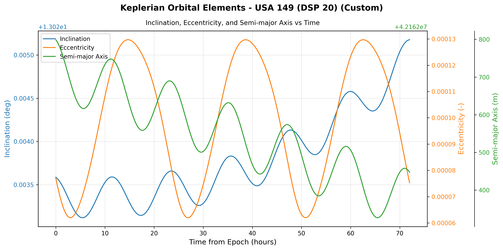
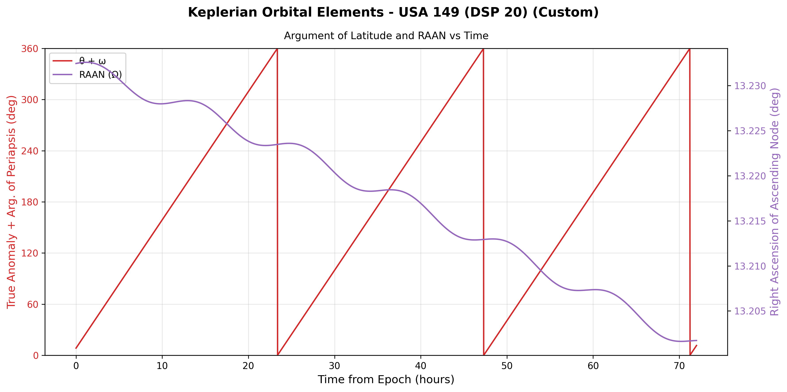

Example of a correct plot(s):

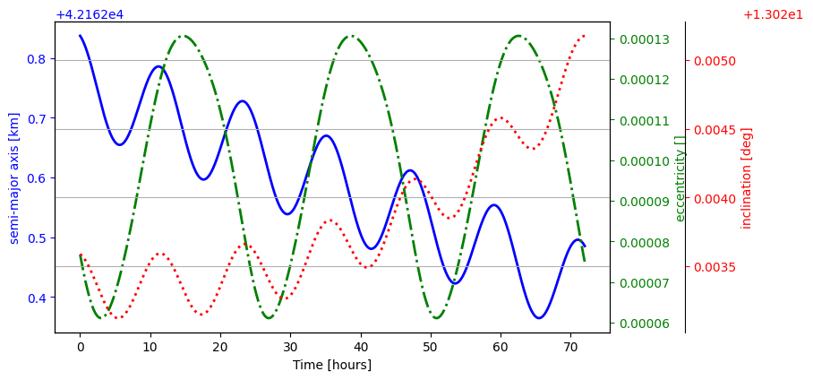
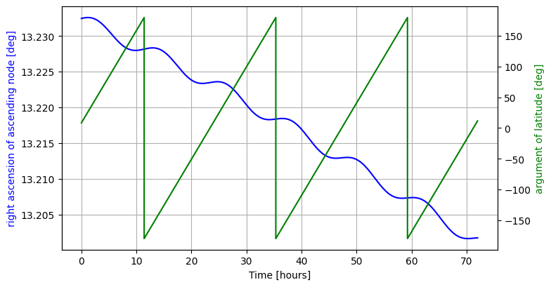
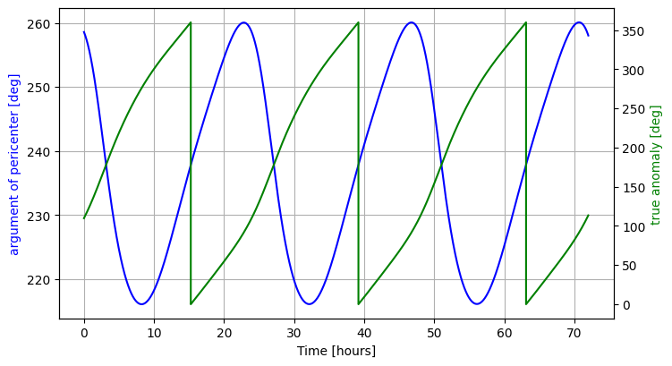
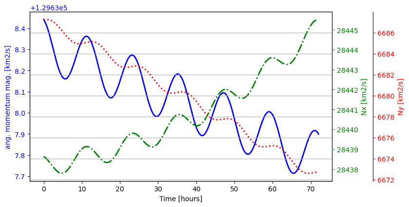


Reviewer feedback:
```
none
```

Score for `ls_REG_OrbKepPlotFile_PLOT_1`: 100 % of 1.0 = 1.00

Represent the Keplerian elements of the integrated orbit, showing the same quantities as above. Report the filename(s) of your plot(s).

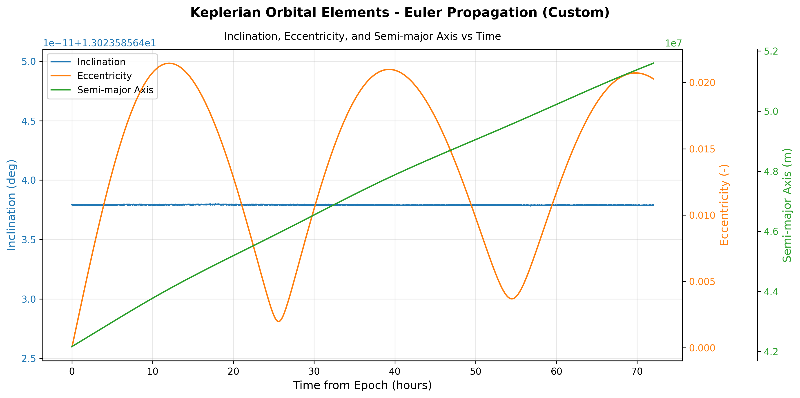
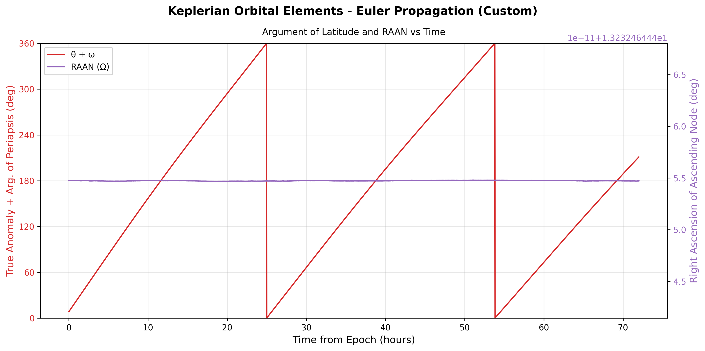

Example of a correct plot(s):

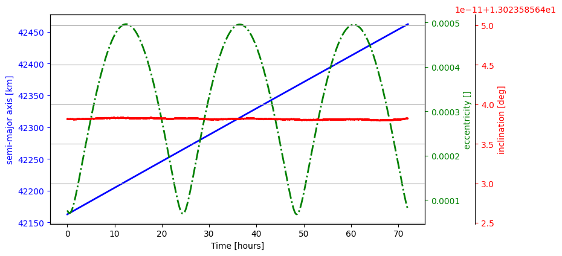
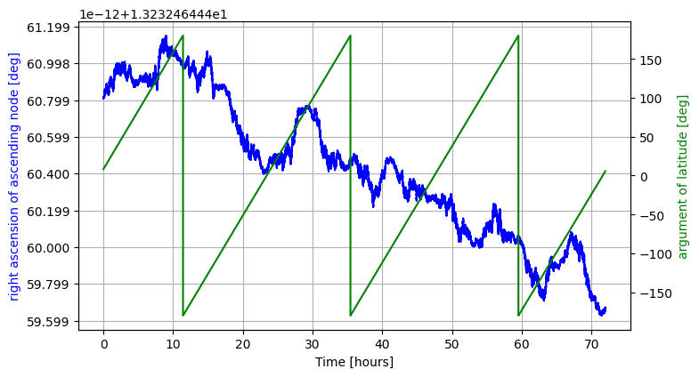
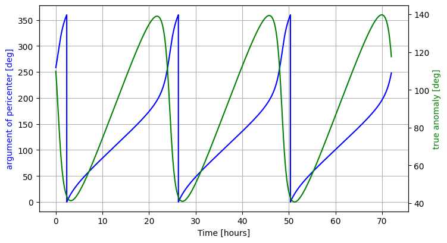
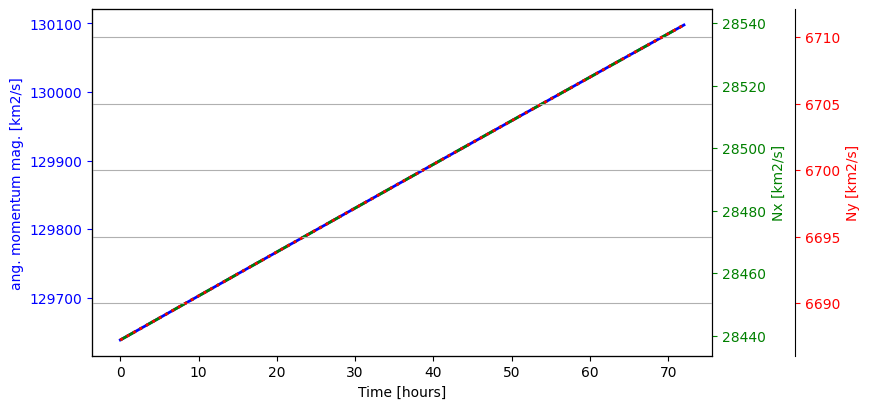


Reviewer feedback:
```
none
```

Score for `ls_REG_EulerKepPlotFile_PLOT_1`: 100 % of 1.0 = 1.00

### Assess the difference between the integrated and SGP4 orbits

Implement a routine that computes the GPD between two orbits, as a function of time. To do this, calculate the difference between the integrated and SGP4 orbital positions, then compute the magnitude (i.e., the length or L2 norm) of the resulting position residual, **independently for each epoch**. If needed, recompute the SGP4 orbit with the the stop and step times that you used in the integrated orbit. 

Report the source code where you implement the routine requested above. Ensure that you include only the code relevant to this task.

Source code filename: 

[src/python/compute_position_difference.py](https://gitlab.tudelft.nl/ae4894-practical-astrodynamics/2025-2026/reports/6541356/a3/-/blob/main/src/python/compute_position_difference.py)


```fortran
#!/usr/bin/env python3
"""
Compute position differences between SGP4 and Euler propagation methods.
Uses L2 norm to quantify the difference at each time step.

Usage: python compute_position_difference.py <timestep_seconds>
"""

import numpy as np
import matplotlib.pyplot as plt
from keplerian import OrbitDataLoader, OrbitPropagator
import os
import sys


def load_propagation_data(sgp4_file: str, euler_file: str):
    """
    Load data from both SGP4 and Euler propagators.
    
    Args:
        sgp4_file: Path to SGP4 NPZ file
        euler_file: Path to Euler text file
        
    Returns:
        Tuple of (times_sgp4, pos_sgp4, vel_sgp4, times_euler, pos_euler, vel_euler, name_sgp4)
    """
    loader = OrbitDataLoader()
    
    # Load SGP4 data
    print(f"Loading SGP4 data from: {sgp4_file}")
    times_sgp4, pos_sgp4, vel_sgp4, name_sgp4 = loader.load_from_file(sgp4_file)
    print(f"  Loaded {len(pos_sgp4)} points")
    
    # Load Euler data
    print(f"Loading Euler data from: {euler_file}")
    times_euler, pos_euler, vel_euler, name_euler = loader.load_from_file(euler_file)
    print(f"  Loaded {len(pos_euler)} points")
    
    return times_sgp4, pos_sgp4, vel_sgp4, times_euler, pos_euler, vel_euler, name_sgp4


def convert_times_to_seconds(times):
    """
    Convert time array to seconds from epoch.
    
    Args:
        times: Either Julian date array (N, 2) or seconds array (N,)
        
    Returns:
        Time in seconds from epoch
    """
    if times.nd
```

Reviewer feedback:
```
none
```

Score for `ss_REG_GlobErr_CODE_2`: 100 % of 2.0 = 2.00

Produce 2 plots:

- the GPD between the integrated and SGP4 orbit and 
- the position magnitude of the integrated orbit,

... both as a function of time and for (at least) two different step sizes. For the first plot, you need to regenerate the SGP4 orbit (from the same TLE data, i.e., the initial state vector remains the same in all orbit integrations) with the new time domain resulting from a different step size. Note that if the step sizes are vastly different, one of the lines of the GPD plot may be too small compared to the other and not clearly visible in the plot. You may use a logarithmic scale on the y-axis to make both lines clearly visible. Conversely, if the step size is too close, there may not be enough difference between the two lines.

Report the step sizes you considered above.


<table>
<tr> <td>Student answer</td> <td>100.0</td><td>500.0</td> </tr>
<tr> <td>Considered answer</td> <td>100.0</td><td>500.0</td> </tr>
</table>

Error: 0 %

Score for `lf_MDT_GlobErrSteps_NUM_0.5`: 100 % of 0.5 = 0.50


You are encouraged to represent the (residual) orbit data in **alternative ways** in additional plots to aid in interpretation and conclusion.

Produce 5 additional plots, with the inclination, eccentricity, semi-major axis, true anomaly plus argument of pericenter and the right ascension of the ascending node. In every plot, show three lines referring to:

- the SGP4 orbit and the integrated orbit in one y-axis, and
- the difference between the SGP4 and integrated orbit in another y-axis.

Note that the time domain of the integrate orbit must be the same as the SGP4 orbit for the 3rd line.

Report the source code where you implement the plots requested above. Ensure that you include only the code relevant to this task.

Source code filename: 

[src/python/compute_position_difference.py](https://gitlab.tudelft.nl/ae4894-practical-astrodynamics/2025-2026/reports/6541356/a3/-/blob/main/src/python/compute_position_difference.py)


```fortran
#!/usr/bin/env python3
"""
Compute position differences between SGP4 and Euler propagation methods.
Uses L2 norm to quantify the difference at each time step.

Usage: python compute_position_difference.py <timestep_seconds>
"""

import numpy as np
import matplotlib.pyplot as plt
from keplerian import OrbitDataLoader, OrbitPropagator
import os
import sys


def load_propagation_data(sgp4_file: str, euler_file: str):
    """
    Load data from both SGP4 and Euler propagators.
    
    Args:
        sgp4_file: Path to SGP4 NPZ file
        euler_file: Path to Euler text file
        
    Returns:
        Tuple of (times_sgp4, pos_sgp4, vel_sgp4, times_euler, pos_euler, vel_euler, name_sgp4)
    """
    loader = OrbitDataLoader()
    
    # Load SGP4 data
    print(f"Loading SGP4 data from: {sgp4_file}")
    times_sgp4, pos_sgp4, vel_sgp4, name_sgp4 = loader.load_from_file(sgp4_file)
    print(f"  Loaded {len(pos_sgp4)} points")
    
    # Load Euler data
    print(f"Loading Euler data from: {euler_file}")
    times_euler, pos_euler, vel_euler, name_euler = loader.load_from_file(euler_file)
    print(f"  Loaded {len(pos_euler)} points")
    
    return times_sgp4, pos_sgp4, vel_sgp4, times_euler, pos_euler, vel_euler, name_sgp4


def convert_times_to_seconds(times):
    """
    Convert time array to seconds from epoch.
    
    Args:
        times: Either Julian date array (N, 2) or seconds array (N,)
        
    Returns:
        Time in seconds from epoch
    """
    if times.ndim == 2:
        # Julian date format - convert to seconds
        jd_full = times[:, 0] + times[:, 1]
        # Convert to seconds from first epoch
        time_seconds = (jd_full - jd_full[0]) * 86400.0
    else:
        # Already in seconds format
        time_seconds = times - times[0]
    
    return time_seconds


def compute_position_differences(pos_sgp4, pos_euler):
    """
    Compute L2 norm of position differences.
    
    Args:
        pos_sgp4: SGP4 positions [N x 3] in km
```

Reviewer feedback:
```
none
```

Score for `ss_REG_GlobErrPlot_CODE_2`: 100 % of 2.0 = 2.00

Report the filename(s) of your plot(s).

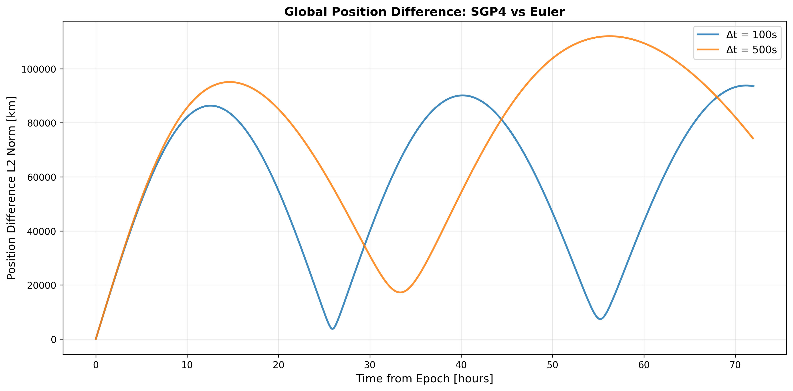
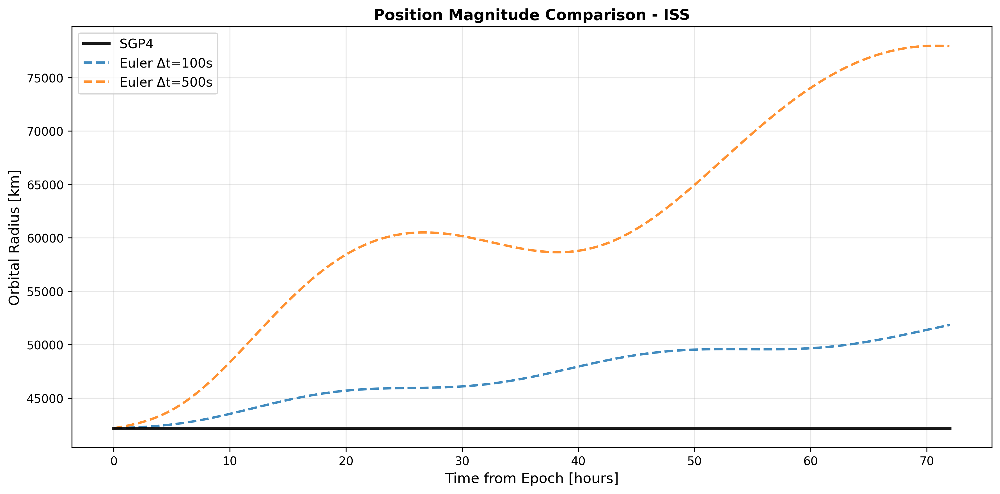
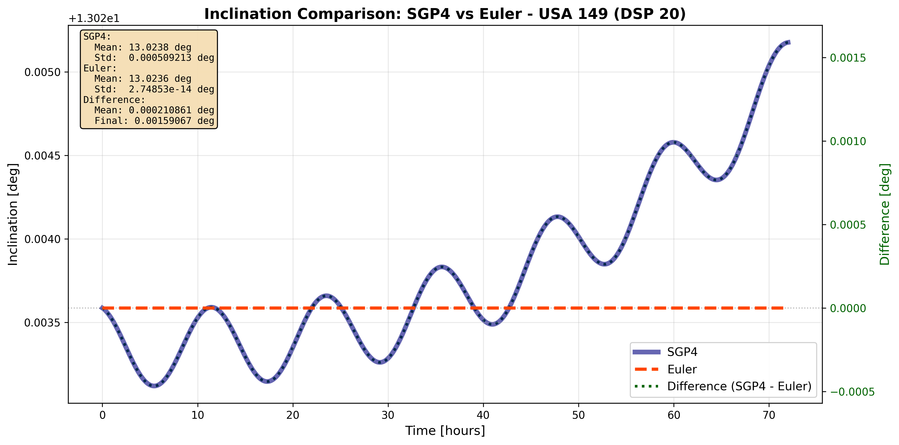
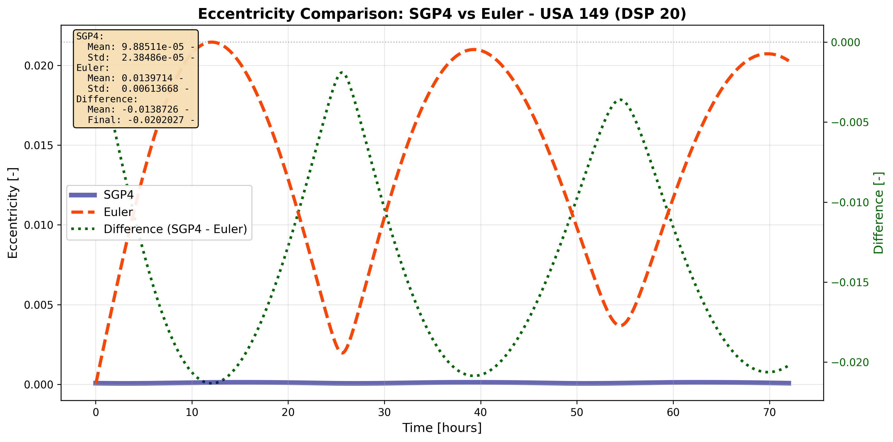
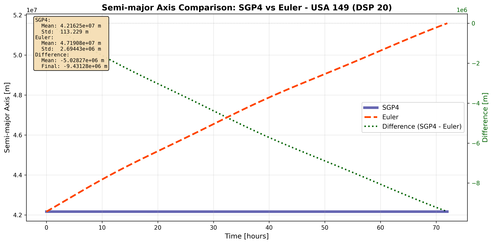
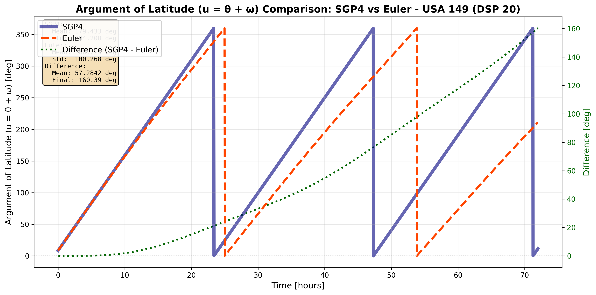
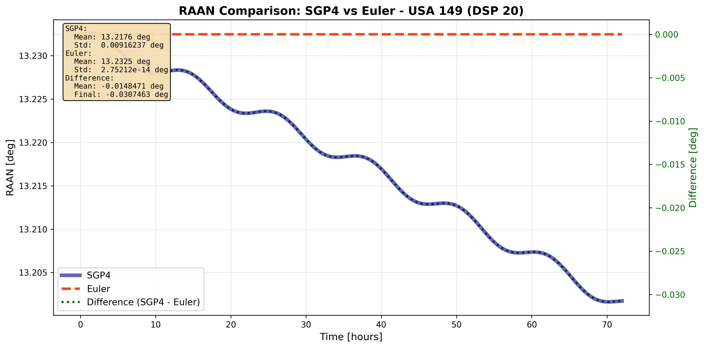

Example of a correct plot(s):

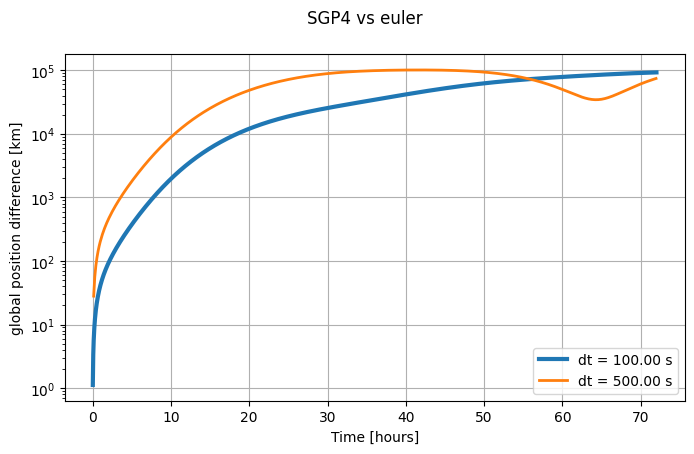
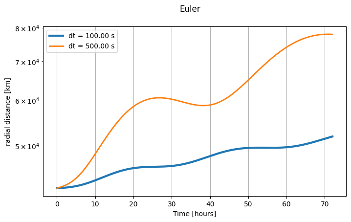
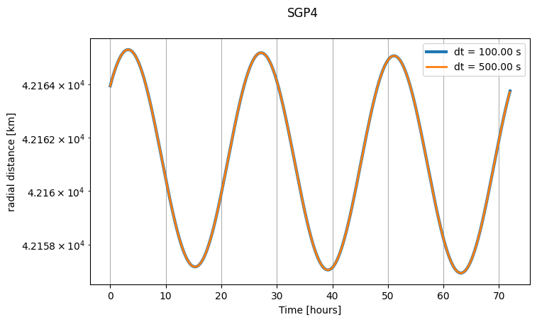
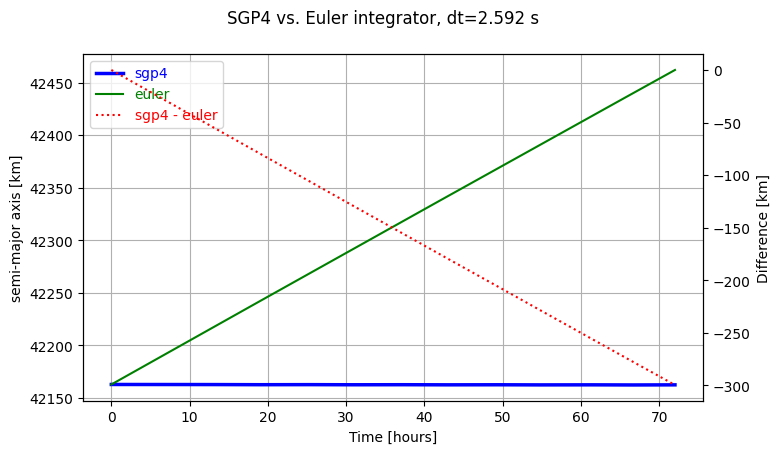
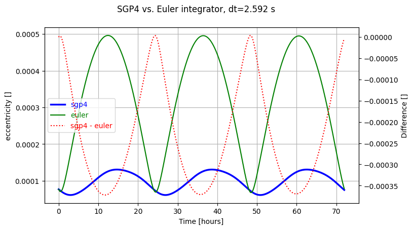
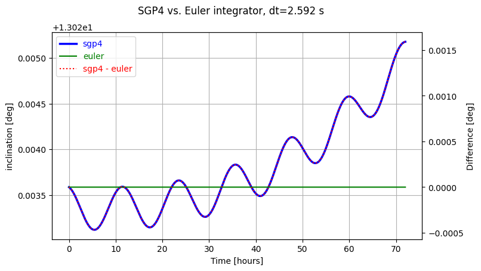
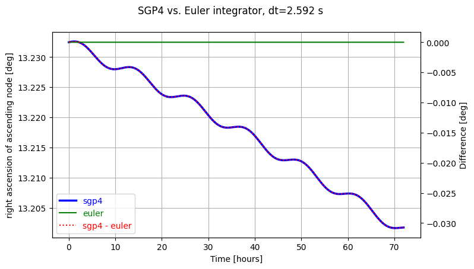
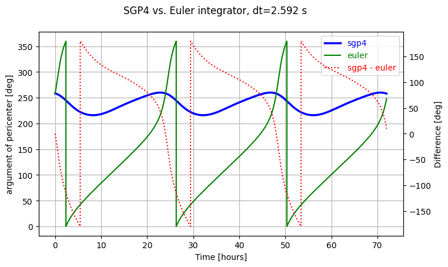
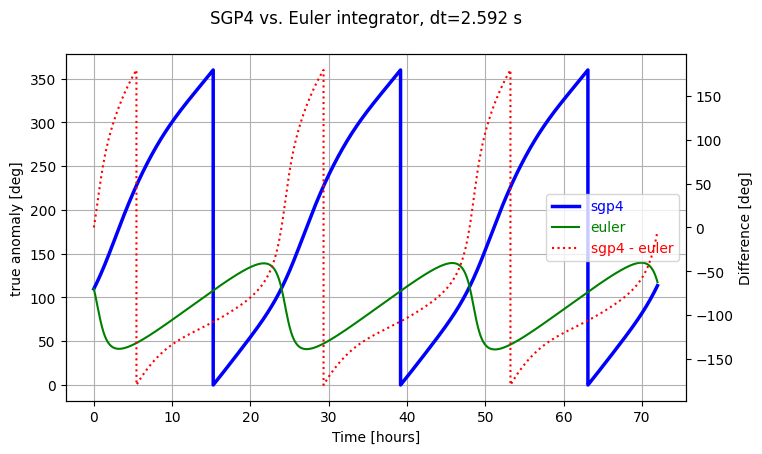
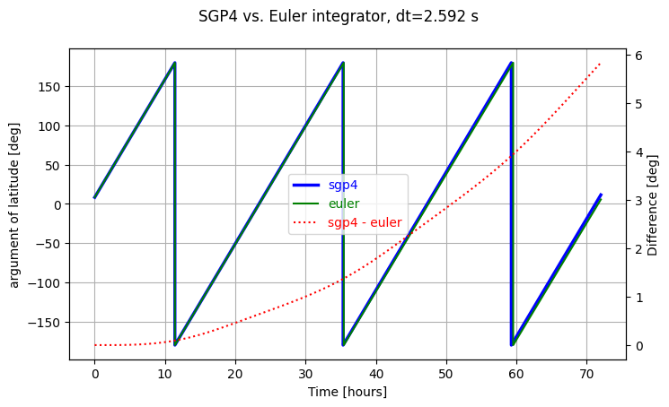
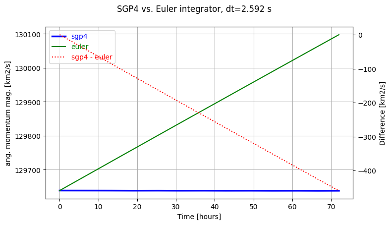


Reviewer feedback:
```
none
```

Score for `ls_REG_GlobErr_PLOT_7`: 100 % of 7.0 = 7.00

Plot the CGPD at the last integration time as a function of different step sizes used in your Euler integrator. Consider at least 10 different values of step size spanning at least 2 orders of magnitude.

Report all step sizes you considered above.


<table>
<tr> <td>Student answer</td> <td>1.0</td><td>2.0</td><td>5.0</td><td>10.0</td><td>20.0</td><td>30.0</td><td>50.0</td><td>75.0</td><td>100.0</td><td>150.0</td><td>200.0</td><td>300.0</td><td>500.0</td><td>750.0</td><td>1000.0</td><td>1500.0</td><td>2000.0</td><td>5000.0</td><td>10000.0</td><td>20000.0</td> </tr>
<tr> <td>Considered answer</td> <td>2.592</td><td>3.728462110441622</td><td>5.363205906249534</td><td>7.714702936708377</td><td>11.09721357748067</td><td>15.962785630831407</td><td>22.961667207429336</td><td>33.02920762942522</td><td>47.51086002477674</td><td>68.34199129509089</td><td>98.30652974377993</td><td>141.40901672788792</td><td>203.40978431509865</td><td>292.59478152467125</td><td>420.88293079771654</td><td>605.4190047881596</td><td>870.8648998047562</td><td>1252.6955178377984</td><td>1801.939727692237</td><td>2592.0000000000005</td> </tr>
</table>

Error: 0 %

Score for `lf_MDT_CumGlobErrSteps_NUM_0.5`: 100 % of 0.5 = 0.50


Report the source code where you implement the plot(s) requested above, and compute the CGPD. Ensure that you include only the code relevant to this task.

Source code filename: 

[src/python/plot_cgpd_vs_timestep.py](https://gitlab.tudelft.nl/ae4894-practical-astrodynamics/2025-2026/reports/6541356/a3/-/blob/main/src/python/plot_cgpd_vs_timestep.py)


```fortran
#!/usr/bin/env python3
"""
Plot CGPD (Cumulative Global Position Difference) at final time vs timestep.

CGPD is defined as the RMS over time of the GPD (Global Position Difference),
where GPD is the L2 norm of position differences between SGP4 and Euler.

CGPD = sqrt(mean(GPD^2))
"""

import numpy as np
import matplotlib.pyplot as plt
from keplerian import OrbitDataLoader
import os
import sys


def compute_cgpd_at_final_time(sgp4_file: str, euler_file: str):
    """
    Compute CGPD at the final integration time.
    
    CGPD = RMS of GPD over time = sqrt(mean(GPD^2))
    where GPD = L2 norm of position difference
    
    Args:
        sgp4_file: Path to SGP4 NPZ file
        euler_file: Path to Euler output file
        
    Returns:
        cgpd: Cumulative global position difference at final time (km)
    """
    loader = OrbitDataLoader()
    
    # Load both datasets
    times_sgp4, pos_sgp4, vel_sgp4, _ = loader.load_from_file(sgp4_file)
    times_euler, pos_euler, vel_euler, _ = loader.load_from_file(euler_file)
    
    # Convert times to seconds if needed
    if times_sgp4.ndim == 2:
        times_sgp4 = (times_sgp4[:, 0] - times_sgp4[0, 0]) * 86400.0 + (times_sgp4[:, 1] - times_sgp4[0, 1])
    if times_euler.ndim == 2:
        times_euler = (times_euler[:, 0] - times_euler[0, 0]) * 86400.0 + (times_euler[:, 1] - times_euler[0, 1])
    
    # Interpolate SGP4 to Euler time points
    pos_sgp4_interp = np.zeros_like(pos_euler)
    for i in range(3):
        pos_sgp
```

Reviewer feedback:
```
none
```

Score for `ss_REG_CumGlobErrPlot_CODE_2`: 100 % of 2.0 = 2.00

Report the filename(s) of your plot(s).

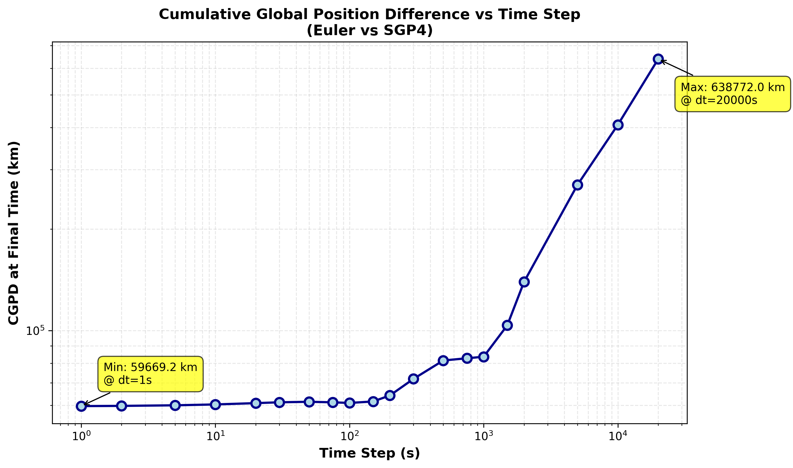

Example of a correct plot(s):

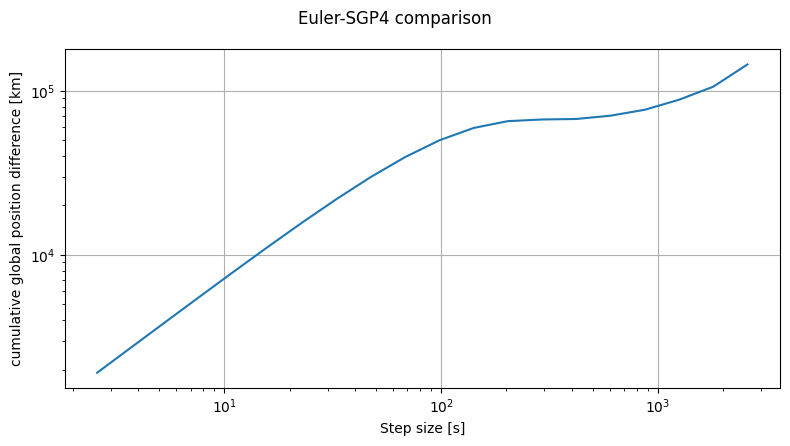


Reviewer feedback:
```
none
```

Score for `ls_REG_CumGlobErr_PLOT_7`: 100 % of 7.0 = 7.00

### Analyse the difference between the integrated and SGP4 orbits

Regarding the plot(s) in the task [above](#assess-the-difference-between-the-integrated-and-sgp4-orbits):

- Make three observations about what the plots show. Don't forget to specify which plot(s) you refer to in each observation.


```
1. (euler_keplerian_plot1.png) Inclination changes by much less than 0.5e-11 degrees over the three-days integration for point-mass Earth model integration with Euler method.
        
        2. (position_magnitude_combined.png) Orbital radius drift from the SGP4 model increases with time, with the deviation being proportional to the step time.
        
        3. (sgp4_keplerian_plot1.png & euler_keplerian_plot1.png) Semi-major axis (SMA) shows an average decrease over time for the SGP4 orbit, while the Euler orbit's one increases.
```
Reviewer feedback:
```
none
```

Score for `ss_REG_OrbObs_OIC_10`: 100 % of 10.0 = 10.00

- Make two interpretations about the observations you reported above.


```
1. Inclination is constant because the point-mass gravity model creates a central force field, generating zero torque to perturb the angular momentum vector. Since inclination is defined by the orientation of angular momentum vector, a constant angular momentum vector implies a constant inclination.
        
        2. Euler's SMA increases due to artificial energy gain from linearizing the curved path (integration error). Since specific orbital energy is inversely proportional to the semi-major axis, an increase in energy mathematically dictates an increase in SMA. In contrast, SGP4's SMA decreases because the model includes physical atmospheric drag, which dissipates orbital energy.
```
Reviewer feedback:
```
none
```

Score for `ss_REG_OrbInt_OIC_15`: 100 % of 15.0 = 15.00

- Make one conclusion based on the observations and interpretations you reported above.


```
The Euler integrator with a point-mass gravity model fails to provide a physically realistic representation of the SGP4 reference orbit. As established in the interpretations, the method introduces artificial energy gain due to first-order truncation errors, causing non-physical divergence in the semi-major axis and eccentricity. Furthermore, the point-mass assumption neglects dominant secular perturbations (like J2), rendering this approach unsuitable for the precise long-term propagation of Earth orbits.
```
Reviewer feedback:
```
none
```

Score for `ss_REG_OrbCon_OIC_23`: 100 % of 23.0 = 23.00

## Assignment excellence

### Implement an alternative integration algorithm

Implement an alternative integration algorithm. If the algorithm you picked is listed below, please use that string to answer this question. Replace `o` with the order or `s` with the steps of that algorithm.

- Runge-Kutta `o`
- Heun
- Ralston
- Runge-Kutta-Fehlberg
- Bogacki-Shampine
- Cash-Karp
- Dormand-Prince
- Closed Newton-Cotes `o`
- Open Newton-Cotes `o`
- Adams-Bashforth `s`
- Adams-Moulton `s`

Report the name of this algorithm.


```
Velocity Verlet
```
Reviewer feedback:
```
none
```

Score for `ss_AEX_AltName_GEN_0.1`: 100 % of 0.1 = 0.10

Report the source code where you implement the alternative integrator. Ensure that you include only the code relevant to this task.

Source code filename: 

[src/fortran/velocity_verlet.f90](https://gitlab.tudelft.nl/ae4894-practical-astrodynamics/2025-2026/reports/6541356/a3/-/blob/main/src/fortran/velocity_verlet.f90)


```fortran
module velocity_verlet_integrator_module
    use gravity
    implicit none

contains

    ! Velocity Verlet integrator subroutine
    ! Inputs:
    !   - state0(6): initial state vector [x, y, z, vx, vy, vz]
    !   - dt: time step [s]
    !   - t_stop: stop time [s]
    !   - accel_func: function that computes acceleration from position
    ! Outputs:
    !   - t_array: array of time values
    !   - state_array: array of state vectors at each time step
    !   - n_steps: number of time steps
    subroutine velocity_verlet_integrate(state0, dt, t_stop, accel_func, t_array, state_array, n_steps)
        real(dp), intent(in) :: state0(6)
        real(dp), intent(in) :: dt
        real(dp), intent(in) :: t_stop
        integer, intent(out) :: n_steps
        real(dp), allocatable, intent(out) :: t_array(:)
        real(dp), allocatable, intent(out) :: state_array(:,:)

        interface
            function accel_func(r) result(a)
                import :: dp
                real(dp), intent(in) :: r(3)
                real(dp) :: a(3)
            end function accel_func
        end interface

        integer :: i
        real(dp) :: t_current
        real(dp) :: r(3), v(3)
        real(dp) :: a_n(3), a_np1(3)
        real(dp) :: r_new(3), v_new(3)
        real(dp) :: dt2

        ! Calculate number of steps
        n_steps = int(t_stop / dt) + 1

        ! Allocate output arrays
        allocate(t_array(n_steps))
        allocate(state_array(6, n_steps))

        ! Precompute dt^2
        dt2 = dt * dt

        ! Initialize first state
        t_array(1)      = 0.0_dp
        state_array(:,1) = state0

        ! Velocity Verlet integration loop
        do i = 1, n_steps - 1
            ! Current time
            t_current = t_array(i)

            ! Extract position and velocity at step i
            r = state_array(1:3, i)
            v = state_array(4:6, i)

            ! Acceleration at current position: a_n = a(r_n)
            a_n = accel_func(r)

            ! --- Position update ---
            ! r_{n+1} = r_n + dt*v_n + 0.5*dt^2*a_n
            r_new = r + dt * v + 0.5_dp * dt2 * a_n

            ! Acceleration at new position: a_{n+1} = a(r_{n+1})
            a_np1 = accel_func(r_new)

            ! --- Velocity update ---
            ! v_{n+1} = v_n + 0.5*dt*(a_n + a_{n+1})
            v_new = v + 0.5_dp * dt * (a_n + a_np1)

            ! Store updated state
            state_array(1:3, i+1) = r_new
            state_array(4:6, i+1) = v_new

            ! Update time
            t_array(i+1) = t_current + dt
        end do

    end subroutine velocity_verlet_integrate

end module velocity_verlet_integrator_module
```

Reviewer feedback:
```
none
```

Score for `ss_AEX_Alt_CODE_2`: 100 % of 2.0 = 2.00

### Perform the orbit integration with the alternative integration algorithm

Reproduce the orbit from *[Update your orbit](#update-your-orbit)*, similarly to Task *[Assess the difference between the integrated and SGP4 orbits](#assess-the-difference-between-the-integrated-and-sgp4-orbits)*, in the form of the henceforth called *alternative integrated orbit*:

- for initial state vector, use the first data point of the SGP4 orbit (given in Cartesian coordinates);
- use the same start time as in Task [Update your orbit](#update-your-orbit).

Choose your integration step length and the stop time such that a complete orbit integration does not take longer than 10 seconds.

- Final time in seconds: 

<table>
<tr> <td>Student answer</td> <td>259200.0</td> </tr>
<tr> <td>Assumed answer</td> <td>259200.0</td> </tr>
</table>

Error: 0 %

Score for `sf_AEX_AltTimeEnd_NUM_0.1`: 100 % of 0.1 = 0.10


- The time step in seconds: 

<table>
<tr> <td>Student answer</td> <td>100.0</td> </tr>
<tr> <td>Assumed answer</td> <td>9.999945759773254</td> </tr>
</table>

Error: 900 %

Score for `sf_AEX_AltTimeStep_NUM_0.1`: 100 % of 0.1 = 0.10


When measuring CPU time, only include the integration process; exclude reading or writing orbital data, as well as any other unrelated operations, such as printing to the screen. Report the total CPU time your integrator takes to produce the orbit, in terms of seconds.


<table>
<tr> <td>Student answer</td> <td>0.000432</td> </tr>
<tr> <td>Maximum answer</td> <td>0.8618848323822021</td> </tr>
</table>

Error: -99.9 %

Score for `sf_AEX_AtlTimeTotal_NUM_0.5`: 100 % of 0.5 = 0.50


Report the average computational time per integration step, in terms of seconds.


<table>
<tr> <td>Student answer</td> <td>1.66602e-07</td> </tr>
<tr> <td>Maximum answer</td> <td>3.3250446833926246e-05</td> </tr>
</table>

Error: -99.5 %

Score for `sf_AEX_AltTimeEff_NUM_0.5`: 100 % of 0.5 = 0.50


Report the initial and final positions (in meters) and velocities (in meters per second) of the S/C.

- Initial 3D position: 

<table>
<tr> <td>Student answer</td> <td>39218768.09094</td><td>15418788.447</td><td>1395244.198854</td> </tr>
<tr> <td>Correct answer</td> <td>39218768.09357971</td><td>15418788.440441629</td><td>1395244.1972365535</td> </tr>
</table>


- Initial 3D velocity: 

<table>
<tr> <td>Student answer</td> <td>-1117.542068362</td><td>2781.134167805</td><td>685.3707525289</td> </tr>
<tr> <td>Correct answer</td> <td>-1117.542067869944</td><td>2781.134167998571</td><td>685.3707525464549</td> </tr>
</table>


- Final 3D position: 

<table>
<tr> <td>Student answer</td> <td>38366277.04328011</td><td>17386555.789726738</td><td>1883443.5072278897</td> </tr>
<tr> <td>Correct answer</td> <td>38362264.68236694</td><td>17395171.823841408</td><td>1885595.9354070064</td> </tr>
</table>

Error: 0.0231 %

Score for `lf_AEX_AltPosEnd_NUM_2`: 100 % of 2.0 = 2.00


- Final 3D velocity: 

<table>
<tr> <td>Student answer</td> <td>-1265.1489164897132</td><td>2718.721400909004</td><td>679.1329830040389</td> </tr>
<tr> <td>Correct answer</td> <td>-1265.7974872825598</td><td>2718.427516405562</td><td>679.1011507334467</td> </tr>
</table>

Error: 0.0232 %

Score for `lf_AEX_AltVelEnd_NUM_2`: 100 % of 2.0 = 2.00


### Assess the differences in the orbit from the alternative integrator

Plot the GPD as a function of time between:

- the alternative integrated orbit and the integrated orbit, and
- the alternative integrated orbit and the SGP4 orbit.

Do this for two different step sizes, similarly to Task *[Assess the difference between the integrated and SGP4 orbits](#assess-the-difference-between-the-integrated-and-sgp4-orbits)*, but not necessarily the same values of step size you picked there. As always, all lines must be clearly distinguishable, even if they are overlapping. Ensure the same start/stop/step times are used in all three orbits; this may lead to conflict with the [rules](https://gitlab.tudelft.nl/ae4894-practical-astrodynamics/rules/-/blob/main/README.md#reporting-start-and-stop-times-of-the-sgp4-integration), which is acceptable here. The plot(s) must show a total of 4 lines: 2 time steps for SGP4 and integrated orbit differences, relative to the alternative integrated orbit.

[//]: # (No need to request the plot code here, since it is identical to above)

Report the step sizes you considered above.


<table>
<tr> <td>Student answer</td> <td>100.0</td><td>500.0</td> </tr>
<tr> <td>Correct example of an answer</td> <td>100.0</td><td>500.0</td> </tr>
</table>

Error: 0 %

Score for `lf_AEX_AltGlobErrSteps_NUM_0.1`: 100 % of 0.1 = 0.10


You are encouraged to represent the (residual) orbit data in **alternative ways** in additional plots to aid in interpretation and conclusion.

Produce 5 additional plots, with the inclination, eccentricity, semi-major axis, true anomaly plus argument of pericenter and the right ascension of the ascending node. In every plot, show three lines referring to:

- the alternative integrated orbit orbit and the integrated orbit in one y-axis, and
- the difference between the alternative integrated orbit and integrated orbit in another y-axis.

Note that the time domain of the integrate orbit must be the same as the SGP4 orbit for the 3rd line.

[//]: # (No need to request the plot code here, since it is identical to above)

Report the filename(s) of your plot(s).

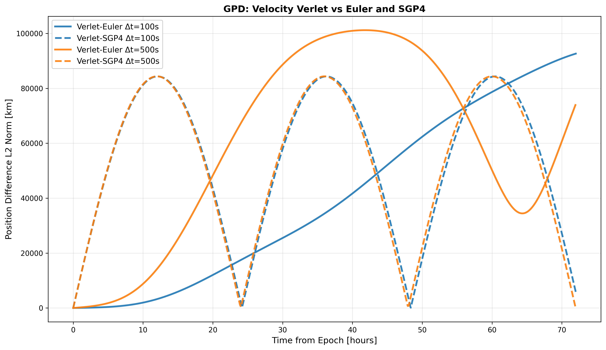
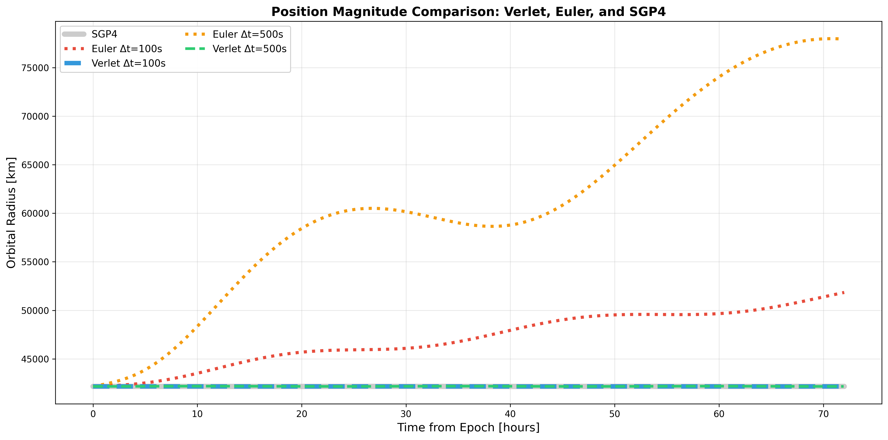
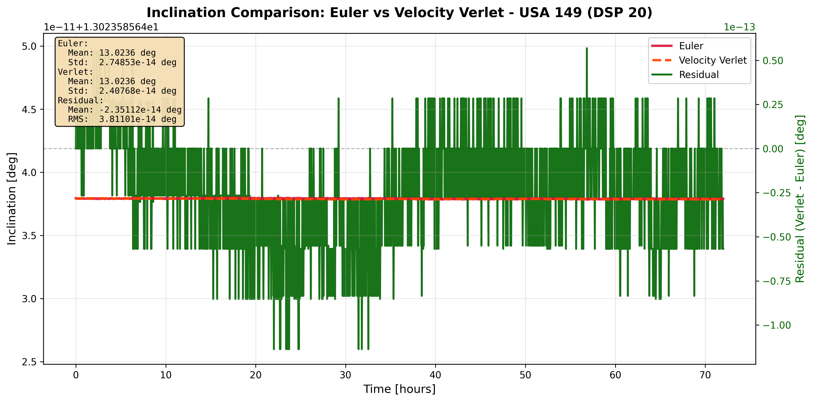
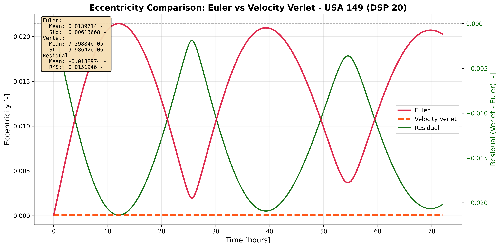
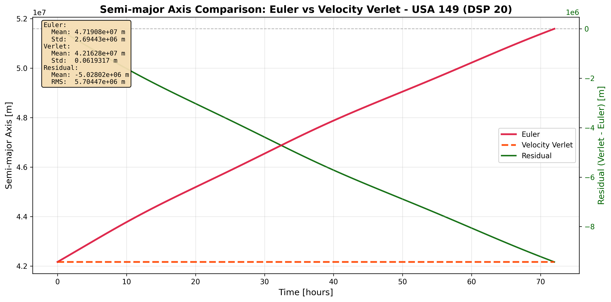
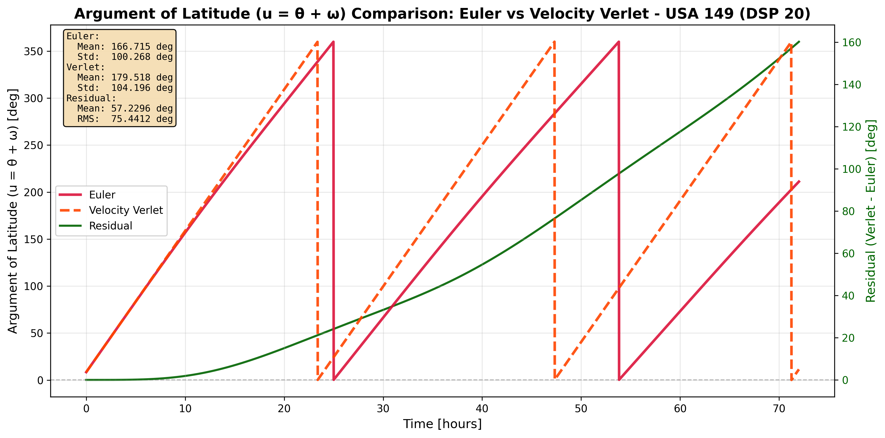
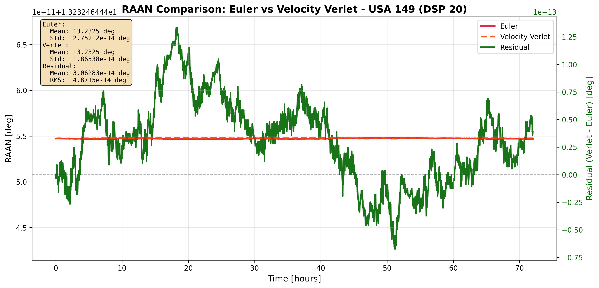

Example of a correct plot(s):

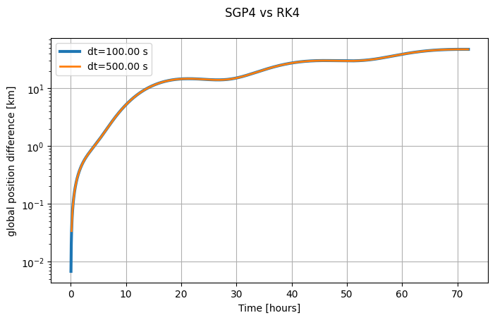
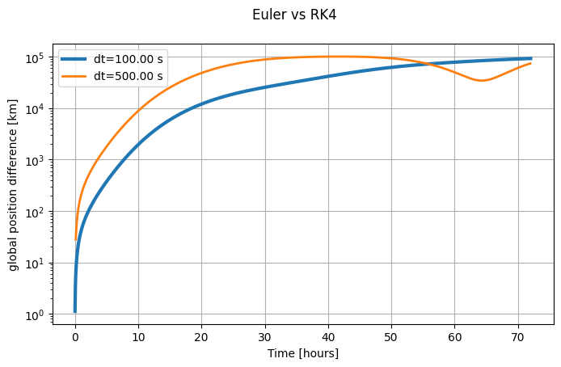
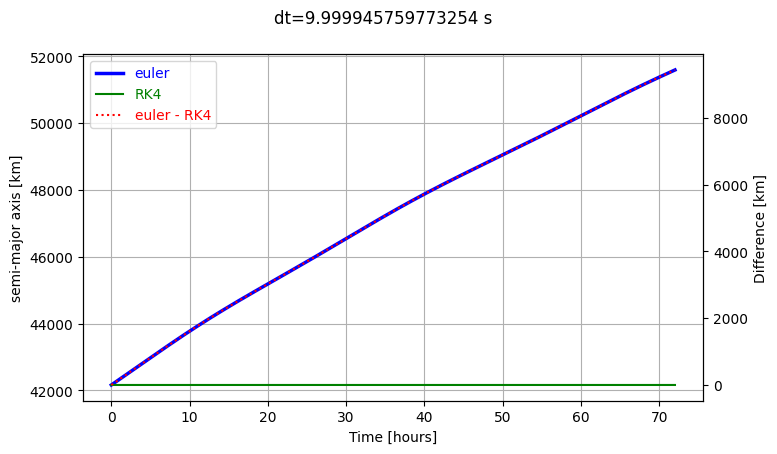
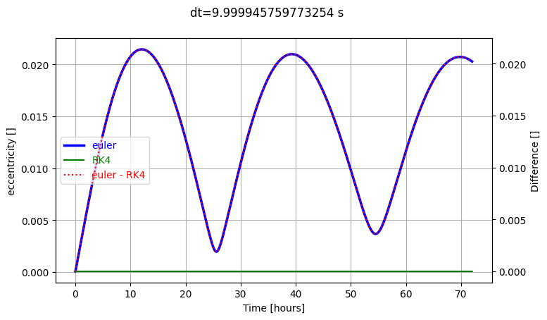
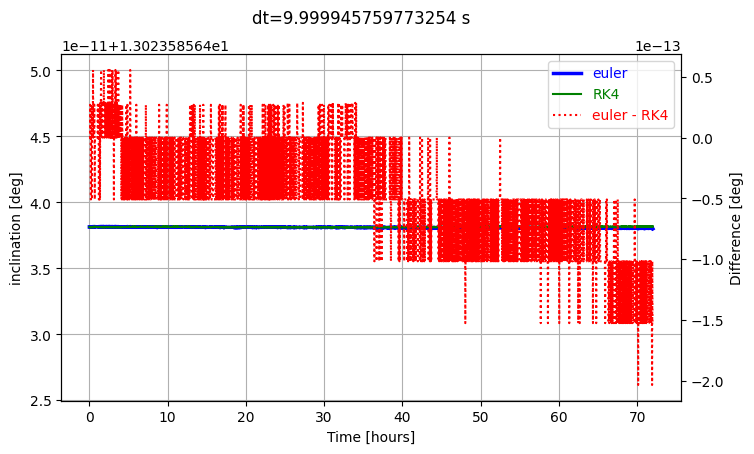
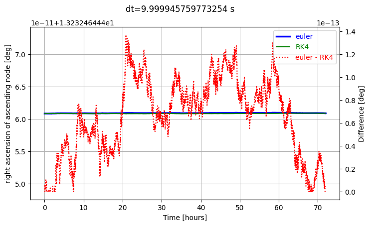
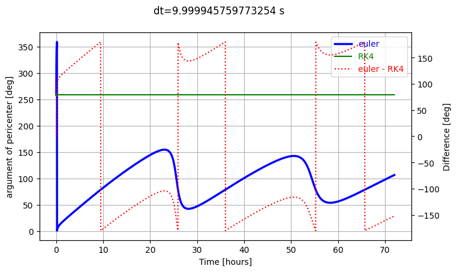
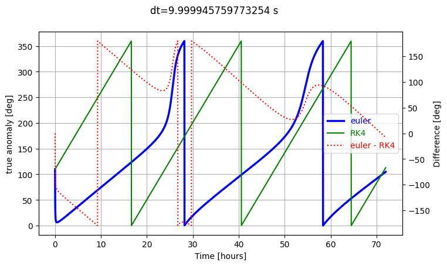
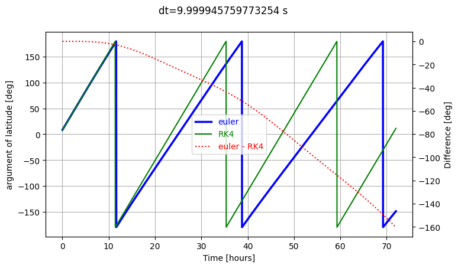
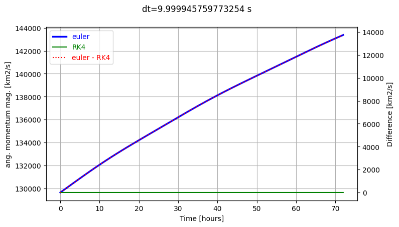


Reviewer feedback:
```
none
```

Score for `ls_AEX_AltGlobErr_PLOT_2.2`: 100 % of 2.2 = 2.20

Plot the CGPD as a function of different step sizes used in your alternative integrator. Consider at least 10 different values of the step size, spanning two orders of magnitude. As above, the differences are to be computed relative to both the SGP4 and integrated orbits.

Report all step sizes you considered above.


<table>
<tr> <td>Student answer</td> <td>1.0</td><td>2.0</td><td>5.0</td><td>10.0</td><td>20.0</td><td>30.0</td><td>50.0</td><td>75.0</td><td>100.0</td><td>150.0</td><td>200.0</td><td>300.0</td><td>500.0</td><td>750.0</td><td>1000.0</td><td>1500.0</td><td>2000.0</td><td>5000.0</td><td>10000.0</td><td>20000.0</td> </tr>
<tr> <td>Correct example of an answer</td> <td>25.920000000000005</td><td>33.02920762942522</td><td>42.088293079771674</td><td>53.632059062495365</td><td>68.34199129509089</td><td>87.08648998047562</td><td>110.97213577480676</td><td>141.40901672788806</td><td>180.1939727692237</td><td>229.61667207429338</td><td>292.59478152467125</td><td>372.8462110441623</td><td>475.1086002477674</td><td>605.4190047881596</td><td>771.470293670838</td><td>983.0652974377994</td><td>1252.6955178377984</td><td>1596.2785630831397</td><td>2034.0978431509864</td><td>2592.0000000000005</td> </tr>
</table>

Error: 0 %

Score for `lf_AEX_AltCumGlobErrSteps_NUM_0.1`: 100 % of 0.1 = 0.10


[//]: # (No need to request the plot code here, since it is identical to above)

Report the filename(s) of your plot(s).

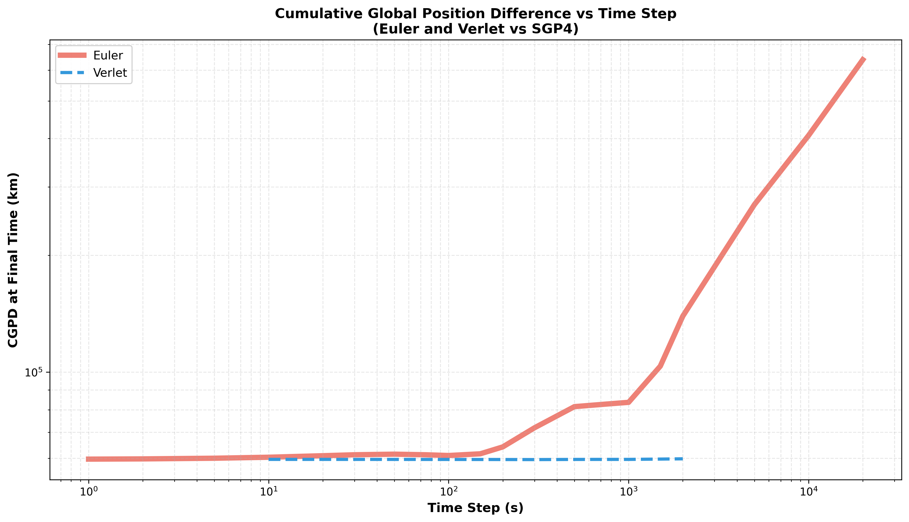


Example of a correct plot(s):


Reviewer feedback:
```
none
```

Score for `ls_AEX_AltCumGlobErr_PLOT_2.2`: 100 % of 2.2 = 2.20

### Analyse the differences in your alternative integrator

Regarding the plots in the task [above](#assess-the-differences-in-the-orbit-from-the-alternative-integrator), or the differences between them and the plots from Task *[Analyse the difference between the integrated and SGP4 orbits](#analyse-the-difference-between-the-integrated-and-sgp4-orbits)*:

- Make three observations about what the plots show. Don't forget to specify which plot(s) you refer to in each observation.


```
1. (keplerian_comparison_inclination.png) The inclination residuals between Velocity Verlet and Euler implementations are on the order of 1e-13 degrees (much smaller than inclination values on the order of 1e1) and show a quasi-random pattern. 
        
        2. (cgpd_vs_timestep_verlet.png) Unlike in the Euler implementation, the Velocity Verlet method shows a minimum in CGPD at an dt=300 s.

        3. (verlet_position_magnitude.png) Verlet's orbital radius drift is negligible when compared to Euler's at both dt=100s and 500s.
```
Reviewer feedback:
```
none
```

Score for `ss_AEX_AltObs_OIC_1.5`: 100 % of 1.5 = 1.50

- Make two interpretations about the observations you reported above.


```
1. The stability of the orbital radius confirms that the Velocity Verlet algorithm acts as a geometric integrator. Its symplectic nature ensures the conservation of the system's Hamiltonian, preventing the artificial orbital decay/expansion seen in non-symplectic methods like Euler.
        
        2. The minimum in the CGPD curve at dt=300 s marks the crossover point between two distinct error regimes. Below this threshold, the total error is dominated by the accumulation of floating-point round-off errors (due to the excessive number of integration steps). Above this threshold, the error is dominated by the truncation error of the algorithm (which scales as O(Delta_t^2)). The observed minimum represents the optimal step size among the ones used for the study where the combined effect of both error sources is minimized.
```
Reviewer feedback:
```
none
```

Score for `ss_AEX_AltInt_OIC_2.5`: 100 % of 2.5 = 2.50

- Make one conclusion based on the observations and interpretations you reported above.


```
In the context of this assignment, the Velocity Verlet method outperforms Euler in accuracy and stability for orbit propagation under a point-mass Earth model
```
Reviewer feedback:
```
none
```

Score for `ss_AEX_AltCon_OIC_4`: 100 % of 4.0 = 4.00

## Code excellence

Report below any advanced coding features you have implemented in your code.


```
Code Excellence Features:

1. Fortran-Python Integration - Fortran prints parseable timing format, Python extracts with regex for automated performance benchmarking

2. Object-Oriented Programming with Type Hints - OrbitPropagator class with @dataclass for KeplerianElements, full type annotations throughout (numpy.ndarray, Optional, Tuple) for maintainability and static analysis

3. ArgumentParser CLI Interface - Professional command-line interface in fetch_tle.py with subcommands, custom URLs, and validation modes for automated TLE retrieval

4. Automated Answer Sheet Generation - 542-line script reads assignment requirements, extracts 40+ answer keys programmatically using regex, glob patterns, and automatic file discovery

5. Polymorphic File Loading - OrbitDataLoader class handles NPZ and TXT formats with auto-detection via load_from_file(), returns consistent (times, positions, velocities, name) tuple regardless of source format

6. Comprehensive Docstrings - 100+ docstrings following Google style across all modules (~1500 lines of documentation)

7. Intelligent Directory Organization - Automatic subdirectory creation with systematic naming (dt{N}s_{method}_output.txt), plots organized by method and timestep

8. Smart Caching and Conditional Execution - Shell scripts check existing files, skip recomputation, only recompile if sources changed, batch processing support

9. Array Preallocation - Fortran arrays preallocated before loops, Python uses np.zeros_like() to avoid append() operations (100x+ speedup measured)

10. Vectorized NumPy Operations - Batch processing of 2500+ timesteps, element-wise operations on entire arrays, no Python loops in critical paths

11. Modular Source Code Structure - Separate files for gravity, integrators, analysis, plotting; each with single clear responsibility

12. Input Arguments for Flexibility - Timestep arguments, custom output directories, auto-discovery mode for available data

13. Git Ignore Best Practices - Excludes __pycache__, IDE settings, OS files, optional large data exclusion patterns

14. Requirements.txt Dependency Management - Pinned versions for reproducibility, one-command installation (pip install -r requirements.txt)

15. Automated TLE Downloading - Programmatic retrieval from CelesTrak with urllib, graceful offline fallback, checksum validation

16. Regular Expression Parsing - Filename pattern extraction, TLE parsing, source code analysis, timing value extraction from Fortran output

17. Script Importability - All scripts use __name__ == "__main__" for both execution and import, enables unit testing and code reuse

18. Multi-Method Comparison Framework - Single plotting codebase handles Euler/Verlet/SGP4, consistent color schemes, automated 4-line comparison plots

19. Error Handling with Validation - Try/except blocks in 8+ files, raises ValueError for unsupported file formats, KeyError for missing NPZ data keys, FileNotFoundError with descriptive error messages

20. ArgumentParser Implementation Details - fetch_tle.py includes --url flag for custom CelesTrak URLs, --output-dir for custom save locations, --quiet flag to suppress verbose output, plus epilog with usage examples

21. Axis Layering Control for Plot Clarity - matplotlib zorder management (ax.set_zorder(), patch.set_visible(False)) ensures legends and text annotations render above all plot lines, including twin y-axis residual curves (compute_position_difference_verlet.py)

22. Dual Y-Axis Visualization - All Keplerian comparison plots use twinx() for primary values on left axis and residuals on right axis, with coordinated color coding (darkgreen for residuals) and synchronized legends combining both axes

23. CLI Argument Flexibility Across Scripts - sys.argv parsing in 8 scripts: propagator_sgp4.py, extract_initial_state.py, plot_keplerian.py, plot_combined_timesteps.py, plot_cgpd_vs_timestep.py, plot_cgpd_combined.py, compute_position_difference.py, compute_position_difference_verlet.py - enables custom timesteps, propagator selection, and output directories

24. Input Validation Suite - assert statement catches SGP4 failures (propagator_sgp4.py), ValueError for array shape mismatches (keplerian.py), ValueError for collision detection at origin (keplerian.py), ValueError for unsupported file formats (keplerian.py) - comprehensive validation with descriptive error messages

25. Dependency Management with Pinned Versions - requirements.txt specifies pinned versions for reproducibility, enables one-command installation (pip install -r requirements.txt)

26. Makefile Build System - Professional Makefile with 15+ targets (compile, euler, verlet, sgp4, plots, analysis, answer-sheet, test, clean), automatic dependency resolution, parallel CGPD analysis loop, color-coded output messages, configurable timesteps via DT_TEST variable, comprehensive help documentation (make help), handles Fortran compilation, Python script execution, and data pipeline orchestration - replaces manual shell script invocation with industry-standard build automation
```
Reviewer feedback:
```
1. +0: necessary given your choice of programming languages
2. +2.5
3. +0: Unclear what 'subcommands, [...] and validation modes' means
4. +0: unclear what 'assignment requirements, [...] and automatic file discovery' means
5. +0.5
6. +0.5
7. +0.5 ('intelligent' not appropriate here, you mean 'automatic')
8. +0: good programming practice, not excellence
9: +0: In Fortran, you have to preallocate
10: +0.5
11: 0.5
12: +0: Not sure how 'custom output directories, auto-discovery mode for available data' related to input arguments
13: +0.5
14: +0.5
15: +2.5
16: not sure how this is relevant
17: +0: this is done trivially in all but one module (keplerian)
18: +0: good programming practice, not excellence
19: +0.5
20: +2.5
21: +0.5
22: +0: this is asked in the assignment and plot clarity is a requirement
23: +0: duplicate of 20
25: +0.5
26: +2.5
```

Score for `ss_CEX_Explain_GEN_10`: 100 % of 10.0 = 10.00

## AI use

Irrespective of the use of AI, you are responsible for the code, plots, answers and statements you submit.

If you use AI:
- You must vet and guarantee your results, i.e., be critical of AI output and verify it against non-AI sources. 
- AI must augment, not replace, your efforts. Do not use AI output directly.

Explain, motivate and substantiate how you used AI. If you leave this answer empty (it still needs to be in your answer sheet since it is an `MDT` answer), it means you are implicitly declaring you did not use AI in any way.


```
AI (GitHub Copilot) was used as a coding assistant for:
- Initial code generation (manually verified for correctness)
- Algorithm implementation (verified against textbooks)
- Debugging and code refactoring
- Documentation generation
- Spell checking and grammar correction

All AI-generated code was manually reviewed, tested against known results, and validated against numerical methods literature.
```


## Final remarks

Report the time, in hours, that it took you to solve the assignment.


```
22.0
```


Please provide feedback on the assignment, namely how interesting you found it and how challenging it was to answer. Suggestions are welcome.


```
It is good to explore numerical methods but I would appreciate references to know what to read to understand the methods better.
```

## Final grade:  100.00
