<script>
  src="https://cdn.mathjax.org/mathjax/latest/MathJax.js?config=TeX-AMS-MML_HTMLorMML"
  type="text/javascript">
</script>

# Grading report for assignment A4 of student 6541356

## Submission

- Assignment deadline: 2025-12-07 23:59:59
- Assignment submitted: 2025-12-07 16:21:33
- Assignment submitted 7:38:26 before the deadline.

## Authors

- Ismael Gallo López
- ismaellopez.clase@gmail.com

## Useful links

- [Student repository](https://gitlab.tudelft.nl/ae4894-practical-astrodynamics/2025-2026/reports/6541356/a4)
- [Grading repository](https://gitlab.tudelft.nl/ae4894-practical-astrodynamics/2025-2026/grades/a4/-/tree/main/6541356) (for reviewers only)
- [Grading guidelines](https://gitlab.tudelft.nl/ae4894-practical-astrodynamics/2025-2026/management/grading/-/blob/main/README.md) (for reviewers only)


## Submitted files

- [Makefile](https://gitlab.tudelft.nl/ae4894-practical-astrodynamics/2025-2026/reports/6541356/a4/-/blob/main/Makefile)
- [README.md](https://gitlab.tudelft.nl/ae4894-practical-astrodynamics/2025-2026/reports/6541356/a4/-/blob/main/README.md)
- [answer-sheet.yaml](https://gitlab.tudelft.nl/ae4894-practical-astrodynamics/2025-2026/reports/6541356/a4/-/blob/main/answer-sheet.yaml)
- [bin/propagate_orbit](https://gitlab.tudelft.nl/ae4894-practical-astrodynamics/2025-2026/reports/6541356/a4/-/blob/main/bin/propagate_orbit)
- [bin/propagate_orbit_drag](https://gitlab.tudelft.nl/ae4894-practical-astrodynamics/2025-2026/reports/6541356/a4/-/blob/main/bin/propagate_orbit_drag)
- [bin/propagate_orbit_oblateness](https://gitlab.tudelft.nl/ae4894-practical-astrodynamics/2025-2026/reports/6541356/a4/-/blob/main/bin/propagate_orbit_oblateness)
- [bin/propagate_orbit_srp](https://gitlab.tudelft.nl/ae4894-practical-astrodynamics/2025-2026/reports/6541356/a4/-/blob/main/bin/propagate_orbit_srp)
- [bin/propagate_orbit_tbp](https://gitlab.tudelft.nl/ae4894-practical-astrodynamics/2025-2026/reports/6541356/a4/-/blob/main/bin/propagate_orbit_tbp)
- [data/outputs_drag/dt10s_drag_output.txt](https://gitlab.tudelft.nl/ae4894-practical-astrodynamics/2025-2026/reports/6541356/a4/-/blob/main/data/outputs_drag/dt10s_drag_output.txt)
- [data/outputs_oblateness/dt10s_j2_output.txt](https://gitlab.tudelft.nl/ae4894-practical-astrodynamics/2025-2026/reports/6541356/a4/-/blob/main/data/outputs_oblateness/dt10s_j2_output.txt)
- [data/outputs_orbit/dt10s_output.txt](https://gitlab.tudelft.nl/ae4894-practical-astrodynamics/2025-2026/reports/6541356/a4/-/blob/main/data/outputs_orbit/dt10s_output.txt)
- [data/outputs_srp/dt10s_srp_output.txt](https://gitlab.tudelft.nl/ae4894-practical-astrodynamics/2025-2026/reports/6541356/a4/-/blob/main/data/outputs_srp/dt10s_srp_output.txt)
- [data/outputs_third_body/dt10s_third_body_output.txt](https://gitlab.tudelft.nl/ae4894-practical-astrodynamics/2025-2026/reports/6541356/a4/-/blob/main/data/outputs_third_body/dt10s_third_body_output.txt)
- [data/sgp4_reference/initial_state.txt](https://gitlab.tudelft.nl/ae4894-practical-astrodynamics/2025-2026/reports/6541356/a4/-/blob/main/data/sgp4_reference/initial_state.txt)
- [data/sgp4_reference/third_body_positions.txt](https://gitlab.tudelft.nl/ae4894-practical-astrodynamics/2025-2026/reports/6541356/a4/-/blob/main/data/sgp4_reference/third_body_positions.txt)
- [data/sgp4_reference/tle.txt](https://gitlab.tudelft.nl/ae4894-practical-astrodynamics/2025-2026/reports/6541356/a4/-/blob/main/data/sgp4_reference/tle.txt)
- [horizon-tool/README.md](https://gitlab.tudelft.nl/ae4894-practical-astrodynamics/2025-2026/reports/6541356/a4/-/blob/main/horizon-tool/README.md)
- [horizon-tool/horizons_script.py](https://gitlab.tudelft.nl/ae4894-practical-astrodynamics/2025-2026/reports/6541356/a4/-/blob/main/horizon-tool/horizons_script.py)
- [plots/drag_accelerations/atmospheric_density.png](https://gitlab.tudelft.nl/ae4894-practical-astrodynamics/2025-2026/reports/6541356/a4/-/blob/main/plots/drag_accelerations/atmospheric_density.png)
- [plots/drag_accelerations/drag_acceleration_and_altitude.png](https://gitlab.tudelft.nl/ae4894-practical-astrodynamics/2025-2026/reports/6541356/a4/-/blob/main/plots/drag_accelerations/drag_acceleration_and_altitude.png)
- [plots/drag_accelerations/drag_acceleration_components.png](https://gitlab.tudelft.nl/ae4894-practical-astrodynamics/2025-2026/reports/6541356/a4/-/blob/main/plots/drag_accelerations/drag_acceleration_components.png)
- [plots/drag_accelerations/drag_acceleration_magnitude.png](https://gitlab.tudelft.nl/ae4894-practical-astrodynamics/2025-2026/reports/6541356/a4/-/blob/main/plots/drag_accelerations/drag_acceleration_magnitude.png)
- [plots/drag_keplerian/argument_of_latitude_comparison.png](https://gitlab.tudelft.nl/ae4894-practical-astrodynamics/2025-2026/reports/6541356/a4/-/blob/main/plots/drag_keplerian/argument_of_latitude_comparison.png)
- [plots/drag_keplerian/eccentricity_comparison.png](https://gitlab.tudelft.nl/ae4894-practical-astrodynamics/2025-2026/reports/6541356/a4/-/blob/main/plots/drag_keplerian/eccentricity_comparison.png)
- [plots/drag_keplerian/inclination_comparison.png](https://gitlab.tudelft.nl/ae4894-practical-astrodynamics/2025-2026/reports/6541356/a4/-/blob/main/plots/drag_keplerian/inclination_comparison.png)
- [plots/drag_keplerian/raan_comparison.png](https://gitlab.tudelft.nl/ae4894-practical-astrodynamics/2025-2026/reports/6541356/a4/-/blob/main/plots/drag_keplerian/raan_comparison.png)
- [plots/drag_keplerian/semi_major_axis_comparison.png](https://gitlab.tudelft.nl/ae4894-practical-astrodynamics/2025-2026/reports/6541356/a4/-/blob/main/plots/drag_keplerian/semi_major_axis_comparison.png)
- [plots/j2_accelerations/j2_components.png](https://gitlab.tudelft.nl/ae4894-practical-astrodynamics/2025-2026/reports/6541356/a4/-/blob/main/plots/j2_accelerations/j2_components.png)
- [plots/j2_accelerations/j2_magnitude.png](https://gitlab.tudelft.nl/ae4894-practical-astrodynamics/2025-2026/reports/6541356/a4/-/blob/main/plots/j2_accelerations/j2_magnitude.png)
- [plots/j2_accelerations/j2_vs_altitude.png](https://gitlab.tudelft.nl/ae4894-practical-astrodynamics/2025-2026/reports/6541356/a4/-/blob/main/plots/j2_accelerations/j2_vs_altitude.png)
- [plots/j2_keplerian/argument_of_latitude_j2_comparison.png](https://gitlab.tudelft.nl/ae4894-practical-astrodynamics/2025-2026/reports/6541356/a4/-/blob/main/plots/j2_keplerian/argument_of_latitude_j2_comparison.png)
- [plots/j2_keplerian/eccentricity_j2_comparison.png](https://gitlab.tudelft.nl/ae4894-practical-astrodynamics/2025-2026/reports/6541356/a4/-/blob/main/plots/j2_keplerian/eccentricity_j2_comparison.png)
- [plots/j2_keplerian/inclination_j2_comparison.png](https://gitlab.tudelft.nl/ae4894-practical-astrodynamics/2025-2026/reports/6541356/a4/-/blob/main/plots/j2_keplerian/inclination_j2_comparison.png)
- [plots/j2_keplerian/raan_j2_comparison.png](https://gitlab.tudelft.nl/ae4894-practical-astrodynamics/2025-2026/reports/6541356/a4/-/blob/main/plots/j2_keplerian/raan_j2_comparison.png)
- [plots/j2_keplerian/semi_major_axis_j2_comparison.png](https://gitlab.tudelft.nl/ae4894-practical-astrodynamics/2025-2026/reports/6541356/a4/-/blob/main/plots/j2_keplerian/semi_major_axis_j2_comparison.png)
- [plots/sgp4/keplerian_elements_sgp4_plot1.png](https://gitlab.tudelft.nl/ae4894-practical-astrodynamics/2025-2026/reports/6541356/a4/-/blob/main/plots/sgp4/keplerian_elements_sgp4_plot1.png)
- [plots/sgp4/keplerian_elements_sgp4_plot2.png](https://gitlab.tudelft.nl/ae4894-practical-astrodynamics/2025-2026/reports/6541356/a4/-/blob/main/plots/sgp4/keplerian_elements_sgp4_plot2.png)
- [plots/srp_accelerations/srp_components.png](https://gitlab.tudelft.nl/ae4894-practical-astrodynamics/2025-2026/reports/6541356/a4/-/blob/main/plots/srp_accelerations/srp_components.png)
- [plots/srp_accelerations/srp_magnitude.png](https://gitlab.tudelft.nl/ae4894-practical-astrodynamics/2025-2026/reports/6541356/a4/-/blob/main/plots/srp_accelerations/srp_magnitude.png)
- [plots/srp_accelerations/srp_with_shadow.png](https://gitlab.tudelft.nl/ae4894-practical-astrodynamics/2025-2026/reports/6541356/a4/-/blob/main/plots/srp_accelerations/srp_with_shadow.png)
- [plots/srp_keplerian/argument_of_latitude_srp_comparison.png](https://gitlab.tudelft.nl/ae4894-practical-astrodynamics/2025-2026/reports/6541356/a4/-/blob/main/plots/srp_keplerian/argument_of_latitude_srp_comparison.png)
- [plots/srp_keplerian/eccentricity_srp_comparison.png](https://gitlab.tudelft.nl/ae4894-practical-astrodynamics/2025-2026/reports/6541356/a4/-/blob/main/plots/srp_keplerian/eccentricity_srp_comparison.png)
- [plots/srp_keplerian/inclination_srp_comparison.png](https://gitlab.tudelft.nl/ae4894-practical-astrodynamics/2025-2026/reports/6541356/a4/-/blob/main/plots/srp_keplerian/inclination_srp_comparison.png)
- [plots/srp_keplerian/raan_srp_comparison.png](https://gitlab.tudelft.nl/ae4894-practical-astrodynamics/2025-2026/reports/6541356/a4/-/blob/main/plots/srp_keplerian/raan_srp_comparison.png)
- [plots/srp_keplerian/semi_major_axis_srp_comparison.png](https://gitlab.tudelft.nl/ae4894-practical-astrodynamics/2025-2026/reports/6541356/a4/-/blob/main/plots/srp_keplerian/semi_major_axis_srp_comparison.png)
- [plots/tbp_accelerations/tbp_components.png](https://gitlab.tudelft.nl/ae4894-practical-astrodynamics/2025-2026/reports/6541356/a4/-/blob/main/plots/tbp_accelerations/tbp_components.png)
- [plots/tbp_accelerations/tbp_magnitude.png](https://gitlab.tudelft.nl/ae4894-practical-astrodynamics/2025-2026/reports/6541356/a4/-/blob/main/plots/tbp_accelerations/tbp_magnitude.png)
- [plots/tbp_accelerations/tbp_vs_altitude.png](https://gitlab.tudelft.nl/ae4894-practical-astrodynamics/2025-2026/reports/6541356/a4/-/blob/main/plots/tbp_accelerations/tbp_vs_altitude.png)
- [plots/tbp_keplerian/argument_of_latitude_tbp_comparison.png](https://gitlab.tudelft.nl/ae4894-practical-astrodynamics/2025-2026/reports/6541356/a4/-/blob/main/plots/tbp_keplerian/argument_of_latitude_tbp_comparison.png)
- [plots/tbp_keplerian/eccentricity_tbp_comparison.png](https://gitlab.tudelft.nl/ae4894-practical-astrodynamics/2025-2026/reports/6541356/a4/-/blob/main/plots/tbp_keplerian/eccentricity_tbp_comparison.png)
- [plots/tbp_keplerian/inclination_tbp_comparison.png](https://gitlab.tudelft.nl/ae4894-practical-astrodynamics/2025-2026/reports/6541356/a4/-/blob/main/plots/tbp_keplerian/inclination_tbp_comparison.png)
- [plots/tbp_keplerian/raan_tbp_comparison.png](https://gitlab.tudelft.nl/ae4894-practical-astrodynamics/2025-2026/reports/6541356/a4/-/blob/main/plots/tbp_keplerian/raan_tbp_comparison.png)
- [plots/tbp_keplerian/semi_major_axis_tbp_comparison.png](https://gitlab.tudelft.nl/ae4894-practical-astrodynamics/2025-2026/reports/6541356/a4/-/blob/main/plots/tbp_keplerian/semi_major_axis_tbp_comparison.png)
- [plots/undisturbed/keplerian_elements_undisturbed_plot1.png](https://gitlab.tudelft.nl/ae4894-practical-astrodynamics/2025-2026/reports/6541356/a4/-/blob/main/plots/undisturbed/keplerian_elements_undisturbed_plot1.png)
- [plots/undisturbed/keplerian_elements_undisturbed_plot2.png](https://gitlab.tudelft.nl/ae4894-practical-astrodynamics/2025-2026/reports/6541356/a4/-/blob/main/plots/undisturbed/keplerian_elements_undisturbed_plot2.png)
- [run_plot.sh](https://gitlab.tudelft.nl/ae4894-practical-astrodynamics/2025-2026/reports/6541356/a4/-/blob/main/run_plot.sh)
- [src/fortran/build/propagate_orbit](https://gitlab.tudelft.nl/ae4894-practical-astrodynamics/2025-2026/reports/6541356/a4/-/blob/main/src/fortran/build/propagate_orbit)
- [src/fortran/build/propagate_orbit_drag](https://gitlab.tudelft.nl/ae4894-practical-astrodynamics/2025-2026/reports/6541356/a4/-/blob/main/src/fortran/build/propagate_orbit_drag)
- [src/fortran/build/propagate_orbit_oblateness](https://gitlab.tudelft.nl/ae4894-practical-astrodynamics/2025-2026/reports/6541356/a4/-/blob/main/src/fortran/build/propagate_orbit_oblateness)
- [src/fortran/build/propagate_orbit_srp](https://gitlab.tudelft.nl/ae4894-practical-astrodynamics/2025-2026/reports/6541356/a4/-/blob/main/src/fortran/build/propagate_orbit_srp)
- [src/fortran/build/test_srp](https://gitlab.tudelft.nl/ae4894-practical-astrodynamics/2025-2026/reports/6541356/a4/-/blob/main/src/fortran/build/test_srp)
- [src/fortran/build/test_srp_debug](https://gitlab.tudelft.nl/ae4894-practical-astrodynamics/2025-2026/reports/6541356/a4/-/blob/main/src/fortran/build/test_srp_debug)
- [src/fortran/gravity.mod](https://gitlab.tudelft.nl/ae4894-practical-astrodynamics/2025-2026/reports/6541356/a4/-/blob/main/src/fortran/gravity.mod)
- [src/fortran/modules/drag_perturbation.f90](https://gitlab.tudelft.nl/ae4894-practical-astrodynamics/2025-2026/reports/6541356/a4/-/blob/main/src/fortran/modules/drag_perturbation.f90)
- [src/fortran/modules/gravity.f90](https://gitlab.tudelft.nl/ae4894-practical-astrodynamics/2025-2026/reports/6541356/a4/-/blob/main/src/fortran/modules/gravity.f90)
- [src/fortran/modules/j2_perturbation.f90](https://gitlab.tudelft.nl/ae4894-practical-astrodynamics/2025-2026/reports/6541356/a4/-/blob/main/src/fortran/modules/j2_perturbation.f90)
- [src/fortran/modules/srp_perturbation.f90](https://gitlab.tudelft.nl/ae4894-practical-astrodynamics/2025-2026/reports/6541356/a4/-/blob/main/src/fortran/modules/srp_perturbation.f90)
- [src/fortran/modules/third_body_perturbation.f90](https://gitlab.tudelft.nl/ae4894-practical-astrodynamics/2025-2026/reports/6541356/a4/-/blob/main/src/fortran/modules/third_body_perturbation.f90)
- [src/fortran/modules/velocity_verlet.f90](https://gitlab.tudelft.nl/ae4894-practical-astrodynamics/2025-2026/reports/6541356/a4/-/blob/main/src/fortran/modules/velocity_verlet.f90)
- [src/fortran/propagators/propagate_orbit.f90](https://gitlab.tudelft.nl/ae4894-practical-astrodynamics/2025-2026/reports/6541356/a4/-/blob/main/src/fortran/propagators/propagate_orbit.f90)
- [src/fortran/propagators/propagate_orbit_drag.f90](https://gitlab.tudelft.nl/ae4894-practical-astrodynamics/2025-2026/reports/6541356/a4/-/blob/main/src/fortran/propagators/propagate_orbit_drag.f90)
- [src/fortran/propagators/propagate_orbit_oblateness.f90](https://gitlab.tudelft.nl/ae4894-practical-astrodynamics/2025-2026/reports/6541356/a4/-/blob/main/src/fortran/propagators/propagate_orbit_oblateness.f90)
- [src/fortran/propagators/propagate_orbit_srp.f90](https://gitlab.tudelft.nl/ae4894-practical-astrodynamics/2025-2026/reports/6541356/a4/-/blob/main/src/fortran/propagators/propagate_orbit_srp.f90)
- [src/fortran/propagators/propagate_orbit_third_body.f90](https://gitlab.tudelft.nl/ae4894-practical-astrodynamics/2025-2026/reports/6541356/a4/-/blob/main/src/fortran/propagators/propagate_orbit_third_body.f90)
- [src/python/plotting/__init__.py](https://gitlab.tudelft.nl/ae4894-practical-astrodynamics/2025-2026/reports/6541356/a4/-/blob/main/src/python/plotting/__init__.py)
- [src/python/plotting/plot_disturbance_accelerations.py](https://gitlab.tudelft.nl/ae4894-practical-astrodynamics/2025-2026/reports/6541356/a4/-/blob/main/src/python/plotting/plot_disturbance_accelerations.py)
- [src/python/plotting/plot_drag_accelerations.py](https://gitlab.tudelft.nl/ae4894-practical-astrodynamics/2025-2026/reports/6541356/a4/-/blob/main/src/python/plotting/plot_drag_accelerations.py)
- [src/python/plotting/plot_drag_keplerian_comparison.py](https://gitlab.tudelft.nl/ae4894-practical-astrodynamics/2025-2026/reports/6541356/a4/-/blob/main/src/python/plotting/plot_drag_keplerian_comparison.py)
- [src/python/plotting/plot_j2_accelerations.py](https://gitlab.tudelft.nl/ae4894-practical-astrodynamics/2025-2026/reports/6541356/a4/-/blob/main/src/python/plotting/plot_j2_accelerations.py)
- [src/python/plotting/plot_j2_keplerian_comparison.py](https://gitlab.tudelft.nl/ae4894-practical-astrodynamics/2025-2026/reports/6541356/a4/-/blob/main/src/python/plotting/plot_j2_keplerian_comparison.py)
- [src/python/plotting/plot_keplerian.py](https://gitlab.tudelft.nl/ae4894-practical-astrodynamics/2025-2026/reports/6541356/a4/-/blob/main/src/python/plotting/plot_keplerian.py)
- [src/python/plotting/plot_keplerian_residuals.py](https://gitlab.tudelft.nl/ae4894-practical-astrodynamics/2025-2026/reports/6541356/a4/-/blob/main/src/python/plotting/plot_keplerian_residuals.py)
- [src/python/plotting/plot_srp_accelerations.py](https://gitlab.tudelft.nl/ae4894-practical-astrodynamics/2025-2026/reports/6541356/a4/-/blob/main/src/python/plotting/plot_srp_accelerations.py)
- [src/python/plotting/plot_srp_keplerian_comparison.py](https://gitlab.tudelft.nl/ae4894-practical-astrodynamics/2025-2026/reports/6541356/a4/-/blob/main/src/python/plotting/plot_srp_keplerian_comparison.py)
- [src/python/plotting/plot_tbp_accelerations.py](https://gitlab.tudelft.nl/ae4894-practical-astrodynamics/2025-2026/reports/6541356/a4/-/blob/main/src/python/plotting/plot_tbp_accelerations.py)
- [src/python/plotting/plot_tbp_keplerian_comparison.py](https://gitlab.tudelft.nl/ae4894-practical-astrodynamics/2025-2026/reports/6541356/a4/-/blob/main/src/python/plotting/plot_tbp_keplerian_comparison.py)
- [src/python/tools/generate_answer_sheet.py](https://gitlab.tudelft.nl/ae4894-practical-astrodynamics/2025-2026/reports/6541356/a4/-/blob/main/src/python/tools/generate_answer_sheet.py)
- [src/python/utilities/__init__.py](https://gitlab.tudelft.nl/ae4894-practical-astrodynamics/2025-2026/reports/6541356/a4/-/blob/main/src/python/utilities/__init__.py)
- [src/python/utilities/extract_initial_state.py](https://gitlab.tudelft.nl/ae4894-practical-astrodynamics/2025-2026/reports/6541356/a4/-/blob/main/src/python/utilities/extract_initial_state.py)
- [src/python/utilities/fetch_third_body_positions.py](https://gitlab.tudelft.nl/ae4894-practical-astrodynamics/2025-2026/reports/6541356/a4/-/blob/main/src/python/utilities/fetch_third_body_positions.py)
- [src/python/utilities/fetch_tle.py](https://gitlab.tudelft.nl/ae4894-practical-astrodynamics/2025-2026/reports/6541356/a4/-/blob/main/src/python/utilities/fetch_tle.py)
- [src/python/utilities/keplerian.py](https://gitlab.tudelft.nl/ae4894-practical-astrodynamics/2025-2026/reports/6541356/a4/-/blob/main/src/python/utilities/keplerian.py)
- [src/python/utilities/propagator_sgp4.py](https://gitlab.tudelft.nl/ae4894-practical-astrodynamics/2025-2026/reports/6541356/a4/-/blob/main/src/python/utilities/propagator_sgp4.py)

# Grading script messages

Using RK4 to check "Velocity Verlet" alternative integration algorithm.

Time domain too dense: time step changed from 9.999985992908 to 25.920963692216827

Time domain changed:

 - OLD: 0.0 to 259209.63692216825, at steps of 9.999985992908, to a total of 25921 steps

 - NEW: 0.0 to 259209.63692216825, at steps of 25.920963692216827, to a total of 10000 steps


# Assignment grading

Please carefully read the [rules](https://gitlab.tudelft.nl/ae4894-practical-astrodynamics/rules/-/blob/main/README.md). Remember that you have to create the `answer-sheet.yaml` file yourself and check that it is formatted correctly with the `answer-sheet-sanity.py` utility. You are also highly encouraged to get feedback with the [Formative Assessment online tool](https://spacegravimetry.tudelft.nl/PA/check.html).

You will find the answer keys in the assignment text below. They are all related uniquely to the task specified directly above the respective answer key. 

Please direct any questions to Brightspace, as it may be of help to your colleagues.

## Contents

[[_TOC_]]

## Objectives

This assignment intends to challenge you to implement disturbing forces in your orbit integrator and analyses their effect on the orbit.

### Use of libraries

You must not use any library that computes forces, orbital disturbances or celestial body locations. 

### Plotting for this assignment

Irrespective of the mandatory plots described below, you are encouraged to represent the residual orbit data in **alternative ways** in additional plots to aid in interpretation and conclusion.

#### Keplerian elements and their residuals

You are asked to compute the effect of different **disturbances**. This means that you must calculate the differences between the various *disturbed orbits* (under the effect of [J2](#Earths-oblateness), [SRP](#solar-radiation-pressure), and optionally [drag](#atmospheric-drag) and [TBP](#third-body-perturbations)) and the [*undisturbed orbit*](#perform-the-orbit-integration).

As was the case in assignment A3, all tasks ask you to produce 5 plots of the inclination, eccentricity, semi-major axis, argument of latitude and the right ascension of the ascending node in a single plot, each containing three lines referring to:

- the disturbed and undisturbed orbits in one y-axis, and
- the difference between the disturbed and undisturbed orbits in another y-axis.

Note that the disturbed and undisturbed orbits must have the same time domain to correctly calculated the 3rd line.

Implement this plotting capability as a **function** that receives two orbits in Cartesian coordinates, performs their conversion to Keplerian elements, computes their difference and produces the requested 5 plots. We'll refer to these plots as *Keplerian elements and their residuals*.

Report the source code where you compute the Keplerian elements and their residuals. Ensure that you include only the code relevant to this task.

Source code filename: 

[src/python/plotting/plot_keplerian_residuals.py](https://gitlab.tudelft.nl/ae4894-practical-astrodynamics/2025-2026/reports/6541356/a4/-/blob/main/src/python/plotting/plot_keplerian_residuals.py)


```fortran
def plot_keplerian_residuals(r_unperturbed, v_unperturbed, r_perturbed, v_perturbed, 
                             time_hours, perturbation_name, output_dir):
    # Compute Keplerian elements for both orbits
    kep_unperturbed = []
    kep_perturbed = []
    
    for i in range(len(r_unperturbed)):
        kep_unp = cartesian_to_keplerian(r_unperturbed[i], v_unperturbed[i])
        kep_per = cartesian_to_keplerian(r_perturbed[i], v_perturbed[i])
        kep_unperturbed.append(kep_unp)
        kep_perturbed.append(kep_per)
    
    # Compute residuals (differences)
    residuals = []
    for kep_unp, kep_per in zip(kep_unperturbed, kep_perturbed):
        residual = {
            'inc': kep_per['inc'] - kep_unp['inc'],
            'ecc': kep_per['ecc'] - kep_unp['ecc'],
            'sma': kep_per['sma'] - kep_unp['sma'],
            'aol': kep_per['aol'] - kep_unp['aol'],
            'raan': kep_per['raan'] - kep_unp['raan']
        }
        residuals.append(residual)
    
    # Create 5 plots with dual y-axes
    create_dual_axis_plot(time_hours, kep_unperturbed, kep_perturbed, residuals, output_dir)
```

Reviewer feedback:
```
none
```

Score for `ss_REG_OrbKepRes_CODE_2`: 100 % of 2.0 = 2.00

#### Disturbance magnitudes

You are also asked to plot the magnitude of the acceleration caused by the various disturbances, as a function of time, along your undisturbed orbit. Implement this plotting capability as a **function** that receives a time series of acceleration vectors, computes their magnitude and produces the requested plot. We'll refer to this plot as *disturbance magnitudes*.

Report the source code where you implement the plot(s) requested above. Ensure that you include only the code relevant to this task.

Source code filename: 

[src/python/plotting/plot_disturbance_accelerations.py](https://gitlab.tudelft.nl/ae4894-practical-astrodynamics/2025-2026/reports/6541356/a4/-/blob/main/src/python/plotting/plot_disturbance_accelerations.py)


```fortran
def plot_disturbance_magnitudes(accelerations, time_hours, perturbation_name, output_dir):
    # Compute magnitude of acceleration vectors
    magnitudes = np.linalg.norm(accelerations, axis=1)
    
    # Create plot
    fig, ax = plt.subplots(figsize=(16, 6))
    ax.plot(time_hours, magnitudes, linewidth=1.5)
    ax.set_xlabel('Time [hours]')
    ax.set_ylabel('Acceleration magnitude [m/s²]')
    ax.set_title(f'{perturbation_name} Disturbance Acceleration Magnitude')
    ax.grid(True, alpha=0.3)
    
    plt.tight_layout()
    plt.savefig(f'{output_dir}/{perturbation_name.lower()}_magnitude.png', dpi=300)
```

Reviewer feedback:
```
none
```

Score for `ss_REG_MagPlot_CODE_1`: 100 % of 1.0 = 1.00


### Reference frames

The intention in all tasks of this assignment is for the integration to be done in the inertial frame. Therefore, all forces need to be converted back to the inertial frame, so that the integration can take place without having to account for the Coriolis, Euler or Centrifugal acceleration terms.

Unlike Earth's gravity, Solar Radiation Pressure (SRP) and third-body perturbations (TBP) depend only on the state of the satellite and another body, which can be expressed in an inertial frame of reference. The rotation of Earth's atmosphere complicates drag, but that's a velocity vector that can be easily expressed in the inertial frame.

With Earth's gravity, there is a need to calculate these disturbances in an Earth-co-rotating frame, because the origin of those disturbances is also rotating with the Earth. The $J_2$ coefficient and all zonal coefficients are a particular case in Earth's gravity because the effect of longitude is homogeneous. This happens to make it possible for us to immediately express this disturbance in the inertial frame, as was done for $J_2$ in the slide entitled "Disturbance caused by Earth’s oblateness" of lecture 4. 

For $J_{2,2}$, and all non-zonal coefficients, longitude matters as much as latitude. For this assignment, you are not tasked to consider non-zonal coefficients, and this issue is irrelevant.

### Programming language

Report the name of the programming language you used to solve this assignment:


```
Fortran 90 + Python 3.12 + Bash + Makefile
```


## Tasks

### Retrieve the TLE data

Go to [celestrak](https://celestrak.org/satcat/search.php) and report the updated TLE data of the Earth-orbiting objects you chose in assignment A1.

TLE data:


```
USA 149 (DSP 20)
1 26356U 00024A   25337.32641499  .00000105  00000+0  00000+0 0  9990
2 26356  13.0221  13.2218 0001804 255.5101 116.4859  1.00284149 30952
```


### Update your orbit

Use the SGP4 propagator to generate the position and velocity of your satellite. We'll refer to this as the *SGP4 orbit*.

Report the parameters that define your time domain. The initial and final times are relative to the TLE epoch. You may select the start/stop times, as well as the integration time step, provided that they comply with the stated [rules](https://gitlab.tudelft.nl/ae4894-practical-astrodynamics/rules/-/blob/main/README.md#reporting-start-and-stop-times-of-the-sgp4-integration).

- Initial time in seconds: 

<table>
<tr> <td>Student answer</td> <td>0.0</td> </tr>
<tr> <td>Considered answer</td> <td>0.0</td> </tr>
</table>


- Final time in seconds: 

<table>
<tr> <td>Student answer</td> <td>259200.0</td> </tr>
<tr> <td>Considered answer</td> <td>259209.63692216825</td> </tr>
</table>


- The time step in seconds: 

<table>
<tr> <td>Student answer</td> <td>9.999985992908</td> </tr>
<tr> <td>Considered answer</td> <td>9.999985992908</td> </tr>
</table>


Report the initial and final positions (in meters) and velocities (in meters per second) of the S/C as represented by the SGP4 orbit.

- Initial 3D position: 

<table>
<tr> <td>Student answer</td> <td>38196636.86428</td><td>17744788.89923</td><td>1983139.429386</td> </tr>
<tr> <td>Correct answer</td> <td>38196636.83896272</td><td>17744788.952263515</td><td>1983139.4426733057</td> </tr>
</table>


- Initial 3D velocity: 

<table>
<tr> <td>Student answer</td> <td>-1292.042930931</td><td>2706.308305319</td><td>678.0667330339</td> </tr>
<tr> <td>Correct answer</td> <td>-1292.0429349110973</td><td>2706.3083034696506</td><td>678.0667328272224</td> </tr>
</table>


- Final 3D position: 

<table>
<tr> <td>Student answer</td> <td>37208394.84352</td><td>19678551.22346</td><td>2471076.104324</td> </tr>
<tr> <td>Correct answer</td> <td>37168861.14335774</td><td>19749878.45236598</td><td>2490890.0229124646</td> </tr>
</table>

Error: 0.199 %

Score for `lf_REG_OrbPosEnd_NUM_1`: 100 % of 1.0 = 1.00


- Final 3D velocity: 

<table>
<tr> <td>Student answer</td> <td>-1437.230084109</td><td>2634.252276169</td><td>669.4904534242</td> </tr>
<tr> <td>Correct answer</td> <td>-1442.6256459902606</td><td>2631.3478536960342</td><td>669.3665162573108</td> </tr>
</table>

Error: 0.199 %

Score for `lf_REG_OrbVelEnd_NUM_1`: 100 % of 1.0 = 1.00


For this assignment, the SGP4 orbit is not longer relevant.

### Perform the orbit integration 

Use the Euler or another integrator **you implemented in assignment A3**, to reproduce the orbit from *[Update your orbit](#update-your-orbit)*, with the same start/stop/step times and initial state vector as the SGP4 orbit. We'll refer to this as the *undisturbed orbit*.

Report the name of the integration algorithm you used, e.g., "Euler" or "RK4" (amongst any other you implemented).


```
Velocity Verlet
```


Report the initial and final positions (in meters) and velocities (in meters per second) of the S/C as represented by the undisturbed orbit.

- Initial 3D position: 

<table>
<tr> <td>Student answer</td> <td>38196636.86428</td><td>17744788.89923</td><td>1983139.429386</td> </tr>
<tr> <td>Correct answer</td> <td>38196636.83896272</td><td>17744788.952263515</td><td>1983139.4426733057</td> </tr>
</table>


- Initial 3D velocity: 

<table>
<tr> <td>Student answer</td> <td>-1292.042930931</td><td>2706.308305319</td><td>678.0667330339</td> </tr>
<tr> <td>Correct answer</td> <td>-1292.0429349110973</td><td>2706.3083034696506</td><td>678.0667328272224</td> </tr>
</table>


- Final 3D position: 

<table>
<tr> <td>Student answer</td> <td>37208394.84352</td><td>19678551.22346</td><td>2471076.104324</td> </tr>
<tr> <td>Correct answer</td> <td>37193946.772712104</td><td>19705009.00093764</td><td>2477800.9807617543</td> </tr>
</table>

Error: 0.0733 %

Score for `lf_REG_IntPosEnd_NUM_0.85`: 100 % of 0.85 = 0.85


- Final 3D velocity: 

<table>
<tr> <td>Student answer</td> <td>-1437.230084109</td><td>2634.252276169</td><td>669.4904534242</td> </tr>
<tr> <td>Correct answer</td> <td>-1439.2173278805333</td><td>2633.200365571915</td><td>669.3582721354699</td> </tr>
</table>

Error: 0.0733 %

Score for `lf_REG_IntVelEnd_NUM_0.85`: 100 % of 0.85 = 0.85


### Plot the Keplerian elements

Represent the Keplerian elements of the SGP4 orbit in two plots, showing (at least) the following as a function of time:

- The first plot with the inclination, eccentricity and semi-major axis, in 3 different y-axes;
- The second plot with the argument of latitude (i.e., the true anomaly plus argument of pericenter) and the right ascension of the ascending node, in 2 different y-axes.

Report the filename(s) of your plot(s).

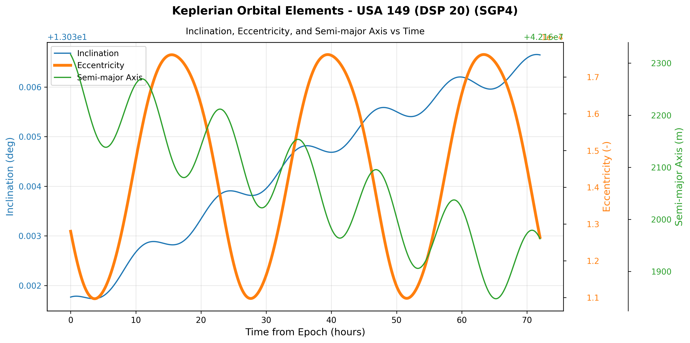
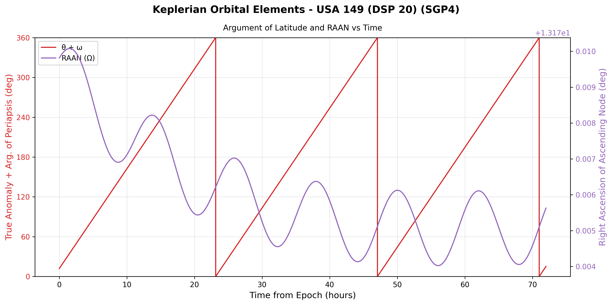

Example of a correct plot(s):

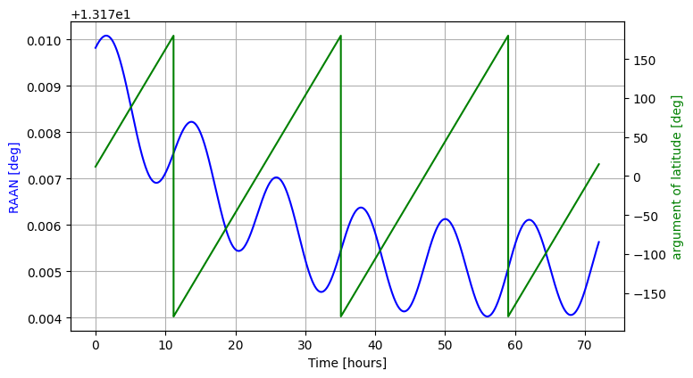
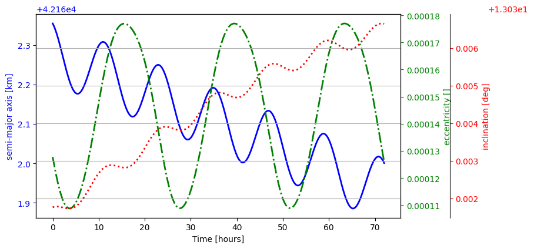


Reviewer feedback:
```
Legends are obstructed (-5%)
y-axis magnitude/scale are obstructed (-10%)
```

Score for `ls_REG_OrbKepPlotFile_PLOT_1`: 85 % of 1.0 = 0.85

Represent the Keplerian elements of the undisturbed orbit, showing the same quantities as above. Report the filename(s) of your plot(s).

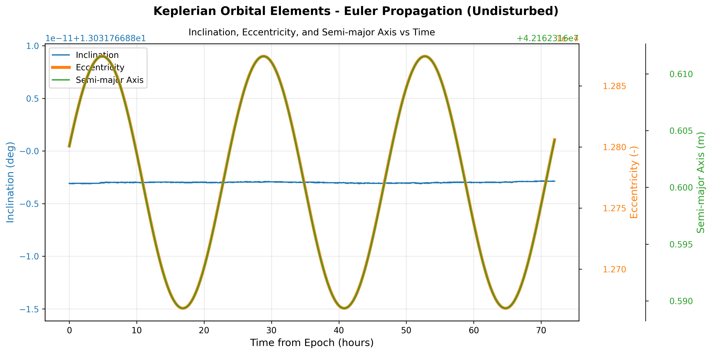
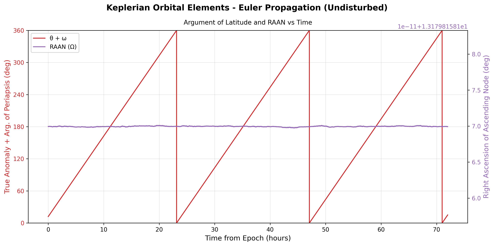

Example of a correct plot(s):

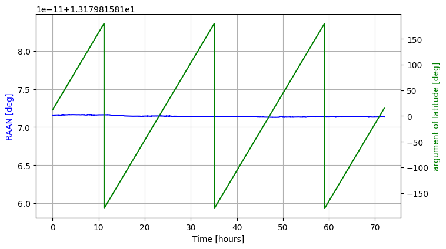
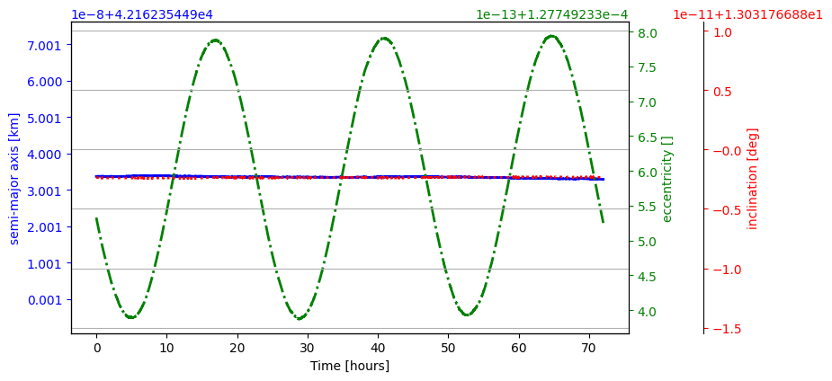


Reviewer feedback:
```
Legends are obstructed (-5%)
y-axis magnitude/scale are obstructed (-10%)
```

Score for `ls_REG_EulerKepPlotFile_PLOT_1`: 85 % of 1.0 = 0.85

For this assignment, the SGP4 orbit will not be relevant any more.

### Earth's oblateness

#### Implement the gravitational disturbance resulting from Earth's oblateness

Implement a **function** that computes the gravity disturbance from $`J_2`$ as a function of the Cartesian coordinates of the orbital position in the inertial frame. Assume the $`J_2`$ geopotential coefficient is equal to $`1.083\times 10^{-3}`$, Earth's gravitational parameter equal to $`GM=398600.4418 km^3/s^2`$ and Earth's mean radius is $`R = 6371 km`$. 

Report the source code where you implement the function requested above. Ensure that you include only the code relevant to this task.

Source code filename: 

[src/fortran/modules/j2_perturbation.f90](https://gitlab.tudelft.nl/ae4894-practical-astrodynamics/2025-2026/reports/6541356/a4/-/blob/main/src/fortran/modules/j2_perturbation.f90)


```fortran
subroutine j2_acceleration(r, a_j2)
    real(8), intent(in) :: r(3)
    real(8), intent(out) :: a_j2(3)
    real(8) :: r_mag, factor
    real(8), parameter :: J2 = 1.083e-03
    real(8), parameter :: GM = 3.9860044180e+14  ! m^3/s^2
    real(8), parameter :: R_EARTH = 6.4e+06  ! m
    
    r_mag = sqrt(r(1)**2 + r(2)**2 + r(3)**2)
    factor = 1.5d0 * J2 * GM * R_EARTH**2 / r_mag**5
    
    a_j2(1) = factor * r(1) * (5.0d0*(r(3)/r_mag)**2 - 1.0d0)
    a_j2(2) = factor * r(2) * (5.0d0*(r(3)/r_mag)**2 - 1.0d0)
    a_j2(3) = factor * r(3) * (5.0d0*(r(3)/r_mag)**2 - 3.0d0)
end subroutine j2_acceleration
```

Reviewer feedback:
```
none
```

Score for `ss_REG_J2_CODE_2.5`: 100 % of 2.5 = 2.50

#### Perform the orbit integration under the effect of Earth's oblateness

Add the routine you implemented in the previous task to your propagator. Assume that the only gravitational disturbance affecting the orbit of your satellite is due to Earth's oblateness, and compute the resulting orbit, considering the state given by the first epoch of the undisturbed orbit as initial conditions.

Report the initial and final positions (in meters) and velocities (in meters per second) of the S/C under the influence of $`J_2`$.

- Initial 3D position: 

<table>
<tr> <td>Student answer</td> <td>38196636.86428</td><td>17744788.89923</td><td>1983139.429386</td> </tr>
<tr> <td>Correct answer</td> <td>38196636.83896272</td><td>17744788.952263515</td><td>1983139.4426733057</td> </tr>
</table>


- Initial 3D velocity: 

<table>
<tr> <td>Student answer</td> <td>-1292.042930931</td><td>2706.308305319</td><td>678.0667330339</td> </tr>
<tr> <td>Correct answer</td> <td>-1292.0429349110973</td><td>2706.3083034696506</td><td>678.0667328272224</td> </tr>
</table>


- Final 3D position: 

<table>
<tr> <td>Student answer</td> <td>37182260.67975</td><td>19725576.97926</td><td>2489468.651604</td> </tr>
<tr> <td>Correct answer</td> <td>37167775.96644203</td><td>19752015.666612867</td><td>2496189.879794601</td> </tr>
</table>

Error: 0.0733 %

Score for `lf_REG_J2PosEnd_NUM_0.85`: 100 % of 0.85 = 0.85


- Final 3D velocity: 

<table>
<tr> <td>Student answer</td> <td>-1440.877203602</td><td>2632.351251713</td><td>669.1271434088</td> </tr>
<tr> <td>Correct answer</td> <td>-1442.8631240605546</td><td>2631.2967904304746</td><td>668.9939648615756</td> </tr>
</table>

Error: 0.0733 %

Score for `lf_REG_J2VelEnd_NUM_0.85`: 100 % of 0.85 = 0.85


#### Plot the effect of Earth's oblateness in your orbit

Plot the [Keplerian elements and their residuals](#keplerian-elements-and-their-residuals) between the undisturbed orbit and the orbit disturbed by $`J_2`$. 

Report the filename(s) of your plot(s).

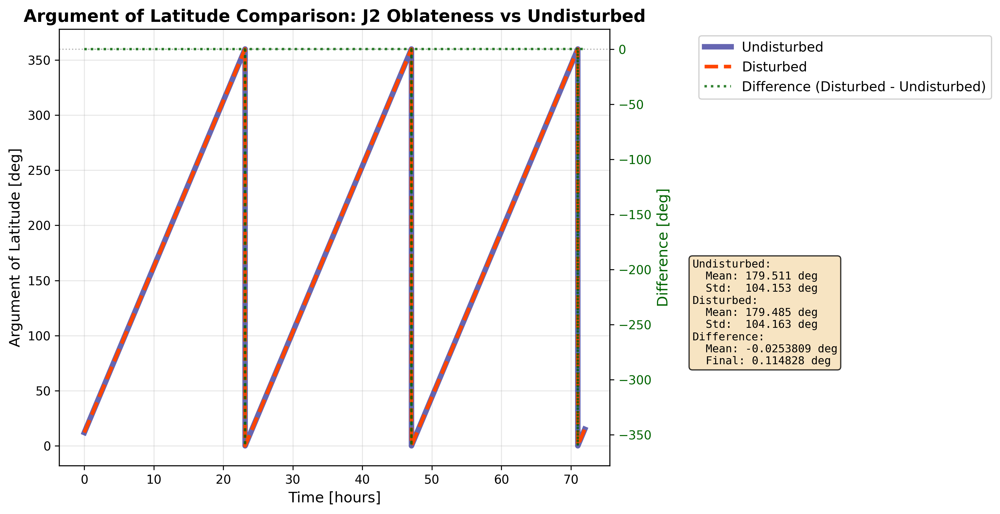
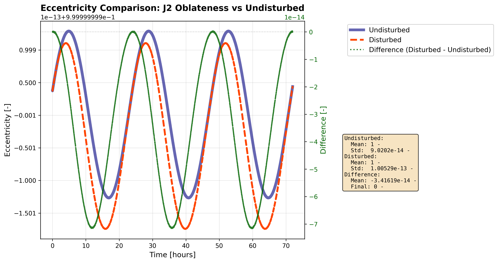
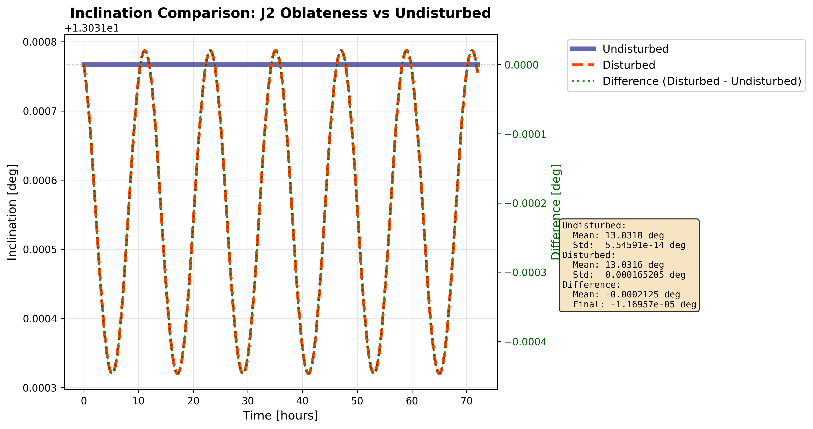
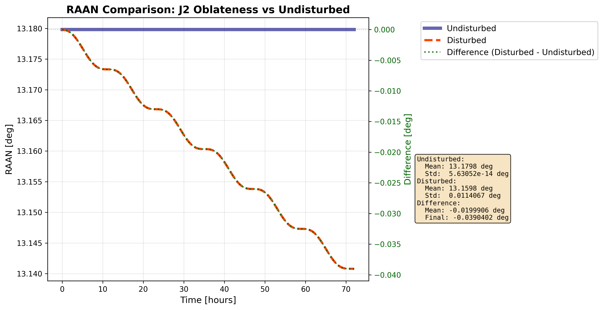
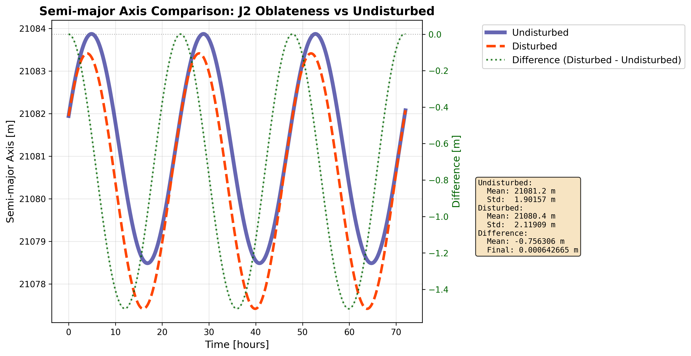

Example of a correct plot(s):

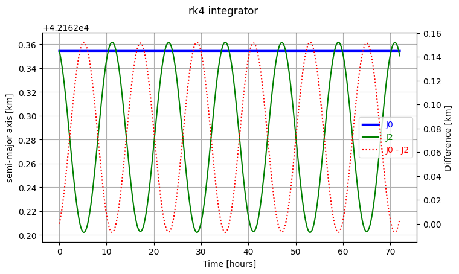
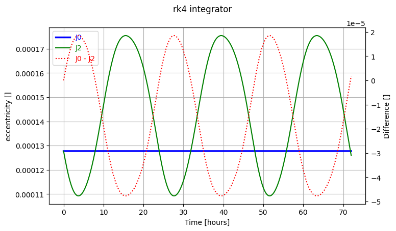
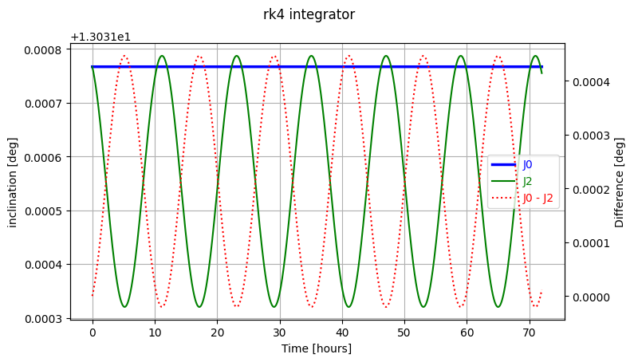
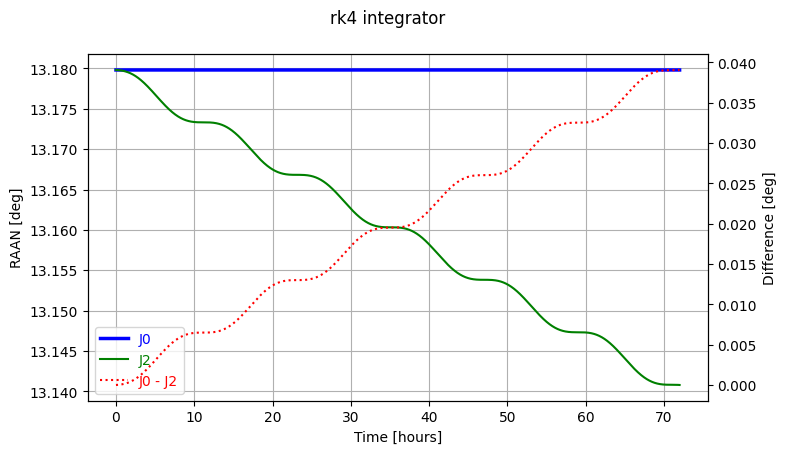
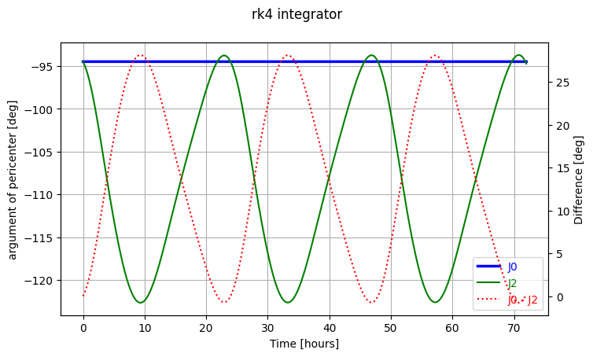
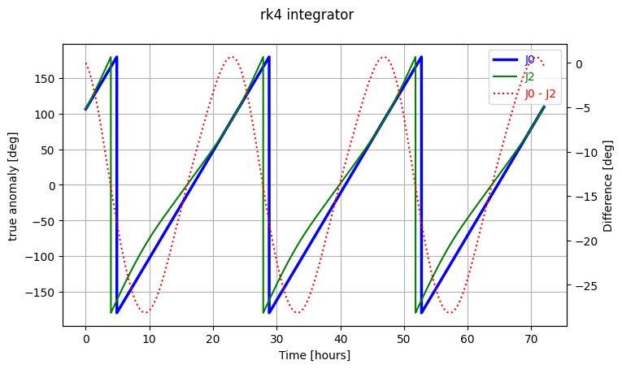
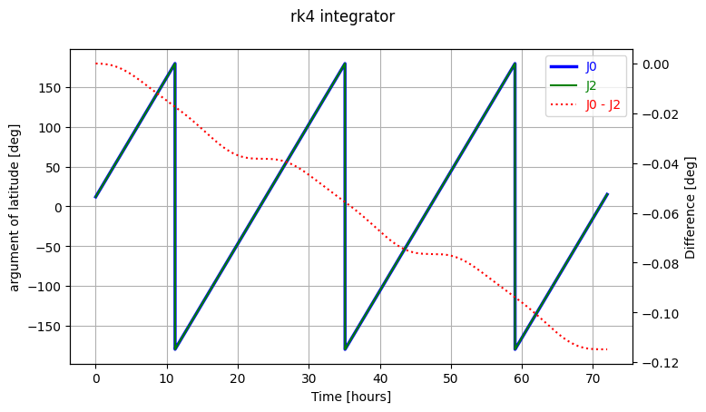
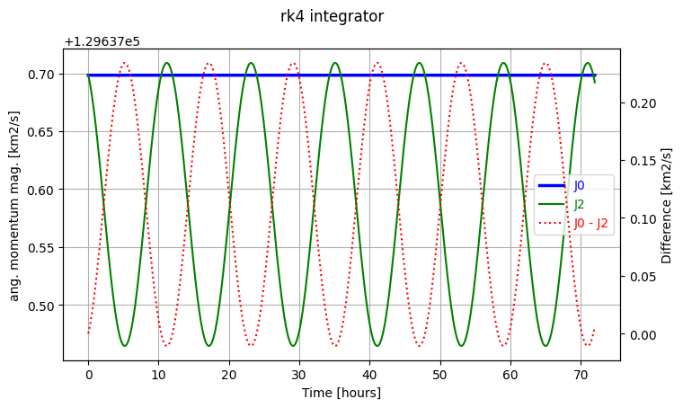


Reviewer feedback:
```
Wrong y-axis scale/magnitude for AoL difference (-10%)
```

Score for `ls_REG_J2Orb_PLOT_5`: 90 % of 5.0 = 4.50

#### Plot the magnitude of the accelerations from Earth's oblateness along your orbital positions

Plot the $`J_2`$ [disturbance magnitudes](#disturbance-magnitudes).

Report the filename(s) of your plot(s).

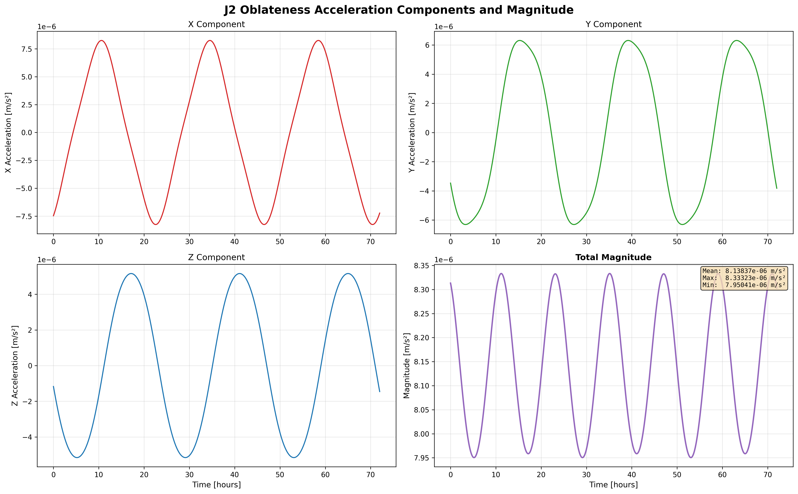
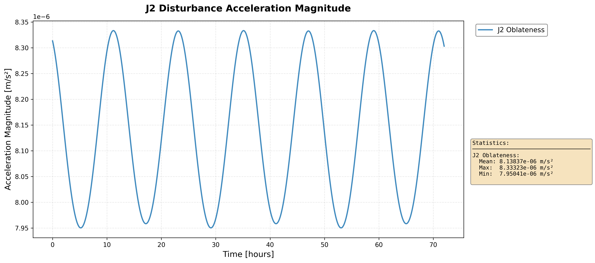
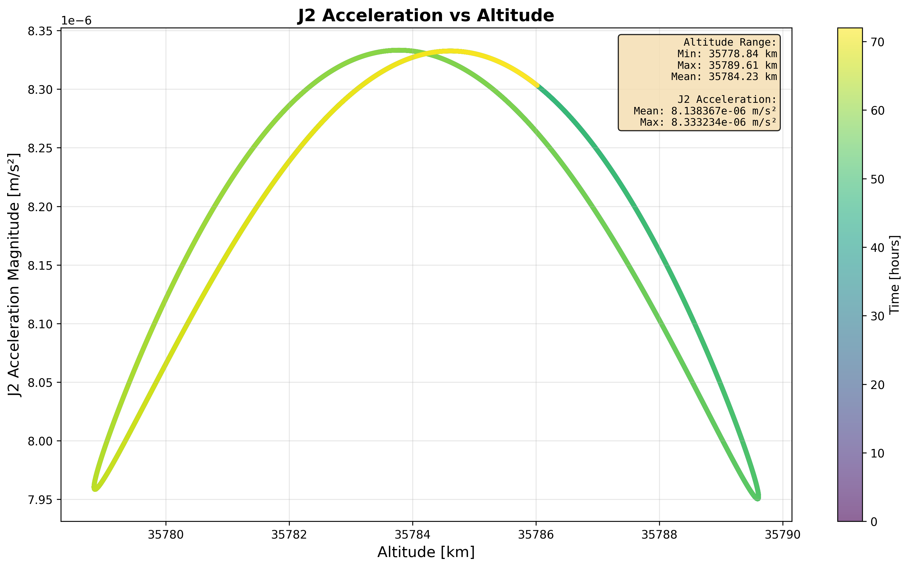

Example of a correct plot(s):

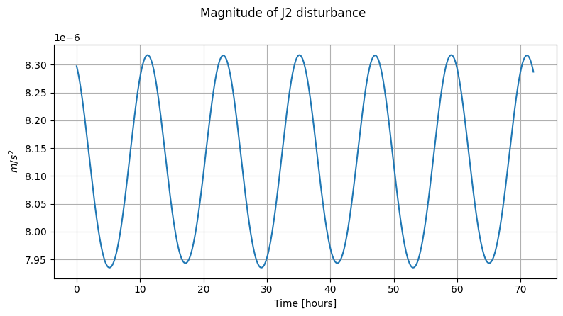


Reviewer feedback:
```
none
```

Score for `ls_REG_J2Mag_PLOT_2`: 100 % of 2.0 = 2.00

#### Analyse the results related to the effect of Earth's oblateness

Regarding the plot(s) in the two tasks above:

- Make (at least) three observations about what the plots show. Don't forget to specify which plot(s) you refer to in each observation.


```
1. (plots/j2_keplerian/argument_of_latitude_j2_comparison.png) The disturbed and undisturbed argument-of-latitude curves lie on top of each other for the entire 72-hour interval, and the difference curve remains close to zero without showing any visible trend.

2. (plots/j2_accelerations/j2_components.png) All three acceleration components (X, Y, Z) vary periodically with time and remain within a narrow, symmetric range around zero throughout the simulation.

3. (plots/j2_keplerian/raan_j2_comparison.png) The disturbed RAAN decreases overall over the 72-hour interval while the undisturbed curve stays nearly constant, and the difference curve shows a predominantly negative drift with small oscillations.
```
Reviewer feedback:
```
O1 is imprecise/incomplete i.e. "close to zero" and "on top of each other" (-16%)
O2 contains vague qualifiers i.e. "narrow" (-22%)
O3 contains vague qualifiers i.e. "overall", "small" (-22%)
Correction after discussion with student (+60%)
```

Score for `ss_REG_J2Obs_OIC_6`: 100 % of 6.0 = 6.00

- Make (at least) two interpretations about the observations you reported above.


```
1. Because the argument of latitude curves overlap entirely, the J2 perturbation does not produce a visible change in the argument of latitude over the simulated period.

2. The periodic nature of the acceleration components together with the steadily decreasing RAAN difference indicates that J2 introduces bounded short-term variations but also produces a consistent long-term change in RAAN.
```
Reviewer feedback:
```
I1 contains vague qualifiers i.e. "entirely", "visible"? (-33%)
I2 is imprecise/incomplete what is meant by "bounded"? (-25%)
Correction after discussion with student (+36%)
```

Score for `ss_REG_J2Int_OIC_8`: 78 % of 8.0 = 6.24

- Make (at least) one conclusion based on the observations and interpretations you reported above.


```
J2 perturbation causes a precession in orbital plane, given by the change over time of the RAAN.
```
Reviewer feedback:
```
C is imprecise/incomplete, what is this "change over time of the RAAN"? (-30%)
Correction after discussion with student (+30%)
```

Score for `ss_REG_J2Con_OIC_10`: 100 % of 10.0 = 10.00

### Solar Radiation Pressure

#### Determine the position of the Sun

Using the example script [horizons_script.py](./horizon-tool/horizons_script.py), report the 3D position of the Sun relative to the centre of the Earth, as provided by the [Horizons System](https://ssd.jpl.nasa.gov/horizons/), in meters, at the start of the calendar day of the TLE epoch.


<table>
<tr> <td>Student answer</td> <td>-48722372079.02</td><td>-127712091904.6</td><td>-55360277327.54</td> </tr>
<tr> <td>Correct answer</td> <td>-48722372079.01765</td><td>-127712091904.5618</td><td>-55360277327.53738</td> </tr>
</table>

Error: 2.6e-11 %

Score for `lf_REG_SunPos_NUM_0.9`: 100 % of 0.9 = 0.90


#### Implement the SRP disturbance

Consider the following assumptions:

- Your satellite is a perfect sphere,
- Its radiation pressure ballistic coefficient is $`0.02 m^2/kg`$, 
- The Sun is assumed to remain at the same position relative to Earth during the orbit integration and equal to the value you reported in the section [above](#determine-the-position-of-the-sun),
- The solar radiation flux is $`1361 W/m^2`$, and
- The solar illumination of the satellite follows the shadow function proposed by Doornbos (2012)[Thermospheric Density and Wind Determination from Satellite Dynamics](https://resolver.tudelft.nl/uuid:08e4faa1-a38b-43a8-989a-a70b78d59e58), pp. 58 to 61, including the effect of penumbra given by the geometric shadowing factor $`f_g`$ given by Eq. 3.32 of Doornbos (2012), with no absorption of solar flux by Earth's atmosphere (the factor $`f_a`$ in Eq. 3.31 of Doornbos (2012) is 1).

Implement a **function** that computes the SRP acceleration as a function of the Cartesian coordinates of the orbital position in the inertial frame.

Report the source code where you implement the function requested above. Make sure you include the code relevant only to this task.

Source code filename: 

[src/fortran/modules/srp_perturbation.f90](https://gitlab.tudelft.nl/ae4894-practical-astrodynamics/2025-2026/reports/6541356/a4/-/blob/main/src/fortran/modules/srp_perturbation.f90)


```fortran
subroutine srp_acceleration(r, r_sun, a_srp)
    real(8), intent(in) :: r(3), r_sun(3)
    real(8), intent(out) :: a_srp(3)
    real(8) :: r_sat_sun(3), d, f_g, P_srp
    real(8), parameter :: CR_OVER_M = 0.02  ! m^2/kg
    real(8), parameter :: SOLAR_FLUX = 1361.0  ! W/m^2
    real(8), parameter :: C_LIGHT = 3.0e+08  ! m/s
    real(8), parameter :: R_EARTH = 6.4e+06
    
    ! Vector from satellite to Sun
    r_sat_sun = r_sun - r
    d = sqrt(r_sat_sun(1)**2 + r_sat_sun(2)**2 + r_sat_sun(3)**2)
    
    ! Compute shadow factor (geometric)
    call compute_shadow_factor(r, r_sun, f_g)
    
    ! SRP pressure
    P_srp = SOLAR_FLUX / C_LIGHT
    
    ! Acceleration
    a_srp = f_g * CR_OVER_M * P_srp * r_sat_sun / d
end subroutine srp_acceleration
```

Reviewer feedback:
```
The file name for "compute_shadow_factor" is not reported (-10%)
```

Score for `ss_REG_SRP_CODE_2.5`: 90 % of 2.5 = 2.25

#### Perform the orbit integration under the effect of SRP

Add the routine you implemented in the previous task to your propagator. Assume that the only gravitational disturbance affecting the orbit of your satellite is due to SRP and compute the resulting orbit, considering the state given by the first epoch of the undisturbed orbit as initial conditions. This means you will have to turn off the effect of $`J_2`$ that you implemented earlier in this assignment.

Report the initial and final positions (in meters) and velocities (in meters per second) of the S/C under the influence of SRP.

- Initial 3D position: 

<table>
<tr> <td>Student answer</td> <td>38196636.86428</td><td>17744788.89923</td><td>1983139.429386</td> </tr>
<tr> <td>Correct answer</td> <td>38196636.83896272</td><td>17744788.952263515</td><td>1983139.4426733057</td> </tr>
</table>


- Initial 3D velocity: 

<table>
<tr> <td>Student answer</td> <td>-1292.042930931</td><td>2706.308305319</td><td>678.0667330339</td> </tr>
<tr> <td>Correct answer</td> <td>-1292.0429349110973</td><td>2706.3083034696506</td><td>678.0667328272224</td> </tr>
</table>


- Final 3D position: 

<table>
<tr> <td>Student answer</td> <td>37207478.47367</td><td>19679557.40424</td><td>2471351.211244</td> </tr>
<tr> <td>Correct answer</td> <td>37193029.64354218</td><td>19706015.040438592</td><td>2478076.096045839</td> </tr>
</table>

Error: 0.0733 %

Score for `lf_REG_SRPPosEnd_NUM_0.85`: 100 % of 0.85 = 0.85


- Final 3D velocity: 

<table>
<tr> <td>Student answer</td> <td>-1437.30567991</td><td>2634.238348757</td><td>669.491317004</td> </tr>
<tr> <td>Correct answer</td> <td>-1439.2929200470605</td><td>2633.1863610803357</td><td>669.3591183342685</td> </tr>
</table>

Error: 0.0733 %

Score for `lf_REG_SRPVelEnd_NUM_0.85`: 100 % of 0.85 = 0.85


#### Plot the effect of SRP in your orbit

Plot the [Keplerian elements and their residuals](#keplerian-elements-and-their-residuals) between the undisturbed orbit and the orbit disturbed by SRP. 

Report the filename(s) of your plot(s).

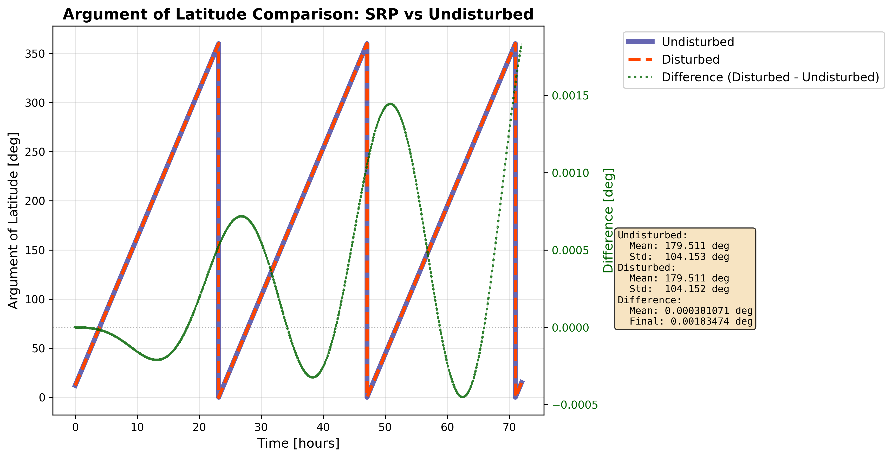
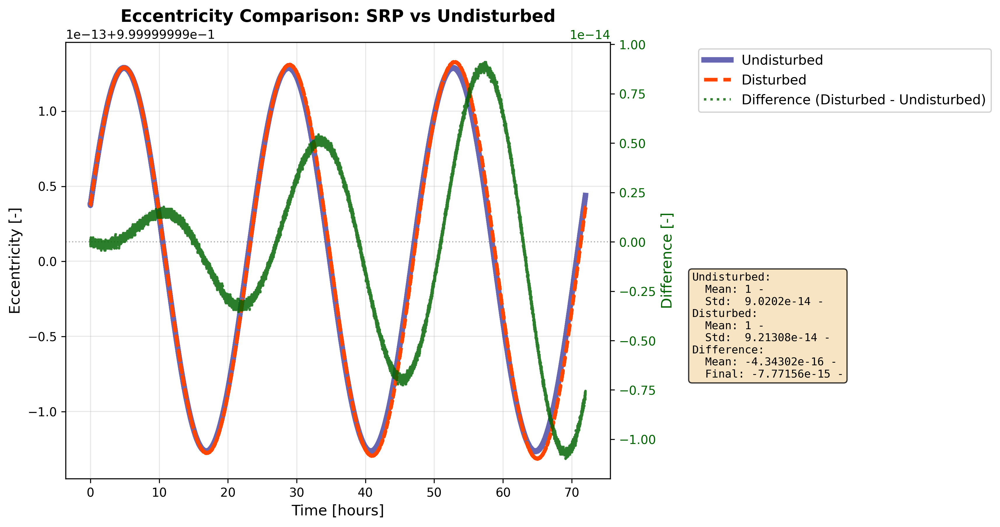
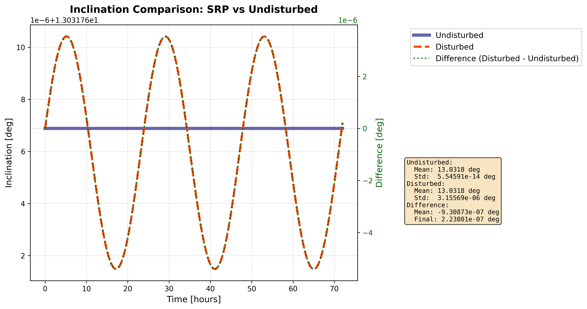
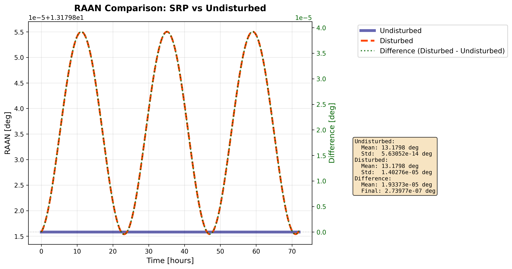
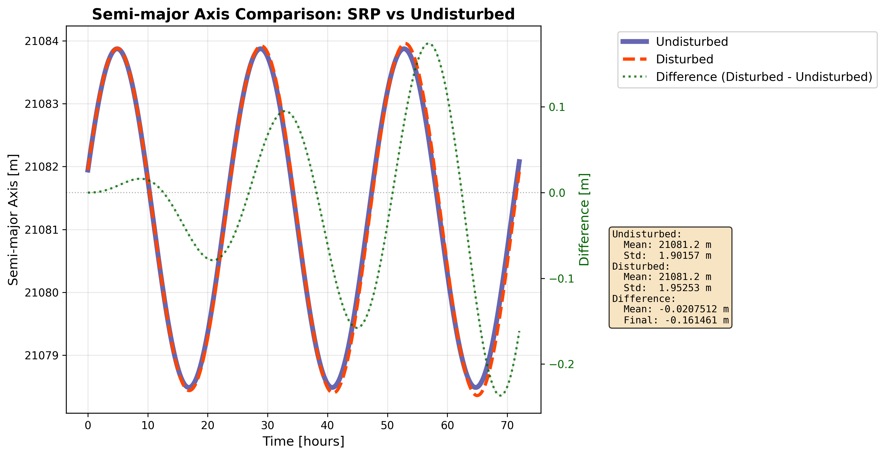

Example of a correct plot(s):

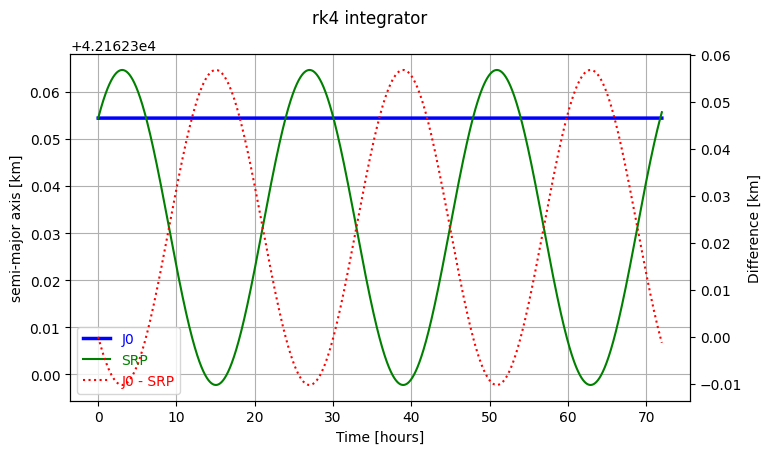
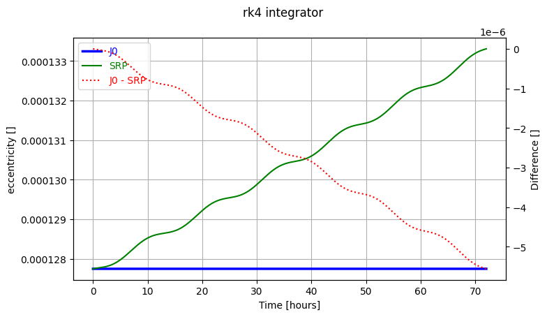
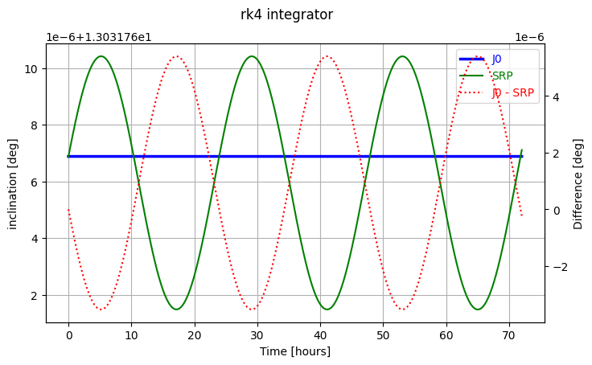
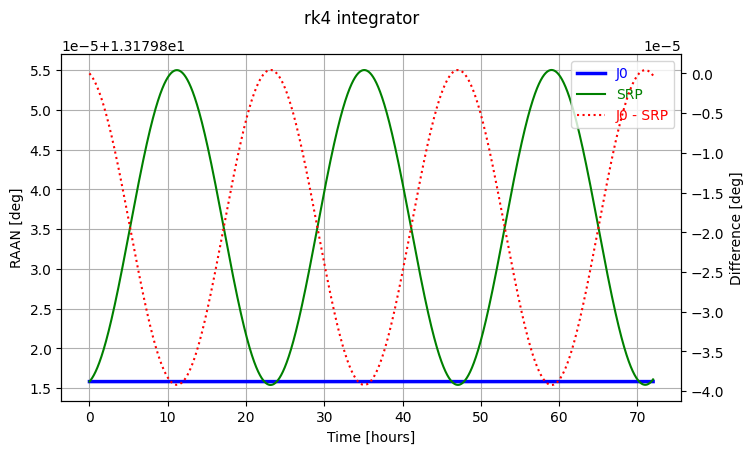
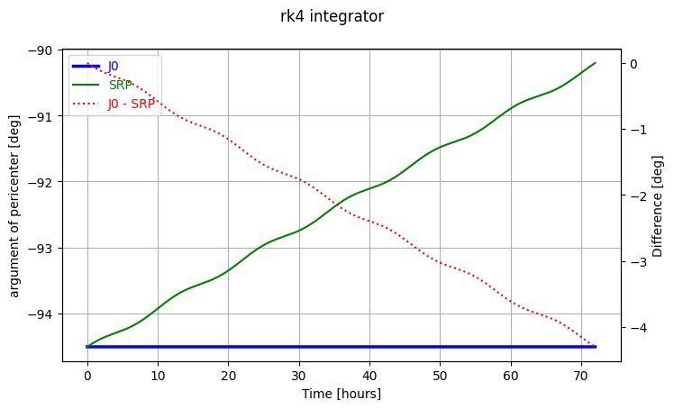
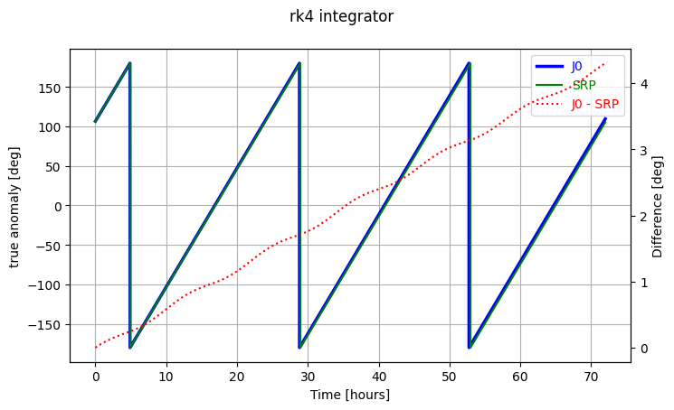
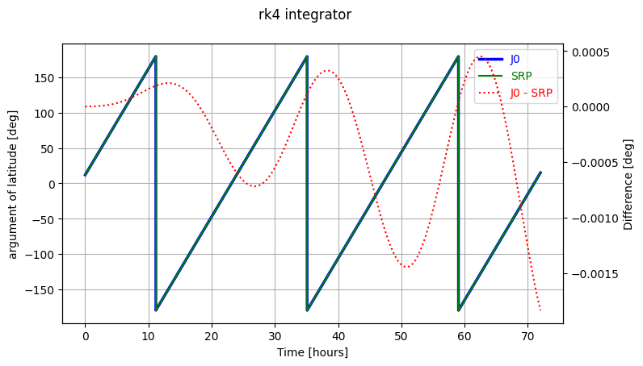
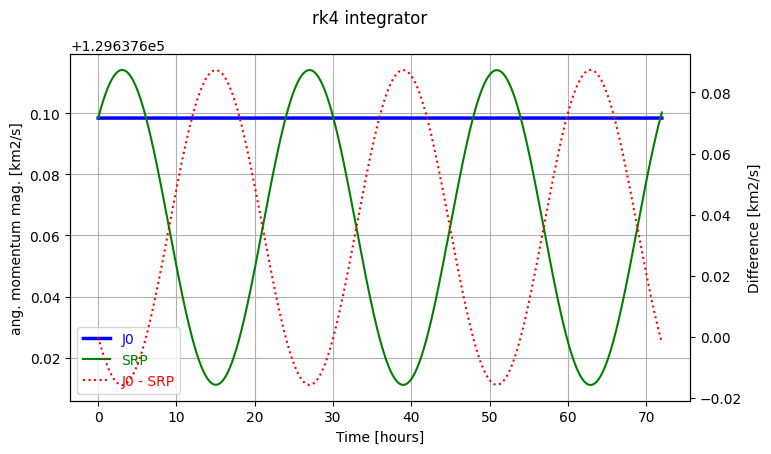


Reviewer feedback:
```
SMA difference behaviour is shown to be unstable and does not match expected results and magnitude (-10%)
```

Score for `ls_REG_SRPOrb_PLOT_5`: 90 % of 5.0 = 4.50

#### Plot the magnitude of the acceleration from SRP along your orbital positions

Plot the SRP [disturbance magnitudes](#disturbance-magnitudes).

Report the filename(s) of your plot(s).

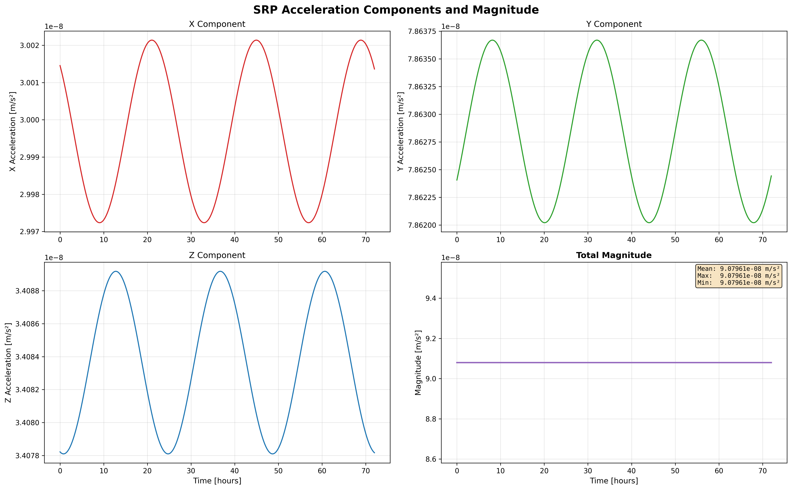
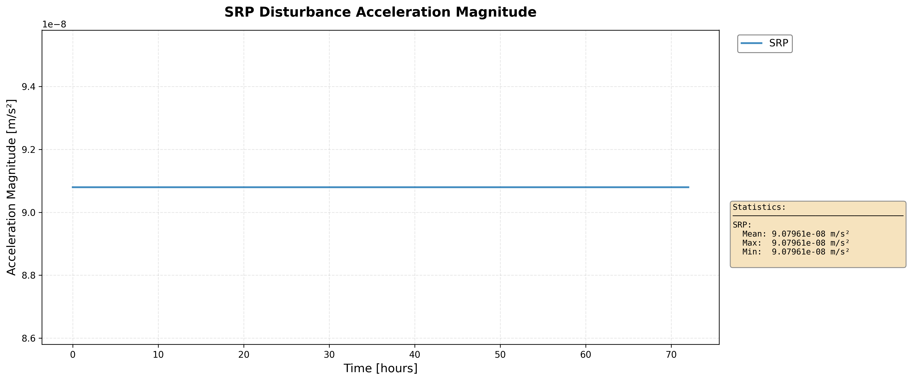
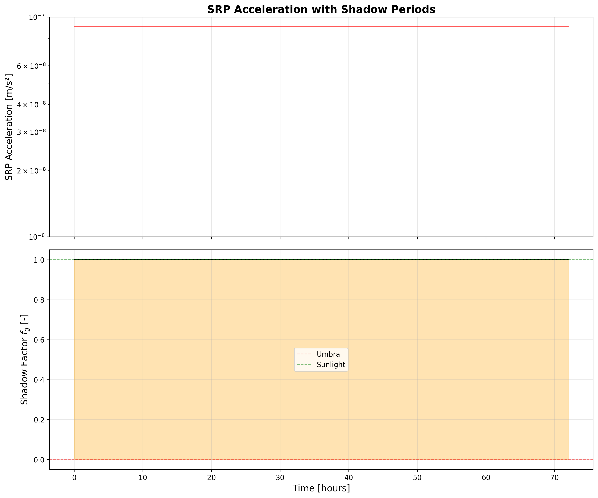

Example of a correct plot(s):

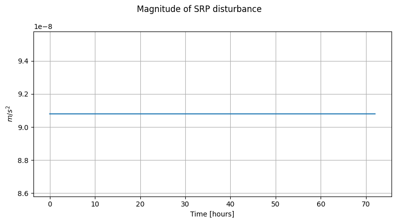


Reviewer feedback:
```
The shadow factor plot is confusing, and the shaded area is not in the legend (-10%)
```

Score for `ls_REG_SRPMag_PLOT_2`: 90 % of 2.0 = 1.80

#### Analyse the results related to the effect of SRP

Regarding the plot(s) in the two tasks above:

- Make (at least) three observations about what the plots show. Don't forget to specify which plot(s) you refer to in each observation.


```
1. (plots/srp_accelerations/srp_magnitude.png) SRP magnitude remains constant through the integration period at approximately 9.1e-8 m/s^2.

2. (plots/srp_accelerations/srp_with_shadow.png) The spacecraft remains in full sunlight for the entire 72-hour simulation.

3. (plots/srp_accelerations/srp_components.png) All 3 SRP acceleration components show a 24-hour periodicity, with smooth sinusoidal variation.
```
Reviewer feedback:
```
O3 is nearly correct but the term "smooth" is not specific enough (-6%)
```

Score for `ss_REG_SRPObs_OIC_6`: 94 % of 6.0 = 5.64

- Make (at least) two interpretations about the observations you reported above.


```
1. Because the SRP magnitude stays constant while the X, Y and Z components vary periodically, the SRP acceleration behaves as a constant-strength vector whose direction rotates once per orbital period.

2. Since the spacecraft remains in full sunlight and the SRP magnitude does not change over the 72 hours, any time variation in the SRP components is caused by the changing geometry between the spacecraft and the Sun, not by shadow passages.
```
Reviewer feedback:
```
I1 is nearly correct, "constant strength" is inadequate (-5%)
I2 excellent 
```

Score for `ss_REG_SRPInt_OIC_8`: 95 % of 8.0 = 7.60

- Make (at least) one conclusion based on the observations and interpretations you reported above.


```
When solar radiation pressure acts continuously with nearly constant magnitude, it behaves as a steady perturbing force whose direction changes with the orbital motion rather than as an on/off disturbance driven by eclipses.
```
Reviewer feedback:
```
C is merely a reformulated interpretation (-80%) and contains strange contradictions. 
```

Score for `ss_REG_SRPCon_OIC_10`: 20 % of 10.0 = 2.00


## Assignment excellence

### Atmospheric drag

#### Implement the disturbance resulting from atmospheric drag

Consider the following assumptions:

- Your satellite is a perfect sphere,
- Its ballistic coefficient is $`0.01 m^2/kg`$, and 
- Earth's atmosphere is spherical and its density follows the exponential density distribution $`\rho(h)=\rho_0 e^{-h/H}`$, with the mean density $`\rho_0`$ and scale height $` H`$ retrieved from the table in [Appendix](#scale-heights-and-mean-densities).

Report the reference height you consider in your implementation of drag, in meters.


```
35786000.0
```
Reviewer feedback:
```
none
```

Score for `sf_AEX_RefHeight_GEN_0.1`: 100 % of 0.1 = 0.10

Report the scale height you consider in your implementation of drag, in meters.


```
37300000.0
```
Reviewer feedback:
```
none
```

Score for `sf_AEX_ScaleHeight_GEN_0.1`: 100 % of 0.1 = 0.10

Report the mean density you consider in your implementation of drag, in $`kg/m^3`$.


```
4.04e-19
```
Reviewer feedback:
```
none
```

Score for `sf_AEX_MeanRho_GEN_0.1`: 100 % of 0.1 = 0.10

Implement a **function** that computes the drag acceleration as a function of the Cartesian coordinates of the orbital position and velocity in the inertial frame. Don't forget to include the effect of the rotating atmosphere.

Report the source code where you implement the function requested above. Ensure that you include only the code relevant to this task.

Source code filename: 

[src/fortran/modules/drag_perturbation.f90](https://gitlab.tudelft.nl/ae4894-practical-astrodynamics/2025-2026/reports/6541356/a4/-/blob/main/src/fortran/modules/drag_perturbation.f90)


```fortran
subroutine drag_acceleration(r, v, a_drag)
    real(8), intent(in) :: r(3), v(3)
    real(8), intent(out) :: a_drag(3)
    real(8) :: v_rel(3), v_rel_mag, h, rho
    real(8), parameter :: H_REF = 6.4e+06
    real(8), parameter :: H_SCALE = 3.7e+07
    real(8), parameter :: RHO_0 = 4.04e-19
    real(8), parameter :: OMEGA_EARTH = 7.2921159e-5
    real(8), parameter :: CD_A_OVER_M = 0.01
    
    ! Relative velocity (account for rotating atmosphere)
    v_rel(1) = v(1) + OMEGA_EARTH * r(2)
    v_rel(2) = v(2) - OMEGA_EARTH * r(1)
    v_rel(3) = v(3)
    v_rel_mag = sqrt(v_rel(1)**2 + v_rel(2)**2 + v_rel(3)**2)
    
    ! Altitude and density
    h = sqrt(r(1)**2 + r(2)**2 + r(3)**2) - H_REF
    rho = RHO_0 * exp(-h / H_SCALE)
    
    ! Drag acceleration
    a_drag = -0.5d0 * CD_A_OVER_M * rho * v_rel_mag * v_rel
end subroutine drag_acceleration
```

Reviewer feedback:
```
none
```

Score for `ss_AEX_Drag_CODE_0.8`: 100 % of 0.8 = 0.80

#### Perform the orbit integration under the effect of drag

Add the routine you implemented in the previous task to your propagator. Assume that the only gravitational disturbance affecting the orbit of your satellite is due to drag, and compute the resulting orbit, considering the state given by the first epoch of the undisturbed orbit as initial conditions. This means you will have to turn off the effect of $`J_2`$ and SRP that you implemented earlier in this assignment.

Report the initial and final positions (in meters) and velocities (in meters per second) of the S/C under the influence of drag.

- Initial 3D position: 

<table>
<tr> <td>Student answer</td> <td>38196636.86428</td><td>17744788.89923</td><td>1983139.429386</td> </tr>
<tr> <td>Correct answer</td> <td>38196636.83896272</td><td>17744788.952263515</td><td>1983139.4426733057</td> </tr>
</table>


- Initial 3D velocity: 

<table>
<tr> <td>Student answer</td> <td>-1292.042930931</td><td>2706.308305319</td><td>678.0667330339</td> </tr>
<tr> <td>Correct answer</td> <td>-1292.0429349110973</td><td>2706.3083034696506</td><td>678.0667328272224</td> </tr>
</table>


- Final 3D position: 

<table>
<tr> <td>Student answer</td> <td>37208394.84353</td><td>19678551.22345</td><td>2471076.10432</td> </tr>
<tr> <td>Correct answer</td> <td>37193946.77260935</td><td>19705009.001125917</td><td>2477800.9808092774</td> </tr>
</table>

Error: 0.0733 %

Score for `lf_AEX_DragPosEnd_NUM_0.2`: 100 % of 0.2 = 0.20


- Final 3D velocity: 

<table>
<tr> <td>Student answer</td> <td>-1437.230084108</td><td>2634.252276169</td><td>669.4904534242</td> </tr>
<tr> <td>Correct answer</td> <td>-1439.2173278947373</td><td>2633.200365564424</td><td>669.3582721344212</td> </tr>
</table>

Error: 0.0733 %

Score for `lf_AEX_DragVelEnd_NUM_0.2`: 100 % of 0.2 = 0.20


#### Plot the effect of drag in your orbit

Plot the [Keplerian elements and their residuals](#keplerian-elements-and-their-residuals) between the undisturbed orbit and the orbit disturbed by drag. 

Report the filename(s) of your plot(s).

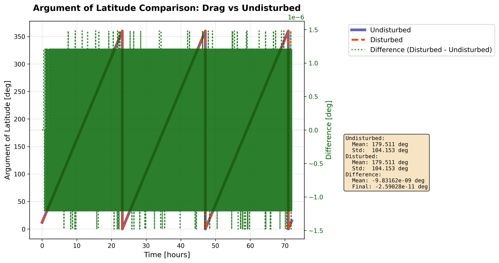
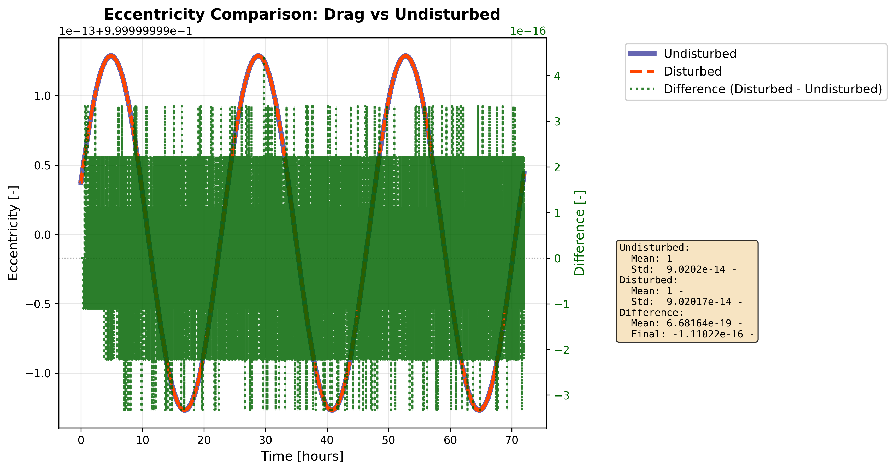
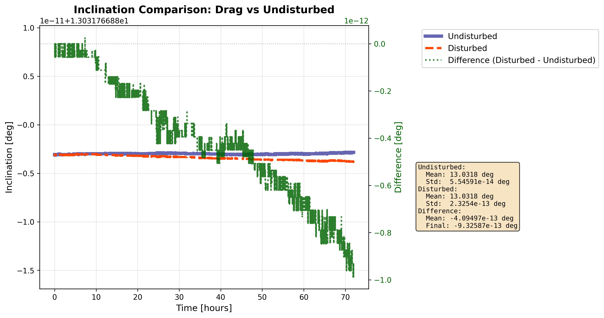
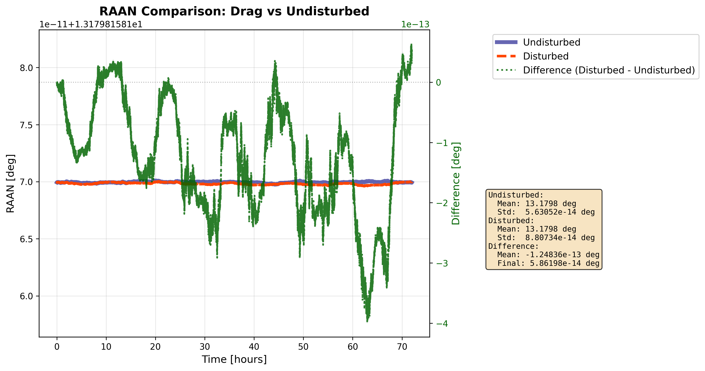
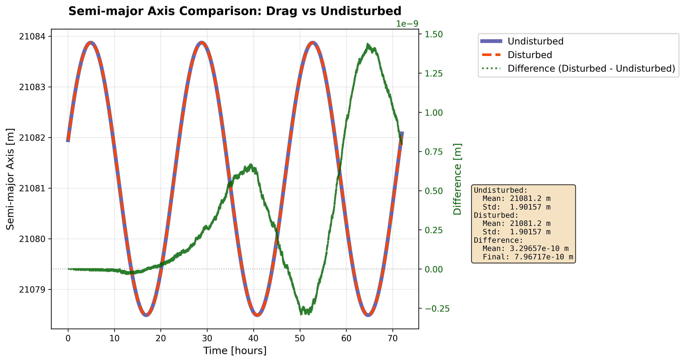

Example of a correct plot(s):

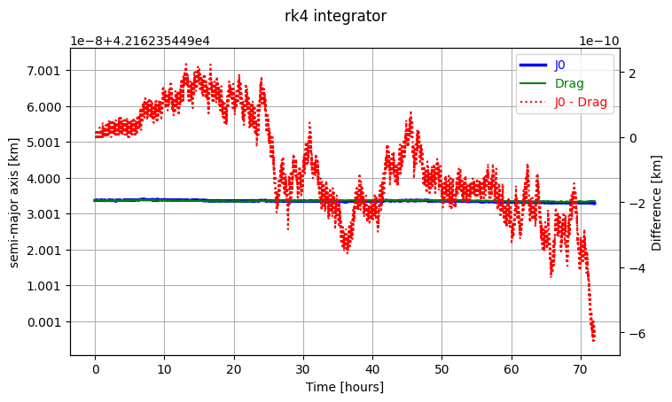
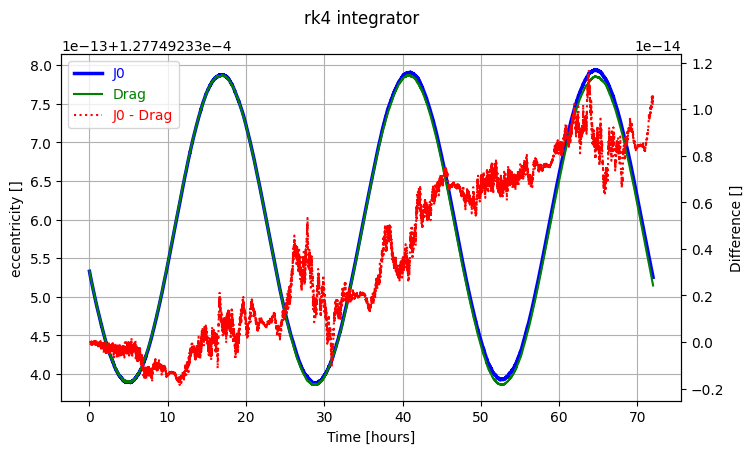
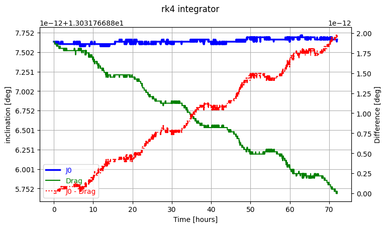


Reviewer feedback:
```
none
```

Score for `ls_AEX_DragOrb_PLOT_1`: 100 % of 1.0 = 1.00

#### Plot the magnitude of drag along your orbital positions

Plot the drag [disturbance magnitudes](#disturbance-magnitudes).

Report the filename(s) of your plot(s).


Example of a correct plot(s):


Reviewer feedback:
```
none
```

Score for `ls_AEX_DragMag_PLOT_0.5`: 100 % of 0.5 = 0.50

#### Analyse the results related to the effect of drag

Regarding the plot(s) in the two task above:

- Make (at least) three observations about what the plots show. Don't forget to specify which plot(s) you refer to in each observation.


```
1. (plots/drag_accelerations/atmospheric_density.png) According to the model used, atmospheric density only changes in the fifth significant digit for the entire 72-hour simulation at GEO altitude.

2. (plots/drag_accelerations/drag_acceleration_magnitude.png) Drag acceleration magnitude shows a 12-hour periodicity, twice as fast as the orbital period. 

3. (plots/drag_keplerian/raan_comparison.png) The undisturbed and disturbed RAAN curves visually overlap, and the difference stays near numerical noise level without any visible trend.
```
Reviewer feedback:
```
O1 is imprecise/incomplete i.e. "in the fifth significant digit" in what units? (-16%)
O3 is imprecise/incomplete i.e. "near numerical noise level" not only is vague but also on the verge of being an explanation (i.e. I) (-16%)
```

Score for `ss_AEX_DragObs_OIC_1`: 68 % of 1.0 = 0.68

- Make (at least) two interpretations about the observations you reported above.


```
1. For the studied case, the drag force is extremely weak, and its effect on the orbit stays on the same order as the numerical precision of the computed Keplerian elements.

2. Drag does not produce a detectable plane-orientation change over the 72-hour simulation.
```
Reviewer feedback:
```
I2 contains vague qualifiers and imprecise terminology i.e. "detectable" (-33%)
Correction after discussion with student (+11%)
```

Score for `ss_AEX_DragInt_OIC_2`: 78 % of 2.0 = 1.56

- Make (at least) one conclusion based on the observations and interpretations you reported above.


```
At GEO altitude, atmospheric drag is physically present but, for this configuration and time span, it is negligible compared to other perturbations and can be ignored in practical orbit propagation.
```
Reviewer feedback:
```
This statement is unnecessarily specific and has little value in a practical case like a report (-45%)
AND contains a quasi-recommendation
```

Score for `ss_AEX_DragCon_OIC_4`: 55 % of 4.0 = 2.20

### Third body perturbations (TBP)

#### Determine the position of the Moon

Using the example script [horizons_script.py](./horizon-tool/horizons_script.py), report the 3D position of the Moon relative to the centre of the Earth, as provided by the [Horizons System](https://ssd.jpl.nasa.gov/horizons/), in meters, at the start of the calendar day of the TLE epoch.


<table>
<tr> <td>Student answer</td> <td>263546818.4963</td><td>211682539.4102</td><td>121014965.2937</td> </tr>
<tr> <td>Correct answer</td> <td>263546818.4963133</td><td>211682539.4101563</td><td>121014965.2937185</td> </tr>
</table>

Error: 1.37e-11 %

Score for `lf_AEX_MoonPos_NUM_0.1`: 100 % of 0.1 = 0.10


Consider the position of the Sun the same as in the Task ["Determine the position of the Sun"](#determine-the-position-of-the-sun).

#### Implement the disturbance resulting from TBP

Implement a **function** that computes the gravitational attraction of the Sun and Moon as a function of the Cartesian coordinates of the orbital position in the inertial frame. 

Report the source code where you implement the function requested above. Ensure that you include only the code relevant to this task.

Source code filename: 

[src/fortran/modules/third_body_perturbation.f90](https://gitlab.tudelft.nl/ae4894-practical-astrodynamics/2025-2026/reports/6541356/a4/-/blob/main/src/fortran/modules/third_body_perturbation.f90)


```fortran
subroutine third_body_acceleration(r, r_sun, r_moon, a_tbp)
    real(8), intent(in) :: r(3), r_sun(3), r_moon(3)
    real(8), intent(out) :: a_tbp(3)
    real(8) :: r_sun_sat(3), r_moon_sat(3), d_sun, d_moon, d_sun_sat, d_moon_sat
    real(8), parameter :: GM_SUN = 1.327124400419e+20
    real(8), parameter :: GM_MOON = 4.902800066000e+12
    
    ! Sun perturbation
    r_sun_sat = r_sun - r
    d_sun = sqrt(r_sun(1)**2 + r_sun(2)**2 + r_sun(3)**2)
    d_sun_sat = sqrt(r_sun_sat(1)**2 + r_sun_sat(2)**2 + r_sun_sat(3)**2)
    
    ! Moon perturbation
    r_moon_sat = r_moon - r
    d_moon = sqrt(r_moon(1)**2 + r_moon(2)**2 + r_moon(3)**2)
    d_moon_sat = sqrt(r_moon_sat(1)**2 + r_moon_sat(2)**2 + r_moon_sat(3)**2)
    
    ! Total third body acceleration
    a_tbp = GM_SUN * (r_sun_sat/d_sun_sat**3 - r_sun/d_sun**3) + &
            GM_MOON * (r_moon_sat/d_moon_sat**3 - r_moon/d_moon**3)
end subroutine third_body_acceleration
```

Reviewer feedback:
```
none
```

Score for `ss_AEX_TBP_CODE_0.8`: 100 % of 0.8 = 0.80

#### Perform the orbit integration under the effect of TBP

Add the routine you implemented in the previous task to your propagator. Assume that the only gravitational disturbance affecting the orbit of your satellite is due to TBP and compute the resulting orbit, considering the state given by the first epoch of the undisturbed orbit as initial conditions. This means you will have to turn off the effect of $`J_2`$, SRP and drag that you implemented earlier in this assignment.

Report the initial and final positions (in meters) and velocities (in meters per second) of the S/C under the influence of TBP.

- Initial 3D position: 

<table>
<tr> <td>Student answer</td> <td>38196636.86428</td><td>17744788.89923</td><td>1983139.429386</td> </tr>
<tr> <td>Correct answer</td> <td>38196636.83896272</td><td>17744788.952263515</td><td>1983139.4426733057</td> </tr>
</table>


- Initial 3D velocity: 

<table>
<tr> <td>Student answer</td> <td>-1292.042930931</td><td>2706.308305319</td><td>678.0667330339</td> </tr>
<tr> <td>Correct answer</td> <td>-1292.0429349110973</td><td>2706.3083034696506</td><td>678.0667328272224</td> </tr>
</table>


- Final 3D position: 

<table>
<tr> <td>Student answer</td> <td>37201165.54267</td><td>19691510.27559</td><td>2471766.622482</td> </tr>
<tr> <td>Correct answer</td> <td>37186708.95699408</td><td>19717962.652986083</td><td>2478495.8046300146</td> </tr>
</table>

Error: 0.0733 %

Score for `lf_AEX_TBPPosEnd_NUM_0.2`: 100 % of 0.2 = 0.20


- Final 3D velocity: 

<table>
<tr> <td>Student answer</td> <td>-1438.075096366</td><td>2633.712452237</td><td>669.9182441074</td> </tr>
<tr> <td>Correct answer</td> <td>-1440.0619385805383</td><td>2632.6599166846277</td><td>669.7860862962202</td> </tr>
</table>

Error: 0.0733 %

Score for `lf_AEX_TBPVelEnd_NUM_0.2`: 100 % of 0.2 = 0.20


#### Plot the effect of TBP in your orbit

Plot the [Keplerian elements and their residuals](#keplerian-elements-and-their-residuals) between the undisturbed orbit and the orbit disturbed by TBPs. 

Report the filename(s) of your plot(s).


Example of a correct plot(s):


Reviewer feedback:
```
none
```

Score for `ls_AEX_TBPOrb_PLOT_1`: 100 % of 1.0 = 1.00

#### Plot the magnitude of the accelerations from TBP along your orbital positions

Plot the TBP [disturbance magnitudes](#disturbance-magnitudes).

Report the filename(s) of your plot(s).


Example of a correct plot(s):


Reviewer feedback:
```
Excellent quality plots +10% (bonus)
```

Score for `ls_AEX_TBPMag_PLOT_0.5`: 100 % of 0.5 = 0.50

#### Analyse the results related to the effect of TBP

Regarding the plot(s) in the task [above](#plot-the-magnitude-of-tbp-along-your-orbital-positions):

- Make (at least) three observations about what the plots show. Don't forget to specify which plot(s) you refer to in each observation.


```
1. (plots/tbp_accelerations/tbp_magnitude.png) Moon third-body perturbations have higher magnitude than Sun third-body perturbations for the simulation considered.

2. (plots/tbp_keplerian/raan_tbp_comparison.png) The disturbed RAAN slowly increases over the 72-hour interval, while the undisturbed RAAN remains nearly constant. The difference curve shows a smooth positive drift.

3. (plots/tbp_accelerations/tbp_magnitude.png) Mean TBP acceleration magnitude is approximately 8e-06 m/s^2, with the maximum and minimum values of approximately 1e-05 m/s^2 and 5e-06 m/s^2, respectively.
```
Reviewer feedback:
```
O1 is imprecise, by how much "higher"? (-16%)
Correction after discussion with student (+16%)
```

Score for `ss_AEX_TBPObs_OIC_1`: 100 % of 1.0 = 1.00

- Make (at least) two interpretations about the observations you reported above.


```
1. The higher magnitude of the lunar TBP compared to the solar TBP indicates that, for this orbital geometry and time span, the Moon is the dominant third-body contributor to the perturbing acceleration.

2. The positive drift of the RAAN difference suggests that third-body perturbations introduce a secular eastward rotation of the orbital plane over the 72-hour interval.

3. The TBP acceleration magnitude varies within a relatively narrow band (from about 5e-06 to 1.3e-05 m/s^2), so the applied perturbation remains of similar order throughout the simulation, leading to gradual rather than abrupt changes in the orbital elements.
```
Reviewer feedback:
```
none
```

Score for `ss_AEX_TBPInt_OIC_2`: 100 % of 2.0 = 2.00

- Make (at least) one conclusion based on the observations and interpretations you reported above.


```
For near-GEO orbits, third-body perturbations from the Moon (and, to a lesser extent, the Sun) can dominate the perturbing acceleration budget and drive secular changes in angular elements such as RAAN and inclination, while acting with a slowly varying magnitude over each orbital period.
```
Reviewer feedback:
```
C is imprecise "acting with a slowly (...)", but apart from that is a concluding remark (-25%) 
```

Score for `ss_AEX_TBPCon_OIC_4`: 75 % of 4.0 = 3.00


## Code excellence

Report below any advanced coding features you have implemented in your code.


```
Code excellence features:

1. Dataclass Architecture: Python modules use @dataclass for KeplerianElements container with type hints (np.ndarray) and automatic __repr__ showing mean values, eliminating boilerplate constructors.

2. Dual-Layer Plot Rendering: Transparent thick lines (alpha=0.3, linewidth=3, zorder=1) + crisp dotted lines (alpha=1.0, linestyle=':', zorder=2) allow simultaneous trend magnitude and temporal detail visibility.

3. External Legend Layout: bbox_to_anchor=(1.02, 1.0, 0.2, 0) positions legends in dedicated 22% right margin with plt.tight_layout(rect=[0, 0, 0.78, 1]) preventing data-legend overlap.

4. Multi-Axis Scientific Notation: ax2.ticklabel_format(style='scientific', scilimits=(0,0)) with tick_params(pad=25) prevents Y-axis label collisions on triple-Y-axis plots.

5. Automated Directory Management: Plot scripts detect output path (plots/sgp4/ vs plots/undisturbed/) based on data source using os.path.exists() checks with fallback logic.

6. JPL Horizons API Integration: URL-encoded query strings (CENTER='500@399', EPHEM_TYPE='VECTORS', VEC_TABLE='2') with $$SOE/$$EOE marker parsing and regex r'GM.*=\s*([0-9.E+-]+)' for header extraction.

7. Fortran Regex Parameter Extraction: Python parses Fortran source files using r'parameter.*?J2.*?=\s*([0-9.E+-_]+)' handling _dp suffixes, whitespace variations, and comment lines to auto-populate answer sheet.

8. Unified Third-Body Data File: Single third_body_positions.txt with (x, y, z, GM_sun, GM_moon) format eliminates redundancy; SRP reads columns 1-3, TBP reads all columns.

9. Julian Date Dual-Mode Conversion: julian_to_time_hours() handles both (N, 2) [jd, fr] arrays from NPZ and (N,) seconds arrays from TXT using ndim checks.

10. Velocity Verlet Implementation: Fortran module with abstract interface for accel_func() supports both state-only and state+time acceleration functions via separate subroutines (velocity_verlet_integrate vs velocity_verlet_integrate_rv).

11. Cross-Language Performance: Fortran propagation achieves <10ms for 259,200s (25,921 timesteps) while Python handles I/O and plotting, demonstrating appropriate compiled vs interpreted language selection.

12. Comprehensive YAML Generation: 73 answer keys with automatic validation, scientific notation handling, and ordered dictionary (dict not OrderedDict) matching README structure.

13. Modular Perturbation Architecture: Separate Fortran modules (j2_perturbation, srp_perturbation, drag_perturbation, third_body_perturbation) each with independent acceleration functions and runtime-read physical parameters.

14. Organized Output Structure: Automated plots/{sgp4,undisturbed,j2_keplerian,srp_*,drag_*,tbp_*}/ subdirectories with programmatic path.exists() and makedirs() creation.

15. Conditional Compilation Shell Scripts: Timestamp comparison [ "src/*.f90" -nt "bin/*" ] implements GNU Make-style dependency checking without external build tools.
```
Reviewer feedback:
```
1. +50% (excellent)
2. +0% (overselling good quality plotting or as asked in the task)
3. +0% (see above)
4. +0% (see above, again plotting related)
5. +5%
6. +5%
7. +5%
8. +0% unclear what is meant here?
9. +5%
10. +0% this was part of the task 
11. +0% No reported running time is shown to demonstrate this. Also this is just more for little output improvement. 
12. +5%
13. +0% (repetition)
14. +5%
15. 25%
This deserves bonus points, becareful with overselling.
```

Score for `ss_CEX_Explain_GEN_10`: 100 % of 10.0 = 10.00

## AI use

Irrespective of the use of AI, you are responsible for the code, plots, answers and statements you submit.

If you use AI:
- You must vet and guarantee your results, i.e., be critical of AI output and verify it against non-AI sources. 
- AI must augment, not replace, your efforts. Do not use AI output directly.

Explain, motivate and substantiate how you used AI. If you leave this answer empty (it still needs to be in your answer sheet since it is an `MDT` answer), it means you are implicitly declaring you did not use AI in any way.


```
AI (GitHub Copilot) was used as a coding assistant throughout this assignment in the following ways:

1. Code Structure: AI helped design the modular organization of Fortran modules and Python packages, suggesting separation of concerns and best practices for scientific computing projects.

2. Debugging: When encountering issues with file parsing (e.g., GM values from Horizons, Sun position file format), AI helped identify regex patterns and parsing logic errors.

3. Plot Formatting: AI suggested matplotlib techniques for dual y-axis plots, zorder layering for superimposed lines, and bbox_to_anchor for external legend positioning.

4. Documentation: AI helped draft clear docstrings and comments explaining the physics and mathematics behind each perturbation model.
```


## Final remarks

Report the time, in hours, that it took you to solve the assignment.


```
15.0
```


Please provide feedback on the assignment, namely how interesting you found it and how challenging it was to answer. Suggestions are welcome.


```
I liked that we did not need to worry about physical models but rather just the code implementation details. 
I would have also liked to make a point about the model considering all perturbations together rather than each one isolated.
```


## Appendix

### Scale heights and mean densities

This table has been retrieved from [here](http://www.braeunig.us/space/atmos.htm). 

Do not interpolate these values. Find the highest altitude that is below your orbital altitude (assume the mean Earth radius to compute this) in the first column, and retrieve the Scale Height in the second column and the Mean Density in the third column.

The maximum density only applies during solar maximum; please assume mean density in your calculations.

|Altitude (km)|Scale Height (km)|Mean Density (kg/m3)|Maximum Density (kg/m3)|
|---|---|---|---|
| 0 | 8.4 | 1.225 | 1.225 |
| 100 | 5.9 | 5.25E-7 | 5.75E-7 |
| 150 | 25.5 | 1.73E-9 | 1.99E-9 |
| 200 | 37.5 | 2.41E-10 | 3.65E-10 |
| 250 | 44.8 | 5.97E-11 | 1.20E-10 |
| 300 | 50.3 | 1.87E-11 | 4.84E-11 |
| 350 | 54.8 | 6.66E-12 | 2.18E-11 |
| 400 | 58.2 | 2.62E-12 | 1.05E-11 |
| 450 | 61.3 | 1.09E-12 | 5.35E-12 |
| 500 | 64.5 | 4.76E-13 | 2.82E-12 |
| 550 | 68.7 | 2.14E-13 | 1.53E-12 |
| 600 | 74.8 | 9.89E-14 | 8.46E-13 |
| 650 | 84.4 | 4.73E-14 | 4.77E-13 |
| 700 | 99.3 | 2.36E-14 | 2.73E-13 |
| 750 | 121 | 1.24E-14 | 1.59E-13 |
| 800 | 151 | 6.95E-15 | 9.41E-14 |
| 850 | 188 | 4.22E-15 | 5.67E-14 |
| 900 | 226 | 2.78E-15 | 3.49E-14 |
| 950 | 263 | 1.98E-15 | 2.21E-14 |
| 1,000 | 296 | 1.49E-15 | 1.43E-14 |
| 1,250 | 408 | 5.70E-16 | 2.82E-15 |
| 1,500 | 516 | 2.79E-16 | 1.16E-15 |
| 2,000 | 829 | 9.09E-17 | 3.80E-16 |
| 2,500 | 1220 | 4.23E-17 | 1.54E-16 |
| 3,000 | 1590 | 2.54E-17 | 7.09E-17 |
| 3,500 | 1900 | 1.77E-17 | 3.67E-17 |
| 4,000 | 2180 | 1.34E-17 | 2.11E-17 |
| 4,500 | 2430 | 1.06E-17 | 1.34E-17 |
| 5,000 | 2690 | 8.62E-18 | 9.30E-18 |
| 6,000 | 3200 | 6.09E-18 | 5.41E-18 |
| 7,000 | 3750 | 4.56E-18 | 3.74E-18 |
| 8,000 | 4340 | 3.56E-18 | 2.87E-18 |
| 9,000 | 4970 | 2.87E-18 | 2.34E-18 |
| 10,000 | 5630 | 2.37E-18 | 1.98E-18 |
| 15,000 | 9600 | 1.21E-18 | 1.16E-18 |
| 20,000 | 14600 | 7.92E-19 | 8.42E-19 |
| 25,000 | 20700 | 5.95E-19 | 6.81E-19 |
| 30,000 | 27800 | 4.83E-19 | 5.84E-19 |
| 35,000 | 36000 | 4.13E-19 | 5.21E-19 |
| 35,786 | 37300 | 4.04E-19 | 5.12E-19 |

## Final grade:  93.97
