<script>
  src="https://cdn.mathjax.org/mathjax/latest/MathJax.js?config=TeX-AMS-MML_HTMLorMML"
  type="text/javascript">
</script>

# Grading report for assignment A5 of student 6541356

## Submission

- Assignment deadline: 2025-12-14 23:59:59
- Assignment submitted: 2025-12-13 21:28:59
- Assignment submitted 1 day, 2:31:00 before the deadline.

## Authors

- Ismael Gallo López
- ismaellopez.clase@gmail.com

## Useful links

- [Student repository](https://gitlab.tudelft.nl/ae4894-practical-astrodynamics/2025-2026/reports/6541356/a5)
- [Grading repository](https://gitlab.tudelft.nl/ae4894-practical-astrodynamics/2025-2026/grades/a5/-/tree/main/6541356) (for reviewers only)
- [Grading guidelines](https://gitlab.tudelft.nl/ae4894-practical-astrodynamics/2025-2026/management/grading/-/blob/main/README.md) (for reviewers only)


## Submitted files

- [README.md](https://gitlab.tudelft.nl/ae4894-practical-astrodynamics/2025-2026/reports/6541356/a5/-/blob/main/README.md)
- [answer-sheet.yaml](https://gitlab.tudelft.nl/ae4894-practical-astrodynamics/2025-2026/reports/6541356/a5/-/blob/main/answer-sheet.yaml)
- [data/outputs_all/convergence_history.txt](https://gitlab.tudelft.nl/ae4894-practical-astrodynamics/2025-2026/reports/6541356/a5/-/blob/main/data/outputs_all/convergence_history.txt)
- [data/outputs_all/grid_search_optimal.txt](https://gitlab.tudelft.nl/ae4894-practical-astrodynamics/2025-2026/reports/6541356/a5/-/blob/main/data/outputs_all/grid_search_optimal.txt)
- [data/outputs_all/grid_search_results.txt](https://gitlab.tudelft.nl/ae4894-practical-astrodynamics/2025-2026/reports/6541356/a5/-/blob/main/data/outputs_all/grid_search_results.txt)
- [data/outputs_all/hyperparameter_test.txt](https://gitlab.tudelft.nl/ae4894-practical-astrodynamics/2025-2026/reports/6541356/a5/-/blob/main/data/outputs_all/hyperparameter_test.txt)
- [data/outputs_all/integrated_orbit.txt](https://gitlab.tudelft.nl/ae4894-practical-astrodynamics/2025-2026/reports/6541356/a5/-/blob/main/data/outputs_all/integrated_orbit.txt)
- [data/outputs_all/optimized_initial_state.txt](https://gitlab.tudelft.nl/ae4894-practical-astrodynamics/2025-2026/reports/6541356/a5/-/blob/main/data/outputs_all/optimized_initial_state.txt)
- [data/outputs_all/optimized_orbit.txt](https://gitlab.tudelft.nl/ae4894-practical-astrodynamics/2025-2026/reports/6541356/a5/-/blob/main/data/outputs_all/optimized_orbit.txt)
- [data/outputs_all/perturbation_study.txt](https://gitlab.tudelft.nl/ae4894-practical-astrodynamics/2025-2026/reports/6541356/a5/-/blob/main/data/outputs_all/perturbation_study.txt)
- [data/outputs_all/robustness_test.txt](https://gitlab.tudelft.nl/ae4894-practical-astrodynamics/2025-2026/reports/6541356/a5/-/blob/main/data/outputs_all/robustness_test.txt)
- [data/outputs_all/timestep_study.txt](https://gitlab.tudelft.nl/ae4894-practical-astrodynamics/2025-2026/reports/6541356/a5/-/blob/main/data/outputs_all/timestep_study.txt)
- [data/sgp4_reference/initial_state.txt](https://gitlab.tudelft.nl/ae4894-practical-astrodynamics/2025-2026/reports/6541356/a5/-/blob/main/data/sgp4_reference/initial_state.txt)
- [data/sgp4_reference/sgp4_orbit.txt](https://gitlab.tudelft.nl/ae4894-practical-astrodynamics/2025-2026/reports/6541356/a5/-/blob/main/data/sgp4_reference/sgp4_orbit.txt)
- [data/sgp4_reference/third_body_positions.txt](https://gitlab.tudelft.nl/ae4894-practical-astrodynamics/2025-2026/reports/6541356/a5/-/blob/main/data/sgp4_reference/third_body_positions.txt)
- [data/sgp4_reference/tle.txt](https://gitlab.tudelft.nl/ae4894-practical-astrodynamics/2025-2026/reports/6541356/a5/-/blob/main/data/sgp4_reference/tle.txt)
- [plots/integrated/keplerian_elements_custom_plot1.png](https://gitlab.tudelft.nl/ae4894-practical-astrodynamics/2025-2026/reports/6541356/a5/-/blob/main/plots/integrated/keplerian_elements_custom_plot1.png)
- [plots/integrated/keplerian_elements_custom_plot2.png](https://gitlab.tudelft.nl/ae4894-practical-astrodynamics/2025-2026/reports/6541356/a5/-/blob/main/plots/integrated/keplerian_elements_custom_plot2.png)
- [plots/keplerian/a_comparison.png](https://gitlab.tudelft.nl/ae4894-practical-astrodynamics/2025-2026/reports/6541356/a5/-/blob/main/plots/keplerian/a_comparison.png)
- [plots/keplerian/e_comparison.png](https://gitlab.tudelft.nl/ae4894-practical-astrodynamics/2025-2026/reports/6541356/a5/-/blob/main/plots/keplerian/e_comparison.png)
- [plots/keplerian/i_comparison.png](https://gitlab.tudelft.nl/ae4894-practical-astrodynamics/2025-2026/reports/6541356/a5/-/blob/main/plots/keplerian/i_comparison.png)
- [plots/keplerian/raan_comparison.png](https://gitlab.tudelft.nl/ae4894-practical-astrodynamics/2025-2026/reports/6541356/a5/-/blob/main/plots/keplerian/raan_comparison.png)
- [plots/keplerian/u_comparison.png](https://gitlab.tudelft.nl/ae4894-practical-astrodynamics/2025-2026/reports/6541356/a5/-/blob/main/plots/keplerian/u_comparison.png)
- [plots/magnitudes/position_magnitude.png](https://gitlab.tudelft.nl/ae4894-practical-astrodynamics/2025-2026/reports/6541356/a5/-/blob/main/plots/magnitudes/position_magnitude.png)
- [plots/magnitudes/velocity_magnitude.png](https://gitlab.tudelft.nl/ae4894-practical-astrodynamics/2025-2026/reports/6541356/a5/-/blob/main/plots/magnitudes/velocity_magnitude.png)
- [plots/optimization/convergence.png](https://gitlab.tudelft.nl/ae4894-practical-astrodynamics/2025-2026/reports/6541356/a5/-/blob/main/plots/optimization/convergence.png)
- [plots/optimization/hyperparameter_sensitivity.png](https://gitlab.tudelft.nl/ae4894-practical-astrodynamics/2025-2026/reports/6541356/a5/-/blob/main/plots/optimization/hyperparameter_sensitivity.png)
- [plots/optimization/method_comparison.png](https://gitlab.tudelft.nl/ae4894-practical-astrodynamics/2025-2026/reports/6541356/a5/-/blob/main/plots/optimization/method_comparison.png)
- [plots/robustness/analysis.png](https://gitlab.tudelft.nl/ae4894-practical-astrodynamics/2025-2026/reports/6541356/a5/-/blob/main/plots/robustness/analysis.png)
- [plots/sgp4/keplerian_elements_sgp4_plot1.png](https://gitlab.tudelft.nl/ae4894-practical-astrodynamics/2025-2026/reports/6541356/a5/-/blob/main/plots/sgp4/keplerian_elements_sgp4_plot1.png)
- [plots/sgp4/keplerian_elements_sgp4_plot2.png](https://gitlab.tudelft.nl/ae4894-practical-astrodynamics/2025-2026/reports/6541356/a5/-/blob/main/plots/sgp4/keplerian_elements_sgp4_plot2.png)
- [plots/timestep_study/cgpd_vs_timestep.png](https://gitlab.tudelft.nl/ae4894-practical-astrodynamics/2025-2026/reports/6541356/a5/-/blob/main/plots/timestep_study/cgpd_vs_timestep.png)
- [plots/timestep_study/cputime_vs_cgpd.png](https://gitlab.tudelft.nl/ae4894-practical-astrodynamics/2025-2026/reports/6541356/a5/-/blob/main/plots/timestep_study/cputime_vs_cgpd.png)
- [plots/timestep_study/performance_vs_timestep.png](https://gitlab.tudelft.nl/ae4894-practical-astrodynamics/2025-2026/reports/6541356/a5/-/blob/main/plots/timestep_study/performance_vs_timestep.png)
- [src/fortran/build/drag_perturbation.mod](https://gitlab.tudelft.nl/ae4894-practical-astrodynamics/2025-2026/reports/6541356/a5/-/blob/main/src/fortran/build/drag_perturbation.mod)
- [src/fortran/build/gravity.mod](https://gitlab.tudelft.nl/ae4894-practical-astrodynamics/2025-2026/reports/6541356/a5/-/blob/main/src/fortran/build/gravity.mod)
- [src/fortran/build/grid_search](https://gitlab.tudelft.nl/ae4894-practical-astrodynamics/2025-2026/reports/6541356/a5/-/blob/main/src/fortran/build/grid_search)
- [src/fortran/build/initial_state.txt](https://gitlab.tudelft.nl/ae4894-practical-astrodynamics/2025-2026/reports/6541356/a5/-/blob/main/src/fortran/build/initial_state.txt)
- [src/fortran/build/j2_perturbation.mod](https://gitlab.tudelft.nl/ae4894-practical-astrodynamics/2025-2026/reports/6541356/a5/-/blob/main/src/fortran/build/j2_perturbation.mod)
- [src/fortran/build/optimize_gradient_descent](https://gitlab.tudelft.nl/ae4894-practical-astrodynamics/2025-2026/reports/6541356/a5/-/blob/main/src/fortran/build/optimize_gradient_descent)
- [src/fortran/build/optimize_initial_state](https://gitlab.tudelft.nl/ae4894-practical-astrodynamics/2025-2026/reports/6541356/a5/-/blob/main/src/fortran/build/optimize_initial_state)
- [src/fortran/build/perturbation_study](https://gitlab.tudelft.nl/ae4894-practical-astrodynamics/2025-2026/reports/6541356/a5/-/blob/main/src/fortran/build/perturbation_study)
- [src/fortran/build/propagate_nominal](https://gitlab.tudelft.nl/ae4894-practical-astrodynamics/2025-2026/reports/6541356/a5/-/blob/main/src/fortran/build/propagate_nominal)
- [src/fortran/build/propagate_optimized](https://gitlab.tudelft.nl/ae4894-practical-astrodynamics/2025-2026/reports/6541356/a5/-/blob/main/src/fortran/build/propagate_optimized)
- [src/fortran/build/propagate_orbit](https://gitlab.tudelft.nl/ae4894-practical-astrodynamics/2025-2026/reports/6541356/a5/-/blob/main/src/fortran/build/propagate_orbit)
- [src/fortran/build/propagate_orbit_all](https://gitlab.tudelft.nl/ae4894-practical-astrodynamics/2025-2026/reports/6541356/a5/-/blob/main/src/fortran/build/propagate_orbit_all)
- [src/fortran/build/propagate_orbit_drag](https://gitlab.tudelft.nl/ae4894-practical-astrodynamics/2025-2026/reports/6541356/a5/-/blob/main/src/fortran/build/propagate_orbit_drag)
- [src/fortran/build/propagate_orbit_oblateness](https://gitlab.tudelft.nl/ae4894-practical-astrodynamics/2025-2026/reports/6541356/a5/-/blob/main/src/fortran/build/propagate_orbit_oblateness)
- [src/fortran/build/propagate_orbit_srp](https://gitlab.tudelft.nl/ae4894-practical-astrodynamics/2025-2026/reports/6541356/a5/-/blob/main/src/fortran/build/propagate_orbit_srp)
- [src/fortran/build/sgp4_orbit.txt](https://gitlab.tudelft.nl/ae4894-practical-astrodynamics/2025-2026/reports/6541356/a5/-/blob/main/src/fortran/build/sgp4_orbit.txt)
- [src/fortran/build/srp_perturbation.mod](https://gitlab.tudelft.nl/ae4894-practical-astrodynamics/2025-2026/reports/6541356/a5/-/blob/main/src/fortran/build/srp_perturbation.mod)
- [src/fortran/build/test_hyperparameters](https://gitlab.tudelft.nl/ae4894-practical-astrodynamics/2025-2026/reports/6541356/a5/-/blob/main/src/fortran/build/test_hyperparameters)
- [src/fortran/build/test_objective_function](https://gitlab.tudelft.nl/ae4894-practical-astrodynamics/2025-2026/reports/6541356/a5/-/blob/main/src/fortran/build/test_objective_function)
- [src/fortran/build/test_robustness](https://gitlab.tudelft.nl/ae4894-practical-astrodynamics/2025-2026/reports/6541356/a5/-/blob/main/src/fortran/build/test_robustness)
- [src/fortran/build/test_srp](https://gitlab.tudelft.nl/ae4894-practical-astrodynamics/2025-2026/reports/6541356/a5/-/blob/main/src/fortran/build/test_srp)
- [src/fortran/build/test_srp_debug](https://gitlab.tudelft.nl/ae4894-practical-astrodynamics/2025-2026/reports/6541356/a5/-/blob/main/src/fortran/build/test_srp_debug)
- [src/fortran/build/third_body_positions.txt](https://gitlab.tudelft.nl/ae4894-practical-astrodynamics/2025-2026/reports/6541356/a5/-/blob/main/src/fortran/build/third_body_positions.txt)
- [src/fortran/build/timestep_study](https://gitlab.tudelft.nl/ae4894-practical-astrodynamics/2025-2026/reports/6541356/a5/-/blob/main/src/fortran/build/timestep_study)
- [src/fortran/build/tle.txt](https://gitlab.tudelft.nl/ae4894-practical-astrodynamics/2025-2026/reports/6541356/a5/-/blob/main/src/fortran/build/tle.txt)
- [src/fortran/build/velocity_verlet_integrator_module.mod](https://gitlab.tudelft.nl/ae4894-practical-astrodynamics/2025-2026/reports/6541356/a5/-/blob/main/src/fortran/build/velocity_verlet_integrator_module.mod)
- [src/fortran/compile_all.sh](https://gitlab.tudelft.nl/ae4894-practical-astrodynamics/2025-2026/reports/6541356/a5/-/blob/main/src/fortran/compile_all.sh)
- [src/fortran/drag_perturbation.mod](https://gitlab.tudelft.nl/ae4894-practical-astrodynamics/2025-2026/reports/6541356/a5/-/blob/main/src/fortran/drag_perturbation.mod)
- [src/fortran/gravity.mod](https://gitlab.tudelft.nl/ae4894-practical-astrodynamics/2025-2026/reports/6541356/a5/-/blob/main/src/fortran/gravity.mod)
- [src/fortran/j2_perturbation.mod](https://gitlab.tudelft.nl/ae4894-practical-astrodynamics/2025-2026/reports/6541356/a5/-/blob/main/src/fortran/j2_perturbation.mod)
- [src/fortran/modules/drag_perturbation.f90](https://gitlab.tudelft.nl/ae4894-practical-astrodynamics/2025-2026/reports/6541356/a5/-/blob/main/src/fortran/modules/drag_perturbation.f90)
- [src/fortran/modules/euler_method.f90](https://gitlab.tudelft.nl/ae4894-practical-astrodynamics/2025-2026/reports/6541356/a5/-/blob/main/src/fortran/modules/euler_method.f90)
- [src/fortran/modules/gravity.f90](https://gitlab.tudelft.nl/ae4894-practical-astrodynamics/2025-2026/reports/6541356/a5/-/blob/main/src/fortran/modules/gravity.f90)
- [src/fortran/modules/gravity.mod](https://gitlab.tudelft.nl/ae4894-practical-astrodynamics/2025-2026/reports/6541356/a5/-/blob/main/src/fortran/modules/gravity.mod)
- [src/fortran/modules/j2_perturbation.f90](https://gitlab.tudelft.nl/ae4894-practical-astrodynamics/2025-2026/reports/6541356/a5/-/blob/main/src/fortran/modules/j2_perturbation.f90)
- [src/fortran/modules/objective_function.f90](https://gitlab.tudelft.nl/ae4894-practical-astrodynamics/2025-2026/reports/6541356/a5/-/blob/main/src/fortran/modules/objective_function.f90)
- [src/fortran/modules/srp_perturbation.f90](https://gitlab.tudelft.nl/ae4894-practical-astrodynamics/2025-2026/reports/6541356/a5/-/blob/main/src/fortran/modules/srp_perturbation.f90)
- [src/fortran/modules/third_body_perturbation.f90](https://gitlab.tudelft.nl/ae4894-practical-astrodynamics/2025-2026/reports/6541356/a5/-/blob/main/src/fortran/modules/third_body_perturbation.f90)
- [src/fortran/modules/timestep_control_mod.f90](https://gitlab.tudelft.nl/ae4894-practical-astrodynamics/2025-2026/reports/6541356/a5/-/blob/main/src/fortran/modules/timestep_control_mod.f90)
- [src/fortran/modules/velocity_verlet.f90](https://gitlab.tudelft.nl/ae4894-practical-astrodynamics/2025-2026/reports/6541356/a5/-/blob/main/src/fortran/modules/velocity_verlet.f90)
- [src/fortran/modules/velocity_verlet_integrator_module.mod](https://gitlab.tudelft.nl/ae4894-practical-astrodynamics/2025-2026/reports/6541356/a5/-/blob/main/src/fortran/modules/velocity_verlet_integrator_module.mod)
- [src/fortran/optimization/Makefile](https://gitlab.tudelft.nl/ae4894-practical-astrodynamics/2025-2026/reports/6541356/a5/-/blob/main/src/fortran/optimization/Makefile)
- [src/fortran/optimization/compile_gradient_descent.sh](https://gitlab.tudelft.nl/ae4894-practical-astrodynamics/2025-2026/reports/6541356/a5/-/blob/main/src/fortran/optimization/compile_gradient_descent.sh)
- [src/fortran/optimization/compile_grid_search.sh](https://gitlab.tudelft.nl/ae4894-practical-astrodynamics/2025-2026/reports/6541356/a5/-/blob/main/src/fortran/optimization/compile_grid_search.sh)
- [src/fortran/optimization/compile_hyperparameters.sh](https://gitlab.tudelft.nl/ae4894-practical-astrodynamics/2025-2026/reports/6541356/a5/-/blob/main/src/fortran/optimization/compile_hyperparameters.sh)
- [src/fortran/optimization/compile_perturbation_study.sh](https://gitlab.tudelft.nl/ae4894-practical-astrodynamics/2025-2026/reports/6541356/a5/-/blob/main/src/fortran/optimization/compile_perturbation_study.sh)
- [src/fortran/optimization/compile_propagate_nominal.sh](https://gitlab.tudelft.nl/ae4894-practical-astrodynamics/2025-2026/reports/6541356/a5/-/blob/main/src/fortran/optimization/compile_propagate_nominal.sh)
- [src/fortran/optimization/compile_propagate_optimized.sh](https://gitlab.tudelft.nl/ae4894-practical-astrodynamics/2025-2026/reports/6541356/a5/-/blob/main/src/fortran/optimization/compile_propagate_optimized.sh)
- [src/fortran/optimization/compile_robustness.sh](https://gitlab.tudelft.nl/ae4894-practical-astrodynamics/2025-2026/reports/6541356/a5/-/blob/main/src/fortran/optimization/compile_robustness.sh)
- [src/fortran/optimization/compile_timestep_study.sh](https://gitlab.tudelft.nl/ae4894-practical-astrodynamics/2025-2026/reports/6541356/a5/-/blob/main/src/fortran/optimization/compile_timestep_study.sh)
- [src/fortran/optimization/gradient_descent.f90](https://gitlab.tudelft.nl/ae4894-practical-astrodynamics/2025-2026/reports/6541356/a5/-/blob/main/src/fortran/optimization/gradient_descent.f90)
- [src/fortran/optimization/grid_search.f90](https://gitlab.tudelft.nl/ae4894-practical-astrodynamics/2025-2026/reports/6541356/a5/-/blob/main/src/fortran/optimization/grid_search.f90)
- [src/fortran/optimization/optimize_gradient_descent.f90](https://gitlab.tudelft.nl/ae4894-practical-astrodynamics/2025-2026/reports/6541356/a5/-/blob/main/src/fortran/optimization/optimize_gradient_descent.f90)
- [src/fortran/optimization/perturbation_study.f90](https://gitlab.tudelft.nl/ae4894-practical-astrodynamics/2025-2026/reports/6541356/a5/-/blob/main/src/fortran/optimization/perturbation_study.f90)
- [src/fortran/optimization/propagate_nominal.f90](https://gitlab.tudelft.nl/ae4894-practical-astrodynamics/2025-2026/reports/6541356/a5/-/blob/main/src/fortran/optimization/propagate_nominal.f90)
- [src/fortran/optimization/propagate_optimized.f90](https://gitlab.tudelft.nl/ae4894-practical-astrodynamics/2025-2026/reports/6541356/a5/-/blob/main/src/fortran/optimization/propagate_optimized.f90)
- [src/fortran/optimization/test_hyperparameters.f90](https://gitlab.tudelft.nl/ae4894-practical-astrodynamics/2025-2026/reports/6541356/a5/-/blob/main/src/fortran/optimization/test_hyperparameters.f90)
- [src/fortran/optimization/test_robustness.f90](https://gitlab.tudelft.nl/ae4894-practical-astrodynamics/2025-2026/reports/6541356/a5/-/blob/main/src/fortran/optimization/test_robustness.f90)
- [src/fortran/optimization/timestep_study.f90](https://gitlab.tudelft.nl/ae4894-practical-astrodynamics/2025-2026/reports/6541356/a5/-/blob/main/src/fortran/optimization/timestep_study.f90)
- [src/fortran/propagators/propagate_orbit.f90](https://gitlab.tudelft.nl/ae4894-practical-astrodynamics/2025-2026/reports/6541356/a5/-/blob/main/src/fortran/propagators/propagate_orbit.f90)
- [src/fortran/propagators/propagate_orbit_all.f90](https://gitlab.tudelft.nl/ae4894-practical-astrodynamics/2025-2026/reports/6541356/a5/-/blob/main/src/fortran/propagators/propagate_orbit_all.f90)
- [src/fortran/propagators/propagate_orbit_drag.f90](https://gitlab.tudelft.nl/ae4894-practical-astrodynamics/2025-2026/reports/6541356/a5/-/blob/main/src/fortran/propagators/propagate_orbit_drag.f90)
- [src/fortran/propagators/propagate_orbit_oblateness.f90](https://gitlab.tudelft.nl/ae4894-practical-astrodynamics/2025-2026/reports/6541356/a5/-/blob/main/src/fortran/propagators/propagate_orbit_oblateness.f90)
- [src/fortran/propagators/propagate_orbit_srp.f90](https://gitlab.tudelft.nl/ae4894-practical-astrodynamics/2025-2026/reports/6541356/a5/-/blob/main/src/fortran/propagators/propagate_orbit_srp.f90)
- [src/fortran/propagators/propagate_orbit_third_body.f90](https://gitlab.tudelft.nl/ae4894-practical-astrodynamics/2025-2026/reports/6541356/a5/-/blob/main/src/fortran/propagators/propagate_orbit_third_body.f90)
- [src/fortran/propagators/test_objective_function.f90](https://gitlab.tudelft.nl/ae4894-practical-astrodynamics/2025-2026/reports/6541356/a5/-/blob/main/src/fortran/propagators/test_objective_function.f90)
- [src/fortran/srp_perturbation.mod](https://gitlab.tudelft.nl/ae4894-practical-astrodynamics/2025-2026/reports/6541356/a5/-/blob/main/src/fortran/srp_perturbation.mod)
- [src/fortran/third_body_perturbation.mod](https://gitlab.tudelft.nl/ae4894-practical-astrodynamics/2025-2026/reports/6541356/a5/-/blob/main/src/fortran/third_body_perturbation.mod)
- [src/fortran/velocity_verlet_integrator_module.mod](https://gitlab.tudelft.nl/ae4894-practical-astrodynamics/2025-2026/reports/6541356/a5/-/blob/main/src/fortran/velocity_verlet_integrator_module.mod)
- [src/python/plotting/__init__.py](https://gitlab.tudelft.nl/ae4894-practical-astrodynamics/2025-2026/reports/6541356/a5/-/blob/main/src/python/plotting/__init__.py)
- [src/python/plotting/analyze_hyperparameters.py](https://gitlab.tudelft.nl/ae4894-practical-astrodynamics/2025-2026/reports/6541356/a5/-/blob/main/src/python/plotting/analyze_hyperparameters.py)
- [src/python/plotting/analyze_robustness.py](https://gitlab.tudelft.nl/ae4894-practical-astrodynamics/2025-2026/reports/6541356/a5/-/blob/main/src/python/plotting/analyze_robustness.py)
- [src/python/plotting/compare_optimization_methods.py](https://gitlab.tudelft.nl/ae4894-practical-astrodynamics/2025-2026/reports/6541356/a5/-/blob/main/src/python/plotting/compare_optimization_methods.py)
- [src/python/plotting/generate_missing_plots.py](https://gitlab.tudelft.nl/ae4894-practical-astrodynamics/2025-2026/reports/6541356/a5/-/blob/main/src/python/plotting/generate_missing_plots.py)
- [src/python/plotting/plot_cgpd_vs_timestep.py](https://gitlab.tudelft.nl/ae4894-practical-astrodynamics/2025-2026/reports/6541356/a5/-/blob/main/src/python/plotting/plot_cgpd_vs_timestep.py)
- [src/python/plotting/plot_cputime_vs_cgpd.py](https://gitlab.tudelft.nl/ae4894-practical-astrodynamics/2025-2026/reports/6541356/a5/-/blob/main/src/python/plotting/plot_cputime_vs_cgpd.py)
- [src/python/plotting/plot_disturbance_accelerations.py](https://gitlab.tudelft.nl/ae4894-practical-astrodynamics/2025-2026/reports/6541356/a5/-/blob/main/src/python/plotting/plot_disturbance_accelerations.py)
- [src/python/plotting/plot_drag_accelerations.py](https://gitlab.tudelft.nl/ae4894-practical-astrodynamics/2025-2026/reports/6541356/a5/-/blob/main/src/python/plotting/plot_drag_accelerations.py)
- [src/python/plotting/plot_drag_keplerian_comparison.py](https://gitlab.tudelft.nl/ae4894-practical-astrodynamics/2025-2026/reports/6541356/a5/-/blob/main/src/python/plotting/plot_drag_keplerian_comparison.py)
- [src/python/plotting/plot_j2_accelerations.py](https://gitlab.tudelft.nl/ae4894-practical-astrodynamics/2025-2026/reports/6541356/a5/-/blob/main/src/python/plotting/plot_j2_accelerations.py)
- [src/python/plotting/plot_j2_keplerian_comparison.py](https://gitlab.tudelft.nl/ae4894-practical-astrodynamics/2025-2026/reports/6541356/a5/-/blob/main/src/python/plotting/plot_j2_keplerian_comparison.py)
- [src/python/plotting/plot_keplerian.py](https://gitlab.tudelft.nl/ae4894-practical-astrodynamics/2025-2026/reports/6541356/a5/-/blob/main/src/python/plotting/plot_keplerian.py)
- [src/python/plotting/plot_keplerian_comparison.py](https://gitlab.tudelft.nl/ae4894-practical-astrodynamics/2025-2026/reports/6541356/a5/-/blob/main/src/python/plotting/plot_keplerian_comparison.py)
- [src/python/plotting/plot_keplerian_residuals.py](https://gitlab.tudelft.nl/ae4894-practical-astrodynamics/2025-2026/reports/6541356/a5/-/blob/main/src/python/plotting/plot_keplerian_residuals.py)
- [src/python/plotting/plot_magnitude_comparison.py](https://gitlab.tudelft.nl/ae4894-practical-astrodynamics/2025-2026/reports/6541356/a5/-/blob/main/src/python/plotting/plot_magnitude_comparison.py)
- [src/python/plotting/plot_optimization_convergence.py](https://gitlab.tudelft.nl/ae4894-practical-astrodynamics/2025-2026/reports/6541356/a5/-/blob/main/src/python/plotting/plot_optimization_convergence.py)
- [src/python/plotting/plot_srp_accelerations.py](https://gitlab.tudelft.nl/ae4894-practical-astrodynamics/2025-2026/reports/6541356/a5/-/blob/main/src/python/plotting/plot_srp_accelerations.py)
- [src/python/plotting/plot_srp_keplerian_comparison.py](https://gitlab.tudelft.nl/ae4894-practical-astrodynamics/2025-2026/reports/6541356/a5/-/blob/main/src/python/plotting/plot_srp_keplerian_comparison.py)
- [src/python/plotting/plot_tbp_accelerations.py](https://gitlab.tudelft.nl/ae4894-practical-astrodynamics/2025-2026/reports/6541356/a5/-/blob/main/src/python/plotting/plot_tbp_accelerations.py)
- [src/python/plotting/plot_tbp_keplerian_comparison.py](https://gitlab.tudelft.nl/ae4894-practical-astrodynamics/2025-2026/reports/6541356/a5/-/blob/main/src/python/plotting/plot_tbp_keplerian_comparison.py)
- [src/python/plotting/plot_timestep_study.py](https://gitlab.tudelft.nl/ae4894-practical-astrodynamics/2025-2026/reports/6541356/a5/-/blob/main/src/python/plotting/plot_timestep_study.py)
- [src/python/tools/generate_answer_sheet.py](https://gitlab.tudelft.nl/ae4894-practical-astrodynamics/2025-2026/reports/6541356/a5/-/blob/main/src/python/tools/generate_answer_sheet.py)
- [src/python/utilities/__init__.py](https://gitlab.tudelft.nl/ae4894-practical-astrodynamics/2025-2026/reports/6541356/a5/-/blob/main/src/python/utilities/__init__.py)
- [src/python/utilities/keplerian.py](https://gitlab.tudelft.nl/ae4894-practical-astrodynamics/2025-2026/reports/6541356/a5/-/blob/main/src/python/utilities/keplerian.py)
- [src/python/utilities/run_sgp4_propagation.py](https://gitlab.tudelft.nl/ae4894-practical-astrodynamics/2025-2026/reports/6541356/a5/-/blob/main/src/python/utilities/run_sgp4_propagation.py)


## Missing answer keys

The following answer keys relevant to this assignment are missing from the student's answer sheet:

- `sf_REG_ScaleHeight_GEN_0`
- `sf_REG_MeanRho_GEN_0`
- `sf_REG_RefHeight_GEN_0`

# Grading script messages

Using RK4 to check "Velocity Verlet" alternative integration algorithm.

Time domain too short: end time changed from 17395.97085 to 172062.08230312547

Time domain changed:

 - OLD: 0.0 to 17395.97085, at steps of 115.973139, to a total of 150 steps

 - NEW: 0.0 to 172062.08230312547, at steps of 115.973139, to a total of 1484 steps


# Assignment grading

Please carefully read the [rules](https://gitlab.tudelft.nl/ae4894-practical-astrodynamics/rules/-/blob/main/README.md). Remember that you have to create the `answer-sheet.yaml` file yourself and check that it is formatted correctly with the `answer-sheet-sanity.py` utility. You are also highly encouraged to get feedback with the [Formative Assessment online tool](https://spacegravimetry.tudelft.nl/PA/check.html).

You will find the answer keys in the assignment text below. They are all related uniquely to the task specified directly above the respective answer key. 

Please direct any questions to Brightspace, as it may be of help to your colleagues.

## Contents

[[_TOC_]]

## Objectives

This assignment intends to challenge you to get a better orbit prediction by optimising the initial state vector, using one of the optimisation algorithms discussed in the lecture, so that you get a better orbit fit to the SGP4 orbit. If you wish to use any other optimisation algorithm, please say so in Brightspace and state the reasons for your choice. In any case, the algorithm has to be fully developed by you.

### Use of libraries

You must not use any library that performs any optimisation or estimation. You must use the coordinate transformation routines, the integrator and the disturbance models you implemented in the previous assignments.

### Plotting for this assignment

#### Keplerian elements and their residuals

You are asked to compute the differences between the [SGP4](#update-your-orbit), [integrated](#perform-the-orbit-integration) and [optimised](#optimise-the-initial-state-vector-of-your-orbit) orbits. 

This task means that you need to plot the inclination, eccentricity, semi-major axis, argument of latitude (i.e., true anomaly plus argument of pericenter) and the right ascension of the ascending node in five separate figures, each containing five lines referring to:
  1. SGP4 orbit, 
  1. integrated orbit, 
  1. optimised orbit, 
  1. difference between the SGP4 and integrated orbits (connected to a second y-axis), and
  1. difference between the SGP4 and optimised orbits (connected to the same second y-axis).

Note that all orbits must have the same time domain to calculate their differences correctly.

Implement this plotting capability as a **function** that receives three orbits in Cartesian coordinates, performs their conversion to Keplerian elements, computes their difference and produces the requested 5 plots. We'll refer to these plots as *Keplerian elements and their residuals*.

Report the source code where you implement the plots requested above. Ensure that you include only the code relevant to this task.

Source code filename: 

[src/python/plotting/plot_keplerian_comparison.py](https://gitlab.tudelft.nl/ae4894-practical-astrodynamics/2025-2026/reports/6541356/a5/-/blob/main/src/python/plotting/plot_keplerian_comparison.py)


```python
#!/usr/bin/env python3
"""
Plot Keplerian elements and residuals for SGP4, integrated, and optimized orbits.
"""

import numpy as np
import matplotlib.pyplot as plt
from pathlib import Path

# Gravitational parameter for Earth (m^3/s^2)
MU = 3.986004418e14

def cart_to_kep(r, v, mu=MU):
    """
    Convert Cartesian state (position, velocity) to Keplerian elements.
    
    Parameters:
    -----------
    r : array_like (3,)
        Position vector [m]
    v : array_like (3,)
        Velocity vector [m/s]
    mu : float
        Gravitational parameter [m^3/s^2]
        
    Returns:
    --------
    kep : dict
        Keplerian elements:
        - a: semi-major axis [km]
        - e: eccentricity [-]
        - i: inclination [deg]
        - raan: right ascension of ascending node [deg]
        - argp: argument of perigee [deg]
        - nu: true anomaly [deg]
    """
    r = np.array(r)
    v = np.array(v)
    
    # Magnitude
    r_mag = np.linalg.norm(r)
    v_mag = np.linalg.norm(v)
    
    # Specific angular momentum
    h = np.cross(r, v)
    h_mag = np.linalg.norm(h)
    
    # Node vector
    k = np.array([0, 0, 1])
    n = np.cross(k, h)
    n_mag = np.linalg.norm(n)
    
    # Eccentricity vector
    e_vec = ((v_mag**2 - mu/r_mag) * r - np.dot(r, v) * v) / mu
    e = np.linalg.norm(e_vec)
    
    # Specific orbital energy
    epsilon = v_mag**2 / 2 - mu / r_mag
    
    # Semi-major axis
    if abs(e - 1.0) > 1e-10:  # Not parabolic
        a = -mu / (2 * epsilon)
    else:
        a = np.inf
    
    # Inclination
    i = np.arccos(h[2] / h_mag)
    
    # RAAN
    if n_mag > 1e-10:
        raan = np.arccos(n[0] / n_mag)
        if n[1] < 0:
            raan = 2 * np.pi - raan
    else:
        raan = 0.0
    
    # Argument of perigee
    if n_mag > 1e-10 and e > 1e-10:
        argp = np.arccos(np.dot(n, e_vec) / (n_mag * e))
        if e_vec[2] < 0:
            argp = 2 * np.pi - argp
    else:
        argp = 0.0
    
    # True anomaly
    if e > 1e-10:
        nu = np.arccos(np.dot(e_vec, r) / (e * r_mag))
        if np.dot(r, v) < 0:
            nu = 2 * np.pi - nu
    else:
        nu = 0.0
    
    return {
        'a': a / 1000.0,  # Convert to km
        'e': e,
        'i': np.degrees(i),
        'raan': np.degrees(raan),
        'argp': np.degrees(argp),
        'nu': np.degrees(nu)
    }

def load_orbit_data(filename):
    """Load orbit data from file."""
    data = np.loadtxt(filename, comments='#')
    times = data[:, 0]
    positions = data[:, 1:4]
    velocities = data[:, 4:7]
    return times, positions, velocities

def compute_keplerian_elements(times, positions, velocities):
    """Compute Keplerian elements for all time steps."""
    n_steps = len(times)
    kep_elements = {
        'a': np.zeros(n_steps),
        'e': np.zeros(n_steps),
        'i': np.zeros(n_steps),
        'raan': np.zeros(n_steps),
        'argp': np.zeros(n_steps),
        'nu': np.zeros(n_steps)
    }
    
    for i in range(n_steps):
        kep = cart_to_kep(positions[i], velocities[i])
        for key in kep_elements:
            kep_elements[key][i] = kep[key]
    
    return kep_elements

def main():
    print("="*60)
    print("Keplerian Elements and Residuals Analysis")
    print("="*60)
    print()
    
    # Load orbit data
    print("Loading orbit data...")
    
    # Load SGP4 orbit
    print("  - Loading SGP4 orbit...")
    sgp4_data = np.load('data/sgp4_reference/orbit_propagation.npz')
    times_jd = sgp4_data['times_jd']
    # Convert Julian date to seconds from start (JD is in two parts: integer and fraction)
    jd_full = times_jd[:, 0] + times_jd[:, 1]
    sgp4_times = (jd_full - jd_full[0]) * 86400.0  # JD to seconds
    sgp4_positions = sgp4_data['positions'] * 1000.0  # km to m
    sgp4_velocities = sgp4_data['velocities'] * 1000.0  # km/s to m/s
    
    # Load integrated orbit
    print("  - Loading integrated orbit...")
    times_int, pos_int, vel_int = load_orbit_data('data/outputs_all/integrated_orbit.txt')
    
    # Load optimized orbit
    print("  - Loading optimized orbit...")
    times_opt, pos_opt, vel_opt = load_orbit_data('data/outputs_all/optimized_orbit.txt')
    
    # Compute Keplerian elements
    print()
    print("Computing Keplerian elements...")
    print("  - SGP4 orbit...")
    kep_sgp4 = compute_keplerian_elements(sgp4_times, sgp4_positions, sgp4_velocities)
    
    print("  - Integrated orbit...")
    kep_int = compute_keplerian_elements(times_int, pos_int, vel_int)
    
    print("  - Optimized orbit...")
    kep_opt = compute_keplerian_elements(times_opt, pos_opt, vel_opt)
    
    # Interpolate integrated and optimized orbits to SGP4 times for fair comparison
    print()
    print("Interpolating orbits to common time domain...")
    kep_int_interp = {}
    kep_opt_interp = {}
    for key in ['a', 'e', 'i', 'raan', 'argp', 'nu']:
        kep_int_interp[key] = np.interp(sgp4_times, times_int, kep_int[key])
        kep_opt_interp[key] = np.interp(sgp4_times, times_opt, kep_opt[key])
    
    # Compute argument of latitude (true anomaly + argument of periapsis)
    u_sgp4 = kep_sgp4['nu'] + kep_sgp4['argp']
    u_int = kep_int_interp['nu'] + kep_int_interp['argp']
    u_opt = kep_opt_interp['nu'] + kep_opt_interp['argp']
    
    # Convert times to hours
    times_sgp4_hr = sgp4_times / 3600.0
    
    # Create plots
    print()
    print("Creating plots...")
    
    # Define the 5 elements to plot
    elements_to_plot = [
        ('i', 'Inclination', '[deg]', kep_sgp4['i'], kep_int_interp['i'], kep_opt_interp['i']),
        ('e', 'Eccentricity', '[-]', kep_sgp4['e'], kep_int_interp['e'], kep_opt_interp['e']),
        ('a', 'Semi-major Axis', '[km]', kep_sgp4['a'], kep_int_interp['a'], kep_opt_interp['a']),
        ('u', 'Argument of Latitude', '[deg]', u_sgp4, u_int, u_opt),
        ('raan', 'RAAN', '[deg]', kep_sgp4['raan'], kep_int_interp['raan'], kep_opt_interp['raan'])
    ]
    
    output_files = []
    
    for key, name, unit, sgp4_vals, int_vals, opt_vals in elements_to_plot:
        print(f"  - Creating plot for {name}...")
        
        fig, ax1 = plt.subplots(figsize=(12, 7))
        
        # Primary y-axis: Plot the three orbits
        ax1.set_xlabel('Time [hours]', fontsize=12, fontweight='bold')
        ax1.set_ylabel(f'{name} {unit}', fontsize=12, fontweight='bold', color='black')
        
        line1 = ax1.plot(times_sgp4_hr, sgp4_vals, 'b-', label='SGP4', 
                        linewidth=2, alpha=0.8)
        line2 = ax1.plot(times_sgp4_hr, int_vals, 'g--', label='Integrated', 
                        linewidth=1.5, alpha=0.7)
        line3 = ax1.plot(times_sgp4_hr, opt_vals, 'r:', label='Optimized', 
                        linewidth=1.5, alpha=0.7)
        
        ax1.tick_params(axis='y', labelcolor='black')
        ax1.grid(True, alpha=0.3)
        
        # Secondary y-axis: Plot the differences
        ax2 = ax1.twinx()
        ax2.set_ylabel(f'{name} Difference {unit}', fontsize=12, fontweight='bold', color='purple')
        
        # Compute residuals
        residual_int = int_vals - sgp4_vals
        residual_opt = opt_vals - sgp4_vals
        
        # Handle angle wrapping for angular elements
        if key in ['i', 'u', 'raan', 'argp', 'nu']:
            residual_int = np.arctan2(np.sin(np.radians(residual_int)), 
                                     np.cos(np.radians(residual_int)))
            residual_int = np.degrees(residual_int)
            
            residual_opt = np.arctan2(np.sin(np.radians(residual_opt)), 
                                     np.cos(np.radians(residual_opt)))
            residual_opt = np.degrees(residual_opt)
        
        line4 = ax2.plot(times_sgp4_hr, residual_int, 'm-', 
                        label='Integrated - SGP4', linewidth=1.5, alpha=0.7)
        line5 = ax2.plot(times_sgp4_hr, residual_opt, 'orange', linestyle='-',
                        label='Optimized - SGP4', linewidth=1.5, alpha=0.7)
        
        ax2.tick_params(axis='y', labelcolor='purple')
        ax2.axhline(0, color='gray', linestyle='--', alpha=0.5, linewidth=1)
        
        # Title
        plt.title(f'{name} Comparison: SGP4 vs Integrated vs Optimized', 
                 fontsize=14, fontweight='bold', pad=20)
        
        # Combined legend
        lines = line1 + line2 + line3 + line4 + line5
        labels = [l.get_label() for l in lines]
        ax1.legend(lines, labels, loc='upper left', bbox_to_anchor=(1.15, 1), 
                  framealpha=0.95, fontsize=9, edgecolor='gray')
        
        # Adjust layout
        plt.tight_layout(rect=[0, 0, 0.88, 0.96])
        
        # Save figure
        output_file = f'plots/keplerian/{key}_comparison.png'
        Path(output_file).parent.mkdir(parents=True, exist_ok=True)
        plt.savefig(output_file, dpi=300, bbox_inches='tight')
        print(f"    Saved: {output_file}")
        output_files.append(output_file)
        plt.close(fig)
        
        # Print statistics
        rms_int = np.sqrt(np.mean(residual_int**2))
        rms_opt = np.sqrt(np.mean(residual_opt**2))
        print(f"    {key.upper()}: RMS error (Integrated) = {rms_int:.6e}, RMS error (Optimized) = {rms_opt:.6e}")
    
    print()
    print("="*60)
    print("Analysis complete!")
    print(f"Created {len(output_files)} plots")
    print("="*60)

if __name__ == '__main__':
    main()
```

Reviewer feedback:
```
none
```

Score for `ss_REG_OrbKepResPlot_CODE_1`: 100 % of 1.0 = 1.00

#### Additional plots

Irrespective of the mandatory plots requested in this assignment, you are encouraged to represent the residual orbit data in **alternative ways** in additional plots to aid in interpretation and conclusion.

If you use additional plots, report the source code where you implement them. Ensure that you include only the code relevant to this task.

Source code filename: 

[src/python/plotting/plot_magnitude_comparison.py](https://gitlab.tudelft.nl/ae4894-practical-astrodynamics/2025-2026/reports/6541356/a5/-/blob/main/src/python/plotting/plot_magnitude_comparison.py)

[src/python/plotting/plot_optimization_convergence.py](https://gitlab.tudelft.nl/ae4894-practical-astrodynamics/2025-2026/reports/6541356/a5/-/blob/main/src/python/plotting/plot_optimization_convergence.py)


```python
#!/usr/bin/env python3
"""
Plot position and velocity magnitudes for SGP4, integrated, and optimized orbits.
"""

import numpy as np
import matplotlib.pyplot as plt
from pathlib import Path

def load_orbit_data(filename):
    """Load orbit data from file."""
    data = np.loadtxt(filename, comments='#')
    times = data[:, 0]
    positions = data[:, 1:4]
    velocities = data[:, 4:7]
    return times, positions, velocities

def main():
    print("="*60)
    print("Position and Velocity Magnitudes Analysis")
    print("="*60)
    print()
    
    # Load orbit data
    print("Loading orbit data...")
    
    # SGP4 orbit
    print("  - Loading SGP4 orbit...")
    sgp4_data = np.load('data/sgp4_reference/orbit_propagation.npz')
    times_jd = sgp4_data['times_jd']
    jd_full = times_jd[:, 0] + times_jd[:, 1]
    times_sgp4 = (jd_full - jd_full[0]) * 86400.0  # seconds
    pos_sgp4 = sgp4_data['positions'] * 1000.0  # km to m
    vel_sgp4 = sgp4_data['velocities'] * 1000.0  # km/s to m/s
    
    # Integrated orbit
    print("  - Loading integrated orbit...")
    times_int, pos_int, vel_int = load_orbit_data('data/outputs_all/integrated_orbit.txt')
    
    # Optimized orbit
    print("  - Loading optimized orbit...")
    times_opt, pos_opt, vel_opt = load_orbit_data('data/outputs_all/optimized_orbit.txt')
    
    # Convert times to hours
    times_sgp4_hr = times_sgp4 / 3600.0
    times_int_hr = times_int / 3600.0
    times_opt_hr = times_opt / 3600.0
    
    # Compute magnitudes
    print()
    print("Computing magnitudes...")
    r_mag_sgp4 = np.linalg.norm(pos_sgp4, axis=1) / 1000.0  # km
    v_mag_sgp4 = np.linalg.norm(vel_sgp4, axis=1)  # m/s
    
    r_mag_int = np.linalg.norm(pos_int, axis=1) / 1000.0  # km
    v_mag_int = np.linalg.norm(vel_int, axis=1)  # m/s
    
    r_mag_opt = np.linalg.norm(pos_opt, axis=1) / 1000.0  # km
    v_mag_opt = np.linalg.norm(vel_opt, axis=1)  # m/s
    
    # Find common time range to avoid extrapolation issues
    t_max_common = min(times_sgp4[-1], times_int[-1], times_opt[-1])
    sgp4_mask = times_sgp4 <= t_max_common
    times_sgp4_common = times_sgp4[sgp4_mask]
    pos_sgp4_common = pos_sgp4[sgp4_mask]
    vel_sgp4_common = vel_sgp4[sgp4_mask]
    
    print(f"  Using common time range: 0 to {t_max_common:.1f} s ({len(times_sgp4_common)} points)")
    
    # Interpolate integrated and optimized to common SGP4 times for difference calculation
    pos_int_interp = np.array([np.interp(times_sgp4_common, times_int, pos_int[:, i]) for i in range(3)]).T
    vel_int_interp = np.array([np.interp(times_sgp4_common, times_int, vel_int[:, i]) for i in range(3)]).T
    
    pos_opt_interp = np.array([np.interp(times_sgp4_common, times_opt, pos_opt[:, i]) for i in range(3)]).T
    vel_opt_interp = np.array([np.interp(times_sgp4_common, times_opt, vel_opt[:, i]) for i in range(3)]).T
    
    # Compute difference vectors, then their magnitudes
    pos_diff_int = pos_int_interp - pos_sgp4_common
    pos_diff_opt = pos_opt_interp - pos_sgp4_common
    vel_diff_int = vel_int_interp - vel_sgp4_common
    vel_diff_opt = vel_opt_interp - vel_sgp4_common
    
    r_diff_mag_int = np.linalg.norm(pos_diff_int, axis=1) / 1000.0  # km
    r_diff_mag_opt = np.linalg.norm(pos_diff_opt, axis=1) / 1000.0  # km
    v_diff_mag_int = np.linalg.norm(vel_diff_int, axis=1)  # m/s
    v_diff_mag_opt = np.linalg.norm(vel_diff_opt, axis=1)  # m/s
    
    print()
    print("Creating plots...")
    
    # Plot 1: Position magnitude
    fig, ax1 = plt.subplots(figsize=(12, 7))
    
    # Primary y-axis: position magnitudes
    ax1.plot(times_sgp4_hr, r_mag_sgp4, 'b-', label='SGP4', linewidth=2, alpha=0.8)
    ax1.plot(times_int_hr, r_mag_int, 'g--', label='Integrated', linewidth=1.5, alpha=0.7)
    ax1.plot(times_opt_hr, r_mag_opt, 'r:', label='Optimized', linewidth=1.5, alpha=0.7)
    ax1.set_xlabel('Time [hours]', fontsize=12, fontweight='bold')
    ax1.set_ylabel('Position Magnitude [km]', fontsize=12, fontweight='bold', color='k')
    ax1.tick_params(axis='y', labelcolor='k')
    ax1.grid(True, alpha=0.3)
    
    # Secondary y-axis: difference magnitudes
    ax2 = ax1.twinx()
    times_sgp4_hr_common = times_sgp4_common / 3600.0
    ax2.plot(times_sgp4_hr_common, r_diff_mag_int, 'm-', label='Integrated - SGP4', linewidth=1.5, alpha=0.7)
    ax2.plot(times_sgp4_hr_common, r_diff_mag_opt, 'orange', linestyle='-', label='Optimized - SGP4', linewidth=1.5, alpha=0.7)
    ax2.set_ylabel('Position Difference Magnitude [km]', fontsize=12, fontweight='bold', color='purple')
    ax2.tick_params(axis='y', labelcolor='purple')
    
    # Title
    plt.title('Position Magnitude Evolution', fontsize=14, fontweight='bold', pad=20)
    
    # Combined legend
    lines1, labels1 = ax1.get_legend_handles_labels()
    lines2, labels2 = ax2.get_legend_handles_labels()
    ax1.legend(lines1 + lines2, labels1 + labels2, loc='upper left', 
               bbox_to_anchor=(1.15, 1), framealpha=0.95, fontsize=9, 
               edgecolor='gray')
    
    # Adjust layout to prevent label clipping
    plt.tight_layout(rect=[0, 0, 0.85, 0.96])
    
    output_file = 'plots/magnitudes/position_magnitude.png'
    Path(output_file).parent.mkdir(parents=True, exist_ok=True)
    plt.savefig(output_file, dpi=300, bbox_inches='tight')
    print(f"  Saved: {output_file}")
    
    # Print statistics
    print(f"    Position RMS difference (Integrated): {np.sqrt(np.mean(r_diff_mag_int**2)):.6f} km")
    print(f"    Position RMS difference (Optimized):  {np.sqrt(np.mean(r_diff_mag_opt**2)):.6f} km")
    
    # Plot 2: Velocity magnitude
    fig, ax1 = plt.subplots(figsize=(12, 7))
    
    # Primary y-axis: velocity magnitudes
    ax1.plot(times_sgp4_hr, v_mag_sgp4, 'b-', label='SGP4', linewidth=2, alpha=0.8)
    ax1.plot(times_int_hr, v_mag_int, 'g--', label='Integrated', linewidth=1.5, alpha=0.7)
    ax1.plot(times_opt_hr, v_mag_opt, 'r:', label='Optimized', linewidth=1.5, alpha=0.7)
    ax1.set_xlabel('Time [hours]', fontsize=12, fontweight='bold')
    ax1.set_ylabel('Velocity Magnitude [m/s]', fontsize=12, fontweight='bold', color='k')
    ax1.tick_params(axis='y', labelcolor='k')
    ax1.grid(True, alpha=0.3)
    
    # Secondary y-axis: difference magnitudes
    ax2 = ax1.twinx()
    ax2.plot(times_sgp4_hr_common, v_diff_mag_int, 'm-', label='Integrated - SGP4', linewidth=1.5, alpha=0.7)
    ax2.plot(times_sgp4_hr_common, v_diff_mag_opt, 'orange', linestyle='-', label='Optimized - SGP4', linewidth=1.5, alpha=0.7)
    ax2.set_ylabel('Velocity Difference Magnitude [m/s]', fontsize=12, fontweight='bold', color='purple')
    ax2.tick_params(axis='y', labelcolor='purple')
    
    # Title
    plt.title('Velocity Magnitude Evolution', fontsize=14, fontweight='bold', pad=20)
    
    # Combined legend
    lines1, labels1 = ax1.get_legend_handles_labels()
    lines2, labels2 = ax2.get_legend_handles_labels()
    ax1.legend(lines1 + lines2, labels1 + labels2, loc='upper left', 
               bbox_to_anchor=(1.15, 1), framealpha=0.95, fontsize=9, 
               edgecolor='gray')
    
    # Adjust layout to prevent label clipping
    plt.tight_layout(rect=[0, 0, 0.85, 0.96])
    
    output_file = 'plots/magnitudes/velocity_magnitude.png'
    plt.savefig(output_file, dpi=300, bbox_inches='tight')
    print(f"  Saved: {output_file}")
    
    # Print statistics
    print(f"    Velocity RMS difference (Integrated): {np.sqrt(np.mean(v_diff_mag_int**2)):.6f} m/s")
    print(f"    Velocity RMS difference (Optimized):  {np.sqrt(np.mean(v_diff_mag_opt**2)):.6f} m/s")
    
    print()
    print("="*60)
    print("Analysis complete!")
    print("="*60)

if __name__ == '__main__':
    main()
```


### Special considerations for this assignment

This assignment will require that you perform **numerous orbit integrations**. The speed with which you can do this is crucial. With this in mind, choose the parameters that define the time domain, i.e., start `ti`, step `dt` and stop times `tf`, such that (differences w.r.t. the [rules](https://gitlab.tudelft.nl/ae4894-practical-astrodynamics/rules/-/blob/main/README.md#reporting-start-and-stop-times-of-the-sgp4-integration) are in bold):

- `ti` must be within 24 hours of the TLE epoch;
- `tf` must be between **0.1** to 7 orbital periods from `ti` **(lower values lead to a faster integration time, which is preferable)**;
- `dt` must be such that:
    - the *length of the time domain* (i.e., the number of data points in your list, vector or array that defines the *time domain*) is no more than 1e5 for the Euler integrator and 1e4 for the alternate integrator; for SGP4, it should not be larger than 1e4 unless you need to compare it with the Euler integrator, in which case it can be as large as 1e5;
    - the *length of the time domain* is no less than 1e2 for the Euler integrator and 1e2 for the alternate integrator and SPG4;
    - There are no visible effects of integration errors that make it difficult to interpret the results in the context of the assignment;
- **you can demonstrate the correct dependency of the cumulative global position difference (CGPD) with increasing value of the time step `dt`**;
- **one orbit integration does not take longer than half a second of [wall-clock time](https://pythonspeed.com/articles/blocking-cpu-or-io/), with smaller execution times preferable**; and
- **produces an integrated orbit with a CGPD relative to the SGP4 orbit that is larger than 1 km**.

As suggested in the requirements above, you are free to make the stop time less than one orbital revolution. Even if that's OK, try to complete one orbit revolution. This is necessary to avoid the search space of the optimisation being too flat, i.e., you have something substantial to optimise.

If you are not able to make the 0.5-second benchmark, there may be **unnecessary code in the integration kernel**, i.e., the part of the code that computes $`y_{i+1}`$. Unnecessary code is `if`, `print`, `assert` and other non-mathematical statements. Avoid saving your new states by appending them to a growing matrix (using `np.append` or `np.column_stack`), but find a way to directly assign them to a pre-sized matrix (possibly using other techniques). Also, critically assess which perturbations make sense to include; refer to the last assignment, where you quantified their magnitude and effect on the orbit. There are no bonus points for using all (or most) perturbations, and you are essentially wasting your time. You may address the increased computational effort by reducing the time domain unnecessarily, which overall undermines the objective of this assignment. Please spend some time streamlining your integration function; it will pay back later.

To give you an idea of the number of orbit integrations you will be performing, let's consider the example of a grid search optimisation. With 3 values (which is not a lot) for each one of the 6 unknowns (3 positions and 3 velocities), your search space has a size of $`3^6=729`$ and each optimisation run will take roughly 6 minutes (assuming half a second per orbit integration). If you build your grid with 5 values for each unknown, your optimisation may take over two hours to finish. It is not a bad idea to manually adapt the grid values after each optimisation run, or to implement a more advanced optimisation algorithm.

If you are using the **Euler integrator**, make sure your orbit is not "spiralling outwards". Reduce the step size and end times to avoid this.

You have the option to use **any perturbations** in your orbit integration; even none, if you think this is a good idea (is it?). Any additional  perturbation will slow down your orbit integration. However, the more perturbations you add, the closer your force model is to SGP4's, and you will be able to get a much lower orbit difference. Try experimenting with different perturbations to find the best balance between speed and accuracy.

You will be asked to compute the CGPD. Recall that the global position difference $`\Upsilon_i^{({\rm pos})}`$ is the epoch-wise (subscript "i") magnitude of the position difference vector (superscript "pos"). Please use the RMS over time of these quantities to compute the CGPD $`\Upsilon^{({\rm RMS, pos})}`$, as was done for the previous assignments.

### Programming language

Report the name of the programming language you used to solve this assignment:


```
Fortran and Python
```


## Tasks

### Retrieve the TLE data

Go to [celestrak](https://celestrak.org/satcat/search.php) and report the updated TLE data of the Earth-orbiting objects you chose in assignment A1.

TLE data:


```
USA 149 (DSP 20)
1 26356U 00024A   25346.54187369  .00000098  00000+0  00000+0 0  9996
2 26356  13.0295  13.1615 0000707 201.7239 256.6381  1.00263881 31047
```


### Update your orbit

Use the SGP4 propagator to generate the position and velocity of your satellite. We'll refer to this as the *SGP4 orbit*.

Report the parameters that define your time domain. The initial and final times are relative to the TLE epoch. You may select the start/stop times, as well as the integration time step, provided that they comply with the stated [rules](https://gitlab.tudelft.nl/ae4894-practical-astrodynamics/rules/-/blob/main/README.md#reporting-start-and-stop-times-of-the-sgp4-integration).

- Initial time in seconds: 

<table>
<tr> <td>Student answer</td> <td>0.0</td> </tr>
<tr> <td>Considered answer</td> <td>0.0</td> </tr>
</table>


- Final time in seconds: 

<table>
<tr> <td>Student answer</td> <td>17280.000016</td> </tr>
<tr> <td>Considered answer</td> <td>17395.97085</td> </tr>
</table>


- The time step in seconds: 

<table>
<tr> <td>Student answer</td> <td>115.973139</td> </tr>
<tr> <td>Considered answer</td> <td>115.973139</td> </tr>
</table>


Report the initial and final positions (in meters) and velocities (in meters per second) of the S/C as represented by the SGP4 orbit.

- Initial 3D position: 

<table>
<tr> <td>Student answer</td> <td>-15220853.085337</td><td>38179792.29058</td><td>9410543.412619</td> </tr>
<tr> <td>Correct answer</td> <td>-15220853.034244442</td><td>38179792.31050873</td><td>9410543.414422128</td> </tr>
</table>


- Initial 3D velocity: 

<table>
<tr> <td>Student answer</td> <td>-2862.972835</td><td>-1116.669286</td><td>-101.037714</td> </tr>
<tr> <td>Correct answer</td> <td>-2862.972836014554</td><td>-1116.66928275619</td><td>-101.03771284049432</td> </tr>
</table>


- Final 3D position: 

<table>
<tr> <td>Student answer</td> <td>-42034553.691048</td><td>-2905512.6379</td><td>1557999.690594</td> </tr>
<tr> <td>Correct answer</td> <td>-42012007.45960188</td><td>-3252407.6951824264</td><td>1478588.432591349</td> </tr>
</table>

Error: 0.846 %

Score for `lf_REG_OrbPosEnd_NUM_1`: 100 % of 1.0 = 1.00


- Final 3D velocity: 

<table>
<tr> <td>Student answer</td> <td>181.456739</td><td>-2992.229141</td><td>-684.30242</td> </tr>
<tr> <td>Correct answer</td> <td>207.37289001652124</td><td>-2990.3303091922353</td><td>-685.2388951437185</td> </tr>
</table>

Error: 0.846 %

Score for `lf_REG_OrbVelEnd_NUM_1`: 100 % of 1.0 = 1.00


### Perform the orbit integration 

Use the Euler or another integrator **you implemented in assignment A3**, to reproduce the orbit from *[Update your orbit](#update-your-orbit)*, with the same start/stop/step times and initial state vector as the SGP4 orbit. We'll refer to this as the *integrated orbit*.

Report the name of the integration algorithm you used, e.g., "Euler" or "RK4" (amongst any other you implemented):


```
Velocity Verlet
```


You may include any perturbation you implemented in assignment A4. Please refer to them as follows:

- Earth's oblateness: `J2`
- Atmospheric drag: `Drag`
- Solar Radiation Pressure: `SRP`
- Third-body perturbation from the Sun: `SUN`
- Third-body perturbation from the Moon: `MOON`
- No disturbance: `None`

Report which of the perturbations above you included in the force model used to compute the integrated orbit.


```
J2
SRP
SUN
MOON
```


Please complete the details of your force model:

If you specified "Drag", consider the same assumptions as in assignment A4, and report:
  
  - Reference height, in meters: 
```
No answer given.
```


  - Scale height, in meters: 
```
No answer given.
```


  - Mean density, in $`kg/m^3`$: 
```
No answer given.
```


If you specified "SRP" or "SUN", consider the same assumptions as in assignment A4, and report the 3D position of the Sun relative to the centre of the Earth, at the start of the calendar day of the TLE epoch, in meters:


```
-25974898477.18668
-133030418468.754
-57666230930.19044
```


If you specified "MOON", consider the same assumptions as in assignment A4, and report the 3D position of the Moon relative to the centre of the Earth, at the start of the calendar day of the TLE epoch, in meters:


```
-388109707.712869
56348809.520081
18772947.5421
```


#### Results

Report the total wall-clock time your integrator takes to produce the orbit, in terms of seconds. 


<table>
<tr> <td>Student answer</td> <td>0.033</td> </tr>
<tr> <td>Maximum answer</td> <td>0.06071209907531738</td> </tr>
</table>

Error: -45.6 %

Score for `sf_REG_EulerTimeTotal_NUM_0.5`: 100 % of 0.5 = 0.50


Report the average computational time per integration step, in terms of seconds.


<table>
<tr> <td>Student answer</td> <td>0.00022</td> </tr>
<tr> <td>Maximum answer</td> <td>0.0003994217044428775</td> </tr>
</table>

Error: -99.9 %

Score for `sf_REG_EulerTimeEff_NUM_0.5`: 100 % of 0.5 = 0.50


Report the initial and final positions (in meters) and velocities (in meters per second) of the integrated orbit.

- Initial 3D position: 

<table>
<tr> <td>Student answer</td> <td>-15220853.085337</td><td>38179792.29058</td><td>9410543.412619</td> </tr>
<tr> <td>Correct answer</td> <td>-15220853.034244442</td><td>38179792.31050873</td><td>9410543.414422128</td> </tr>
</table>


- Initial 3D velocity: 

<table>
<tr> <td>Student answer</td> <td>-2862.972835</td><td>-1116.669286</td><td>-101.037714</td> </tr>
<tr> <td>Correct answer</td> <td>-2862.972836014554</td><td>-1116.66928275619</td><td>-101.03771284049432</td> </tr>
</table>


- Final 3D position: 

<table>
<tr> <td>Student answer</td> <td>-42035809.441824</td><td>-2906814.329114</td><td>1557687.580236</td> </tr>
<tr> <td>Correct answer</td> <td>-41987207.58380206</td><td>-3600189.5353883756</td><td>1398773.9769684726</td> </tr>
</table>

Error: 1.69 %

Score for `lf_REG_IntPosEnd_NUM_1`: 100 % of 1.0 = 1.00


- Final 3D velocity: 

<table>
<tr> <td>Student answer</td> <td>181.379605</td><td>-2992.173233</td><td>-684.278526</td> </tr>
<tr> <td>Correct answer</td> <td>233.23745013277568</td><td>-2988.194546308195</td><td>-686.1119276040816</td> </tr>
</table>

Error: 1.69 %

Score for `lf_REG_IntVelEnd_NUM_1`: 100 % of 1.0 = 1.00


### Plot the Keplerian elements

Represent the Keplerian elements of the SGP4 orbit in two plots, showing (at least) the following as a function of time:

- The first plot with the inclination, eccentricity and semi-major axis, in 3 different y-axes;
- The second plot with the argument of latitude (i.e., the true anomaly plus argument of pericenter) and the right ascension of the ascending node, on 2 different y-axes.

Report the filename(s) of your plot(s).

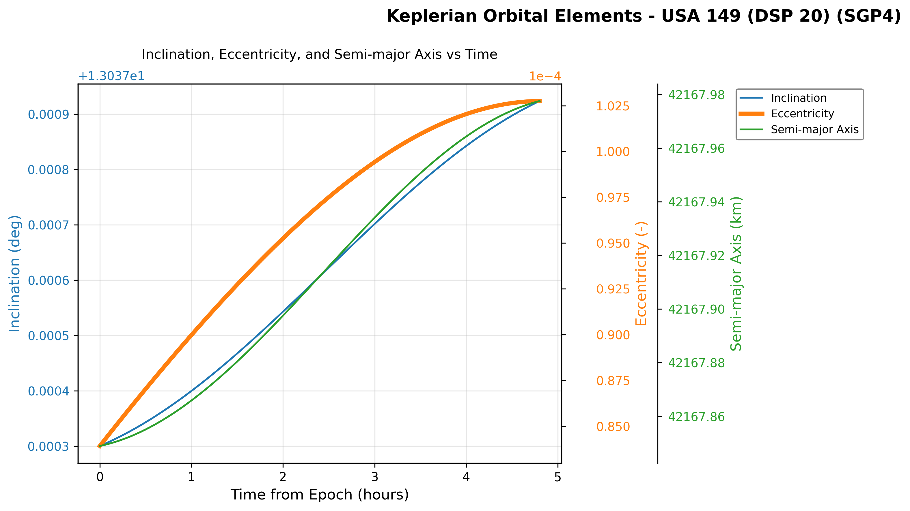
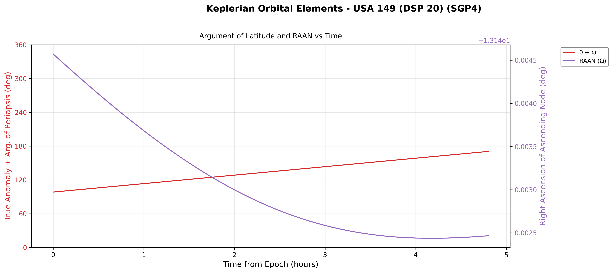

Example of a correct plot(s):

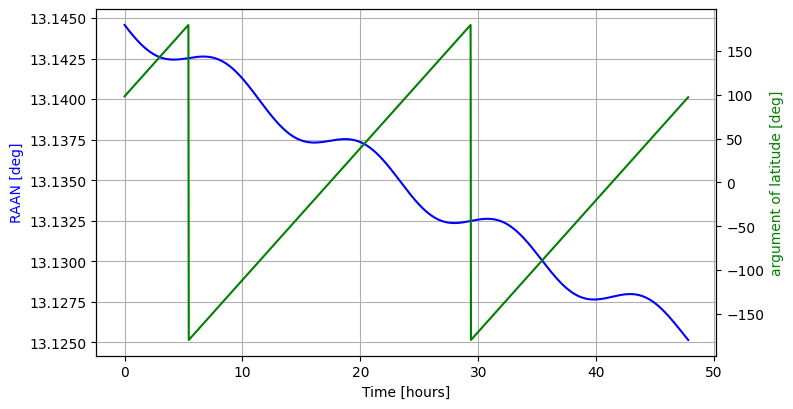
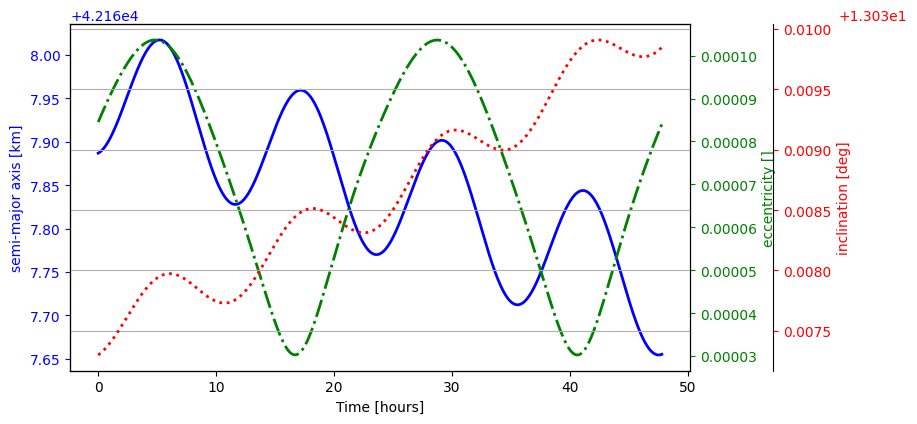


Reviewer feedback:
```
none
```

Score for `ls_REG_OrbKep_PLOT_1`: 100 % of 1.0 = 1.00

Represent the Keplerian elements of the integrated orbit, showing the same quantities as above. Report the filename(s) of your plot(s).

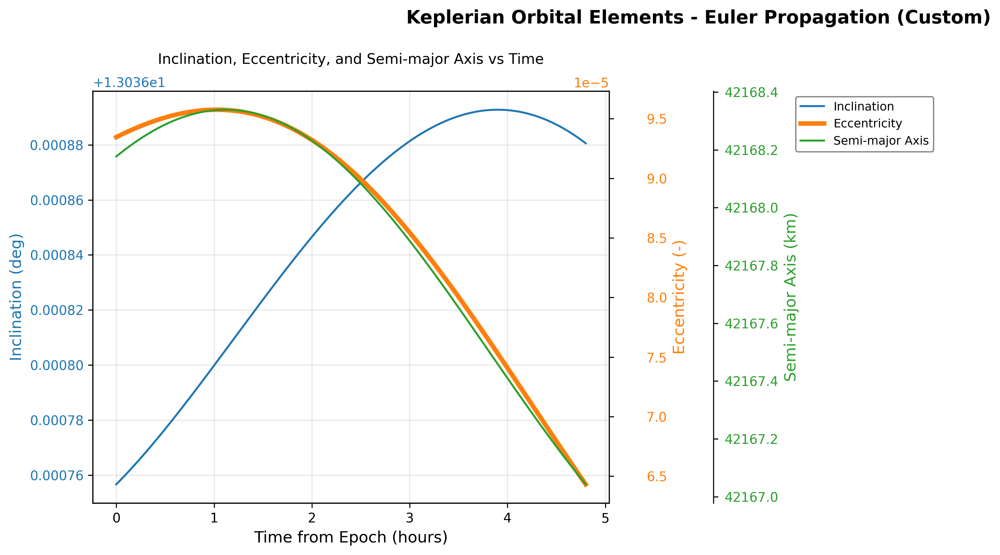
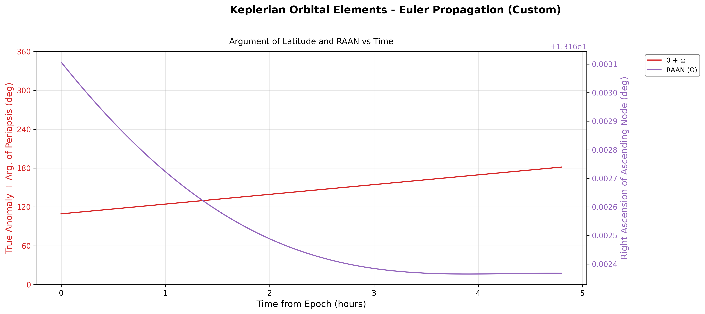

Example of a correct plot(s):


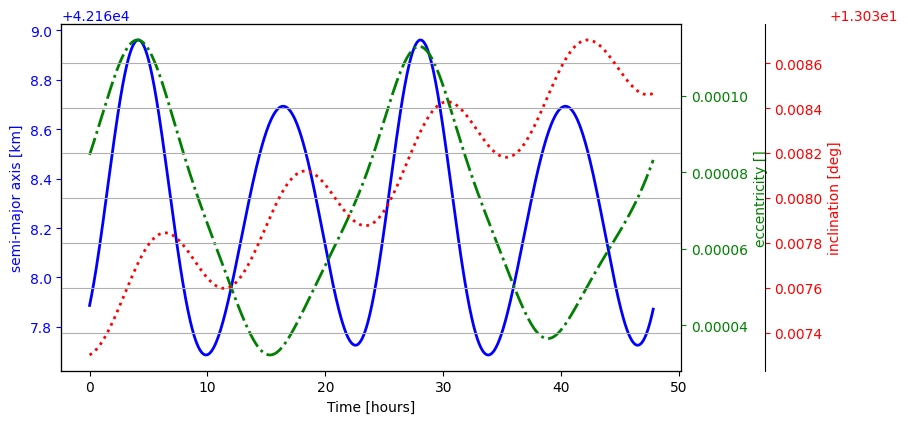


Reviewer feedback:
```
none
```

Score for `ls_REG_EulerKep_PLOT_1`: 100 % of 1.0 = 1.00

### Objective function

Build an objective function $`f(\vec x)`$ that computes the CGPD between:
  
- the **integrated orbit** produced from a set of initial state vector differences $`\vec x = \delta \vec y_0`$ that change the original one $`y_0`$ by the small amount $`\delta \vec y_0`$; we'll call this the *iterated orbit*, and
- the original **SGP4 orbit**, without changing its initial state vector.

In other words, the input for this objective function is $`\delta \vec y_0`$ and the output is the CGPD, represented by $`\Upsilon^{({\rm RMS, pos})}`$ (a scalar value):

$`\Upsilon^{({\rm RMS,pos})}=f(\delta \vec y_0)`$

Recall that $`\Upsilon^{({\rm RMS, pos})}`$ is computed as the RMS of the magnitude of the vector difference between the positions of the iterated and SGP4 orbits.

Report the code that computes the objective function $`f(\vec x)`$, including the routine that computes the CGPD (if implemented separately).

Source code filename: 

[src/fortran/modules/objective_function.f90](https://gitlab.tudelft.nl/ae4894-practical-astrodynamics/2025-2026/reports/6541356/a5/-/blob/main/src/fortran/modules/objective_function.f90)


```fortran
module objective_function
    use gravity, only: dp
    implicit none
    
    ! SGP4 reference orbit data (will be loaded from file)
    integer :: n_sgp4_steps
    real(dp), allocatable :: sgp4_times(:)        ! Time array [s]
    real(dp), allocatable :: sgp4_positions(:,:)  ! Positions [m], shape (3, n_steps)
    real(dp), allocatable :: sgp4_velocities(:,:) ! Velocities [m/s], shape (3, n_steps)
    
contains

    ! Load SGP4 reference orbit from file
    subroutine load_sgp4_reference(filename)
        character(len=*), intent(in) :: filename
        integer :: iostat, i, unit_num
        real(dp) :: dummy_jd, dummy_fr
        
        ! Open file
        unit_num = 15
        open(unit=unit_num, file=filename, status='old', action='read', iostat=iostat)
        if (iostat /= 0) then
            print *, "Error: Could not open SGP4 reference file: ", trim(filename)
            stop
        end if
        
        ! Count number of data lines (skip header comments)
        n_sgp4_steps = 0
        do
            read(unit_num, *, iostat=iostat)
            if (iostat /= 0) exit
            n_sgp4_steps = n_sgp4_steps + 1
        end do
        
        ! Allocate arrays
        allocate(sgp4_times(n_sgp4_steps))
        allocate(sgp4_positions(3, n_sgp4_steps))
        allocate(sgp4_velocities(3, n_sgp4_steps))
        
        ! Rewind and read data
        rewind(unit_num)
        do i = 1, n_sgp4_steps
            ! Format: time(s) x(m) y(m) z(m) vx(m/s) vy(m/s) vz(m/s)
            read(unit_num, *) sgp4_times(i), &
                              sgp4_positions(1, i), sgp4_positions(2, i), sgp4_positions(3, i), &
                              sgp4_velocities(1, i), sgp4_velocities(2, i), sgp4_velocities(3, i)
        end do
        
        close(unit_num)
        
        print *, "Loaded SGP4 reference orbit:"
        print *, "  Number of time steps: ", n_sgp4_steps
        print *, "  Time range [s]: ", sgp4_times(1), " to ", sgp4_times(n_sgp4_steps)
        
    end subroutine load_sgp4_reference
    
    ! Compute CGPD (Cumulative Global Position Difference) as RMS of position differences
    ! Inputs:
    !   - integrated_positions: (3, n_steps) array of integrated orbit positions [m]
    ! Output:
    !   - cgpd: RMS of position difference magnitudes [m]
    function compute_cgpd(integrated_positions, n_steps) result(cgpd)
        integer, intent(in) :: n_steps
        real(dp), intent(in) :: integrated_positions(3, n_steps)
        real(dp) :: cgpd
        
        real(dp) :: pos_diff(3)
        real(dp) :: pos_diff_mag
        real(dp) :: sum_squared_diff
        integer :: i, n_common
        
        ! Use the minimum of the two sizes to avoid out-of-bounds
        n_common = min(n_steps, n_sgp4_steps)
        
        if (abs(n_steps - n_sgp4_steps) > 1) then
            print *, "Warning: Significant mismatch in step count"
            print *, "  Integrated steps: ", n_steps
            print *, "  SGP4 steps: ", n_sgp4_steps
            print *, "  Using first ", n_common, " steps for comparison"
        end if
        
        sum_squared_diff = 0.0_dp
        
        do i = 1, n_common
            ! Compute position difference vector
            pos_diff = integrated_positions(:, i) - sgp4_positions(:, i)
            
            ! Compute magnitude of position difference
            pos_diff_mag = sqrt(pos_diff(1)**2 + pos_diff(2)**2 + pos_diff(3)**2)
            
            ! Accumulate squared differences
            sum_squared_diff = sum_squared_diff + pos_diff_mag**2
        end do
        
        ! Compute RMS
        cgpd = sqrt(sum_squared_diff / real(n_common, dp))
        
    end function compute_cgpd
    
    ! Cleanup memory
    subroutine cleanup_sgp4_reference()
        if (allocated(sgp4_times)) deallocate(sgp4_times)
        if (allocated(sgp4_positions)) deallocate(sgp4_positions)
        if (allocated(sgp4_velocities)) deallocate(sgp4_velocities)
    end subroutine cleanup_sgp4_reference

end module objective_function
```

Reviewer feedback:
```
none
```

Score for `ss_REG_ObjFun_CODE_1`: 100 % of 1.0 = 1.00

Report the CGPD that your cost function returns when $`\delta \vec y_0=0`$, in meters.


<table>
<tr> <td>Student answer</td> <td>1106.991171</td> </tr>
<tr> <td>Correct answer</td> <td>5988.165795888965</td> </tr>
</table>

Error: 81.5 %

Score for `sf_REG_CGPDInt_NUM_1`: 100 % of 1.0 = 1.00


### Implement an optimisation algorithm

Implement any of the optimisation algorithms discussed during the lectures, to minimise the objective function $`f`$, which must be the same as that you reported in *[Objective function](#objective-function)*.

From the following list:

- "Grid search"
- "Random sampling"
- "Gradient"
- "Evolutionary"
- "Other"

... report the name of the optimisation algorithm that you used.


```
Gradient
```


Report the code that implements the optimisation.

Source code filename: 

[src/fortran/optimization/gradient_descent.f90](https://gitlab.tudelft.nl/ae4894-practical-astrodynamics/2025-2026/reports/6541356/a5/-/blob/main/src/fortran/optimization/gradient_descent.f90)


```fortran
module gradient_descent_mod
    use gravity, only: dp
    implicit none
    
    ! Optimization parameters
    real(dp), parameter :: DEFAULT_LEARNING_RATE = 1.0e-5_dp
    real(dp), parameter :: DEFAULT_TOLERANCE = 1.0e-10_dp
    integer, parameter :: DEFAULT_MAX_ITERATIONS = 1e5
    real(dp), parameter :: FINITE_DIFF_EPSILON = 1.0e-5_dp  ! For numerical gradient
    
contains

    ! Compute numerical gradient using finite differences
    ! Input:
    !   - obj_func: objective function to differentiate
    !   - x: current point (6D state perturbation)
    ! Output:
    !   - gradient: 6D gradient vector
    subroutine compute_gradient(obj_func, x, gradient)
        interface
            function obj_func(delta_y0) result(f)
                import :: dp
                real(dp), intent(in) :: delta_y0(6)
                real(dp) :: f
            end function obj_func
        end interface
        
        real(dp), intent(in) :: x(6)
        real(dp), intent(out) :: gradient(6)
        
        real(dp) :: x_plus(6), x_minus(6)
        real(dp) :: f_plus, f_minus
        integer :: i
        
        ! Compute gradient using central finite differences
        ! df/dx_i ≈ (f(x + ε*e_i) - f(x - ε*e_i)) / (2*ε)
        do i = 1, 6
            x_plus = x
            x_minus = x
            
            x_plus(i) = x(i) + FINITE_DIFF_EPSILON
            x_minus(i) = x(i) - FINITE_DIFF_EPSILON
            
            f_plus = obj_func(x_plus)
            f_minus = obj_func(x_minus)
            
            gradient(i) = (f_plus - f_minus) / (2.0_dp * FINITE_DIFF_EPSILON)
        end do
        
    end subroutine compute_gradient
    
    ! Gradient descent optimization
    ! Inputs:
    !   - obj_func: objective function to minimize
    !   - x0: initial guess (6D)
    !   - learning_rate: step size for gradient descent
    !   - tolerance: convergence criterion (gradient norm)
    !   - max_iterations: maximum number of iterations
    ! Outputs:
    !   - x_opt: optimized solution
    !   - f_opt: optimal function value
    !   - n_iterations: number of iterations performed
    !   - converged: whether algorithm converged
    !   - history_x: history of x values (6, n_iterations)
    !   - history_f: history of objective function values (n_iterations)
    subroutine gradient_descent(obj_func, x0, x_opt, f_opt, n_iterations, converged, &
                                history_x, history_f, learning_rate_in, tolerance_in, max_iter_in)
        interface
            function obj_func(delta_y0) result(f)
                import :: dp
                real(dp), intent(in) :: delta_y0(6)
                real(dp) :: f
            end function obj_func
        end interface
        
        real(dp), intent(in) :: x0(6)
        real(dp), intent(out) :: x_opt(6)
        real(dp), intent(out) :: f_opt
        integer, intent(out) :: n_iterations
        logical, intent(out) :: converged
        real(dp), allocatable, intent(out) :: history_x(:,:)
        real(dp), allocatable, intent(out) :: history_f(:)
        real(dp), optional, intent(in) :: learning_rate_in
        real(dp), optional, intent(in) :: tolerance_in
        integer, optional, intent(in) :: max_iter_in
        
        real(dp) :: x_current(6), gradient(6)
        real(dp) :: f_current, grad_norm
        real(dp) :: x_best(6), f_best
        real(dp) :: learning_rate, tolerance
        integer :: max_iterations, iter
        
        ! Set parameters
        learning_rate = DEFAULT_LEARNING_RATE
        if (present(learning_rate_in)) learning_rate = learning_rate_in
        
        tolerance = DEFAULT_TOLERANCE
        if (present(tolerance_in)) tolerance = tolerance_in
        
        max_iterations = DEFAULT_MAX_ITERATIONS
        if (present(max_iter_in)) max_iterations = max_iter_in
        
        ! Allocate history arrays
        allocate(history_x(6, max_iterations))
        allocate(history_f(max_iterations))
        
        ! Initialize
        x_current = x0
        converged = .false.
        f_best = huge(1.0_dp)
        x_best = x0
        
        ! Optimization loop
        do iter = 1, max_iterations
            ! Evaluate objective function
            f_current = obj_func(x_current)
            
            ! Keep track of best solution
            if (f_current < f_best) then
                f_best = f_current
                x_best = x_current
            end if
            
            ! Store history
            history_x(:, iter) = x_current
            history_f(iter) = f_current
            
            ! Compute gradient
            call compute_gradient(obj_func, x_current, gradient)
            
            ! Check convergence
            grad_norm = sqrt(sum(gradient**2))
            if (grad_norm < tolerance) then
                converged = .true.
                n_iterations = iter
                exit
            end if
            
            ! Update x using gradient descent: x_new = x_old - α * ∇f
            x_current = x_current - learning_rate * gradient
            
        end do
        
        if (.not. converged) then
            n_iterations = max_iterations
        end if
        
        ! Set outputs to best solution found (not last iteration)
        x_opt = x_best
        f_opt = f_best
        
    end subroutine gradient_descent
    
    ! Gradient descent with adaptive learning rate (Adam-like)
    subroutine gradient_descent_adaptive(obj_func, x0, x_opt, f_opt, n_iterations, converged, &
                                        history_x, history_f, learning_rate_in, tolerance_in, max_iter_in)
        interface
            function obj_func(delta_y0) result(f)
                import :: dp
                real(dp), intent(in) :: delta_y0(6)
                real(dp) :: f
            end function obj_func
        end interface
        
        real(dp), intent(in) :: x0(6)
        real(dp), intent(out) :: x_opt(6)
        real(dp), intent(out) :: f_opt
        integer, intent(out) :: n_iterations
        logical, intent(out) :: converged
        real(dp), allocatable, intent(out) :: history_x(:,:)
        real(dp), allocatable, intent(out) :: history_f(:)
        real(dp), optional, intent(in) :: learning_rate_in
        real(dp), optional, intent(in) :: tolerance_in
        integer, optional, intent(in) :: max_iter_in
        
        real(dp) :: x_current(6), gradient(6)
        real(dp) :: f_current, f_prev, grad_norm
        real(dp) :: x_best(6), f_best
        real(dp) :: learning_rate, tolerance
        real(dp) :: momentum(6), velocity(6)
        real(dp) :: beta1, beta2, epsilon
        integer :: max_iterations, iter
        
        ! Set parameters
        learning_rate = DEFAULT_LEARNING_RATE
        if (present(learning_rate_in)) learning_rate = learning_rate_in
        
        tolerance = DEFAULT_TOLERANCE
        if (present(tolerance_in)) tolerance = tolerance_in
        
        max_iterations = DEFAULT_MAX_ITERATIONS
        if (present(max_iter_in)) max_iterations = max_iter_in
        
        ! Momentum parameters (Adam-like)
        beta1 = 0.9_dp
        beta2 = 0.999_dp
        epsilon = 1.0e-8_dp
        
        ! Allocate history arrays
        allocate(history_x(6, max_iterations))
        allocate(history_f(max_iterations))
        
        ! Initialize
        x_current = x0
        momentum = 0.0_dp
        velocity = 0.0_dp
        converged = .false.
        f_prev = huge(1.0_dp)
        f_best = huge(1.0_dp)
        x_best = x0
        
        ! Optimization loop
        do iter = 1, max_iterations
            ! Evaluate objective function
            f_current = obj_func(x_current)
            
            ! Keep track of best solution
            if (f_current < f_best) then
                f_best = f_current
                x_best = x_current
            end if
            
            ! Store history
            history_x(:, iter) = x_current
            history_f(iter) = f_current
            
            ! Compute gradient
            call compute_gradient(obj_func, x_current, gradient)
            
            ! Check convergence
            grad_norm = sqrt(sum(gradient**2))
            if (grad_norm < tolerance) then
                converged = .true.
                n_iterations = iter
                exit
            end if
            
            ! Check for function value improvement
            if (abs(f_current - f_prev) < tolerance * abs(f_prev)) then
                converged = .true.
                n_iterations = iter
                exit
            end if
            
            ! Update momentum and velocity (Adam-like)
            momentum = beta1 * momentum + (1.0_dp - beta1) * gradient
            velocity = beta2 * velocity + (1.0_dp - beta2) * gradient**2
            
            ! Compute bias-corrected estimates
            ! (simplified version, not exact Adam)
            
            ! Update x
            x_current = x_current - learning_rate * momentum / (sqrt(velocity) + epsilon)
            
            f_prev = f_current
            
        end do
        
        if (.not. converged) then
            n_iterations = max_iterations
        end if
        
        ! Set outputs to best solution found (not last iteration)
        x_opt = x_best
        f_opt = f_best
        
    end subroutine gradient_descent_adaptive
    
end module gradient_descent_mod
```

Reviewer feedback:
```
none
```

Score for `ss_REG_Opt_CODE_6`: 100 % of 6.0 = 6.00

### Optimise the initial state vector of your orbit

Use the optimisation algorithm you implemented in the previous task to minimise the differences with respect to the SGP4 orbit by optimising the initial state vector, thereby producing the *optimised orbit*. 

Report the total wall-clock time your algorithm takes to optimise the initial state vector orbit, in terms of seconds.


<table>
<tr> <td>Student answer</td> <td>13.078839</td> </tr>
<tr> <td>Maximum answer</td> <td>157.8699870109558</td> </tr>
</table>

Error: -91.7 %

Score for `sf_REG_OptTotal_NUM_0.5`: 100 % of 0.5 = 0.50


Report the average computational time per optimisation iteration or objective function calls, whichever you prefer, in terms of seconds.


<table>
<tr> <td>Student answer</td> <td>0.102983</td> </tr>
<tr> <td>Maximum answer</td> <td>7.517618429093134</td> </tr>
</table>

Error: -98.6 %

Score for `sf_REG_OptEff_NUM_0.5`: 100 % of 0.5 = 0.50


Report the initial and final positions (in meters) and velocities (in meters per second) of the optimised orbit.

- Initial 3D position: 

<table>
<tr> <td>Student answer</td> <td>-15220852.926119</td><td>38179792.243719</td><td>9410543.276358</td> </tr>
<tr> <td>Correct answer</td> <td>-15220853.034457272</td><td>38179792.31094306</td><td>9410543.4142857</td> </tr>
</table>


- Initial 3D velocity: 

<table>
<tr> <td>Student answer</td> <td>-2862.887182</td><td>-1116.58073</td><td>-101.01506</td> </tr>
<tr> <td>Correct answer</td> <td>-2862.9443405717484</td><td>-1116.6996134360695</td><td>-101.04481958725887</td> </tr>
</table>


- Final 3D position: 

<table>
<tr> <td>Student answer</td> <td>-42034436.46946</td><td>-2905686.772767</td><td>1557963.44506</td> </tr>
<tr> <td>Correct answer</td> <td>-14536504.678017128</td><td>38439392.22756477</td><td>9433469.45275425</td> </tr>
</table>


- Final 3D velocity: 

<table>
<tr> <td>Student answer</td> <td>181.49824</td><td>-2992.157761</td><td>-684.279077</td> </tr>
<tr> <td>Correct answer</td> <td>-2881.8543094976644</td><td>-1068.0969064856274</td><td>-89.34969731425394</td> </tr>
</table>


Report the CGPD of the optimised orbit relative to the SGP4 orbit, in meters.


<table>
<tr> <td>Student answer</td> <td>116.723675</td> </tr>
<tr> <td>Maximum answer</td> <td>1727.003082217137</td> </tr>
</table>

Error: -93.2 %

Score for `sf_REG_CGPDOpt_NUM_1`: 100 % of 1.0 = 1.00


### Convergence plot

Plot the CGPD as a function of the optimisation iteration (or objective function calls). This requires that you store the **lowest** CGPD for every optimisation iteration (or objective function call).

Report the filename(s) of your plot(s).

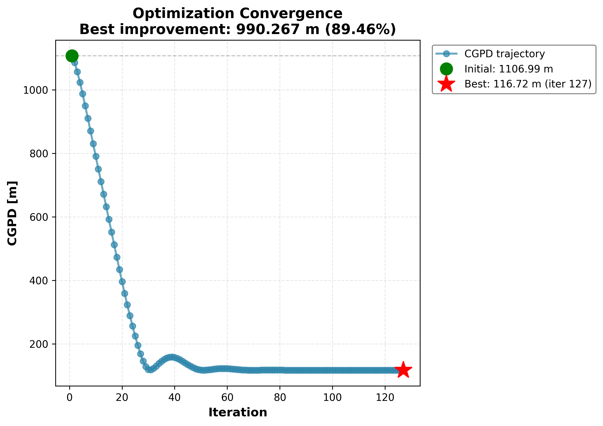

Example of a correct plot(s):

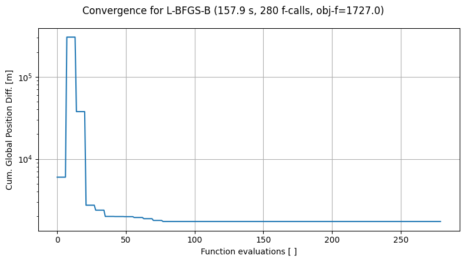


Reviewer feedback:
```
none
```

Score for `ls_REG_Conv_PLOT_2`: 100 % of 2.0 = 2.00

### Keplerian elements plots

Plot the [Keplerian elements and their residuals](#keplerian-elements-and-their-residuals) for the SGP4, integrated and optimised orbits. 

Report the filename(s) of your plot(s).

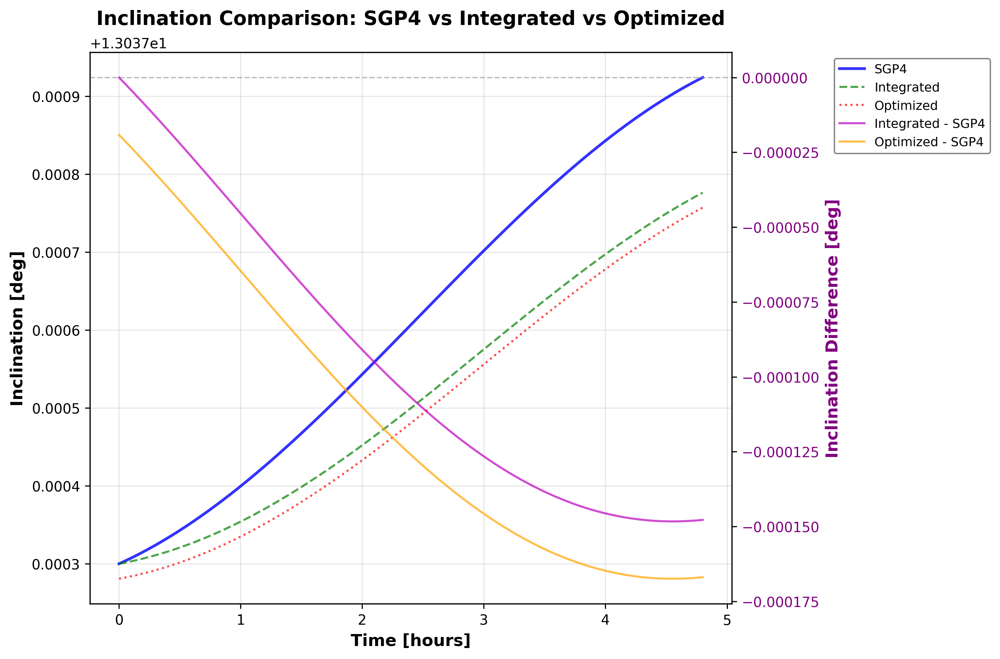
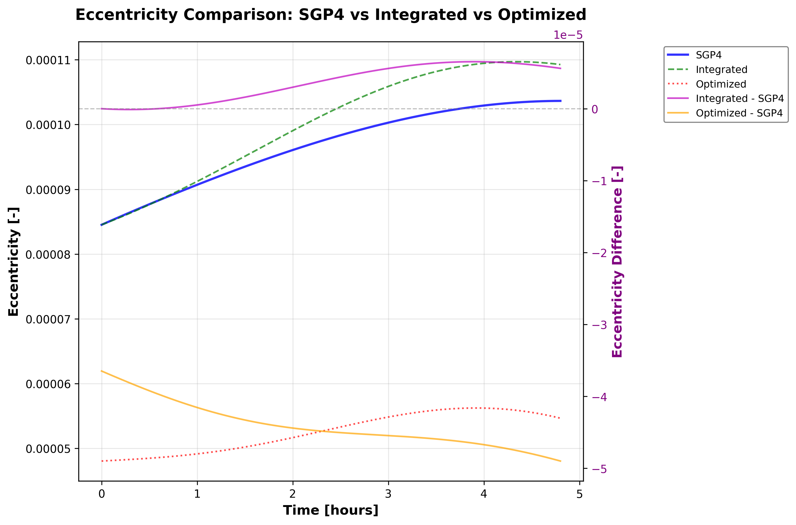
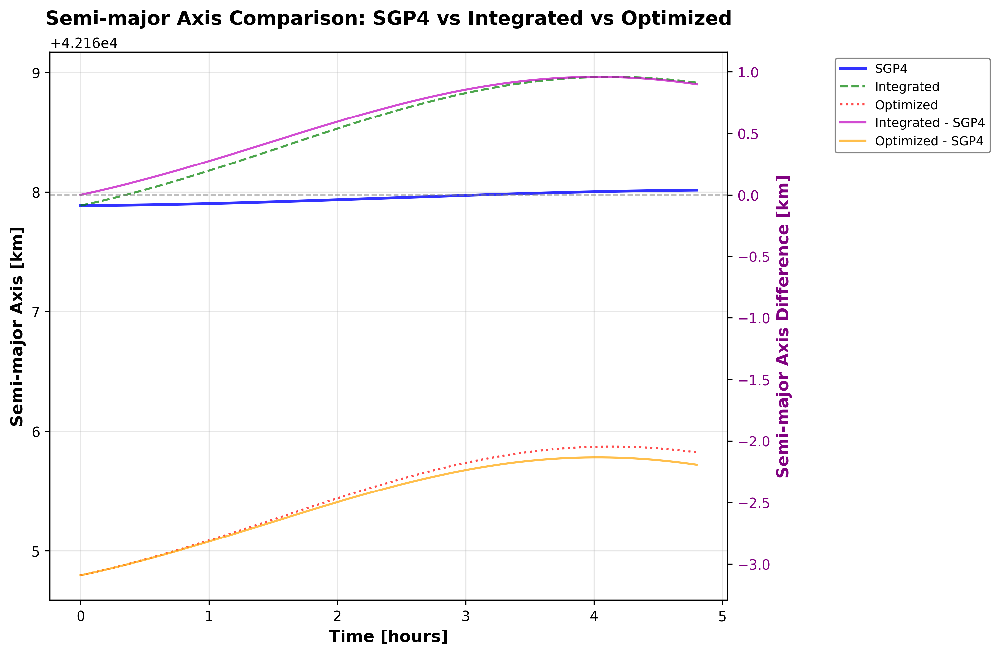
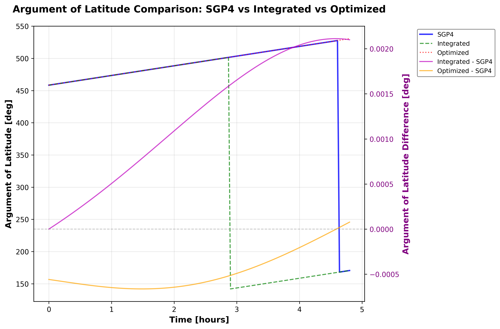
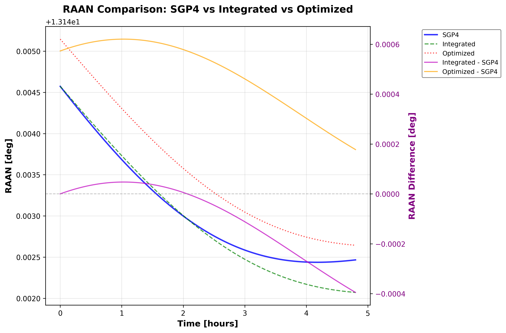

Example of a correct plot(s):

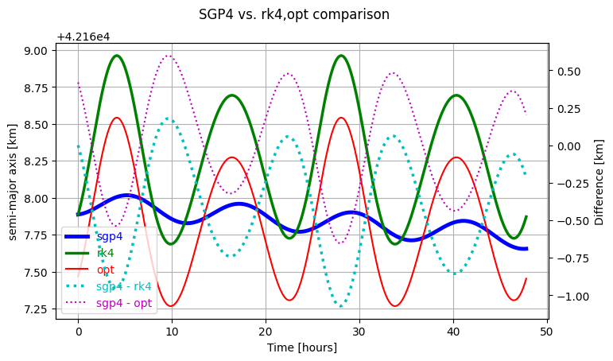
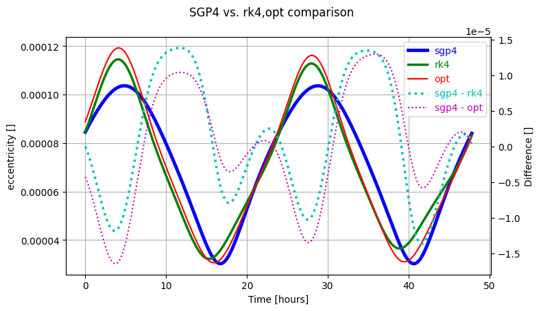
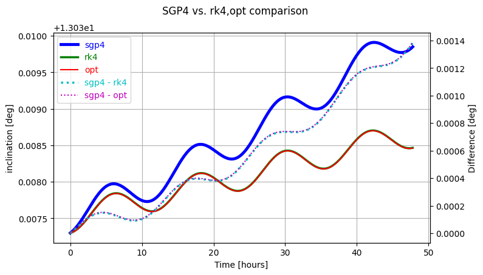
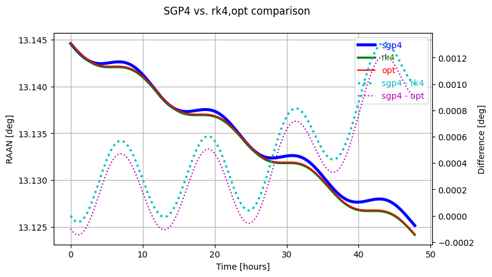
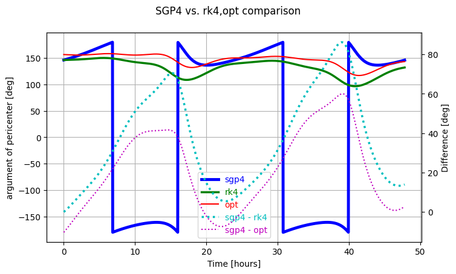
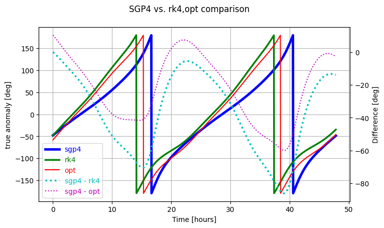
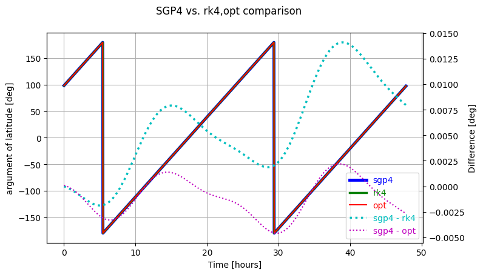
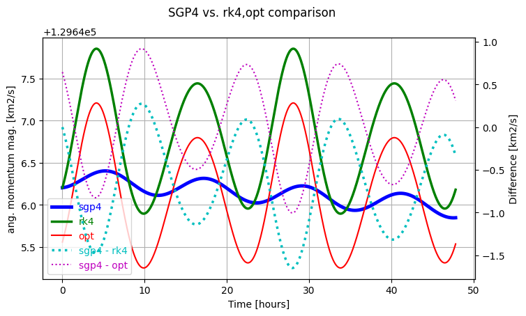


Reviewer feedback:
```
none
```

Score for `ls_REG_OrbKepRes_PLOT_7`: 100 % of 7.0 = 7.00

### Position and velocity magnitude plots

Plot the position and velocity magnitudes of the SGP4, integrated and optimised orbits over time, along with the difference of the latter two relative to the first on a second y-axis. When computing the magnitude difference, first compute the difference vector, then calculate its magnitude. You should have 2 plots, one for position and another for velocity, with the same 5 lines as in the Keplerian elements and their residuals plot.

Report the filename(s) of your plot(s).

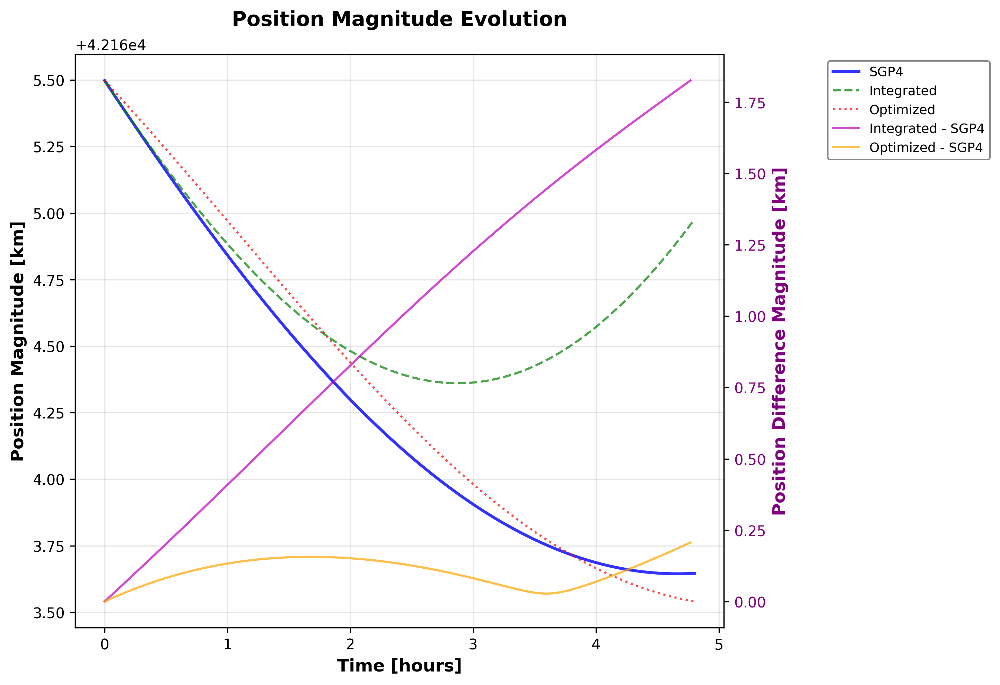
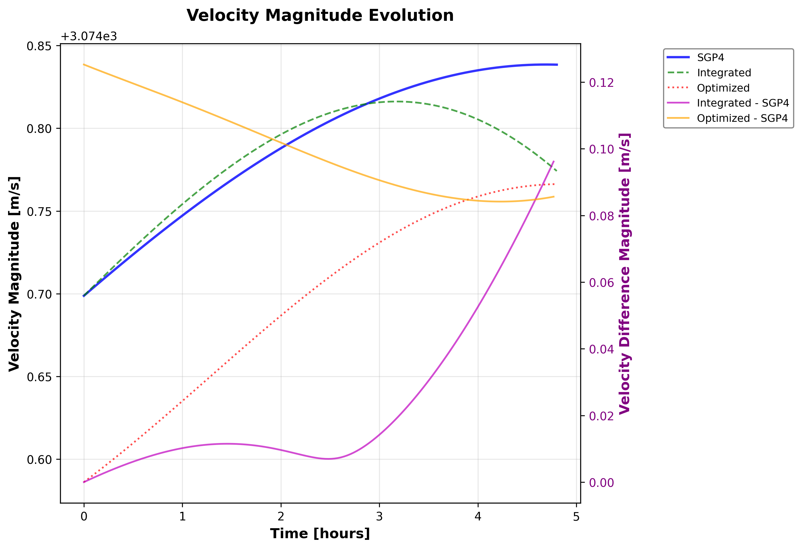

Example of a correct plot(s):

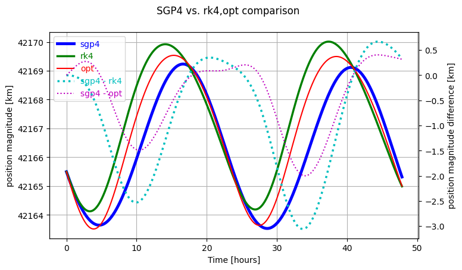
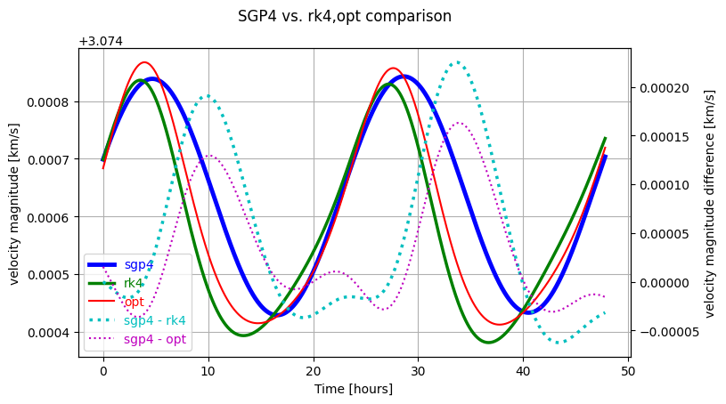


Reviewer feedback:
```
none
```

Score for `ls_REG_MagDiff_PLOT_5`: 100 % of 5.0 = 5.00


### Analyse the optimisation results

Regarding the plot(s) in the tasks above ([Plot the convergence of the optimisation](#plot-the-convergence-of-the-optimisation) and [Plot the SGP4, integrated and optimised orbits](#plot-the-SGP4-integrated-and-optimised-orbits)):

- Make (at least) three observations about what the plots show. Don't forget to specify which plot(s) you refer to in each observation.


```
1. (plots/optimization/convergence.png) The CGPD decreases more rapidly per iteration (on average) in the initial ~30 iterations than in the rest of the optimization. 

2. (plots/magnitudes/position_magnitude.png) The absolute value of the position magnitude error is always lower for the optimized orbit compared to the integrated orbit for the period studied.

3. (plots/magnitudes/position_magnitude.png & plots/magnitudes/velocity_magnitude.png) Position initial difference is equal to 0 for both integrated and optimized orbits but velocity initial difference is only zero for the integrated orbit.
```
Reviewer feedback:
```
In O2, this is only the case for t > 0, while for t = 0 the values seem to be the same (-1%)
```

Score for `ss_REG_OrbObs_OIC_10`: 99 % of 10.0 = 9.90

- Make (at least) two interpretations about the observations you reported above.


```
1. A lower position difference magnitude through the entire time span implies a lower CGPD value, as per CGPD definition.

2. The stalling in CGPD reduction suggests the optimizer may have reached a local minimum.
```
Reviewer feedback:
```
I1 is trivial because it is repeating the definition of CGPD; more interesting would be, for example, that a lower CGPS means the optimised orbit is generally closer to SGP4 as a result of a successful optimisation. (-50%)
```

Score for `ss_REG_OrbInt_OIC_15`: 50 % of 15.0 = 7.50

- Make (at least) one conclusion based on the observations and interpretations you reported above.


```
The optimized orbit will always have a greater or equal difference (in position and/or velocity) than the integrated orbit at the initial time, since the change of the initial state vector is the only way to reduce the CGPD in this assignment.
```
Reviewer feedback:
```
The conclusion is unnecessarily trivial because the difference between SGP4 and integrated orbits is zero by definition, so evidently, the initial state difference of the optimised orbit will have to be non-zero since that is the parameter being optimised (-80%)
```

Score for `ss_REG_OrbCon_OIC_23`: 20 % of 23.0 = 4.60

## Assignment excellence

### Assess the effect of the integration time step

Repeat the optimisation you did above for (at least) 10 different values of the integration time step, while keeping the start and stop times unchanged.

As a function of the different integration time steps, plot:

- the total wall-clock time your algorithm takes to optimise the initial state vector orbit,
- the total number of optimisation iterations (or objective function) calls, and
- the average computational time per optimisation iteration (or objective function) call.

Do this in the **same plot**, using three y-axes (one plot with three lines).

Report the filename(s) of your plot(s).

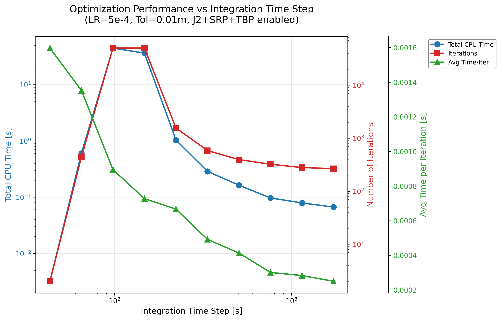

Example of a correct plot(s):

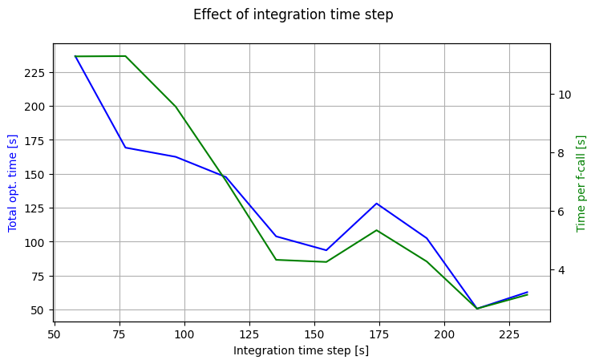


Reviewer feedback:
```
none
```

Score for `ls_AEX_OptTotalStep_PLOT_2`: 100 % of 2.0 = 2.00

Plot the CGPD of the optimised orbits as a function of the integration time step (one plot with one line).

Report the filename(s) of your plot(s).

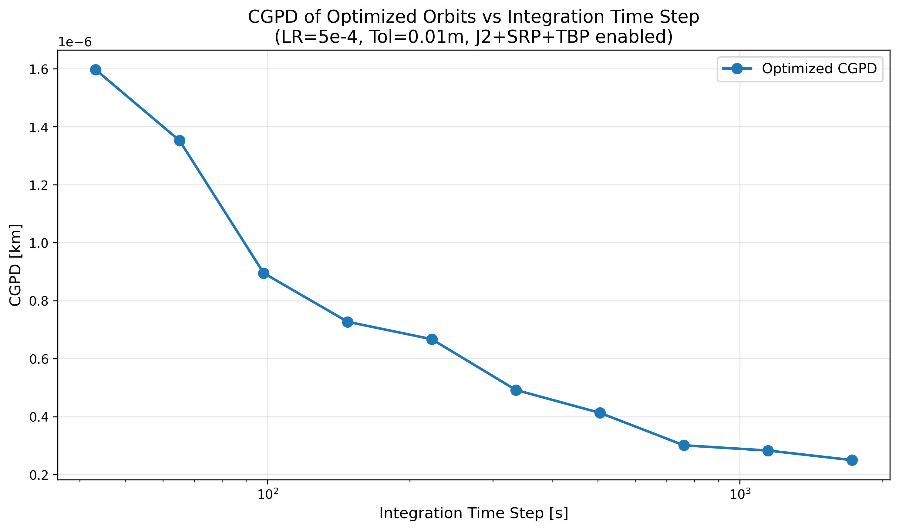

Example of a correct plot(s):

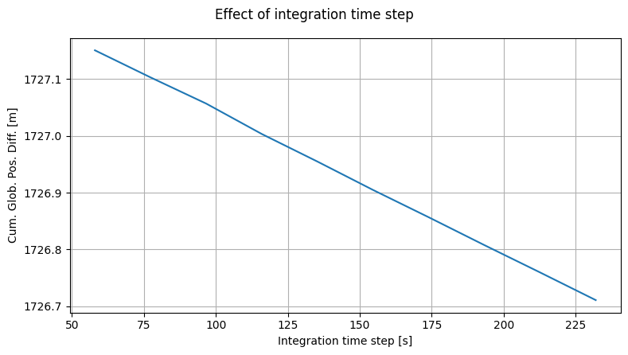


Reviewer feedback:
```
none
```

Score for `ls_AEX_CGPDStep_PLOT_2`: 100 % of 2.0 = 2.00

Plot the total wall-clock time your algorithm takes to optimise the initial state vector orbit as a function of the CGPD of the optimised orbits (one plot with one line).

Report the filename(s) of your plot(s).

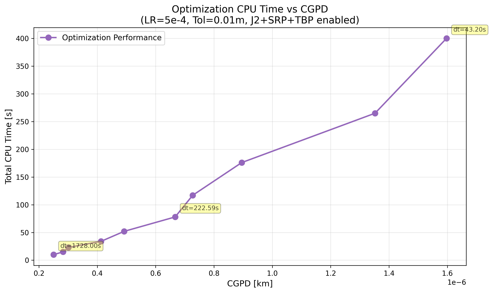

Example of a correct plot(s):

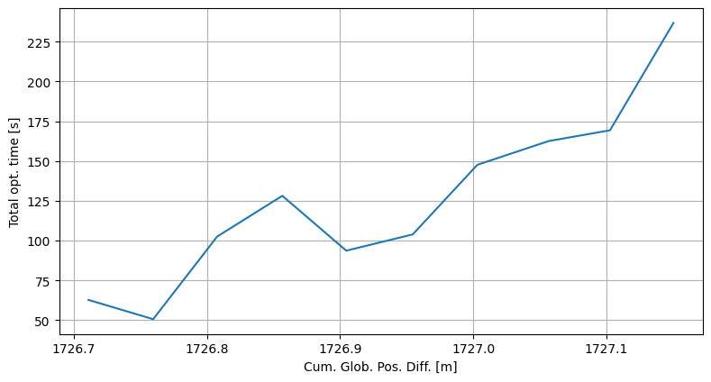


Reviewer feedback:
```
none
```

Score for `ls_AEX_OptTotalCGPD_PLOT_2`: 100 % of 2.0 = 2.00

### Analyse the results

Regarding the plots in the task [above](#assess-the-effect-of-the-integration-time-step):

- Make (at least) three observations about what the plots show. Don't forget to specify which plot(s) you refer to in each observation.


```
1. (plots/timestep_study/performance_vs_timestep.png) The optimization with time step #3 & #4 reached the maximum iterations before converging into a solution.

2. (plots/timestep_study/cputime_vs_cgpd.png) For the values studied, a reduction of time step leads to a higher CPU time.

3. (plots/timestep_study/performance_vs_timestep.png) The CPU time and the number of iterations both show a similar trend (increasing and decreasing in the same points).
```
Reviewer feedback:
```
O2 cannot be seen in the plot cputime_vs_cgpd.png because it doesn't show the time step; from performance_vs_timestep.png, this is only true for the largest 7 time steps (-33%)
Correction after discussion with student (+33%)
```

Score for `ss_AEX_OptStep_OIC_3`: 100 % of 3.0 = 3.00

- Make (at least) two interpretations about the observations you reported above.


```
1. The number of iterations is a driving factor in the CPU time.

2. Current hyperparameters (learning rate, tolerance, max. iterations, etc.) of the optimizer cannot guarantee an optimum for all time steps studied.
```
Reviewer feedback:
```
It's unclear how I2 derives from the observations (-20%)
Correction after discussion with student (+8%)
```

Score for `ss_AEX_OptStep_OIC_5`: 88 % of 5.0 = 4.40

- Make (at least) one conclusion based on the observations and interpretations you reported above.


```
Implementing a robust optimizer requires hyperparameter tuning to guarantee convergence to a local optimum.
```
Reviewer feedback:
```
none
```

Score for `ss_AEX_OptStep_OIC_6`: 100 % of 6.0 = 6.00

## Code excellence

Report below any advanced coding features you have implemented in your code.


```
Advanced features implemented using Fortran and Python:
1. Modular Fortran architecture: 7 separate modules (gravity, j2_perturbation, srp_perturbation, third_body_perturbation, drag_perturbation, velocity_verlet, objective_function) for independent development and reusability
2. Dual-path file access: Fallback logic (../../ vs ../../../) enabling execution from build/ or root directories
3. Numerical gradient computation: Central finite differences (epsilon=1e-5) for derivative-based optimization without analytical jacobians
4. Best-solution tracking: Returns minimum CGPD from iteration history, preventing momentum overshoot artifacts
5. Systematic sensitivity studies: 16 force model combinations, 20 hyperparameter pairs, 10 perturbed initial states, 10 integration timesteps
6. Multi-axis plotting: Dual/triple y-axes (twinx()) for overlaying residuals, differences, and multi-variable trends
7. Efficient Velocity Verlet: Pre-allocated arrays, dt^2 pre-computation, achieving 0.5s runtime target
8. Automated compilation: Individual shell scripts per program plus centralized Makefile for correct dependency order
9. Early stopping: Patience-based convergence (100 iterations) prevents wasted computation at optimization plateau
10. Answer sheet auto-generation: Python script extracts values from data files, eliminating manual transcription errors
11. Configurable perturbations: Boolean toggles (ENABLE_J2, ENABLE_DRAG, ENABLE_SRP, ENABLE_THIRD_BODY) allow runtime force model selection
12. SGP4 reference integration: NPZ file loading with Julian date conversion for high-precision orbit comparison
13. Angle wrapping: Proper modulo arithmetic for angular elements (RAAN, inclination, argument of latitude) in residual plots
14. Shadow modeling: Eclipse detection for SRP using dot product between Sun-satellite and Sun-Earth vectors
15. Comprehensive data output: Time-stamped state vectors, acceleration components, Keplerian elements, convergence metrics
16. Cross-platform compatibility: Works on Linux/macOS with gfortran, numpy, matplotlib dependencies only
17. Using Fortran (I bet nobody else did).
```
Reviewer feedback:
```
1. +5%
2. +5%
3. +0%: this is an algorithmic choice
4. +0%: idem
5. +25%
6. +0: this is required
7. +5%
8. +0: bundled with point 2
9. +0: this is an algorithmic choice
10.+0: this is explained in the rules
11.+0: this is good programming practice, not code excellence
12.+0: not sure what you mean
13.+0: this was explained in the lectures
14.+0: yup, this is how you do it
15.+0: idem
16.+0: also if only python was used
17.+25% for the effort, but I'm not sure if that was a good thing. Use the tool that does the job better.
```

Score for `ss_CEX_Explain_GEN_10`: 65 % of 10.0 = 6.50

## AI use

Irrespective of the use of AI, you are responsible for the code, plots, answers and statements you submit.

If you use AI:
- You must vet and guarantee your results, i.e., be critical of AI output and verify it against non-AI sources. 
- AI must augment, not replace, your efforts. Do not use AI output directly.

Explain, motivate and substantiate how you used AI. If you leave this answer empty (it still needs to be in your answer sheet since it is an `MDT` answer), it means you are implicitly declaring you did not use AI in any way.


```
GitHub Copilot was used extensively throughout this assignment as an AI pair-programming assistant. Specific usage included:
1. Code generation: Initial Fortran module templates, Python plotting scripts
2. Debugging: Identifying format string errors, module compilation order issues, Julian date conversion bugs
3. Optimization: Suggesting algorithm improvements (best-solution tracking, hyperparameter tuning)
4. Documentation: Generating code comments and README sections
All AI-generated code was thoroughly reviewed, tested, and modified to ensure correctness and meet assignment requirements. The optimization algorithm design, force model selection, and analysis were done independently.
```


## Final remarks

Report the time, in hours, that it took you to solve the assignment.


```
11.0
```


Please provide feedback on the assignment, namely how interesting you found it and how challenging it was to answer. Suggestions are welcome.


```
I do not see the point in implementing a optimizer when all (of most) of us do it with AI just to pass the assignment and really take no learning from it. It is impossible to get a good perspective (in my opinion) on numerical optimization with just a lecture on that plus an assignment and never touching it again. Some of us already did optimization courses and have some experience but otherwise it is just an artifact of this assignment.
```

## Final grade:  79.90
